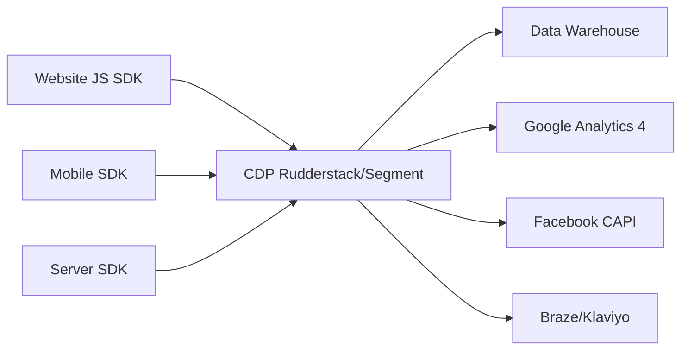
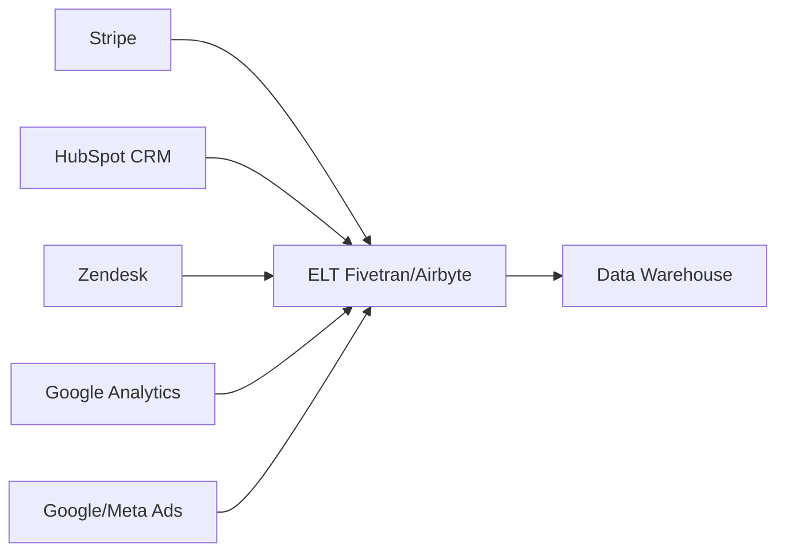
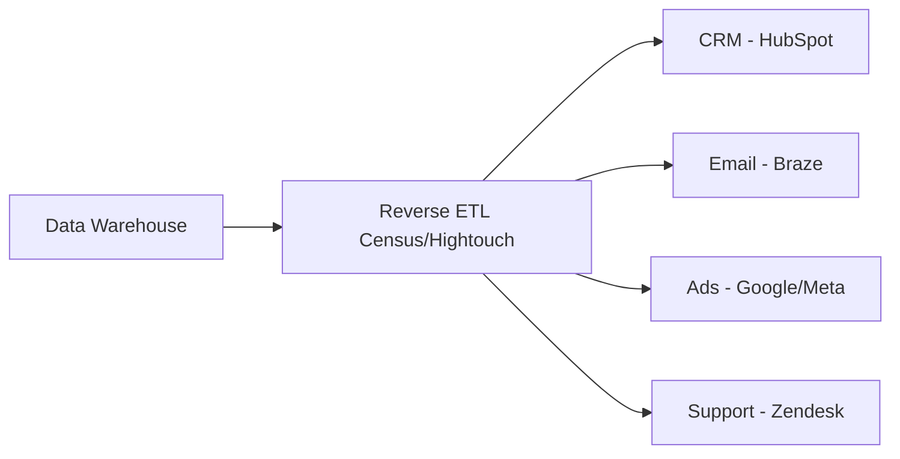

import { Aside, Steps } from '@astrojs/starlight/components';

# Integrazioni & ELT

<Aside type="tip">
In questa lezione chiudiamo il modulo Data Collection collegando tutti i pezzi: come i dati passano dalle sorgenti (sito web, app, CRM, tool SaaS) alle destinazioni (data warehouse, strumenti di analytics, piattaforme marketing).
</Aside>

## Il Problema dell'Integrazione

Ogni azienda moderna usa decine di strumenti software: un CRM per i contatti, una piattaforma di email marketing, un tool di customer support, un sistema di billing, un e-commerce, strumenti di project management, e così via. Ognuno di questi strumenti genera e contiene dati preziosi, ma sono **isolati in silos**.

Il risultato è che per rispondere a una semplice domanda come "quanto vale un cliente che arriva da Google Ads e contatta il supporto entro 30 giorni?" devi aprire 4 tool diversi, esportare CSV, fare join manuali in un foglio Excel, e sperare che i dati siano aggiornati. È un processo lento, fragile, e soggetto a errori.

Le integrazioni risolvono questo problema portando tutti i dati in un unico posto — il **Data Warehouse** — dove possono essere combinati, trasformati e analizzati con SQL.

## ELT vs ETL: Un Cambio di Paradigma

### ETL (Extract-Transform-Load) — L'Approccio Tradizionale

Per decenni, lo standard era **ETL**: estrarre i dati dalle sorgenti, trasformarli *durante il trasporto*, e caricarli nel warehouse già pronti per l'analisi.

```
Sorgente → [Estrazione] → [Trasformazione] → [Caricamento] → Warehouse
```

**Problemi dell'ETL:**
- Le trasformazioni sono scritte in linguaggi proprietari (Informatica, SSIS, Talend)
- Se la trasformazione ha un bug, devi ricaricare tutto
- Non puoi accedere ai dati raw — perdi informazioni
- Ogni nuovo requisito analitico richiede una nuova pipeline

### ELT (Extract-Load-Transform) — L'Approccio Moderno

Il paradigma moderno è **ELT**: estrarre i dati, caricarli nel warehouse **così come sono** (raw), e poi trasformarli *dentro il warehouse* usando SQL.

```
Sorgente → [Estrazione] → [Caricamento] → Warehouse → [Trasformazione in SQL/dbt]
```

**Vantaggi dell'ELT:**
- I dati raw sono sempre disponibili — puoi ritrasformarli senza ricaricare
- Le trasformazioni sono in SQL — un linguaggio che tutti i data team conoscono
- Il warehouse moderno è potente abbastanza per fare le trasformazioni (ClickHouse, BigQuery, Snowflake)
- **dbt** (data build tool) rende le trasformazioni versionabili, testabili e documentate

<Aside type="note">
Il passaggio da ETL a ELT è stato reso possibile dal crollo del costo dello storage e dal miglioramento delle performance dei warehouse moderni. Archiviare i dati raw costa poco; rielaborarli è veloce. Non c'è più motivo di trasformare prima del caricamento.
</Aside>

## Le Due Pipeline: Behavioral Data + SaaS Data

Nel contesto della data collection, ci sono due pipeline distinte che alimentano il warehouse:

### Pipeline 1: Behavioral Data (via CDP)

I dati comportamentali — eventi generati dalle interazioni degli utenti con il tuo sito/app — vengono raccolti tramite una **Customer Data Platform (CDP)** come Rudderstack o Segment.



**Caratteristiche:**
- Dati event-based (track, identify, page)
- Real-time o near real-time
- Alto volume (milioni di eventi/giorno)
- Configurazione nel codice dell'applicazione

### Pipeline 2: SaaS Data (via ELT Tool)

I dati provenienti dagli strumenti SaaS — CRM, billing, support, marketing — vengono estratti tramite tool di **ELT** come Fivetran o Airbyte.



**Caratteristiche:**
- Dati entity-based (tabelle: clienti, ordini, ticket)
- Batch (ogni 5 min, 1 ora, o 1 giorno)
- Volume moderato (migliaia-milioni di righe per sync)
- Configurazione point-and-click (no code)

### La Convergenza nel Warehouse

Entrambe le pipeline convergono nel Data Warehouse, dove i dati vengono uniti:

```sql
-- Esempio: unire dati comportamentali con dati CRM
SELECT
    e.user_id,
    h.company_name,
    h.deal_stage,
    COUNT(DISTINCT e.event_name) AS distinct_events,
    COUNT(*) AS total_events,
    MIN(e.timestamp) AS first_event,
    MAX(e.timestamp) AS last_event
FROM raw_events e
JOIN hubspot_contacts h ON e.user_id = h.email
WHERE e.timestamp >= '2024-01-01'
GROUP BY e.user_id, h.company_name, h.deal_stage
ORDER BY total_events DESC;
```

Questa query sarebbe impossibile senza le integrazioni: combina dati di tracking (raw_events) con dati CRM (hubspot_contacts) per capire come i lead più attivi si muovono nel funnel di vendita.

## Tool di ELT: Fivetran vs Airbyte

### Fivetran

Fivetran è il leader di mercato per l'ELT SaaS. È un servizio managed che offre **300+ connettori** pre-costruiti verso le sorgenti dati più comuni.

**Pro:**
- Setup in minuti (point-and-click)
- Connettori affidabili e mantenuti dal vendor
- Schema migration automatica (se la sorgente aggiunge una colonna, Fivetran la replica)
- Supporto enterprise (SLA, compliance, security)

**Contro:**
- Costoso (pricing basato su Monthly Active Rows — MAR)
- Vendor lock-in
- Meno flessibilità per sorgenti custom

**Pricing indicativo:**
- Free tier: fino a 500.000 MAR
- Standard: ~$1/1.000 MAR
- Enterprise: custom

### Airbyte

Airbyte è l'alternativa open-source a Fivetran. Può essere self-hosted (gratuito) o usato come servizio cloud.

**Pro:**
- Open source (self-hosted gratuito)
- **350+ connettori** (community + custom)
- Nessun vendor lock-in
- Puoi scrivere connettori custom in Python
- Pricing più prevedibile

**Contro:**
- Self-hosted richiede manutenzione (DevOps)
- Alcuni connettori meno maturi di Fivetran
- Schema migration manuale in alcuni casi

**Pricing (cloud):**
- Free tier: 5 connettori
- Pro: da $300/mese

### Confronto Diretto

| Aspetto | Fivetran | Airbyte |
|---------|----------|---------|
| **Tipo** | SaaS fully managed | Open source + Cloud option |
| **Connettori** | 300+ (curati) | 350+ (community) |
| **Setup** | 5 minuti | 15-30 minuti (cloud) / ore (self-hosted) |
| **Affidabilità** | Molto alta | Alta (dipende dal connettore) |
| **Costo** | Alto (MAR-based) | Basso-medio |
| **Custom connectors** | No (devi chiedere) | Sì (CDK in Python) |
| **Best for** | Team che vogliono zero manutenzione | Team con competenze DevOps |

## CDP: Rudderstack vs Segment

### Segment

Segment (acquisita da Twilio) è la CDP più conosciuta. Raccoglie dati comportamentali e li distribuisce a 300+ destinazioni.

**Pro:**
- Ecosistema maturo e vasto
- Protocols (schema enforcement)
- Personas (identity resolution + audience)
- Ottima documentazione

**Contro:**
- Molto costoso ($120/mese per 10.000 MTU, scala rapidamente)
- Vendor lock-in
- Le feature avanzate (Personas) richiedono il piano Business ($$$)

### Rudderstack

Rudderstack è l'alternativa open-source a Segment. Offre funzionalità simili con un modello di pricing più sostenibile.

**Pro:**
- Open source (data plane self-hosted)
- Pricing basato sugli eventi, non sugli MTU
- Warehouse-first: integrazione nativa con il data warehouse
- Transformations in JavaScript (lato server)

**Contro:**
- Ecosistema meno maturo di Segment
- Meno integrazioni device-mode
- Self-hosted richiede infrastruttura

### Confronto Diretto

| Aspetto | Segment | Rudderstack |
|---------|---------|-------------|
| **Pricing** | MTU-based (costoso) | Event-based (più prevedibile) |
| **Open Source** | No | Sì (data plane) |
| **Identity Resolution** | Sì (Personas, $$) | Sì (warehouse-based) |
| **Trasformazioni** | Functions (limitato) | Transformations (JS completo) |
| **Warehouse Integration** | Warehouse Destinations | Warehouse-first approach |
| **Best for** | Grandi enterprise | Startup e PMI data-savvy |

## Progettare la Tua Architettura di Integrazione

### Step 1: Inventario delle Sorgenti

Elenca tutti i sistemi che contengono dati utili per l'analisi:

| Sorgente | Tipo | Dati chiave | Frequenza ideale |
|----------|------|------------|-----------------|
| Website/App | Behavioral | Eventi, pageview, conversioni | Real-time |
| CRM (HubSpot/Salesforce) | Entity | Contatti, deal, pipeline | Ogni 15 min |
| Billing (Stripe) | Entity | Pagamenti, subscription, invoice | Ogni 5 min |
| Support (Zendesk/Intercom) | Entity | Ticket, satisfaction, tempo risposta | Ogni 1 ora |
| Ads (Google/Meta) | Entity | Spend, impression, click, conversioni | Ogni 6 ore |
| Email (Mailchimp/Braze) | Entity | Invii, aperture, click, unsubscribe | Ogni 1 ora |

### Step 2: Scelta dei Tool

```
Behavioral Data → CDP (Rudderstack o Segment)
SaaS Data → ELT (Fivetran o Airbyte)
Tutti convergono → Data Warehouse (ClickHouse o BigQuery)
Trasformazioni → dbt
```

### Step 3: Schema Design nel Warehouse

Organizza le tabelle in layer:

```
├── raw/                    # Dati grezzi come arrivano
│   ├── rudderstack_events  # Eventi dal CDP
│   ├── stripe_payments     # Pagamenti da Fivetran
│   ├── hubspot_contacts    # Contatti da Fivetran
│   └── ...
│
├── staging/                # Pulizia e normalizzazione (dbt)
│   ├── stg_events          # Eventi puliti e tipizzati
│   ├── stg_payments        # Pagamenti normalizzati
│   └── stg_contacts        # Contatti deduplicati
│
├── intermediate/           # Join e logica di business (dbt)
│   ├── int_user_events     # Eventi arricchiti con dati utente
│   └── int_user_payments   # Pagamenti con info utente
│
└── marts/                  # Tabelle pronte per l'analisi (dbt)
    ├── dim_users           # Dimensione utenti
    ├── fct_orders          # Fatto ordini
    └── fct_sessions        # Fatto sessioni
```

### Step 4: Monitoring e Alerting

Le pipeline di integrazione si rompono. I connettori falliscono, le API cambiano, i limiti di rate vengono superati. Implementa:

- **Freshness checks**: Verifica che ogni tabella sia stata aggiornata di recente
- **Row count checks**: Verifica che il numero di righe sia ragionevole
- **Schema drift alerts**: Notifica quando la sorgente aggiunge/rimuove colonne
- **Error notifications**: Alert immediato quando un sync fallisce

```sql
-- Esempio: verifica freshness in ClickHouse
SELECT
    table,
    max(received_at) AS last_received,
    dateDiff('minute', max(received_at), now()) AS minutes_since_last
FROM system.parts
WHERE database = 'analytics'
GROUP BY table
HAVING minutes_since_last > 60  -- Alert se più di 1 ora di ritardo
ORDER BY minutes_since_last DESC;
```

## Reverse ETL: Chiudere il Cerchio

Il **Reverse ETL** è il processo inverso: prendere i dati dal warehouse e inviarli ai tool operativi. Ad esempio:

- Inviare il **lead score** calcolato nel warehouse al CRM (HubSpot)
- Sincronizzare i **segmenti utente** dal warehouse al tool di email (Braze)
- Aggiornare le **audience pubblicitarie** su Google/Meta Ads



**Tool di Reverse ETL:**
- **Census**: Leader di mercato, ottimo per warehouse-first team
- **Hightouch**: Alternativa solida, buona integrazione con dbt

Il Reverse ETL completa il ciclo: i dati vengono raccolti (Collection), archiviati (Warehouse), trasformati (dbt), e riportati ai tool operativi dove i team li usano per agire.

## Riepilogo del Modulo Data Collection

Con questa lezione chiudiamo il modulo Data Collection. Ecco cosa abbiamo coperto:

<Steps>
1. **Introduzione**: Perché la data collection è il fondamento e cosa significa essere veramente data-driven.

2. **Terminologia**: Metriche, KPI, Driver — il vocabolario che ogni professionista dei dati deve padroneggiare.

3. **Framework**: I 4 pilastri (Collect, Store, Analyze, Act) che guidano la strategia.

4. **Event Tracking Design**: Come progettare un tracking plan robusto con naming conventions, proprietà e trigger.

5. **Quick Start**: Come funziona un SDK di analytics sotto il cofano — identity, batching, context enrichment.

6. **Privacy & GDPR**: Come raccogliere dati nel rispetto della legge — consenso, Consent Mode v2, server-side tracking.

7. **Integrazioni & ELT**: Come collegare tutte le sorgenti dati al warehouse — CDP, ELT, Reverse ETL.
</Steps>

---

*Nel prossimo modulo — Data Warehousing — vedremo come archiviare, organizzare e interrogare questi dati in modo efficiente con SQL avanzato, ClickHouse e OLAP.*
