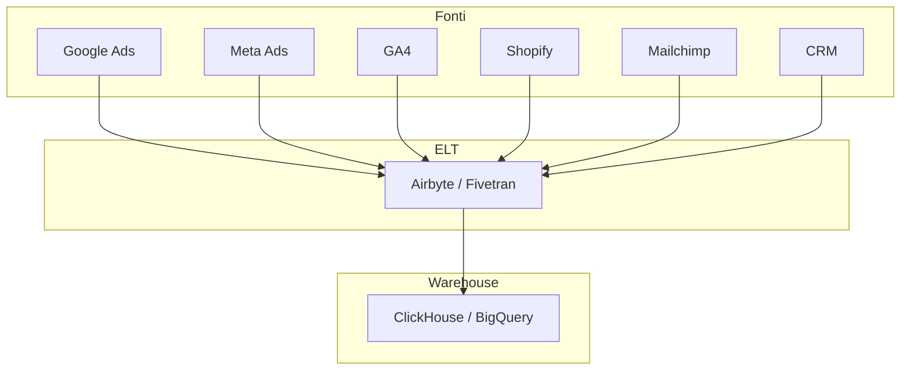

# Integrazioni & ELT

> **Obiettivo:** Connettere le fonti dati aziendali (CRM, Ads, Analytics) in un unico data warehouse attraverso pipeline ELT.

## 1. Il Panorama delle Integrazioni



## 2. Tool di Integrazione

| Tool | Open Source | N. Connettori | Prezzo |
|:---|:---:|:---:|:---|
| **Airbyte** | ✅ | 350+ | Free (self-hosted) |
| **Fivetran** | ❌ | 500+ | Da $1/MAR |
| **Stitch** | ❌ | 100+ | Da $100/mese |
| **Meltano** | ✅ | 200+ | Free |

## 3. Configurazione Airbyte

```yaml
# Connettore Google Ads → ClickHouse
source:
  type: source-google-ads
  config:
    credentials:
      developer_token: "${GOOGLE_ADS_TOKEN}"
      client_id: "${GOOGLE_CLIENT_ID}"
    customer_id: "123-456-7890"
    start_date: "2025-01-01"

destination:
  type: destination-clickhouse
  config:
    host: clickhouse.example.com
    port: 8443
    database: marketing
    username: airbyte
    ssl: true

sync:
  schedule: "0 6 * * *"  # Ogni giorno alle 6:00
  mode: incremental
  cursor_field: date
```

## 4. Best Practices

| Practice | Perché |
|:---|:---|
| Incremental sync | Non ricaricare tutto ogni volta |
| Schema change alerts | Sapere quando le API cambiano |
| Data quality checks post-load | Verificare completezza e freshness |
| Staging layer | Non trasformare durante il load |
| Idempotenza | Poter rieseguire senza duplicati |

```sql
-- Check post-integrazione: dati freschi?
SELECT source, MAX(loaded_at) AS last_load,
    DATE_DIFF('hour', MAX(loaded_at), NOW()) AS hours_ago
FROM _airbyte_metadata
GROUP BY source
HAVING hours_ago > 24;  -- Alert se dati vecchi >24h
```

## 5. Pattern ELT con dbt

```sql
-- staging/stg_google_ads.sql
SELECT
    date AS ad_date,
    campaign_name,
    impressions,
    clicks,
    cost_micros / 1000000.0 AS cost,
    conversions
FROM {{ source('google_ads', 'campaign_performance') }}
WHERE date >= '2025-01-01'
```

## Risorse
- **Tool:** Airbyte (open source), Fivetran, dbt
- **Pattern:** ELT > ETL per data warehouse moderni
