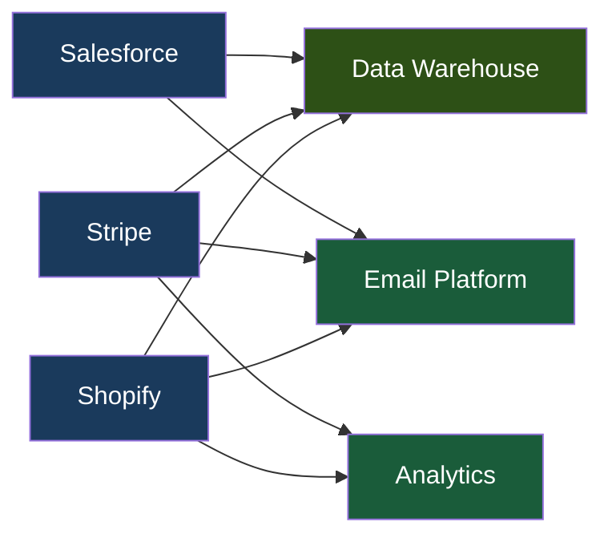

import { Aside, Steps, Tabs, TabItem } from '@astrojs/starlight/components'

Un'azienda media nel 2024 usa 130 applicazioni SaaS diverse (Blissfully SaaS Trends Report). Ogni sistema ha i suoi dati: il CRM sa chi sono i clienti, la piattaforma di advertising sa quanto si spende per acquisirli, il sistema di pagamento sa quanto pagano, il product analytics tool sa come usano il prodotto. Nessuno di questi sistemi parla con gli altri nativamente.

Il problema dell'integrazione dati non è tecnologico — è architetturale. Non si tratta di quale tool usare, ma di quale pattern adottare per non finire a gestire 130×129 = 16.770 connessioni point-to-point.

## Il problema delle integrazioni point-to-point

Immagina di voler connettere 5 sistemi sorgente a 5 sistemi destinazione. Con integrazioni dirette, hai bisogno di 25 connessioni (5×5). Con 10 sistemi per lato, sono 100 connessioni. Con 20 per lato, sono 400. Questo è il problema N×M.



La soluzione è il modello Hub-and-Spoke: ogni sorgente si connette a un hub centrale (CDP, Data Warehouse), e da lì i dati si distribuiscono a tutte le destinazioni.

## Le 5 categorie di sorgenti da integrare

### 1. CRM e Sales

**Salesforce, HubSpot, Pipedrive**

Oggetti chiave: Lead, Contact, Account (Company), Deal/Opportunity, Activity

```python
# Esempio: pull da HubSpot API
import requests

def get_hubspot_deals(api_key: str, after: str = None):
    url = "https://api.hubapi.com/crm/v3/objects/deals"
    params = {
        "limit": 100,
        "properties": "dealname,amount,closedate,dealstage,pipeline",
        "after": after  # pagination cursor
    }
    headers = {"Authorization": f"Bearer {api_key}"}
    response = requests.get(url, params=params, headers=headers)
    return response.json()
```

<Aside type="caution">
I CRM aggiornano i record esistenti (UPDATE) frequentemente. Assicurati che la pipeline gestisca gli update, non solo gli insert. Usa `hs_lastmodifieddate` o `updatedAt` come campo incrementale.
</Aside>

### 2. Advertising Platforms

**Google Ads, Meta Ads, LinkedIn Ads, TikTok Ads**

Metriche chiave: impressioni, click, costo, conversioni, ROAS

Il problema specifico delle advertising API: hanno rate limit molto bassi (es. Google Ads: 1.000 richieste/giorno per account) e richiedono OAuth2 con token refresh.

```python
# Google Ads: pattern per gestire token refresh
from google.ads.googleads.client import GoogleAdsClient
from google.auth.exceptions import RefreshError

def refresh_oauth_token(refresh_token: str, client_id: str, client_secret: str):
    """Rinnova il token OAuth2 quando scade"""
    # Token Google Ads scadono ogni ora
    # Il refresh token non scade (a meno di revoca)
    pass
```

### 3. Payment e Revenue

**Stripe, Braintree, Recurly, Chargebee**

Oggetti chiave: Charge, Customer, Subscription, Invoice, Refund, Dispute

Stripe ha una delle migliori API del settore — webhook nativi, SDK ufficiali, documentazione eccellente:

```python
# Stripe webhook per eventi in tempo reale
import stripe
from fastapi import FastAPI, Request

app = FastAPI()

@app.post("/webhooks/stripe")
async def handle_stripe_webhook(request: Request):
    payload = await request.body()
    sig_header = request.headers.get('stripe-signature')

    try:
        event = stripe.Webhook.construct_event(
            payload, sig_header, STRIPE_WEBHOOK_SECRET
        )
    except stripe.error.SignatureVerificationError:
        return {"error": "Invalid signature"}, 400

    if event['type'] == 'charge.succeeded':
        charge = event['data']['object']
        # Invia a Kafka o scrivi direttamente nel DW
        await process_payment(charge)

    return {"received": True}
```

### 4. Product Analytics

**Mixpanel, Amplitude, Heap, Segment**

Questi tool hanno già i tuoi eventi — potresti voler estrarre i dati per combinarli con altri sistemi nel DW centrale.

Amplitude offre export via API o direttamente su S3 (Data Export). Mixpanel ha Raw Data Export. Entrambi esportano in JSON newline-delimited (NDJSON).

### 5. Customer Support

**Zendesk, Intercom, Freshdesk**

Oggetti chiave: Ticket, Conversation, Agent, Customer, Tag, Satisfaction Score

I dati del customer support sono preziosi per analytics: correlazione CSAT con LTV, identificazione dei segmenti con più problemi, feature request emergenti.

## I 5 approcci di integrazione

### Approccio 1: Managed Connectors (Fivetran, Airbyte)

La scelta più comune per la maggior parte delle sorgenti standard.

**Fivetran**: leader di mercato, 300+ connettori, completamente managed, schema migration automatica. Pricing per MAR (Monthly Active Rows) — costoso per grandi volumi.

**Airbyte**: open-source (self-hostable) o cloud, 300+ connettori, più flessibile e meno costoso. Community di connettori custom molto attiva.

```yaml
# Airbyte connection config (YAML per versionamento)
source:
  sourceType: stripe
  config:
    client_secret: "${STRIPE_SECRET_KEY}"
    start_date: "2023-01-01T00:00:00Z"
    lookback_window_days: 30  # riprocessa gli ultimi 30 giorni per late updates

destination:
  destinationType: bigquery
  config:
    project_id: "my-project"
    dataset_id: "stripe_raw"
    credentials_json: "${GCP_SERVICE_ACCOUNT_JSON}"

sync_mode: incremental_append  # oppure: full_refresh, incremental_dedup
schedule:
  scheduleType: cron
  cronExpression: "0 */3 * * *"  # ogni 3 ore
```

**Quando usare managed vs self-hosted Airbyte**:
- Managed: team piccolo, nessuna infrastruttura dedicata, sorgenti standard
- Self-hosted Airbyte: budget ridotto, dati sensibili da non condividere con terze parti, sorgenti custom

### Approccio 2: Native API Pull

Per sorgenti non supportate dai managed connector o quando serve massima flessibilità.

```python
# Pattern generico per API pull con pagination e retry
import requests
import time
from typing import Iterator, Dict

def paginated_api_fetch(
    url: str,
    headers: dict,
    params: dict,
    page_key: str = 'next_cursor'
) -> Iterator[Dict]:
    """Fetch paginato con exponential backoff su errori"""
    cursor = None

    while True:
        if cursor:
            params[page_key] = cursor

        for attempt in range(3):
            try:
                response = requests.get(url, headers=headers, params=params, timeout=30)

                if response.status_code == 429:  # Rate limited
                    retry_after = int(response.headers.get('Retry-After', 60))
                    time.sleep(retry_after)
                    continue

                response.raise_for_status()
                data = response.json()
                break

            except requests.RequestException as e:
                if attempt == 2:
                    raise
                time.sleep(2 ** attempt)  # exponential backoff: 1s, 2s, 4s

        yield from data.get('items', [])

        cursor = data.get('next_cursor')
        if not cursor:
            break
```

### Approccio 3: Webhook (Push)

Il sistema sorgente invia i dati al tuo endpoint quando accade un evento. Latenza: secondi.

```python
# Endpoint che riceve webhook da qualsiasi sistema
from fastapi import FastAPI, Request, BackgroundTasks
import json

app = FastAPI()

@app.post("/webhooks/{source}")
async def receive_webhook(
    source: str,
    request: Request,
    background_tasks: BackgroundTasks
):
    payload = await request.json()

    # Validazione della firma (ogni sistema ha il suo metodo)
    validate_signature(source, request.headers, await request.body())

    # Processo in background per rispondere velocemente
    background_tasks.add_task(process_and_store, source, payload)

    # IMPORTANTE: rispondere entro 5-10 secondi o il mittente considera failed
    return {"received": True, "timestamp": time.time()}
```

### Approccio 4: File Export (S3/SFTP)

Il metodo legacy, ancora usato da molti sistemi enterprise:

```python
import boto3

def process_s3_exports(bucket: str, prefix: str):
    """Processa export CSV/JSON da S3"""
    s3 = boto3.client('s3')
    paginator = s3.get_paginator('list_objects_v2')

    for page in paginator.paginate(Bucket=bucket, Prefix=prefix):
        for obj in page.get('Contents', []):
            if obj['LastModified'] > last_processed_time:
                # Leggi e processa il file
                response = s3.get_object(Bucket=bucket, Key=obj['Key'])
                process_file(response['Body'])
```

### Approccio 5: iPaaS (Zapier, Make, n8n)

Per pipeline leggere e prototipazione rapida. Non adatto per volumi alti o logica complessa.

**Limiti degli iPaaS per analytics**:
- Volume limitato (Zapier: max 50K tasks/mese nel piano base)
- Nessun controllo sullo schema del dato
- Difficile da debuggare in produzione
- Costo alto per grandi volumi

## Gestione sicura delle credenziali API

```python
# MAI hardcodare credenziali nel codice
# SBAGLIATO:
STRIPE_SECRET = "sk_live_abc123..."  # visibile in git, nei log, ovunque

# CORRETTO: usa variabili d'ambiente
import os
STRIPE_SECRET = os.environ['STRIPE_SECRET_KEY']

# MEGLIO: usa un secrets manager
import boto3

def get_secret(secret_name: str) -> str:
    client = boto3.client('secretsmanager', region_name='eu-west-1')
    response = client.get_secret_value(SecretId=secret_name)
    return response['SecretString']

STRIPE_SECRET = get_secret('prod/stripe/secret_key')
```

## Schema Mapping: il canonical model

Ogni sistema usa nomi diversi per gli stessi concetti. Senza un canonical model, ogni team usa nomi diversi nel DW.

**Esempio: campo "deal" nei CRM**

| Sistema | Campo | Significato |
|---------|-------|-------------|
| Salesforce | Opportunity | Il deal |
| HubSpot | Deal | Il deal |
| Pipedrive | Deal | Il deal |
| Zendesk Sell | Deal | Il deal |
| **Canonical model** | **deal_id, deal_name, deal_stage, deal_amount** | Standard nel DW |

```sql
-- Trasformazione dbt: normalizza i deal da HubSpot al canonical model
-- models/staging/stg_hubspot_deals.sql
SELECT
    id                                          AS deal_id,
    properties.dealname                         AS deal_name,
    properties.dealstage                        AS deal_stage,
    properties.pipeline                         AS pipeline_id,
    CAST(properties.amount AS DECIMAL(18,2))    AS deal_amount,
    properties.closedate::DATE                  AS expected_close_date,
    properties.hs_lastmodifieddate::TIMESTAMP   AS updated_at,
    'hubspot'                                   AS crm_source
FROM {{ source('hubspot_raw', 'deals') }};
```

## Integration Catalog: documentare le integrazioni

Ogni integrazione deve essere documentata in un catalogo. Template:

```markdown
## Integrazione: Stripe → BigQuery

| Campo | Valore |
|-------|--------|
| Source | Stripe (Production) |
| Destination | BigQuery `project.stripe_raw` |
| Tool | Fivetran |
| Oggetti | charges, customers, subscriptions, invoices, refunds |
| Modalità sync | Incremental (ogni 3 ore) |
| Latenza SLA | Dati disponibili entro 4 ore dall'evento |
| Owner | Data Engineering Team |
| Alert | #data-alerts Slack se freshness > 5 ore |
| Ultimo test | 2024-02-01 |
| Note | Stripe usa soft delete — i refund aggiornano la charge originale |
```

## Monitoring della freshness

```sql
-- Query per verificare la freshness di ogni integrazione
SELECT
    source_name,
    MAX(loaded_at) AS last_load,
    CURRENT_TIMESTAMP - MAX(loaded_at) AS data_age,
    CASE
        WHEN CURRENT_TIMESTAMP - MAX(loaded_at) > INTERVAL '5 hours' THEN 'CRITICAL'
        WHEN CURRENT_TIMESTAMP - MAX(loaded_at) > INTERVAL '3 hours' THEN 'WARNING'
        ELSE 'OK'
    END AS status
FROM integration_metadata
GROUP BY source_name
ORDER BY data_age DESC;
```

<Aside type="tip">
Il principio "use managed tools for standard sources, build custom for unique sources" evita di sprecare ingegneria dove non è necessario. Fivetran o Airbyte per Salesforce e Stripe. Codice custom per le API interne proprietarie.
</Aside>
