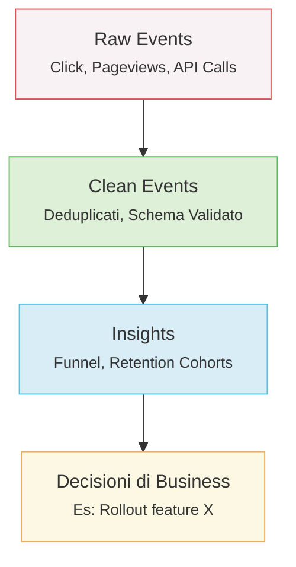

import { Aside, Steps, Tabs, TabItem, Card, CardGrid } from '@astrojs/starlight/components'

## L'illusione dei Metriche di Business

Nel 2012, il team di prodotto di Airbnb affrontò un mistero: alcuni host avevano un tasso di retention a 6 mesi eccezionalmente alto, mentre altri abbandonavano la piattaforma quasi subito. Guardando le classiche metriche transazionali — numero di prenotazioni, revenue generata, review score — non emergeva alcun pattern chiaro. Sembrava puro rumore statistico.

L'intuizione arrivò quando decisero di incrociare i dati di business con i **dati comportamentali**. Iniziarono ad analizzare:
- Quanto tempo un host trascorreva nella schermata di modifica del profilo?
- Quante foto della proprietà caricava prima di pubblicare?
- Quanti caratteri utilizzava nella sezione "About me"?

Il risultato fu una rivelazione: **gli host che completavano il profilo al 100% avevano una retention a 6 mesi 3 volte superiore** rispetto a chi lo lasciava parziale. Non dipendeva dalla città, dalla demografia o dal prezzo dell'alloggio. Era l'intento iniziale, misurato tramite azioni minime, a predire il successo a lungo termine.

Questo insight era invisibile guardando solo i database transazionali. Viveva esclusivamente nel comportamento degli utenti — nei click, nei form compilati, nel tempo speso sull'app. Questa è la vera potenza della data collection moderna: **non raccogliere "più" dati, ma raccogliere i segnali comportamentali che anticipano i risultati economici.**

---

## 1. I Tre Pilastri del Dato

Per costruire una strategia di raccolta dati efficace, dobbiamo smettere di trattare tutti i dati come se fossero uguali. Esistono tre forme fondamentali di dati, ciascuna con uno scopo preciso.

<CardGrid>
  <Card title="1. Behavioral Data (Comportamentali)" icon="rocket">
    **Cosa fa l'utente.** Sono le azioni osservabili: visite, click, tempo speso, scroll. Sono il segnale più diretto di intento ed engagement, ma richiedono un tracking esplicito.
    *Es: Utente visita `/pricing` 3 volte in 2 giorni.*
  </Card>
  <Card title="2. Transactional Data (Transazionali)" icon="approve-check">
    **Cosa compra/scambia l'utente.** Dati certi presenti nei database aziendali: ordini, fatture, rinnovi, chargeback. Sono perfetti per la revenue, ma non spiegano il "perché".
    *Es: Ordine #4821, totale €87.50, pagato con carta.*
  </Card>
  <Card title="3. Declarative Data (Dichiarativi)" icon="pencil">
    **Cosa dice di sé l'utente.** Survey, form, interviste (NPS, feedback). Danno un contesto preziosissimo, ma sono soggetti a bias cognitivi e di desiderabilità sociale.
    *Es: NPS 8, "Uso il tool per risparmiare tempo".*
  </Card>
</CardGrid>

### La potenza dell'intersezione

Nessuno di questi tre pilastri racconta la storia completa. Il caso Airbnb è un esempio da manuale:
1. I dati **transazionali** indicavano chi rimaneva un host attivo.
2. I dati **comportamentali** hanno rivelato il pattern (completamento profilo).
3. I dati **dichiarativi** (tramite survey successive) spiegarono il *perché*: gli host che completavano il profilo avevano obiettivi più chiari e prendevano il ruolo più seriamente.

<Aside type="tip" title="Best Practice">
Se il tuo team sta basando le decisioni solo su dati transazionali provenienti dal gestionale, stai guidando guardando dallo specchietto retrovisore. Al momento della transazione, il 90% del processo decisionale dell'utente è già avvenuto.
</Aside>

---

## 2. La Piramide dell'Event Data

I behavioral data vengono generati da un meccanismo chiamato **event tracking**. Per capire perché questo sistema è essenziale ma fragile, dobbiamo visualizzare il processo di trasformazione del dato.

Il fallimento nel 90% delle aziende avviene tra il gradino 1 e il gradino 2. I team implementano SDK per raccogliere milioni di **Raw Events**, ma senza processi di validazione si ritrovano con dati sporchi. Costruire **Insights** su eventi non affidabili porta a decisioni disastrose.

---

## 3. Client-Side vs Server-Side Tracking

Una decisione architetturale fondamentale è da *dove* generare gli eventi. Le aziende più mature utilizzano un approccio misto.

<Tabs>
  <TabItem label="Client-Side Tracking" icon="laptop">
    **Come funziona:** Un SDK nel browser (JS) o nell'app mobile invia l'evento direttamente alla piattaforma (es. Segment, Mixpanel).
    
    **Vantaggi:**
    - Accesso a contesto ricco: URL, referrer, UTM parameters, risoluzione schermo.
    - Facile per eventi UI: click, scroll, hover, video views.
    
    **Svantaggi:**
    - Bloccato da Ad-blocker (fino al 30-40% di perdita dati su un'audience B2B).
    - Inaffidabile per connessioni di rete instabili.
  </TabItem>
  
  <TabItem label="Server-Side Tracking" icon="server">
    **Come funziona:** Il tracking avviene nel backend dell'applicazione. (Es: l'API Node.js/Python invia l'evento `Purchase Completed`).
    
    **Vantaggi:**
    - 100% affidabile per metriche business-critical. Impossibile da arginare con Ad-blocker.
    - Dati sicuri e arricchiti (es: margine di profitto, non visibile lato client).
    
    **Svantaggi:**
    - Richiede tempo dagli sviluppatori backend.
    - Non ha accesso al DOM o ai cookie del browser utente in modo nativo.
  </TabItem>
</Tabs>

### Il Framework di Assegnazione: Cosa tracciare e dove?

Usa questa tabella per decidere quale approccio adoperare:

| Azione dell'Utente | Metodo Consigliato | Perché |
| :--- | :--- | :--- |
| **Registrazione completata** | Server-Side | Dato definitivo, essenziale al 100%. |
| **Acquisto / Pagamento** | Server-Side | Evita frodi o duplicati da ricaricamento pagina. |
| **Click bottone / Hover UI** | Client-Side | Evento esclusivo dell'interfaccia utente. |
| **Visita pagina (Pageview)** | Client-Side | Necessario per catturare UTM e Referrer reali. |

<Aside type="caution" title="Attenzione ai dati sensibili (PII)">
Non passare MAI dati come email in chiaro, password, o estremi bancari all'interno degli eventi comportamentali. Utilizza sempre identifier anonimi o hash sicuri per conformità GDPR e sicurezza architetturale.
</Aside>

---

## 4. Errori Comuni (e Costosi) da Evitare

La strada per un'infrastruttura dati matura è lastricata dei tre grandi errori strategici:

1. **La filosofia "Raccogliamo tutto, poi si vedrà"**: Raccogliere click casuali genera costi di storage e rumore nei dashboard. Porta all'*Analysis Paralysis* in cui è impossibile trovare il segnale giusto in mezzo a 5.000 custom events non documentati.
2. **Nessuna Ownership**: Se sia il marketing che il prodotto implementano tracking senza parlarsi, si arriva allo *schema drift*. Il marketing chiama l'evento `SignUp`, il frontend `User_Registered`, il backend `account_created`.
3. **Mancanza di Sanity Checks**: Prima di lodare un conversion rate fenomenale, incrocia i dati: il numero di `purchase` in Mixpanel/GA4 corrisponde alle transazioni effettive su Stripe? Se diverge per più del 5%, c'è un bug nel tracking.

---

## 5. Framework Azionabile: L'Audit Eventuale (Tracking Plan)

Per evitare il caos, ogni team deve avere un **Tracking Plan**. Non è un tool, è un semplice foglio di calcolo condiviso (Google Sheets o Notion) che fa da "Single Source of Truth". 

Inizia implementando subito questo processo in 4 step per la tua core-feature:

<Steps>

1. **Definisci l'Obiettivo di Business**
   Quale decisione dobbiamo prendere? 
   *Esempio: Vogliamo sapere se la nuova funzionalità "Export in PDF" riduce il churn degli utenti Enterprise.*

2. **Identifica il "Job to be Done" (JTBD) dell'utente in quel flusso**
   Cosa sta cercando di ottenere l'utente? 
   *Esempio: L'utente vuole generare un report mensile da condividere con i manager.*

3. **Includi un Evento Critico nel Tracking Plan**
   Definisci nomenclature chiare (Azione Oggetto).
   *Evento: `Report Exported`*

4. **Elenca le Proprietà (Context)**
   Quali dimensioni servono per segmentare?
   *Proprietà:*
   * `format`: 'PDF' o 'CSV'
   * `page_count`: integer (num pagine)
   * `user_tier`: 'Free' o 'Enterprise'

</Steps>

Questo processo sposta il focus dalla tecnologia alla strategia: eliminerai il 60% degli eventi inutili che rallentano l'applicativo e confondono l'analista.

---

## Conclusione e Next Steps

La data collection non riguarda la quantità di SDK che inserisci nel sito. Riguarda l'intenzione con cui proietti la strategia di business sui dati generati dagli utenti. 

Per avere un'architettura **world-class**, bisogna:
- Smettere di raccogliere ogni click senza criterio
- Separare eventi UI (Client) da eventi transazionali logici (Server)
- Utilizzare un Tracking Plan vivo e aggiornato

**Nelle prossime lezioni:** Entreremo nella pratica assoluta. Analizzeremo come si costruisce tecnicamente un Event Tracking su framework moderni (React, server, ecc) e costruiremo noi stessi un tracker.
