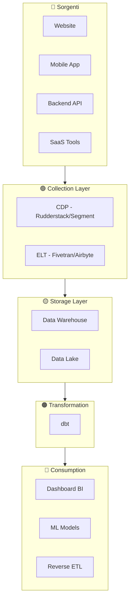

## Introduzione alla Data Collection


> **Consiglio:**
> Questa lezione è il punto di partenza del tuo percorso. Qui capirai perché la raccolta dati non è un dettaglio tecnico, ma la decisione strategica più importante che un'azienda possa prendere.


## Il Mito del "Data-Driven"

Ogni azienda oggi si dichiara "data-driven". È diventato un mantra da inserire nelle presentazioni ai board, nelle job description e nelle landing page aziendali. Ma la realtà è profondamente diversa: secondo una ricerca di NewVantage Partners, **solo il 26,5% delle aziende** si considera effettivamente data-driven, nonostante il 97,2% dichiari di investire in iniziative di Big Data e AI.

Questo divario enorme tra ambizione e realtà nasce da un fraintendimento fondamentale: essere data-driven non significa avere dati, significa prendere decisioni *guidate* dai dati. E per prendere decisioni guidate dai dati, il primo passo — quello che determina tutto il resto — è **raccogliere i dati giusti nel modo giusto**.

### I Tre Livelli di Maturità Analitica

Le organizzazioni si collocano tipicamente in uno di questi tre stadi:

1. **Data-Inspired**: L'azienda guarda i dati occasionalmente, ma le decisioni vengono prese di pancia. I report esistono ma arrivano tardi, sono incompleti, e vengono usati più per giustificare decisioni già prese che per informarne di nuove. *"I numeri dicono X, ma il mio istinto dice Y, quindi facciamo Y."*

2. **Data-Informed**: L'azienda usa i dati come uno degli input nel processo decisionale. Esistono dashboard e report regolari, ma manca un framework sistematico. I dati convivono con l'intuizione e l'esperienza, senza una gerarchia chiara. *"I numeri dicono X, l'istinto dice Y, facciamo un compromesso."*

3. **Data-Driven**: Ogni decisione parte dai dati. Esistono ipotesi formalizzate, esperimenti strutturati, metriche chiare e una cultura dove nessuno — dal CEO allo stagista — può ignorare ciò che i numeri dicono. *"I numeri dicono X, quindi facciamo X, e poi misuriamo l'impatto."*


> **Attenzione:**
> Attenzione: essere data-driven non significa essere schiavi dei numeri. Significa avere un processo disciplinato dove i dati hanno la priorità, ma il giudizio umano resta fondamentale per interpretarli e contestualizzarli.


## Perché la Data Collection è il Fondamento

Immagina di costruire un grattacielo. Puoi avere i migliori architetti, i materiali più costosi, gli ingegneri strutturali più brillanti — ma se le fondamenta sono fragili, tutto crolla. La data collection è esattamente questo: **le fondamenta del tuo sistema analitico**.

### La Catena del Valore dei Dati

```
Raccolta → Trasporto → Archiviazione → Trasformazione → Analisi → Decisione → Azione
```

Ogni anello di questa catena dipende dalla qualità dell'anello precedente. Se la raccolta è difettosa, ogni passaggio successivo amplifica l'errore. Questo principio è noto come **GIGO (Garbage In, Garbage Out)** ed è il motivo per cui aziende che spendono milioni in tool di Business Intelligence e data science ottengono risultati deludenti: investono nella parte sbagliata della catena.

### Il Costo dell'Errore nella Raccolta Dati

Il costo di correggere un errore nei dati cresce esponenzialmente man mano che ci si sposta lungo la catena del valore:

| Fase | Costo di correzione | Esempio |
|------|---------------------|---------|
| **Raccolta** | 1x (base) | Aggiungere una proprietà mancante all'evento |
| **Trasporto** | 5x | Riprocessare mesi di eventi dalla coda |
| **Archiviazione** | 10x | Migrare colonne in tabelle con miliardi di righe |
| **Trasformazione** | 20x | Riscrivere modelli dbt che dipendono dal campo |
| **Analisi** | 50x | Invalidare mesi di report e decisioni già prese |

Questa è la ragione economica — non solo tecnica — per investire tempo e risorse nella progettazione della raccolta dati **prima** di scrivere una singola riga di codice.

## I Quattro Problemi Fondamentali della Data Collection

### 1. Il Problema della Completezza

Non stai raccogliendo abbastanza dati, oppure stai raccogliendo i dati sbagliati. Il marketing traccia i click ma non le conversioni. L'engineering logga gli errori ma non le performance. Il prodotto misura le feature usage ma non il contesto d'uso.

**Sintomo tipico**: "Non abbiamo i dati per rispondere a questa domanda" è una frase che senti regolarmente nei meeting.

**Soluzione**: Un **Tracking Plan** centralizzato e collaborativo che coinvolge tutti gli stakeholder — marketing, prodotto, engineering, finance — nella definizione di cosa tracciare e perché.

### 2. Il Problema della Qualità

I dati ci sono, ma non ci si può fidare. Campi nulli dove non dovrebbero esserci, valori impossibili (ordini con importo negativo), duplicati, formati inconsistenti (date in 3 formati diversi nella stessa tabella).

**Sintomo tipico**: Due dashboard che mostrano numeri diversi per la stessa metrica. Nessuno sa quale sia quella giusta.

**Soluzione**: **Validation e contratti sui dati** a livello di ingestion. Strumenti come JSON Schema, Great Expectations, o Soda per validare i dati prima che entrino nel warehouse.

### 3. Il Problema della Tempestività

I dati arrivano troppo tardi per essere utili. Il report sulle vendite di ieri è disponibile domani sera. L'anomalia nel funnel viene scoperta una settimana dopo. Il budget pubblicitario viene sprecato per 3 giorni prima che qualcuno noti che la campagna è rotta.

**Sintomo tipico**: Le decisioni vengono prese su dati vecchi di giorni o settimane, rendendo impossibile qualsiasi reazione rapida.

**Soluzione**: Architetture ibride batch + real-time. Non tutto deve essere real-time, ma gli **eventi critici di business** (conversioni, errori, anomalie) devono essere disponibili in minuti, non in giorni.

### 4. Il Problema della Governance

Nessuno sa dove sono i dati, chi li ha creati, cosa significano, o se possono essere usati. Mancano ownership, documentazione, e processi di accesso. Ogni team ha la sua "versione della verità" in spreadsheet separati.

**Sintomo tipico**: "Chiedi a Marco, è l'unico che sa come funziona quella tabella" — il classico bus factor di 1.

**Soluzione**: **Data Catalogs** (come DataHub, Atlan, o anche un semplice wiki interno), ownership chiara per ogni dataset, e processi di onboarding per i nuovi membri del team.

## La Data Collection nel Contesto del Modern Data Stack

Il panorama tecnologico della data collection si è evoluto radicalmente negli ultimi anni. Siamo passati da un mondo in cui ogni tool aveva il proprio silo di dati a un'architettura modulare e componibile.

### L'Architettura Moderna



In questa architettura, la **Collection Layer** è il primo touchpoint con i dati. È qui che si determina:

- **Cosa** viene raccolto (quali eventi, quali proprietà)
- **Come** viene raccolto (client-side vs server-side)
- **Dove** viene inviato (warehouse, tool di analytics, piattaforme marketing)
- **Quando** viene raccolto (real-time, near real-time, batch)

### CDP vs ETL: Due Approcci Complementari

| | CDP (Customer Data Platform) | ELT (Extract-Load-Transform) |
|---|---|---|
| **Cosa raccoglie** | Eventi comportamentali (click, pageview, purchase) | Dati da sistemi SaaS (CRM, billing, support) |
| **Come funziona** | SDK nel codice dell'app/sito | Connettori pre-costruiti verso API di terze parti |
| **Esempi** | Rudderstack, Segment, Snowplow | Fivetran, Airbyte, Stitch |
| **Frequenza** | Real-time (evento per evento) | Batch (ogni 5 min / 1 ora / 1 giorno) |
| **Chi lo configura** | Engineering + Data Team | Data Team (spesso self-service) |

Entrambi alimentano il Data Warehouse, dove i dati vengono uniti, trasformati e resi disponibili per l'analisi.

## Come Strutturare Questo Modulo

Nei prossimi capitoli, affronteremo ogni aspetto della data collection in profondità:

1. **Terminologia**: Parleremo la stessa lingua — metriche, KPI, driver, dimensioni.
2. **Framework**: I 4 pilastri su cui costruire una strategia di raccolta dati solida.
3. **Event Tracking Design**: Come progettare un tracking plan professionale — naming conventions, proprietà, schema.
4. **Quick Start Pratico**: Costruiremo un tracker da zero per capire cosa succede "sotto il cofano".
5. **Privacy & Compliance**: GDPR, CCPA, Consent Mode v2 — come raccogliere dati nel rispetto della legge.
6. **Integrazioni & ELT**: Come collegare le sorgenti dati alle destinazioni nel tuo stack.

## Cosa Imparerai alla Fine di Questo Modulo

Al termine di questo modulo, sarai in grado di:

- **Progettare** un Tracking Plan professionale da zero, con naming conventions chiare e proprietà ben definite
- **Scegliere** gli strumenti giusti per il tuo stack di data collection (CDP, ELT, o entrambi)
- **Implementare** il tracking sia client-side che server-side, sapendo quando usare quale approccio
- **Garantire** la qualità dei dati con validation, contratti e processi di governance
- **Rispettare** la privacy degli utenti implementando correttamente il consenso e le normative vigenti


> **Note:**
> Questo non è un corso teorico. Ogni lezione contiene esempi pratici, codice reale e esercizi. La teoria serve a capire il *perché*, la pratica a padroneggiare il *come*.


## Prerequisiti

Per seguire al meglio questo modulo, è utile avere:

- Familiarità di base con **HTML/JavaScript** (per comprendere gli snippet di tracking)
- Un account su uno strumento di analytics (anche Google Analytics 4 gratuito va bene)
- Curiosità e voglia di sporcarsi le mani con i dati

Non serve essere un ingegnere software. Questo modulo è progettato per **analisti, marketer, product manager e data engineer** che vogliono costruire fondamenta solide.


*Nella prossima lezione, partiremo dalla terminologia: capiremo la differenza tra metriche, KPI e driver, e perché confonderli è il primo errore che le aziende commettono.*
