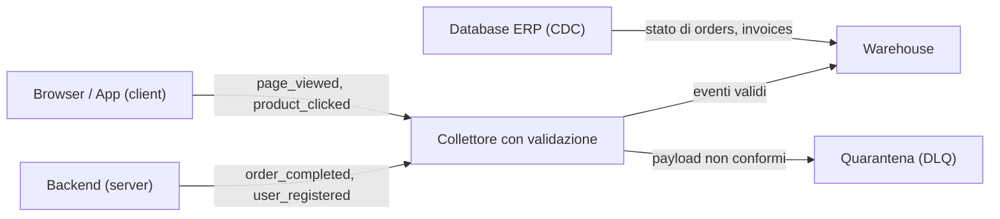

Un e-commerce italiano misura gli acquisti con uno script JavaScript nel browser, attivato sulla pagina di ringraziamento, e lascia che ogni team scelga i nomi degli eventi (scenario costruito, con numeri di esempio). Su iOS l'evento si chiama `Purchase_Done`, su Android `order_completed`, sul web `checkoutSuccess`. Il database dell'ERP registra 10.000 ordini al mese, ma nei sistemi di analisi marketing e prodotto i conti non tornano mai.

Il problema non è Google Analytics. I fatti transazionali sono affidati al browser anziché al server, e nessuno ha scritto un contratto che dica quali eventi esistono, con quali campi e con quale chiave di deduplicazione.

> **Idea chiave:** il browser vede l'interfaccia, il server vede i soldi. Una raccolta dati regge solo se ogni segnale parte dal livello che può osservarlo con certezza, ha un contratto scritto prima del codice ed è validato e deduplicato appena entra.

## Il ventotto percento di ordini che non arriva mai

Nello scenario costruito un audit confronta la tabella degli eventi analitici con il database PostgreSQL dell'ERP e trova tre falle strutturali.

La prima: l'evento di acquisto parte solo dal browser, quando si carica `/thank-you`. Il 18% degli utenti usa ad-blocker o browser con protezione anti-tracciamento, e un altro 10% paga con bonifico istantaneo o app bancaria e chiude la finestra prima del ritorno al sito. Insieme sono il 28% degli incassi reali che non raggiunge mai l'analisi.

La seconda: chi lascia aperta `/thank-you` sullo smartphone la ricarica il giorno dopo riaprendo il browser. L'evento non contiene un identificativo univoco, quindi lo stesso ordine viene registrato due o tre volte.

La terza: per sapere quanti carrelli sono stati creati bisogna unire sette nomi diversi (`add_to_cart`, `AddToCart`, `cart_add`, `item_added`), e il prezzo a volte è una stringa come `"€ 49,90"` e a volte un intero in centesimi, `4990`.

Il conto, con i numeri dello scenario, mostra come due errori opposti si mascherino a vicenda.

1. Ordini reali nell'ERP: 10.000 ordini.
2. Ordini persi dal browser: 10.000 × 28% = 2.800 ordini, quindi ne restano 7.200.
3. Duplicati da refresh sul 6% dei tracciati: 7.200 × 6% = 432 eventi.
4. Eventi `order_completed` nel warehouse: 7.200 + 432 = 7.632 eventi.
5. Scarto netto: (7.632 − 10.000) / 10.000 = −23,7%.

Un cruscotto che guarda solo il totale vede un calo del 23,7% e pensa a un problema di copertura. In realtà ne ha due distinti, 2.800 ordini mancanti e 432 eventi fantasma, che richiedono rimedi diversi: un canale server-side per i primi, una chiave di idempotenza per i secondi.

## Tre canali di raccolta, tre livelli di certezza

Una strategia moderna non sceglie un unico canale. Assegna ogni categoria di segnale al livello architetturale che ne garantisce l'osservabilità.

Il **client** (browser o SDK mobile) è l'unico punto che vede il contesto del dispositivo, i parametri UTM della pagina di atterraggio, lo scorrimento, le impression e le micro-interazioni prima del login. È però inaffidabile per i fatti di business, perché l'utente o il browser possono bloccarlo.

Il **server** (API di backend, oppure un contenitore server-side di tag manager) è il punto autorevole per gli eventi transazionali e di stato. Il backend scrive l'evento nel momento in cui la transazione va a buon fine, indifferente agli ad-blocker e alle chiusure del browser. Per non perdere l'attribuzione riceve dal client l'`anonymous_id` nella richiesta.

Il **Change Data Capture** (CDC) replica nel warehouse lo stato completo delle tabelle applicative, come `orders`, `users`, `invoices`, leggendo il log del database. Serve alla quadratura contabile e cattura anche ciò che nessun evento ha mai descritto, come un rimborso eseguito a mano.



| Categoria di segnale | Canale corretto | Perché |
|---|---|---|
| Visualizzazione pagina, clic, impression | Client | Esiste solo sul dispositivo |
| Registrazione, ordine, rinnovo | Server | Certifica una transazione, immune a blocchi |
| Stato di ordini, fatture, resi | CDC | Quadratura contabile al centesimo |

## Il tracking plan come contratto versionato

Il tracking plan è il documento che dice, per ogni evento, cosa significa, quando scatta, quali proprietà porta e chi ne risponde. Si scrive prima dello sviluppo e vive nel repository accanto al codice, così ogni modifica passa da una revisione.

La convenzione è `oggetto_azione` con il verbo al passato, in `snake_case`: `product_viewed`, `cart_updated`, `order_completed`. Per ogni evento il piano elenca le proprietà obbligatorie con il loro tipo, il canale di emissione e il team `owner`. Senza owner, un evento rotto non ha nessuno a cui segnalarlo.

```yaml
# tracking-plan.yaml: contratto dell'evento order_completed
event: order_completed
description: "Ordine pagato e confermato dal gateway di pagamento"
channel: server
owner: team-checkout
schema_version: 2
required:
  - event_id
  - occurred_at
  - anonymous_id
  - order_id
  - revenue_eur
  - currency
properties:
  event_id: { type: string, format: uuid }
  occurred_at: { type: string, format: date-time }
  anonymous_id: { type: string }
  user_id: { type: [string, "null"] }
  order_id: { type: string }
  revenue_eur: { type: number, minimum: 0 }
  currency: { type: string, enum: [EUR] }
```

Il file è la sorgente unica: da lì si genera il JSON Schema usato dal collettore, la documentazione per gli sviluppatori e i controlli nei test automatici. Quando un team vuole aggiungere un campo apre una modifica al piano, non rilascia nulla di nascosto.

## Validazione e deduplicazione alla fonte

Il tracking plan serve solo se qualcuno lo applica. Il collettore di ingresso valida ogni payload contro lo schema: i conformi entrano nella tabella principale, i non conformi finiscono in una **Dead Letter Queue**, una tabella di quarantena che conserva l'evento grezzo con il motivo del rifiuto. Scartare con un errore HTTP senza salvare nulla nasconde i bug di rilascio e fa perdere dati.

```python
# Validazione alla fonte: i payload non conformi vanno in quarantena con il motivo
from jsonschema import Draft202012Validator

SCHEMA_ORDER = {
    "type": "object",
    "required": ["event_id", "occurred_at", "anonymous_id", "order_id", "revenue_eur", "currency"],
    "properties": {
        "event_id": {"type": "string"},
        "revenue_eur": {"type": "number", "minimum": 0},
        "currency": {"type": "string", "enum": ["EUR"]},
    },
}
validatore = Draft202012Validator(SCHEMA_ORDER)

def smista(payload, scrivi_valido, scrivi_quarantena):
    errori = [e.message for e in validatore.iter_errors(payload)]
    if errori:
        # il payload grezzo non si perde: serve per riversarlo dopo la correzione
        scrivi_quarantena({"violation_reason": "; ".join(errori), "raw_payload": payload})
    else:
        scrivi_valido(payload)
```

La deduplicazione si appoggia su `event_id`, che può essere un UUID oppure una chiave deterministica derivata dai dati, per esempio un hash di `'order_completed:' || order_id`. La seconda forma ha un vantaggio: lo stesso ordine emesso due volte da due componenti produce lo stesso identificativo. Lo stesso `event_id` va inviato anche alle API di conversione delle piattaforme pubblicitarie, così il pixel del browser e la chiamata server-side si deduplicano tra loro.

In ClickHouse la tabella principale usa `ReplacingMergeTree` ordinata su `event_id` e una seconda tabella raccoglie le violazioni.

```sql
-- Tabella principale: eventi validati, deduplicati su event_id durante i merge
CREATE TABLE raw_tracking.events_valid
(
    event_date Date,
    event_name LowCardinality(String),
    event_id String,
    occurred_at DateTime64(3, 'UTC'),
    ingested_at DateTime64(3, 'UTC') DEFAULT now64(3),
    channel_source LowCardinality(String), -- client_web, client_app, server_backend
    anonymous_id String,
    user_id String,
    order_id String,
    revenue_eur Decimal(12, 2),
    currency LowCardinality(String)
)
ENGINE = ReplacingMergeTree(ingested_at)
PARTITION BY toYYYYMM(event_date)
ORDER BY (event_name, event_date, event_id);

-- Quarantena: payload che violano il tracking plan, con motivo e testo grezzo
CREATE TABLE raw_tracking.events_quarantine
(
    quarantined_at DateTime DEFAULT now(),
    platform LowCardinality(String),
    event_name String,
    violation_reason String,
    raw_payload_json String
)
ENGINE = MergeTree
PARTITION BY toYYYYMM(quarantined_at)
ORDER BY (quarantined_at, platform, event_name);
```

Con un nuovo rilascio Android che invia `revenue_eur` come stringa `"29.90"` invece del numero `29.90`, la tabella di quarantena cattura l'evento, un allarme avvisa il team mobile e gli eventi recuperati si riversano nella tabella principale appena il tipo è corretto.

## La quadratura giornaliera contro l'ERP

La prova che l'architettura funziona è un confronto automatico, ogni giorno, tra gli ordini tracciati e quelli del database transazionale. Lo scarto accettabile è sotto l'1%, e vicino a zero sugli eventi emessi dal server. La stessa query misura anche quanto avrebbe perso il solo client, il suo punto cieco.

```sql
-- Quadratura giornaliera: tracking vs ERP, punto cieco del client e violazioni di schema
WITH tracking_orders AS (
    SELECT
        event_date,
        uniqExact(order_id) AS tracked_unique_orders,
        uniqExactIf(order_id, channel_source LIKE 'client_%') AS client_only_orders
    FROM raw_tracking.events_valid FINAL
    WHERE event_name = 'order_completed'
      AND event_date = today() - 1
    GROUP BY event_date
),
erp_orders AS (
    SELECT
        toDate(created_at) AS order_date,
        uniqExact(order_id) AS erp_true_orders
    FROM raw_erp.orders_cdc FINAL
    WHERE toDate(created_at) = today() - 1
      AND status = 'paid'
    GROUP BY order_date
)
SELECT
    e.order_date,
    e.erp_true_orders,
    t.tracked_unique_orders,
    round((t.tracked_unique_orders - e.erp_true_orders) * 100.0 / e.erp_true_orders, 2) AS discrepanza_pct,
    round((e.erp_true_orders - t.client_only_orders) * 100.0 / e.erp_true_orders, 1) AS punto_cieco_client_pct,
    (SELECT count() FROM raw_tracking.events_quarantine
      WHERE quarantined_at >= now() - INTERVAL 24 HOUR) AS violazioni_24h
FROM erp_orders AS e
LEFT JOIN tracking_orders AS t ON e.order_date = t.event_date;
```

Con i numeri dello scenario, il giorno tipo ha 10.000 ordini nell'ERP. Con l'emissione server-side e la deduplicazione su `event_id` gli ordini tracciati sono 10.000, quindi lo scarto è (10.000 − 10.000) / 10.000 = 0,00%. Gli ordini visti dal solo client sono 7.200, quindi il punto cieco è (10.000 − 7.200) / 10.000 = 28,0%. Il confronto rende visibile in una colonna il valore economico del canale server.

## Come scegliere il canale per un nuovo evento

Per ogni evento che entra nel tracking plan la decisione è una domanda: chi può osservare con certezza questo fatto? Se esiste solo sul dispositivo, come una visualizzazione di pagina, un banner o un filtro applicato, parte dal client. Se è un passaggio del funnel transazionale o autenticato, come `user_registered`, `lead_submitted`, `checkout_started`, `order_completed`, `subscription_renewed`, parte dal server. Se è lo stato corrente di un'entità di business, o un rimborso successivo, lo porta il CDC.

L'errore tipico del passaggio al server è dimenticare di inoltrare dal browser al backend l'`anonymous_id` e i parametri della campagna. Se il server emette `order_completed` con `user_id = 42` ma senza l'identificativo anonimo che quell'utente aveva cinque minuti prima, mentre cliccava sull'annuncio, il 100% degli ordini è contato bene e lo 0% è attribuibile a una campagna. Il browser raccoglie identità anonima e sorgente di traffico, il server legge la stessa identità dalla richiesta HTTP e certifica la transazione.

## Errori che rendono inutilizzabili i dati alla fonte

Una raccolta senza tracking plan, affidata al solo client e senza validazione mostra tutti i sintomi insieme: tre nomi per lo stesso evento, prezzi in formati diversi e conteggi che divergono dal database. Chi prova a ripararli a valle scrive query piene di `OR` e di funzioni di pulizia, e le rifà a ogni nuova versione dell'app.

### Tracciare ordini e pagamenti solo con un pixel nel browser

Il sintomo è una perdita costante tra il 15% e il 35% degli incassi reali. Sembra ragionevole perché il pixel è facile da installare e il marketing lo conosce. Succede perché i pagamenti moderni (3D Secure, wallet, bonifico, buy-now-pay-later) portano spesso l'utente su un'app esterna: se il pagamento riesce ma l'utente non torna sul sito, quell'acquisto per il client non è mai esistito. I rinnovi automatici di un abbonamento avvengono a computer spento e sono invisibili al browser al 100%. La correzione è emettere dal backend ogni conversione di business.

### Lasciare che ogni sviluppatore scelga nomi e tipi senza uno schema

Il sintomo è un campo che si chiama `orderId` su web, `order_id` su iOS e `id_ordine` su Android, con tipi diversi. Succede perché dire di tracciare un evento quando l'utente compra, senza consegnare la specifica del payload, lascia a ciascuno l'interpretazione. Rattoppare con `coalesce()` ed espressioni regolari in dbt rallenta le query e si rompe a ogni versione. La correzione è un tracking plan con JSON Schema, usato sia dagli sviluppatori sia dal collettore.

### Scartare in silenzio gli eventi non validi invece di metterli in quarantena

Il sintomo è un calo di volume dopo un rilascio, senza alcun errore visibile. Succede perché il collettore risponde con un rifiuto e il messaggio sparisce: sembra pulizia, ma nasconde il bug e perde il dato. La correzione è la tabella di quarantena con il motivo della violazione, un allarme sul numero di righe e una procedura per riversare gli eventi recuperati.

## Verifica sulla strategia di raccolta

La metrica che certifica l'affidabilità è la riconciliazione delle transazioni tra tracking e database contabile: scarto giornaliero sotto l'1% su ordini e ricavi, vicino a zero sugli eventi server-side, e nessun evento senza schema nel warehouse.

1. Un sito registra 6.000 ordini nell'ERP e il suo pixel ne conta 4.320. Quanto vale il punto cieco del client e quale canale lo copre?

<details>
<summary>Mostra risposta</summary>

Il punto cieco è (6.000 − 4.320) / 6.000 = 1.680 / 6.000 = 28%. Lo copre l'emissione server-side dal backend, che scrive l'evento al momento della conferma del pagamento. Il CDC dell'ERP serve poi come controllo contabile indipendente.

</details>

2. Perché `event_id` deve essere generato all'origine e non assegnato dal collettore al momento dell'arrivo?

<details>
<summary>Mostra risposta</summary>

Perché un ritentativo di rete o un refresh produce un secondo messaggio con contenuto identico: se la chiave nascesse all'arrivo, ogni copia riceverebbe un identificativo diverso e sarebbe indistinguibile da un secondo acquisto. Con una chiave creata alla nascita dell'evento, o derivata da `order_id`, le copie coincidono e `ReplacingMergeTree` ne tiene una.

</details>

3. Un rilascio Android invia `revenue_eur` come stringa. Che cosa deve succedere a quei payload e chi ne viene informato?

<details>
<summary>Mostra risposta</summary>

Il validatore li rifiuta dalla tabella principale e li scrive in `events_quarantine` con il motivo della violazione e il testo grezzo. Un allarme sul numero di violazioni avvisa il team mobile indicato come owner nel tracking plan. Corretto il tipo, gli eventi si riversano nella tabella principale senza perdere dati.

</details>

4. Il server emette `order_completed` con `user_id` ma senza `anonymous_id`. Il conteggio degli ordini è corretto. Che cosa si rompe?

<details>
<summary>Mostra risposta</summary>

Si rompe l'attribuzione: senza l'identificativo anonimo non si può collegare l'ordine alle pagine viste e al clic sull'annuncio, quindi nessuna campagna riceve il credito della vendita. La correzione è far inviare dal browser l'`anonymous_id` nella richiesta di acquisto e riportarlo nell'evento server-side.

</details>
