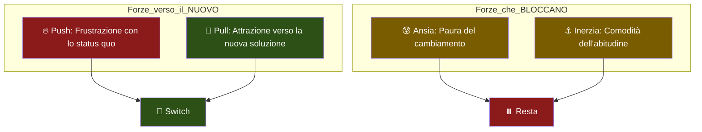

# Il Framework Jobs to Be Done (JTBD)

> **Obiettivo:** Capire *perché* i clienti scelgono un prodotto e come tradurre queste motivazioni in eventi tracciabili per costruire analytics significativi.

## 1. Il Concetto Fondamentale

Il framework JTBD, sviluppato da **Clayton Christensen** alla Harvard Business School, ribalta la prospettiva tradizionale del marketing:

> **Le persone non comprano prodotti; li "assumono" per svolgere un lavoro specifico nella loro vita.**

Quando un utente acquista un trapano, non vuole un trapano. Vuole un buco nel muro. O meglio: vuole appendere quel quadro per sentirsi finalmente "a casa".

### Perché è fondamentale per la Data Collection

La differenza tra **tracciare tutto** e **tracciare ciò che conta** sta proprio qui. Il JTBD ci dice *quali* eventi misurare:

```javascript
// ❌ Tracciamento generico - troppo rumore
analytics.track('button_clicked', { button_id: 'btn-123' });

// ✅ Tracciamento JTBD - cattura l'intento
analytics.track('job_completed', {
  job: 'organize_workspace',
  trigger: 'first_project_created',
  outcome: 'success',
  time_to_complete_seconds: 45
});
```

## 2. La Leggenda del Milkshake

Per capire il JTBD in azione, il caso più celebre è quello del **milkshake di McDonald's**.

Una catena di fast food voleva vendere più milkshake. Provarono di tutto: nuovi gusti, prezzi bassi, pubblicità. **Risultato: zero.**

Christensen scoprì che il 40% dei milkshake veniva venduto alle **8:00 del mattino** a pendolari solitari.

| Domanda JTBD | Risposta |
|:---|:---|
| **Chi** lo compra? | Pendolari solitari in auto |
| **Quando?** | Mattina presto, prima del lavoro |
| **Quale "lavoro" fa?** | Sconfiggere la noia di 30 minuti in auto |
| **Quali alternative?** | Banana (finisce troppo presto), bagel (briciole), caffè (troppo caldo) |
| **Perché il milkshake vince?** | Dura 20 min, tiene impegnata una mano, sazia fino a pranzo |

### Traduzione in eventi tracciabili

```javascript
// Piano di tracking ispirato al JTBD
const jtbd_tracking_plan = {
  job: 'reduce_commute_boredom',
  functional_events: [
    'product_purchased',        // Ha comprato
    'consumption_duration',     // Quanto è durato
    'satisfaction_rating'       // Soddisfazione post-consumo
  ],
  emotional_events: [
    'mood_before_purchase',     // Come si sentiva prima
    'mood_after_consumption'    // Come si sente dopo
  ],
  context_events: [
    'time_of_day',              // Mattina/pomeriggio/sera
    'location_type',            // Drive-through vs in-store
    'is_alone'                  // Solo o in compagnia
  ]
};
```

## 3. I Tre Tipi di Job

Ogni decisione di acquisto coinvolge tre dimensioni:

| Tipo di Job | Definizione | Esempio (App di fitness) | Evento da tracciare |
|:---|:---|:---|:---|
| **Funzionale** | Il compito pratico da svolgere | Seguire un programma di allenamento | `workout_completed` |
| **Emotivo** | Come vuole sentirsi il cliente | Sentirsi in controllo della propria salute | `streak_milestone_reached` |
| **Sociale** | Come vuole essere percepito | Essere visto come persona atletica | `workout_shared_social` |

```python
# Modello dati per tracciare i 3 tipi di job
job_schema = {
    "event": "job_progress",
    "properties": {
        "job_type": "functional | emotional | social",
        "job_id": "string",           # es. "get_fit", "feel_confident"
        "progress_pct": "float",      # 0.0 - 1.0
        "satisfaction": "int",        # 1-10
        "context": {
            "time_of_day": "string",
            "device": "string",
            "session_number": "int"
        }
    }
}
```

## 4. Le 4 Forze del Cambiamento

Perché un cliente decide di lasciare il vecchio prodotto per il nuovo? Quattro forze in competizione:



### Tracciare le 4 Forze

```sql
-- Query: Analisi delle forze di switch per coorte
SELECT
    u.signup_cohort,
    -- PUSH: frustrazione col prodotto precedente
    AVG(CASE WHEN s.question = 'prev_product_frustration' 
        THEN s.score END) AS avg_push_score,
    -- PULL: attrattiva del nuovo prodotto
    AVG(CASE WHEN s.question = 'new_product_appeal' 
        THEN s.score END) AS avg_pull_score,
    -- ANXIETY: paura del cambiamento
    AVG(CASE WHEN s.question = 'switching_anxiety' 
        THEN s.score END) AS avg_anxiety_score,
    -- INERTIA: abitudine
    AVG(CASE WHEN s.question = 'habit_strength' 
        THEN s.score END) AS avg_inertia_score,
    -- Retention a 30 giorni
    COUNT(DISTINCT CASE WHEN a.last_active >= u.signup_date + INTERVAL 30 DAY 
        THEN u.user_id END) * 100.0 / COUNT(DISTINCT u.user_id) AS retention_d30
FROM users u
LEFT JOIN surveys s ON u.user_id = s.user_id
LEFT JOIN activity a ON u.user_id = a.user_id
GROUP BY u.signup_cohort
ORDER BY u.signup_cohort;
```

## 5. Bisogni Stabili, Soluzioni Dinamiche

I bisogni umani non cambiano. Cambia la tecnologia con cui li soddisfiamo:

| Bisogno Stabile | Soluzione 1900 | Soluzione 2000 | Soluzione 2026 |
|:---|:---|:---|:---|
| Comunicare a distanza | Lettera / Telegrafo | Email / SMS | WhatsApp / Videochiamate AI |
| Spostarsi rapidamente | Cavallo / Treno | Auto / Aereo | Ride sharing / Autonome |
| Conservare ricordi | Ritratto dipinto | Fotocamera | Cloud / Social / AI generativa |
| Imparare cose nuove | Biblioteca | DVD/e-learning | LLM / Corsi interattivi |

> **Principio chiave:** Se ti innamori del tuo prodotto (la soluzione), rischi di fallire. Se ti innamori del problema del cliente (il Job), sarai sempre innovativo.

## 6. Le Interviste JTBD: Le 3 Domande d'Oro

Per scoprire i veri "Jobs" dei clienti, servono interviste qualitative strutturate:

### Timeline dell'Intervista


### Le 3 Domande d'Oro

1. **Il Contesto:** "Cosa stava succedendo nella tua vita quando hai deciso che ti serviva questo prodotto?"
2. **Il Momento Zero:** "Qual è stato l'evento specifico che ti ha fatto dire 'Basta, mi serve una soluzione'?"
3. **L'Emozione:** "Come ti sei sentito subito dopo l'acquisto? E dopo una settimana?"

### Template di Analisi delle Interviste

```python
import pandas as pd

# Struttura per analizzare le interviste JTBD
interview_template = {
    "interviewee_id": "INT_001",
    "date": "2026-02-20",
    "product": "App di project management",
    
    # Timeline
    "first_thought": "3 mesi prima, quando i progetti iniziarono a sfuggire",
    "trigger_event": "Perso una deadline importante davanti al cliente",
    "alternatives_considered": ["Trello", "Notion", "Foglio Excel"],
    "purchase_moment": "Demo gratuita dopo aver visto un case study",
    "post_purchase_feeling": "Sollievo, sensazione di controllo",
    
    # I 3 Job
    "functional_job": "Tenere traccia di task e deadline",
    "emotional_job": "Sentirsi organizzato e professionale",
    "social_job": "Apparire affidabile davanti ai clienti",
    
    # Le 4 Forze
    "push": "Caos nei progetti, deadline mancate",
    "pull": "UI pulita, automazioni, integrazioni Slack",
    "anxiety": "Curva di apprendimento, migrazione dati",
    "inertia": "Il team era abituato a Excel"
}

# Aggregazione di 20+ interviste per trovare pattern
def analyze_interviews(interviews: list[dict]) -> pd.DataFrame:
    df = pd.DataFrame(interviews)
    
    # Cluster dei Job più frequenti
    jobs = df[['functional_job', 'emotional_job', 'social_job']]
    print("=== JOB PIÙ FREQUENTI ===")
    for col in jobs.columns:
        print(f"\n{col}:")
        print(df[col].value_counts().head(5))
    
    # Pattern nelle 4 forze
    print("\n=== FORZE DOMINANTI ===")
    forces = df[['push', 'pull', 'anxiety', 'inertia']]
    for col in forces.columns:
        print(f"\n{col} - Temi comuni:")
        print(df[col].value_counts().head(3))
    
    return df
```

## 7. Dal JTBD al Tracking Plan

Il valore reale del JTBD per la data collection è la capacità di creare un **tracking plan orientato ai risultati**, non alle azioni:

| Job Identificato | Evento Chiave | Proprietà | Metrica di Successo |
|:---|:---|:---|:---|
| Organizzare il lavoro | `project_created` | n_tasks, template_used | Tempo al primo task completato |
| Sentirsi produttivo | `daily_summary_viewed` | tasks_completed, streak | % utenti che tornano il giorno dopo |
| Collaborare col team | `member_invited` | role, channel | % inviti accettati entro 24h |
| Non perdere deadline | `reminder_set` | urgency, advance_hours | % deadline rispettate |

## 8. Esercizio Pratico

Prenditi un momento per riflettere sul tuo **caffè di stamattina**:

- **Job Funzionale:** Ti serviva caffeina per svegliarti?
- **Job Emotivo:** Era un piccolo premio per iniziare bene la giornata?
- **Job Sociale:** È stata una scusa per fare due chiacchiere con un collega?

> **Riflessione:** Se gestissi un bar e capissi che il "Job" dei tuoi clienti è quello *Sociale*, investiresti di più in tavolini accoglienti o nella qualità estrema dei chicchi? E soprattutto, *come lo misureresti*?

```python
# Esercizio: definisci il tracking plan per il tuo bar
my_bar_tracking = {
    "job_hypothesis": "Il caffè è una scusa per socializzare",
    "events_to_track": [
        {"event": "order_placed", "props": ["is_alone", "group_size", "time_of_day"]},
        {"event": "table_occupied", "props": ["duration_min", "n_people", "zone"]},
        {"event": "loyalty_card_used", "props": ["frequency", "avg_spend"]},
    ],
    "success_metric": "avg_visit_duration_minutes",
    "expected_outcome": "Clienti in gruppo restano 3x più a lungo"
}
```

## Riepilogo

| Concetto | Takeaway |
|:---|:---|
| **JTBD** | Le persone "assumono" prodotti per un lavoro specifico |
| **3 Tipi di Job** | Funzionale, Emotivo, Sociale |
| **4 Forze** | Push + Pull vs Ansia + Inerzia |
| **Per la Data Collection** | Traccia il *progresso verso il Job*, non solo i click |
| **Interviste** | 3 domande d'oro per scoprire i veri bisogni |

## Risorse

- **Libro:** *Competing Against Luck* — Clayton Christensen (2016)
- **Framework:** [JTBD.info](https://jtbd.info) — Risorse e template
- **Tool:** Miro JTBD Canvas per mappare visivamente i Job

---

## JTBD Applicato al Design di Event Schema

La maggior parte dei tracking plan sono costruiti "dall'interno verso l'esterno": si guarda l'interfaccia del prodotto, si decide cosa tracciare ("c'è un bottone, tracciamo il click"), e si nominano gli eventi seguendo la struttura UI. Questo approccio produce dati tecnici ma poveri di significato.

Il JTBD inverte questa logica: si parte dai **Job** che gli utenti stanno cercando di completare, e si disegnano gli eventi che misurano il progresso verso quei Job. Il risultato è un tracking plan orientato agli outcome, non alle azioni.

### Jobs Stories vs User Stories: la Differenza Fondamentale

Alan Klement, nel suo libro *When Coffee and Kale Compete* (2016), formalizza la differenza tra User Stories e Jobs Stories — una distinzione cruciale per chiunque voglia usare il JTBD per il design di un tracking plan.

**User Story** (formato Agile classico):
```
Come [tipo di utente],
voglio [azione/feature],
così che [beneficio generico].
```

Esempio: "Come manager, voglio poter esportare i report in PDF, così che posso condividerli con il mio team."

Il problema: la User Story descrive l'implementazione (esportare in PDF) ma non il contesto o la motivazione reale. Perché il manager vuole condividere il report? Con chi? In quale situazione specifica?

**Jobs Story** (formato JTBD di Klement):
```
Quando [situazione specifica],
voglio [motivazione / progress verso il Job],
così che [outcome / come mi sentirò].
```

Esempio: "Quando devo presentare i risultati mensili al board senza avere accesso a internet, voglio avere i dati chiave in un formato che posso portare stampato, così che la riunione non dipenda dalla connessione e io appaia professionale e preparato."

La Jobs Story è molto più ricca: specifica il contesto (riunione board, no internet), la motivazione reale (non dipendere dalla connessione), e l'outcome emotivo (apparire professionale). Queste informazioni cambiano radicalmente cosa si traccia:

Non basta tracciare `report_exported`. Si deve tracciare:
- `report_exported` con proprietà `format: 'pdf'`, `destination: 'local_disk'`
- `offline_access_initiated` quando l'utente scarica per uso offline
- `report_printed` se si riesce a rilevarlo
- `board_presentation_prepared` come evento di workflow

### Le 4 Forze del Progresso: Push, Pull, Anxiety, Habit

Il modello delle 4 forze (sviluppato da Bob Moesta, collaboratore di Christensen) spiega perché gli utenti adottano o non adottano un prodotto. Per il design degli eventi, ogni forza corrisponde a segnali che si possono misurare.

**Push (Spinta verso il cambiamento)**: La frustrazione con la soluzione attuale. Il momento in cui l'utente dice "non ce la faccio più con questo".

Segnali misurabili: errori ripetuti sullo stesso flusso (`task_failed` con stesso `error_type` più di 3 volte), abbandono a metà di un processo (`checkout_abandoned` dopo `cart_item_added`), ricerca di funzionalità mancanti (`help_searched` con query che contengono "come faccio a...").

```sql
-- Identifica gli utenti in fase "Push" (alta frustrazione)
SELECT
    user_id,
    count() AS error_count,
    countIf(event_name = 'help_searched') AS help_searches,
    countIf(event_name = 'task_abandoned') AS abandonments
FROM events
WHERE event_time >= today() - 7
GROUP BY user_id
HAVING error_count > 5 OR help_searches > 3 OR abandonments > 2
ORDER BY error_count DESC;
```

**Pull (Attrazione verso la nuova soluzione)**: La promessa del nuovo prodotto. Cosa ha visto l'utente che lo ha fatto desiderare un cambiamento.

Segnali misurabili: pagine visitate prima della registrazione (`page_viewed` con `page_path` contenente 'pricing', 'features', 'case-study'), sorgente di acquisizione (`utm_source`, `referrer`), tempo trascorso sulla landing page.

**Anxiety (Ansia da cambiamento)**: La paura di sbagliare la scelta, il costo di apprendimento del nuovo prodotto, il rischio di perdere i dati del vecchio sistema.

Segnali misurabili: aperture ripetute della pagina di onboarding senza completarla (`onboarding_step_viewed` senza `onboarding_completed`), visite frequenti alla documentazione o help center, domande di supporto pre-acquisto.

**Habit (Abitudine al vecchio)**: La forza d'inerzia che mantiene l'utente sulla soluzione esistente.

Segnali misurabili: utilizzo del prodotto in pattern identici ogni settimana (stessa funzionalità, stesso orario), bassa esplorazione di feature nuove, resistenza agli upgrade.

### Mapping Pratici: Eventi → JTBD per SaaS B2B

Consideriamo un tool di project management SaaS B2B (simile ad Asana o Linear). Il tracking plan tipico traccia: `project_created`, `task_created`, `task_completed`, `member_invited`, `comment_added`. Questi eventi sono tecnicamente corretti ma JTBD-agnostici.

Ricostruiamo il tracking plan dai Job:

**Job 1: "Non perdere nessuna deadline importante"**

| Evento JTBD | Nome Tecnico | Proprietà Chiave |
|---|---|---|
| L'utente sente il pericolo di una deadline mancata | `deadline_approaching_viewed` | `days_until_deadline`, `task_completion_pct` |
| L'utente attiva un reminder per se stesso | `reminder_set` | `advance_hours`, `method: email/push/slack` |
| L'utente completa un task in ritardo | `task_completed` | `days_overdue`, `was_blocked_by` |
| La deadline viene posticipata | `deadline_changed` | `reason`, `new_delay_days` |

**Job 2: "Far sembrare il mio team organizzato al cliente"**

| Evento JTBD | Nome Tecnico | Proprietà Chiave |
|---|---|---|
| Condivisione del progresso con esterni | `project_shared_externally` | `recipient_type: client/stakeholder`, `view_only` |
| Creazione di un report di status | `status_report_created` | `format`, `period` |
| Export per presentazione | `project_exported` | `export_format`, `destination` |

**Job 3: "Onboardare un nuovo membro del team rapidamente"**

| Evento JTBD | Nome Tecnico | Proprietà Chiave |
|---|---|---|
| Invito di un nuovo membro | `member_invited` | `role`, `projects_shared` |
| Primo accesso del nuovo membro | `first_login` + `invited_by` | `time_to_first_login_hours` |
| Completamento del primo task dal nuovo membro | `first_task_completed_by_invited_user` | `days_since_invite` |

Questo tracking plan orientato ai Job produce metriche molto più significative:
- "Qual è il tempo medio tra l'invito e il primo task completato?" (misura l'efficacia dell'onboarding)
- "Quanti utenti usano la funzione di condivisione esterna?" (misura l'adozione del Job 2)
- "Quanto spesso le deadline vengono posticipate, e per quale ragione?" (misura la frustrazione verso il Job 1)

### Come Usare il JTBD per Definire il Tracking Plan

Il processo in 5 passi per costruire un tracking plan orientato al JTBD:

**Passo 1: Conduci le interviste JTBD**

Prima di scrivere un singolo evento, intervista 5-10 clienti usando le domande della Timeline (descritte nella sezione precedente). Non chiedere "Cosa fai con il prodotto?" — chiedi "Cosa stava succedendo nella tua vita prima di scegliere di usare questo prodotto?"

Le trascrizioni delle interviste rivelano i Job reali, spesso diversi da quelli che il team assume.

**Passo 2: Identifica i 3-5 Job principali**

Dalle interviste emergono pattern. Raggruppa le motivazioni simili e nomina ogni Job con un gerundio: "Organizzare il lavoro del team", "Non perdere deadline importanti", "Essere aggiornato sullo stato del progetto senza dover chiedere".

**Passo 3: Disegna il "Job Map" per ogni Job**

Il Job Map (Alan Klement) descrive i passi che l'utente deve completare per svolgere il Job:

```
Job: "Non perdere deadline importanti"

1. Definire la deadline al momento della creazione del task
2. Monitorare il progresso verso la deadline
3. Ricevere alert quando la deadline si avvicina
4. Riassegnare o rimuovere blocchi se il task è in ritardo
5. Documentare la causa del ritardo per imparare
```

Ogni passo del Job Map diventa un candidato a evento da tracciare.

**Passo 4: Definisci gli eventi e le proprietà**

Per ogni passo del Job Map, definisci:
- Il nome dell'evento (verbo + sostantivo: `deadline_set`, `progress_checked`, `blocker_removed`)
- Le proprietà che catturano il contesto JTBD
- La metrica di successo associata

**Passo 5: Identifica le "forze" da misurare**

Per ogni Job, disegna gli eventi che corrispondono alle 4 forze. Gli eventi di Push (frustrazione) ti dicono chi sta per fare churn. Gli eventi di Pull (aha moment) ti dicono chi probabilmente resterà.

```python
# Script per classificare gli eventi del tracking plan per forza JTBD
tracking_plan_jtbd = {
    "job_1_no_missed_deadlines": {
        "push_signals": [
            "deadline_missed",
            "task_overdue_viewed",
            "help_searched with query containing 'deadline'"
        ],
        "pull_signals": [
            "first_reminder_set",   # Ha scoperto i reminder → aha moment
            "deadline_met_after_risk"  # Ha completato in tempo nonostante il rischio
        ],
        "anxiety_signals": [
            "onboarding_deadline_step_skipped",  # Ha saltato la configurazione
            "reminder_disabled"  # Ha disabilitato i reminder (troppo rumorosi?)
        ],
        "habit_signals": [
            "task_completed_without_deadline"  # Ancora abituato a non mettere deadline
        ]
    }
}
```

### Il Tracking Plan Orientato al JTBD per un SaaS B2B: Esempio Completo

Mettiamo insieme tutto in un tracking plan strutturato per un tool di project management, con 5 Job identificati dalle interviste:

```yaml
# tracking_plan_jtbd.yml
version: "2.0"
product: "ProjectFlow SaaS"
jobs_identified:
  - id: J1
    name: "Non perdere deadline importanti"
    frequency: "daily"
    emotional_intensity: "high"
  - id: J2
    name: "Coordinare il lavoro del team senza riunioni continue"
    frequency: "daily"
    emotional_intensity: "medium"
  - id: J3
    name: "Dimostrare il progresso al management"
    frequency: "weekly"
    emotional_intensity: "high"

events:
  # Job J1 — Deadline
  - name: deadline_set
    job: J1
    trigger: "Utente aggiunge una data di scadenza a un task"
    properties:
      task_id: string
      days_until_deadline: integer
      has_reminder: boolean
    success_metric: "% task con deadline che vengono completati on-time"

  - name: deadline_missed
    job: J1
    trigger: "Data di scadenza superata senza completamento"
    properties:
      task_id: string
      days_overdue: integer
      was_assigned: boolean
    success_metric: "Trend decrescente nel tempo"

  # Job J3 — Reporting
  - name: status_report_generated
    job: J3
    trigger: "Utente esporta o condivide un report di status"
    properties:
      project_id: string
      recipient_type: "internal | external | management"
      format: "pdf | link | email"
    success_metric: "DAU/WAU degli utenti che usano questa feature"
```

Questo tracking plan, a differenza di uno costruito sulla UI, permette di rispondere a domande che contano davvero:
- "Quanti utenti hanno completato almeno un Job J1 questa settimana?" (misura il core value)
- "Gli utenti che completano il Job J3 hanno un churn rate più basso?" (misura se il reporting crea retention)
- "Qual è il tempo mediano dal `deadline_set` al `task_completed`?" (misura l'efficacia del tool sul Job principale)

Senza JTBD, potresti misurare le stesse cose indirettamente, ma con molto più effort e molta meno precisione. Il JTBD non è solo una filosofia di prodotto: è un framework operativo per costruire analytics significativi.
