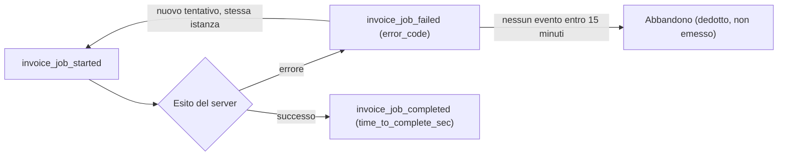

Considera uno scenario costruito con numeri di esempio: una piattaforma SaaS di fatturazione elettronica adotta uno strumento di auto-capture e chiede agli sviluppatori di tracciare "qualsiasi interazione sulla pagina". Dopo sei mesi il database contiene 480 tipi di evento (`button_hover_blue`, `scroll_14_pct`, `modal_close_icon_x`) per 300 milioni di righe al mese. Quando l'amministratore delegato chiede quanti nuovi clienti sono riusciti a inviare la prima fattura entro 10 minuti dall'iscrizione e dove si fermano gli altri, nessuno sa rispondere. I dati abbondano, ma manca l'evento che dice se il cliente ha portato a termine il suo compito.

## Quattrocentoottanta eventi e nessuna risposta sul compito del cliente

Il caso ricostruito qui sopra ha una causa precisa: il piano di tracciamento è stato disegnato guardando gli elementi grafici del DOM (bottoni, menu, icone) e non il progresso che il cliente cerca di compiere. Il quadro teorico è quello dei Jobs to be Done di Christensen, che spiega l'acquisto di un prodotto come l'"assunzione" di una soluzione per un lavoro preciso ([Christensen et al., 2016](https://hbr.org/2016/09/know-your-customers-jobs-to-be-done)). Chi paga un abbonamento di fatturazione non vuole cliccare un pulsante: vuole inviare una fattura valida al Sistema di Interscambio senza errori e senza perdere un pomeriggio.

Un audit sull'uso reale dei 480 eventi dell'esempio mostra tre difetti. Il primo è lo spreco: 422 eventi su 480, cioè l'88%, non sono mai stati interrogati da una query negli ultimi sei mesi, eppure occupano spazio, appesantiscono l'app mobile e confondono gli analisti con nomi quasi identici come `click_btn_submit` e `form_btn_pressed`. Il secondo è la fragilità: quando un designer sposta un'azione da un pulsante a una scorciatoia da tastiera, o uno sviluppatore rinomina un componente React, gli eventi legati all'elemento grafico smettono di scattare e la serie storica si spezza. Il terzo è l'assenza del dato che conta: nessuno dei tre passi del job per cui il cliente paga (`invoice_job_started`, `invoice_job_failed`, `invoice_job_completed`) è stato modellato.

Questa lezione sposta il criterio di selezione: un evento entra nel piano di tracciamento perché misura l'avanzamento, l'ostacolo o il completamento di un lavoro del cliente, e perché qualcuno ha già deciso che cosa farà quando quel numero cambia. Il resto è rumore che costa.

## Il job come unità di misura: started, failed, completed

> **Idea chiave:** i bottoni e i colori cambiano a ogni redesign, il lavoro del cliente resta lo stesso per anni; un evento stabile descrive il lavoro, non l'interfaccia.

Applicare i Jobs to be Done alla raccolta dati significa scomporre ogni lavoro fondamentale in tre eventi che non dipendono dall'interfaccia. Per un prodotto di fatturazione i job possono essere `send_first_invoice`, `reconcile_bank_statement` o `complete_b2b_checkout`; per ciascuno si tracciano un inizio, un possibile fallimento e un completamento. L'inizio cattura il momento in cui l'utente manifesta l'intenzione di compiere il lavoro. Il fallimento registra l'ostacolo e lo spiega con una proprietà obbligatoria, ad esempio `error_code = 'missing_sdi_code'`. Il completamento chiude il lavoro e porta con sé la durata e l'esito di valore.



Il diagramma mostra due dettagli che spesso si perdono. Un job può fallire più volte prima di riuscire, e tutti i tentativi appartengono alla stessa istanza identificata da `job_instance_id`: è questo identificativo che permette di contare i tentativi per job e di misurare il tempo tra il primo avvio e il completamento. L'abbandono, invece, non è un evento emesso dall'app: lo si deduce dall'assenza del completamento entro una finestra scelta in anticipo, qui 15 minuti.

La stessa struttura regge anche quando l'interfaccia cambia. Se la fattura viene inviata da un pulsante, da una scorciatoia da tastiera o da un'API pubblica, la tripletta resta identica e la serie storica non si interrompe. Per lo stesso motivo conviene emettere gli eventi di completamento dal backend, dopo la risposta del server, e non dal clic: cliccare "Invia fattura" non significa averla inviata, perché il server può rispondere con un errore di validazione.

## Il test di valore: metrica, decisione, costo

Prima di sviluppare un nuovo evento, chi lo richiede compila tre campi obbligatori. Il primo indica quale metrica alimenta, ad esempio il Job Completion Rate o il tempo mediano di completamento. Il secondo indica quale decisione cambia se quella metrica si muove. Una risposta valida suona così: se il tasso di errore su `missing_sdi_code` supera il 15%, il team aggiunge la ricerca automatica del codice destinatario a partire dalla partita IVA. Una risposta come "è interessante da sapere" fa bocciare l'evento. Il terzo campo dichiara il costo: volume mensile stimato, proprietario del dato e impegno di manutenzione.

La tabella mostra come il filtro tratta quattro richieste tipiche dell'esempio.

| Evento richiesto | Metrica alimentata | Decisione collegata | Esito |
|---|---|---|---|
| `invoice_job_completed` | Job Completion Rate, tempo mediano | Se scende sotto l'80%, il team di prodotto riprioritizza lo sprint | Approvato |
| `invoice_job_failed` con `error_code` | Quota di errori per motivo | Si interviene sul motivo più frequente | Approvato |
| `ui_click_header_cta_v2` | Nessuna | Nessuna, "serve per capire" | Bocciato |
| `scroll_14_pct` | Nessuna | Nessuna | Bocciato |

Il filtro funziona perché sposta la discussione prima del codice. Aggiungere un evento costa pochi minuti a uno sviluppatore, ma ogni evento approvato genera per anni costi di storage, documentazione e manutenzione. Un controllo periodico completa il quadro: ogni trimestre si eliminano dal collettore gli eventi "zombie", quelli con zero interrogazioni negli ultimi 90 giorni, e si misura la quota di eventi raccolti che alimenta davvero un modello o una dashboard.

## Come appare un job nel payload

Un piano di tracciamento guidato dai job produce payload piccoli e leggibili. L'esempio seguente mostra i tre eventi dello stesso tentativo di invio, nello schema che il collettore riceve.

```json
{
  "_comment": "Tre eventi della stessa istanza di job: avvio, fallimento di validazione, completamento",
  "events": [
    {
      "event_id": "evt_01HZX3",
      "event": "invoice_job_started",
      "user_id": "usr_8841",
      "group_id": "acc_300",
      "occurred_at": "2026-11-09T09:14:02.000Z",
      "properties": { "job_instance_id": "job_5f21", "invoice_type": "b2b" }
    },
    {
      "event_id": "evt_01HZX4",
      "event": "invoice_job_failed",
      "user_id": "usr_8841",
      "group_id": "acc_300",
      "occurred_at": "2026-11-09T09:15:40.000Z",
      "properties": { "job_instance_id": "job_5f21", "error_code": "missing_sdi_code" }
    },
    {
      "event_id": "evt_01HZX9",
      "event": "invoice_job_completed",
      "user_id": "usr_8841",
      "group_id": "acc_300",
      "occurred_at": "2026-11-09T09:16:44.000Z",
      "properties": { "job_instance_id": "job_5f21", "time_to_complete_sec": 162 }
    }
  ]
}
```

Nel browser la chiamata di completamento parte dal punto in cui il server ha risposto con successo, non dal gestore del clic.

```javascript
// Emissione dell'evento di completamento solo dopo la conferma del backend
async function sendInvoice(draft, jobInstanceId, startedAtMs) {
  const response = await fetch("/api/invoices", { method: "POST", body: JSON.stringify(draft) });
  if (!response.ok) {
    const err = await response.json();
    // L'ostacolo viene registrato con un codice stabile, non con il testo del messaggio
    analytics.track("invoice_job_failed", { job_instance_id: jobInstanceId, error_code: err.code });
    return;
  }
  analytics.track("invoice_job_completed", {
    job_instance_id: jobInstanceId,
    time_to_complete_sec: Math.round((Date.now() - startedAtMs) / 1000), // numero, non stringa
  });
}
```

## Calcolare il Job Completion Rate passo per passo

Il Job Completion Rate è il rapporto tra i job completati entro una finestra fissata e i job avviati nella stessa settimana. Con numeri di esempio, una settimana vede 2.000 clienti avviare l'invio di una fattura (`invoice_job_started`). Di questi, 1.284 clienti raggiungono `invoice_job_completed` entro 15 min (900 secondi). Il tasso è 1.284 / 2.000 = 0,642, cioè il 64,2%. I clienti che non completano sono 2.000 − 1.284 = 716, il 35,8% del totale.

Per capire dove intervenire si guardano i motivi di fallimento di quei 716 clienti. Se 301 hanno `missing_sdi_code` come primo ostacolo, la quota è 301 / 716 = 0,420, cioè il 42,0% degli abbandoni, e 301 / 2.000 = 0,151, cioè il 15,1% di tutti gli avvii. Il team decide di inserire la ricerca automatica del codice destinatario dalla partita IVA. Anche eliminando quell'ostacolo per tutti, il tasso salirebbe al massimo da 64,2% a 64,2% + 15,1% = 79,3%, perché non tutti i clienti sbloccati arriverebbero poi in fondo. L'obiettivo di 85% richiede di agire anche sugli altri motivi: 0,85 × 2.000 = 1.700 clienti che completano, cioè 1.700 − 1.284 = 416 clienti in più rispetto a oggi.

La misura si replica su scala reale con una query ClickHouse che raggruppa per istanza e poi per settimana.

```sql
-- Job Completion Rate settimanale, tempo mediano e primo ostacolo per il job "invio fattura"
WITH job_instances AS (
    SELECT
        job_instance_id,
        minIf(occurred_at, event_name = 'invoice_job_started')   AS started_at,
        minIf(occurred_at, event_name = 'invoice_job_completed') AS completed_at,
        countIf(event_name = 'invoice_job_completed')            AS n_completed,
        countIf(event_name = 'invoice_job_failed')               AS n_failed,
        anyIf(error_code, event_name = 'invoice_job_failed')     AS first_error
    FROM analytics_prod.fct_product_events
    WHERE event_date >= today() - 56
      AND event_name IN ('invoice_job_started', 'invoice_job_failed', 'invoice_job_completed')
      AND job_instance_id != ''
    GROUP BY job_instance_id
    HAVING countIf(event_name = 'invoice_job_started') > 0
)
SELECT
    toStartOfWeek(started_at, 1) AS settimana,
    count() AS job_avviati,
    countIf(n_completed > 0 AND dateDiff('second', started_at, completed_at) <= 900) AS completati_entro_15m,
    round(100 * completati_entro_15m / job_avviati, 1) AS job_completion_rate_pct,
    round(quantileIf(0.5)(dateDiff('second', started_at, completed_at), n_completed > 0)) AS p50_secondi,
    round(avg(n_failed), 2) AS errori_medi_per_job,
    topKIf(1)(first_error, n_completed = 0 AND first_error != '') AS ostacolo_principale
FROM job_instances
GROUP BY settimana
ORDER BY settimana DESC;
```

La tabella restituita cambia la conversazione del lunedì. Invece di leggere che il bottone blu ha ricevuto 450.000 clic, il responsabile di prodotto legge un tasso del 64,2%, un tempo mediano di 142 secondi per chi ci riesce e un ostacolo dominante identificato. La decisione è immediata e verificabile nelle due settimane successive.

## Tracking esplicito o auto-capture: quando usare l'uno o l'altro

Molti strumenti di product analytics offrono una modalità di auto-capture che registra clic, cambi di input e pagine viste direttamente dal DOM. Non è alternativa al piano di tracciamento: i due approcci rispondono a domande diverse.

| Criterio | Tracking esplicito sui job | Auto-capture |
|---|---|---|
| Stabilità nel tempo | Alta, indipendente dal redesign | Bassa, dipende da classi CSS e struttura HTML |
| Proprietà di business (piano, margine, esito server) | Presenti, scritte dal codice | Assenti, il DOM non le conosce |
| Validazione e tipi | Possibile a monte con uno schema | Difficile |
| Costo iniziale | Qualche minuto di sviluppo per evento | Quasi nullo |
| Costo di analisi | Basso, nomi controllati | Alto, serve riconoscere i selettori giusti |

Per le metriche core, i funnel di attivazione, le dashboard aziendali e i modelli dbt serve semantica stabile: si usa il tracking esplicito. L'auto-capture ha senso come strumento temporaneo di esplorazione per chi progetta l'interfaccia, ad esempio una mappa di calore su una pagina per qualche settimana. La confusione comune è usarlo per evitare di scrivere le chiamate `track()`: il costo non sparisce, si sposta da dieci minuti di uno sviluppatore a ore settimanali di un analista che rincorre selettori cambiati a ogni rilascio.

## Tre errori quando si decide cosa tracciare

Un audit sugli eventi non utilizzati rende il primo errore misurabile, perché mostra quante righe sono state scritte senza che nessuno le interrogasse.

```sql
-- Audit degli eventi zombie: molte righe scritte in 90 giorni, nessuna interrogazione degli analisti
SELECT
    e.event_name,
    count() AS righe_scritte_90gg,
    round(sum(length(e.raw_payload_json)) / 1073741824, 2) AS gb_scritti,
    coalesce(max(q.queries_count_90d), 0) AS interrogazioni_90gg
FROM raw_tracking.events_valid AS e
LEFT JOIN monitoring.event_query_usage_90d AS q ON e.event_name = q.event_name
WHERE e.event_date >= today() - 90
  AND e.event_name LIKE 'ui_click_%'
GROUP BY e.event_name
HAVING interrogazioni_90gg = 0
ORDER BY righe_scritte_90gg DESC;
```

### Tracciare l'elemento grafico invece del significato

Chiamare un evento `clicked_header_cta_v2` o affidarsi a selettori CSS come `div.checkout > button.btn-primary` lega i dati all'implementazione del frontend. Sembra ragionevole perché è veloce e gli sviluppatori non devono decidere nulla. Il sintomo è una metrica che crolla a zero dopo un aggiornamento della libreria UI, o un clic contato come successo quando il server ha restituito un errore. La correzione è nominare l'evento per il lavoro svolto e emetterlo dal punto in cui l'esito è noto.

### Approvare richieste generiche del tipo "tracciamo tutto"

La richiesta nasce da una buona intenzione: non perdere dati utili. Il sintomo, dopo qualche mese, è un catalogo di 500 eventi senza documentazione e senza ipotesi collegate, in cui gli analisti passano settimane a chiedere quando scatti esattamente `step_2_trigger_b` e finiscono per non fidarsi di nessun evento. Una trentina di eventi core, tipizzati e testati, battono di gran lunga cinquecento eventi rumorosi. La correzione è il test di valore applicato prima dello sviluppo e la pulizia trimestrale degli zombie.

### Misurare conteggi grezzi invece del tasso di completamento

Esultare perché `search_executed` è cresciuto del 40% è una trappola classica. Se un utente esegue 12 ricerche di fila senza aprire un risultato, non è coinvolto: il motore non trova ciò che cerca. Il numero di eventi sale mentre il job fallisce. La correzione è ancorare ogni conteggio all'esito, ad esempio `search_result_selected` nella stessa sessione, e leggere il tasso di completamento al posto del volume.

## Controllo prima di approvare un evento nel piano di tracciamento

1. Un evento `ui_click_promo_banner` viene proposto da un designer che dice di volerlo per capire come si comportano gli utenti. Quale delle tre domande del test di valore non ha una risposta e che cosa succede alla richiesta?

<details>
<summary>Mostra risposta</summary>

Manca la decisione: non è indicato quale azione cambierebbe al variare della metrica, e non è dichiarata nemmeno la metrica alimentata. La richiesta viene bocciata così com'è e rimandata. Il designer può ripresentarla riformulata, ad esempio come `promo_offer_accepted` legato al job di acquisto, con la soglia che farebbe cambiare il banner.

</details>

2. In una settimana ci sono 2.500 job avviati e 1.600 completati entro 15 minuti. Qual è il Job Completion Rate e quanti job servono per arrivare all'85%?

<details>
<summary>Mostra risposta</summary>

Il tasso è 1.600 / 2.500 = 0,64, cioè il 64%. Per arrivare all'85% servono 2.500 × 0,85 = 2.125 job completati, quindi 2.125 − 1.600 = 525 job in più.

</details>

3. Perché l'evento di completamento va emesso dopo la risposta del backend e non nel gestore del clic?

<details>
<summary>Mostra risposta</summary>

Il clic dimostra l'intenzione, non l'esito. Se il server risponde con un errore di validazione, un evento emesso al clic conta come successo un lavoro che non è stato compiuto e gonfia il tasso di completamento. L'evento emesso dopo il risultato riflette quello che il cliente ha davvero ottenuto.

</details>

4. Un evento di fallimento ha `error_code` valorizzato solo in metà dei casi. Quale analisi diventa inaffidabile e come si corregge?

<details>
<summary>Mostra risposta</summary>

La classifica degli ostacoli, perché metà degli abbandoni finisce in una categoria vuota e il motivo dominante risulta sottostimato o sbagliato. Si corregge rendendo `error_code` obbligatorio nello schema del collettore, con un elenco chiuso di valori, in modo che un evento di fallimento senza codice venga rifiutato a monte.

</details>
