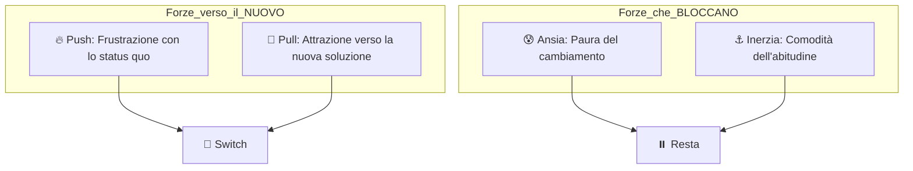
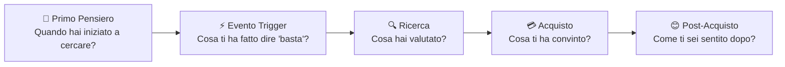

# Il Framework Jobs to Be Done (JTBD)

> **Obiettivo:** Capire *perché* i clienti scelgono un prodotto e come tradurre queste motivazioni in eventi tracciabili per costruire analytics significativi.

## 1. Il Concetto Fondamentale

Il framework JTBD, sviluppato da **Clayton Christensen** alla Harvard Business School, ribalta la prospettiva tradizionale del marketing:

> **Le persone non comprano prodotti; li "assumono" per svolgere un lavoro specifico nella loro vita.**

Quando un utente acquista un trapano, non vuole un trapano. Vuole un buco nel muro. O meglio: vuole appendere quel quadro per sentirsi finalmente "a casa".

### Perché è fondamentale per la Data Collection

La differenza tra **tracciare tutto** e **tracciare ciò che conta** sta proprio qui. Il JTBD ci dice *quali* eventi misurare:

```javascript
// ❌ Tracciamento generico - troppo rumore
analytics.track('button_clicked', { button_id: 'btn-123' });

// ✅ Tracciamento JTBD - cattura l'intento
analytics.track('job_completed', {
  job: 'organize_workspace',
  trigger: 'first_project_created',
  outcome: 'success',
  time_to_complete_seconds: 45
});
```

## 2. La Leggenda del Milkshake

Per capire il JTBD in azione, il caso più celebre è quello del **milkshake di McDonald's**.

Una catena di fast food voleva vendere più milkshake. Provarono di tutto: nuovi gusti, prezzi bassi, pubblicità. **Risultato: zero.**

Christensen scoprì che il 40% dei milkshake veniva venduto alle **8:00 del mattino** a pendolari solitari.

| Domanda JTBD | Risposta |
|:---|:---|
| **Chi** lo compra? | Pendolari solitari in auto |
| **Quando?** | Mattina presto, prima del lavoro |
| **Quale "lavoro" fa?** | Sconfiggere la noia di 30 minuti in auto |
| **Quali alternative?** | Banana (finisce troppo presto), bagel (briciole), caffè (troppo caldo) |
| **Perché il milkshake vince?** | Dura 20 min, tiene impegnata una mano, sazia fino a pranzo |

### Traduzione in eventi tracciabili

```javascript
// Piano di tracking ispirato al JTBD
const jtbd_tracking_plan = {
  job: 'reduce_commute_boredom',
  functional_events: [
    'product_purchased',        // Ha comprato
    'consumption_duration',     // Quanto è durato
    'satisfaction_rating'       // Soddisfazione post-consumo
  ],
  emotional_events: [
    'mood_before_purchase',     // Come si sentiva prima
    'mood_after_consumption'    // Come si sente dopo
  ],
  context_events: [
    'time_of_day',              // Mattina/pomeriggio/sera
    'location_type',            // Drive-through vs in-store
    'is_alone'                  // Solo o in compagnia
  ]
};
```

## 3. I Tre Tipi di Job

Ogni decisione di acquisto coinvolge tre dimensioni:

| Tipo di Job | Definizione | Esempio (App di fitness) | Evento da tracciare |
|:---|:---|:---|:---|
| **Funzionale** | Il compito pratico da svolgere | Seguire un programma di allenamento | `workout_completed` |
| **Emotivo** | Come vuole sentirsi il cliente | Sentirsi in controllo della propria salute | `streak_milestone_reached` |
| **Sociale** | Come vuole essere percepito | Essere visto come persona atletica | `workout_shared_social` |

```python
# Modello dati per tracciare i 3 tipi di job
job_schema = {
    "event": "job_progress",
    "properties": {
        "job_type": "functional | emotional | social",
        "job_id": "string",           # es. "get_fit", "feel_confident"
        "progress_pct": "float",      # 0.0 - 1.0
        "satisfaction": "int",        # 1-10
        "context": {
            "time_of_day": "string",
            "device": "string",
            "session_number": "int"
        }
    }
}
```

## 4. Le 4 Forze del Cambiamento

Perché un cliente decide di lasciare il vecchio prodotto per il nuovo? Quattro forze in competizione:



### Tracciare le 4 Forze

```sql
-- Query: Analisi delle forze di switch per coorte
SELECT
    u.signup_cohort,
    -- PUSH: frustrazione col prodotto precedente
    AVG(CASE WHEN s.question = 'prev_product_frustration' 
        THEN s.score END) AS avg_push_score,
    -- PULL: attrattiva del nuovo prodotto
    AVG(CASE WHEN s.question = 'new_product_appeal' 
        THEN s.score END) AS avg_pull_score,
    -- ANXIETY: paura del cambiamento
    AVG(CASE WHEN s.question = 'switching_anxiety' 
        THEN s.score END) AS avg_anxiety_score,
    -- INERTIA: abitudine
    AVG(CASE WHEN s.question = 'habit_strength' 
        THEN s.score END) AS avg_inertia_score,
    -- Retention a 30 giorni
    COUNT(DISTINCT CASE WHEN a.last_active >= u.signup_date + INTERVAL 30 DAY 
        THEN u.user_id END) * 100.0 / COUNT(DISTINCT u.user_id) AS retention_d30
FROM users u
LEFT JOIN surveys s ON u.user_id = s.user_id
LEFT JOIN activity a ON u.user_id = a.user_id
GROUP BY u.signup_cohort
ORDER BY u.signup_cohort;
```

## 5. Bisogni Stabili, Soluzioni Dinamiche

I bisogni umani non cambiano. Cambia la tecnologia con cui li soddisfiamo:

| Bisogno Stabile | Soluzione 1900 | Soluzione 2000 | Soluzione 2026 |
|:---|:---|:---|:---|
| Comunicare a distanza | Lettera / Telegrafo | Email / SMS | WhatsApp / Videochiamate AI |
| Spostarsi rapidamente | Cavallo / Treno | Auto / Aereo | Ride sharing / Autonome |
| Conservare ricordi | Ritratto dipinto | Fotocamera | Cloud / Social / AI generativa |
| Imparare cose nuove | Biblioteca | DVD/e-learning | LLM / Corsi interattivi |

> **Principio chiave:** Se ti innamori del tuo prodotto (la soluzione), rischi di fallire. Se ti innamori del problema del cliente (il Job), sarai sempre innovativo.

## 6. Le Interviste JTBD: Le 3 Domande d'Oro

Per scoprire i veri "Jobs" dei clienti, servono interviste qualitative strutturate:

### Timeline dell'Intervista



### Le 3 Domande d'Oro

1. **Il Contesto:** "Cosa stava succedendo nella tua vita quando hai deciso che ti serviva questo prodotto?"
2. **Il Momento Zero:** "Qual è stato l'evento specifico che ti ha fatto dire 'Basta, mi serve una soluzione'?"
3. **L'Emozione:** "Come ti sei sentito subito dopo l'acquisto? E dopo una settimana?"

### Template di Analisi delle Interviste

```python
import pandas as pd

# Struttura per analizzare le interviste JTBD
interview_template = {
    "interviewee_id": "INT_001",
    "date": "2026-02-20",
    "product": "App di project management",
    
    # Timeline
    "first_thought": "3 mesi prima, quando i progetti iniziarono a sfuggire",
    "trigger_event": "Perso una deadline importante davanti al cliente",
    "alternatives_considered": ["Trello", "Notion", "Foglio Excel"],
    "purchase_moment": "Demo gratuita dopo aver visto un case study",
    "post_purchase_feeling": "Sollievo, sensazione di controllo",
    
    # I 3 Job
    "functional_job": "Tenere traccia di task e deadline",
    "emotional_job": "Sentirsi organizzato e professionale",
    "social_job": "Apparire affidabile davanti ai clienti",
    
    # Le 4 Forze
    "push": "Caos nei progetti, deadline mancate",
    "pull": "UI pulita, automazioni, integrazioni Slack",
    "anxiety": "Curva di apprendimento, migrazione dati",
    "inertia": "Il team era abituato a Excel"
}

# Aggregazione di 20+ interviste per trovare pattern
def analyze_interviews(interviews: list[dict]) -> pd.DataFrame:
    df = pd.DataFrame(interviews)
    
    # Cluster dei Job più frequenti
    jobs = df[['functional_job', 'emotional_job', 'social_job']]
    print("=== JOB PIÙ FREQUENTI ===")
    for col in jobs.columns:
        print(f"\n{col}:")
        print(df[col].value_counts().head(5))
    
    # Pattern nelle 4 forze
    print("\n=== FORZE DOMINANTI ===")
    forces = df[['push', 'pull', 'anxiety', 'inertia']]
    for col in forces.columns:
        print(f"\n{col} - Temi comuni:")
        print(df[col].value_counts().head(3))
    
    return df
```

## 7. Dal JTBD al Tracking Plan

Il valore reale del JTBD per la data collection è la capacità di creare un **tracking plan orientato ai risultati**, non alle azioni:

| Job Identificato | Evento Chiave | Proprietà | Metrica di Successo |
|:---|:---|:---|:---|
| Organizzare il lavoro | `project_created` | n_tasks, template_used | Tempo al primo task completato |
| Sentirsi produttivo | `daily_summary_viewed` | tasks_completed, streak | % utenti che tornano il giorno dopo |
| Collaborare col team | `member_invited` | role, channel | % inviti accettati entro 24h |
| Non perdere deadline | `reminder_set` | urgency, advance_hours | % deadline rispettate |

## 8. Esercizio Pratico

Prenditi un momento per riflettere sul tuo **caffè di stamattina**:

- **Job Funzionale:** Ti serviva caffeina per svegliarti?
- **Job Emotivo:** Era un piccolo premio per iniziare bene la giornata?
- **Job Sociale:** È stata una scusa per fare due chiacchiere con un collega?

> **Riflessione:** Se gestissi un bar e capissi che il "Job" dei tuoi clienti è quello *Sociale*, investiresti di più in tavolini accoglienti o nella qualità estrema dei chicchi? E soprattutto, *come lo misureresti*?

```python
# Esercizio: definisci il tracking plan per il tuo bar
my_bar_tracking = {
    "job_hypothesis": "Il caffè è una scusa per socializzare",
    "events_to_track": [
        {"event": "order_placed", "props": ["is_alone", "group_size", "time_of_day"]},
        {"event": "table_occupied", "props": ["duration_min", "n_people", "zone"]},
        {"event": "loyalty_card_used", "props": ["frequency", "avg_spend"]},
    ],
    "success_metric": "avg_visit_duration_minutes",
    "expected_outcome": "Clienti in gruppo restano 3x più a lungo"
}
```

## Riepilogo

| Concetto | Takeaway |
|:---|:---|
| **JTBD** | Le persone "assumono" prodotti per un lavoro specifico |
| **3 Tipi di Job** | Funzionale, Emotivo, Sociale |
| **4 Forze** | Push + Pull vs Ansia + Inerzia |
| **Per la Data Collection** | Traccia il *progresso verso il Job*, non solo i click |
| **Interviste** | 3 domande d'oro per scoprire i veri bisogni |

## Risorse

- **Libro:** *Competing Against Luck* — Clayton Christensen (2016)
- **Framework:** [JTBD.info](https://jtbd.info) — Risorse e template
- **Tool:** Miro JTBD Canvas per mappare visivamente i Job
