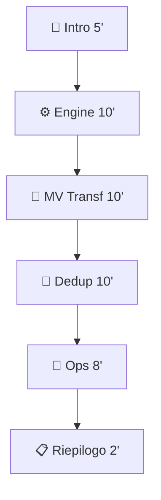

## Kafka + ClickHouse: Pipeline Real-Time per Marketing Analytics — Lezione Completa

Integrare Kafka e ClickHouse non è solo collegare un tubo a un secchio. È la spina dorsale delle moderne architetture di Marketing Analytics in tempo reale. Quando un utente clicca su un annuncio o visita il sito, quell'evento deve apparire nella dashboard del CMO in meno di 5 secondi. In questa lezione, costruiremo una pipeline robusta, fault-tolerant e scalabile capace di gestire milioni di eventi al secondo senza perdere un colpo.

### Obiettivi di Apprendimento

Al termine di questa lezione, lo studente sarà in grado di:
1.  Configurare il `Kafka Table Engine` in ClickHouse per consumare topic multi-partizione.
2.  Implementare Materialized Views (MV) per trasformare e filtrare i dati JSON grezzi in tempo reale.
3.  Gestire la deduplicazione degli eventi usando `ReplacingMergeTree` per garantire la semantica "Exactly-Once".
4.  Gestire gli errori di formato (es. JSON malformati) con tabelle di "Dead Letter Queue" virtuali.
5.  Monitorare il Consumer Lag per evitare che ClickHouse rimanga indietro rispetto a Kafka.

### Timeline della Lezione

| Fase | Argomento | Durata |
|------|-----------|--------|
| 1 | Introduzione: L'architettura Lambda vs Kappa | 5 min |
| 2 | Configurazione: Il Kafka Engine | 10 min |
| 3 | Trasformazione: Materialized Views JSON | 10 min |
| 4 | Strategia: Deduplicazione (Exactly-Once) | 10 min |
| 5 | Ops: Error Handling & Monitoring | 8 min |
| 6 | Riepilogo e Domande | 2 min |
| **Totale** | | **45 min** |



### Fase 1 — Introduzione: L'architettura Lambda vs Kappa (5 min)

Storicamente, le aziende usavano l'architettura **Lambda**:
*   *Speed Layer:* Streaming veloce ma impreciso (Storm/Spark).
*   *Batch Layer:* Lento ma preciso (Hadoop/Hive) che correggeva i dati la notte.
*   *Risultato:* Codice duplicato, complessità doppia.

Oggi usiamo l'architettura **Kappa**:
*   Tutto è uno stream. Kafka è la fonte della verità (Log).
*   ClickHouse consuma lo stream per l'analisi real-time E storica.
*   Se c'è un bug, non correggi il batch; fai "Replay" del topic Kafka.

ClickHouse funge da "Consumer" nativo, eliminando la necessità di scrivere consumer Java/Python personalizzati intermedi. Meno codice = meno bug.

### Fase 2 — Configurazione: Il Kafka Engine (10 min)

In ClickHouse, una "Tabella Kafka" non contiene dati. È un'interfaccia di lettura (un puntatore allo stream).

```sql
CREATE TABLE queue_marketing_events (
    timestamp DateTime,
    user_id UInt64,
    event_type String,
    metadata String  -- JSON grezzo
) ENGINE = Kafka()
SETTINGS
    kafka_broker_list = 'kafka1:9092,kafka2:9092',
    kafka_topic_list = 'marketing.events',
    kafka_group_name = 'ch_consumer_group',
    kafka_format = 'JSONEachRow',
    kafka_num_consumers = 4; -- 1 per partizione
```

**Best Practices:**
*   **kafka_group_name:** Deve essere univoco. Se usi lo stesso gruppo di un altro servizio, gli ruberai i messaggi!
*   **kafka_num_consumers:** Impostalo uguale al numero di partizioni del topic Kafka per il massimo parallelismo.
*   **kafka_skip_broken_messages:** Imposta a un valore basso (es. 10) per evitare che un singolo messaggio corrotto blocchi l'intera pipeline.

### Fase 3 — Trasformazione: Materialized Views JSON (10 min)

La tabella Kafka è volatile. Appena leggi, i dati spariscono. Dobbiamo persisterli in una tabella `MergeTree`. La Materialized View fa da ponte.

Spesso i dati arrivano come JSON complessi. ClickHouse può estrarre campi al volo.

**Tabella Destinazione (Fisica):**
```sql
CREATE TABLE marketing_events (
    timestamp DateTime,
    user_id UInt64,
    event_type LowCardinality(String),
    campaign_id UInt32,
    revenue Float64
) ENGINE = MergeTree()
PARTITION BY toYYYYMM(timestamp)
ORDER BY (event_type, timestamp);
```

**Materialized View (Ponte):**
```sql
CREATE MATERIALIZED VIEW mv_marketing_events TO marketing_events
AS SELECT
    toDateTime(JSONExtractString(metadata, 'ts')) as timestamp,
    user_id,
    event_type,
    JSONExtractUInt(metadata, 'campaign_id') as campaign_id,
    JSONExtractFloat(metadata, 'value') as revenue
FROM queue_marketing_events;
```
Questa MV parsa il JSON `metadata`, estrae i campi, converte i tipi e scrive nella tabella finale. Tutto in microsecondi.

### Fase 4 — Strategia: Deduplicazione (Exactly-Once) (10 min)

Kafka garantisce "At-Least-Once". Se la rete cade, potrebbe inviare lo stesso evento due volte. Nel marketing, contare due volte una vendita da 100€ è un disastro.

Come otteniamo "Exactly-Once"?
1.  **Inserimento Idempotente:** Usiamo un `event_id` univoco (UUID) generato alla fonte.
2.  **ReplacingMergeTree:** Un motore speciale di ClickHouse che rimuove i duplicati in background.

```sql
CREATE TABLE distinct_orders (
    order_id String,
    timestamp DateTime,
    amount Float64
) ENGINE = ReplacingMergeTree(timestamp) -- Tiene la versione più recente
ORDER BY order_id; -- La chiave di deduplicazione
```

*Nota:* La deduplicazione avviene in modo asincrono (durante il merge). Se fai `SELECT count()` potresti vedere ancora duplicati recenti.
Per il conteggio esatto in query time:
`SELECT count() FROM distinct_orders FINAL` (più lento) o `SELECT count(DISTINCT order_id)`.

### Fase 5 — Ops: Error Handling & Monitoring (8 min)

Cosa succede se il formato JSON cambia e la pipeline si rompe?

**1. Dead Letter Queue (DLQ)**
ClickHouse salva i messaggi corrotti in tabelle di sistema virtuali se abilitato.
*   Monitora la tabella `system.errors`.
*   Imposta `kafka_handle_error_mode='stream'`. I messaggi errati vengono deviati su una tabella separata `_error` invece di bloccare tutto.

**2. Monitoring del Lag**
Se Kafka riceve 10.000 msg/sec e ClickHouse ne processa 8.000, il "Lag" cresce. Prima o poi i dati saranno vecchi di ore.
*   Usa Grafana per monitorare la metrica `Kafka Consumer Lag`.
*   Se il Lag cresce, aumenta `kafka_num_consumers` o ottimizza la MV (meno calcoli pesanti).

### Fase 6 — Riepilogo e Domande (2 min)

1.  **Disaccoppiamento.** Kafka bufferizza i picchi di traffico, proteggendo ClickHouse.
2.  **Logica nella MV.** Usa la MV per pulire, filtrare e trasformare i dati prima di scriverli su disco.
3.  **Deduplicazione.** Usa `ReplacingMergeTree` e chiavi univoche.
4.  **Monitoraggio.** Il Lag è il nemico silenzioso.

### Domande di Verifica

1.  Cosa succede ai dati letti dalla tabella `ENGINE = Kafka` se non c'è nessuna Materialized View collegata? (Spoiler: Vengono letti e scartati nel nulla).
2.  Perché è importante che `kafka_group_name` sia univoco per l'ambiente ClickHouse?
3.  Qual è la differenza tra "At-Least-Once" e "Exactly-Once" e come ClickHouse gestisce la seconda?
4.  Come si usa la funzione `JSONExtract` all'interno di una Materialized View per gestire schemi flessibili?
5.  Cosa indica un aumento costante del "Consumer Lag" e quali sono le due azioni principali per risolverlo?

### Riferimenti Bibliografici

-   ClickHouse Kafka Engine Documentation.
-   Confluent Blog (Kafka and ClickHouse integration patterns).
-   Altinity (ClickHouse Kafka Best Practices).
