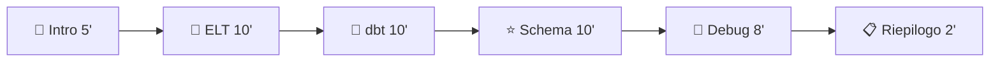

## Marketing Data Pipeline: Costruire l'Autostrada dei Dati — Lezione Completa

Excel ha un limite: 1.048.576 righe. E un limite ancora più grande: la pazienza umana. Scaricare CSV da Facebook Ads, Google Ads e Stripe ogni mattina, pulirli a mano e incollarli su un foglio non è analisi, è data entry. In questa lezione, impareremo a costruire una **Marketing Data Pipeline** moderna (MDS - Modern Data Stack) che automatizza il flusso dai dati grezzi alla dashboard, permettendo al team di concentrarsi sugli insight, non sull'ETL.

### Obiettivi di Apprendimento

Al termine di questa lezione, lo studente sarà in grado di:
1.  Progettare un'architettura ELT (Extract, Load, Transform) moderna vs ETL classica.
2.  Configurare connettori automatici (Fivetran/Airbyte) per estrarre dati da API pubblicitarie.
3.  Utilizzare **dbt (data build tool)** per trasformare i dati grezzi in modelli analitici puliti.
4.  Gestire la qualità dei dati con test automatici (es. "verifica che il ROAS non sia negativo").
5.  Orchestrare l'aggiornamento giornaliero dei dati per garantire la freschezza delle dashboard.

### Timeline della Lezione

| Fase | Argomento | Durata |
|------|-----------|--------|
| 1 | Introduzione: The Modern Data Stack | 5 min |
| 2 | Extract & Load: Fivetran e Airbyte | 10 min |
| 3 | Transform: La rivoluzione di dbt | 10 min |
| 4 | Architettura: Star Schema per il Marketing | 10 min |
| 5 | Esercizi: Debugging di una Pipeline | 8 min |
| 6 | Riepilogo e Domande | 2 min |
| **Totale** | | **45 min** |



### Fase 1 — Introduzione: The Modern Data Stack (5 min)

Fino al 2015, costruire un data warehouse richiedeva un team di ingegneri e mesi di lavoro. Oggi, grazie al Cloud, puoi farlo in un pomeriggio con la carta di credito.

Il **Modern Data Stack** si basa su 3 pilastri:
1.  **Warehouse Cloud:** (Snowflake, BigQuery, ClickHouse). Scalabilità infinita, paghi solo quello che usi.
2.  **Pipeline Ingestione:** (Fivetran, Airbyte). "Idraulica" gestita. Non scrivi più script Python per le API di Facebook che cambiano ogni mese.
3.  **Trasformazione:** (dbt). Usi SQL (non Java/Scala) per modellare i dati.

### Fase 2 — Extract & Load: Fivetran e Airbyte (10 min)

La prima fase è portare i dati "Raw" (grezzi) nel Warehouse.
Non pulirli! Scaricali così come sono. (Approccio ELT: Extract -> Load -> Transform).

**Strumenti:**
*   **Fivetran:** Il leader. Colleghi Google Ads, metti le credenziali, e lui scarica tutto ogni 6 ore.
    *   *Pro:* Zero manutenzione. Schema migration automatico (se FB aggiunge una colonna, Fivetran la aggiunge).
    *   *Contro:* Costoso (paghi a righe).
*   **Airbyte:** L'alternativa Open Source.
    *   *Pro:* Puoi hostarlo tu (gratis, paghi solo server). Estensibile.
    *   *Contro:* Richiede gestione DevOps.

**Risultato:**
Nel tuo DB avrai tabelle grezze come `facebook_ads.insights`, `shopify.orders`, `google_analytics.sessions`. Sono brutte, piene di JSON e nomi strani. Va bene così.

### Fase 3 — Transform: La rivoluzione di dbt (10 min)

Ora dobbiamo pulire il caos. **dbt (data build tool)** è lo standard.
Permette agli analisti che conoscono SQL di fare il lavoro degli ingegneri.

**Il Workflow dbt:**
1.  Scrivi una query `SELECT` che pulisce i dati (es. `roas_model.sql`).
2.  dbt la esegue nel Warehouse e crea una tabella (o vista) pulita.
3.  Puoi citare altri modelli: `FROM {{ ref('stg_facebook_ads') }}`. Crea un grafo di dipendenze (Lineage).

*Esempio:*
```sql
-- models/marts/marketing_report.sql
WITH fb AS (SELECT date, spend, clicks FROM {{ ref('stg_facebook') }}),
     gg AS (SELECT date, spend, clicks FROM {{ ref('stg_google') }})

SELECT 'Facebook' as channel, * FROM fb
UNION ALL
SELECT 'Google' as channel, * FROM gg
```
Questo crea una tabella unificata pronta per la dashboard.

### Fase 4 — Architettura: Star Schema per il Marketing (10 min)

Come organizziamo le tabelle finali? Il modello **Star Schema** (Kimball) è ancora il migliore per la BI.

1.  **Fact Table (Fatti):** Eventi che sono accaduti. Numerici.
    *   `fact_orders`: id_ordine, data, importo, id_cliente.
    *   `fact_ad_spend`: data, id_campagna, costo, impression.
2.  **Dimension Table (Dimensioni):** Il contesto (Chi, Cosa, Dove). Testuali.
    *   `dim_customers`: id_cliente, email, città, data_iscrizione.
    *   `dim_campaigns`: id_campagna, nome, piattaforma, budget.

La BI farà: `SELECT sum(amount) FROM fact_orders JOIN dim_customers ON ... WHERE dim_customers.city = 'Milano'`. Veloce e intuitivo.

```mermaid
erDiagram
    FACT_SPEND ||--|{ DIM_CAMPAIGN : belongs_to
    FACT_SPEND ||--|{ DIM_DATE : happened_on
    FACT_SPEND {
        date_id FK
        campaign_id FK
        amount float
        impressions int
    }
    DIM_CAMPAIGN {
        campaign_id PK
        campaign_name string
        channel string
    }
```

### Fase 5 — Esercizi: Debugging di una Pipeline (8 min)

**Scenario:** La dashboard segna "Spesa Facebook: 0€" per ieri. Il CEO è preoccupato.

**Checklist di Debugging:**
1.  **Source:** Entra in Business Manager. I dati ci sono? (Sì).
2.  **Ingestion (Fivetran/Airbyte):** Controlla i log. L'ultimo sync è avvenuto?
    *   *Errore trovato:* "Token Scaduto". (Qualcuno ha cambiato la password di Facebook).
    *   *Fix:* Riconnetti l'account.
3.  **Warehouse:** Fai una `SELECT * FROM raw_facebook WHERE date = yesterday`. Se è vuota, il problema è l'ingestion. Se è piena, il problema è dbt.
4.  **Transformation (dbt):** Esegui `dbt run`. Se fallisce, leggi l'errore SQL.

**Data Quality Test:**
In dbt puoi aggiungere test automatici nel file YAML:
```yaml
- name: spend
  tests:
    - not_null
    - dbt_expectations.expect_column_values_to_be_between:
        min_value: 0 # Impossibile spendere negativo
```
Se il test fallisce, dbt ti manda una mail *prima* che il CEO apra la dashboard.

### Fase 6 — Riepilogo e Domande (2 min)

1.  **ELT > ETL.** Prima carica, poi trasforma. È più flessibile.
2.  **SQL è Re.** Con dbt, SQL diventa un linguaggio di programmazione completo.
3.  **Testa tutto.** I dati "marciscono" silenziosamente. Metti dei sensori.
4.  **Modulare.** Non fare query di 1000 righe. Spezzale in modelli piccoli e riutilizzabili.

### Domande di Verifica

1.  Qual è la differenza principale tra ETL (Extract-Transform-Load) e ELT (Extract-Load-Transform) e perché ELT è preferito nel cloud?
2.  A cosa serve lo strumento "dbt" in una Modern Data Stack?
3.  Spiega la differenza tra una "Fact Table" e una "Dimension Table".
4.  Cosa succede se Fivetran scarica una nuova colonna che non era prevista nello schema originale della tabella?
5.  Perché è importante avere test automatici sulla qualità dei dati (Data Quality Tests) nella pipeline?

### Riferimenti Bibliografici

-   Tristan Handy, "The Analytics Engineering Guide", dbt Labs.
-   Ralph Kimball, "The Data Warehouse Toolkit", Wiley, 2013 (Un classico).
-   Fivetran Blog (Modern Data Stack best practices).
