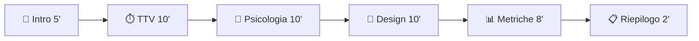
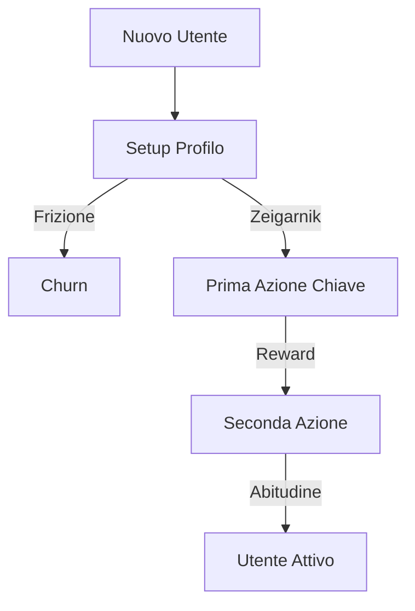

## Onboarding e Attivazione — Lezione Completa

Il momento più critico nella vita di un utente è la prima sessione. Se in quei primi 5 minuti non capisce il valore del prodotto, la probabilità che torni crolla verticalmente. L'Onboarding non è un tutorial noioso che spiega i pulsanti; è un'esperienza progettata per portare l'utente al successo nel minor tempo possibile.

### Obiettivi di Apprendimento

Al termine di questa lezione, lo studente sarà in grado di:
1.  Definire la metrica di "Attivazione" specifica per il proprio prodotto.
2.  Progettare un flusso di onboarding che riduce il Time-to-Value (TTV).
3.  Applicare principi psicologici come l'Effetto Zeigarnik per aumentare il tasso di completamento.
4.  Identificare i 3 tipi di onboarding: Benefit-oriented, Function-oriented, Doing-oriented.
5.  Analizzare il funnel di attivazione per trovare i punti di frizione.

### Timeline della Lezione

| Fase | Argomento | Durata |
|------|-----------|--------|
| 1 | Introduzione: Attivazione vs Iscrizione | 5 min |
| 2 | Strategia: Time-to-Value e Frizione | 10 min |
| 3 | Psicologia: Effetto Zeigarnik e Gamification | 10 min |
| 4 | Design: I 3 Modelli di Onboarding | 10 min |
| 5 | Analisi: Misurare il Successo | 8 min |
| 6 | Riepilogo e Domande | 2 min |
| **Totale** | | **45 min** |

### Fase 1 — Introduzione: Attivazione vs Iscrizione (5 min)

Molte aziende festeggiano il numero di iscritti ("Vanity Metric"). Ma un utente iscritto che non usa il prodotto è un costo, non un asset.
L'**Attivazione** è il momento in cui l'utente esegue l'azione chiave che genera valore *per lui*.

*   *SaaS B2B (es. Slack):* Non è l'iscrizione. È quando invii il primo messaggio al team.
*   *E-commerce:* Non è la visita. È il primo acquisto (o l'aggiunta al carrello).
*   *Social:* Non è il login. È seguire 5 persone o postare la prima foto.

Se l'utente non si attiva entro la prima settimana (spesso entro il primo giorno), è perso per sempre (Churn immediato).

### Fase 2 — Strategia: Time-to-Value e Frizione (10 min)

Il nemico numero uno dell'attivazione è la **Frizione**. Ogni campo da compilare, ogni email di conferma da cliccare, ogni tutorial da leggere è un ostacolo.

**Time-to-Value (TTV)**
È il tempo che passa dall'iscrizione al momento in cui l'utente esclama "Wow, questo mi è utile!".
*   *Obiettivo:* Ridurre il TTV a zero.
*   *Esempio:* Duolingo ti fa fare una lezione di lingua *prima* di chiederti di registrarti. Ti dà valore subito (TTV negativo).

**Frizione Positiva vs Negativa**
*   **Negativa:** Chiedere la carta di credito prima di mostrare il prodotto. (Blocca l'utente).
*   **Positiva:** Chiedere "Qual è il tuo obiettivo? Perdere peso o mettere massa?" (Personalizza l'esperienza e aumenta l'impegno).

### Fase 3 — Psicologia: Effetto Zeigarnik e Gamification (10 min)

Perché le checklist funzionano così bene?
L'**Effetto Zeigarnik** afferma che le persone ricordano i compiti incompleti o interrotti meglio di quelli completati. Il cervello umano ha un bisogno innato di "chiudere il cerchio".

**Applicazione nell'Onboarding:**
*   Mostra una barra di progresso: "Sei al 20% del completamento del profilo".
*   Usa una Checklist:
    *   [x] Crea account
    *   [ ] Carica foto profilo
    *   [ ] Invia primo messaggio
*   *Trick:* Inizia con il primo punto già spuntato ("Crea account"). Questo dà una sensazione di progresso immediato (Endowed Progress Effect).

**Gamification:**
*   Badge, livelli, premi virtuali per le prime azioni.
*   Attenzione: La gamification non salva un prodotto inutile. È la ciliegina sulla torta, non la torta.

### Fase 4 — Design: I 3 Modelli di Onboarding (10 min)

Non esiste un onboarding universale. Scegli il modello giusto per il tuo prodotto.

1.  **Benefit-Oriented (Orientato ai Benefici):**
    *   *Cosa:* Spiega "Perché" usare il prodotto.
    *   *Quando:* Prodotti complessi o innovativi che richiedono un cambio di mentalità.
    *   *Esempio:* Slide iniziali: "Risparmia tempo", "Collabora meglio".

2.  **Function-Oriented (Orientato alle Funzioni):**
    *   *Cosa:* Spiega "Come" usare il prodotto (i bottoni).
    *   *Quando:* Interfacce non standard o complesse (es. Photoshop).
    *   *Rischio:* Noioso. L'utente vuole fare, non studiare.

3.  **Doing-Oriented (Imparare Facendo):**
    *   *Cosa:* Guida l'utente a completare il primo task reale.
    *   *Quando:* La maggior parte delle app moderne.
    *   *Esempio:* Trello ti fa creare la tua prima scheda trascinandola. "Sposta questa scheda qui".

### Fase 5 — Analisi: Misurare il Successo (8 min)

Come sai se il tuo onboarding funziona?

**Metriche Chiave:**
1.  **Tasso di completamento del Setup:** % utenti che finiscono il tutorial.
2.  **Activation Rate:** % utenti che raggiungono l'Aha Moment.
3.  **Drop-off per Step:** Dove si bloccano?
    *   Step 1 (Email): 100%
    *   Step 2 (Foto): 80%
    *   Step 3 (Invita Amici): 20% -> *Qui c'è il problema!*

**Analisi di Coorte:**
Confronta l'attivazione degli utenti di Gennaio con quelli di Febbraio dopo aver cambiato l'onboarding. Se è salita dal 20% al 25%, hai vinto.

### Fase 6 — Riepilogo e Domande (2 min)

1.  **Value First.** Dai valore prima di chiedere impegno.
2.  **Togli tutto.** Se un campo non è vitale, eliminalo.
3.  **Personalizza.** Chiedi chi sono per mostrare ciò che serve a loro.
4.  **Misura.** Guarda dove cadono nel funnel.

### Domande di Verifica

1.  Cos'è il "Time-to-Value" e perché è critico ridurlo al minimo?
2.  Spiega l'Effetto Zeigarnik e come può essere usato per aumentare il completamento del profilo.
3.  Qual è la differenza tra un onboarding "Benefit-Oriented" e uno "Doing-Oriented"?
4.  Perché chiedere la carta di credito subito può essere considerato "Frizione Negativa", mentre chiedere gli interessi dell'utente è "Frizione Positiva"?
5.  In un'analisi del funnel di onboarding, come identifichi il collo di bottiglia principale?

### Riferimenti Bibliografici

-   Samuel Hulick, "User Onboarding: The Ultimate Guide for SaaS Founders", UserOnboard.com.
-   Ramli John, "Product-Led Onboarding: How to Turn New Users Into Lifelong Customers", ProductLed, 2021.
-   Pulkit Agrawal, "Retention Hacking", 2016.
