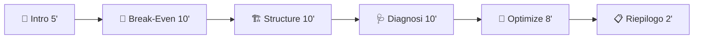
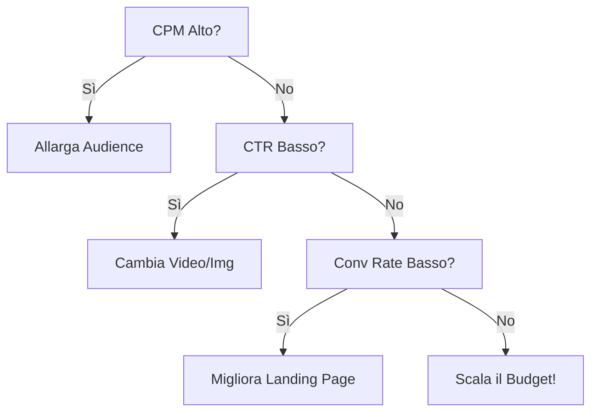

## Performance Marketing: Data Science per l'Acquisizione — Lezione Completa

Il Performance Marketing non è "spendere soldi su Facebook". È una disciplina finanziaria. Ogni euro investito deve generare un ritorno misurabile (ROAS). Ma tra algoritmi black-box, tracciamento rotto e creatività che saturano in 3 giorni, gestire il budget è diventato un lavoro da Data Scientist. In questa lezione, impareremo a gestire le campagne come un portafoglio di investimenti ad alto rischio e alto rendimento.

### Obiettivi di Apprendimento

Al termine di questa lezione, lo studente sarà in grado di:
1.  Calcolare il **Break-Even ROAS** per ogni prodotto per non perdere soldi.
2.  Strutturare un account pubblicitario (Google/Meta) seguendo il principio della "Liquidity" (consolidamento).
3.  Analizzare le metriche secondarie (CPM, CTR, CPC) per diagnosticare *perché* una campagna non converte.
4.  Implementare una strategia di **Creative Testing** scientifica (3x3 Matrix).
5.  Gestire il budget con regole di scaling automatiche (o manuali disciplinate).

### Timeline della Lezione

| Fase | Argomento | Durata |
|------|-----------|--------|
| 1 | Introduzione: La fine del "Media Buying" manuale | 5 min |
| 2 | Matematica: Margin Analysis e Break-Even | 10 min |
| 3 | Strategia: Account Structure Moderno | 10 min |
| 4 | Diagnostica: Il Funnel delle Metriche | 10 min |
| 5 | Esercizi: Ottimizzazione di una Campagna | 8 min |
| 6 | Riepilogo e Domande | 2 min |
| **Totale** | | **45 min** |

### Fase 1 — Introduzione: La fine del "Media Buying" manuale (5 min)

Una volta il media buyer sceglieva tutto: "Mostra questo banner su Repubblica.it dalle 14 alle 16".
Oggi l'algoritmo (Meta Advantage+, Google PMax) sceglie *chi*, *dove* e *quando*.
Il lavoro umano si è spostato su tre leve:
1.  **Creatività:** Il video/immagine è il nuovo target.
2.  **Dati:** Feed prodotti, Conversion API, Segnali 1st party.
3.  **Strategia:** Offerta, Prezzo, Landing Page.

### Fase 2 — Matematica: Margin Analysis e Break-Even (10 min)

Prima di spendere 1€, devi sapere quanto puoi permetterti di pagare un cliente (CPA Target).

**Calcolo del Break-Even ROAS:**
*   Prezzo Prodotto: 100€
*   COGS (Costo prodotto + Spedizione): 40€
*   Margine Lordo: 60€ (60%).
*   **Break-Even ROAS = 1 / Margine %**
    *   1 / 0.60 = **1.66**

Se la tua campagna ha ROAS 1.5, stai perdendo soldi su ogni vendita. Se ha ROAS 2.0, sei in profitto.
*Attenzione:* Questo è il ROAS sul primo acquisto. Se consideri il LTV, puoi permetterti un ROAS più basso.

### Fase 3 — Strategia: Account Structure Moderno (10 min)

L'errore classico: "Iper-segmentazione". 100 campagne, 500 adset, audience di 10.000 persone.
Gli algoritmi moderni hanno bisogno di dati. Se frammenti il budget, l'algoritmo non esce mai dalla "Learning Phase".

**La Struttura "Hagakure" (Consolidata):**
1.  **Campagna Prospecting (Broad):** Target ampio. Lascia che l'algoritmo trovi i clienti. Escludi chi ha già comprato.
2.  **Campagna Retargeting (Dinamico):** Catalogo prodotti per chi ha visto ma non comprato. (Spesso integrata nella Prospecting oggi).
3.  **Campagna Retention:** Per i clienti esistenti (es. lancio nuova collezione).

Meno campagne = Più dati per campagna = Algoritmo più intelligente.

### Fase 4 — Diagnostica: Il Funnel delle Metriche (10 min)

La campagna non converte. Perché? Non guardare solo il ROAS. Guarda il funnel.

1.  **CPM (Costo per 1000 impression):** È alto? C'è molta competizione o l'audience è troppo piccola.
2.  **CTR (Click-Through Rate):** È basso (< 1%)? La creatività non attira l'attenzione o il messaggio è sbagliato ("Hook" debole).
3.  **CPC (Costo per Click):** CPM / CTR. Se il CPM è alto o il CTR è basso, il traffico ti costa caro.
4.  **CR (Conversion Rate):** È basso (< 2%)? La Landing Page non convince. O il prezzo è fuori mercato. O l'annuncio prometteva cose che la pagina non mantiene (Discrepanza).

### Fase 5 — Esercizi: Ottimizzazione di una Campagna (8 min)

**Scenario:** E-commerce di occhiali.
*   Campagna A: ROAS 4.0, Spesa 50€/giorno.
*   Campagna B: ROAS 2.5, Spesa 500€/giorno.
*   Target ROAS: 2.0.

**Domanda:** Cosa fai?
1.  Spegni B? No, è sopra target e porta volume.
2.  Aumenti A? Sì, ma con cautela. Spesso le campagne ad alto ROAS hanno poco volume (stanno prendendo solo i frutti bassi). Se scalate, il ROAS scende.
3.  **Azione:** Scala A del 20% ogni 2-3 giorni finché il ROAS tiene. Cerca di migliorare la creatività di B per alzare il ROAS a 3.0.

### Fase 6 — Riepilogo e Domande (2 min)

1.  **Finanza.** Il marketing è investire soldi per comprare fatturato.
2.  **Consolida.** Non frammentare l'account.
3.  **Diagnostica.** Usa le metriche secondarie (CTR, CR) per capire il "perché".
4.  **Creatività.** È l'unica leva che ti è rimasta per battere l'algoritmo.

### Domande di Verifica

1.  Come si calcola il "Break-Even ROAS" sapendo il margine lordo del prodotto?
2.  Perché la "Learning Phase" è critica per gli algoritmi di Meta/Google e come si evita di resettarla?
3.  Qual è la relazione matematica tra CPM, CTR e CPC?
4.  In una struttura di account moderna, perché si tende ad avere audience "Broad" (ampie) invece di iper-targettizzate?
5.  Se il CTR è alto ma il Conversion Rate è basso, dove risiede probabilmente il problema?

### Riferimenti Bibliografici

-   Andrew Chen, "The Law of Shitty Clickthroughs".
-   Meta Blueprint, "Performance Marketing Certification".
-   Byron Sharp, "How Brands Grow" (capitolo sulla Mental Availability applicata al digital).
