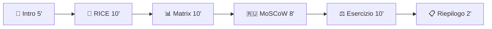
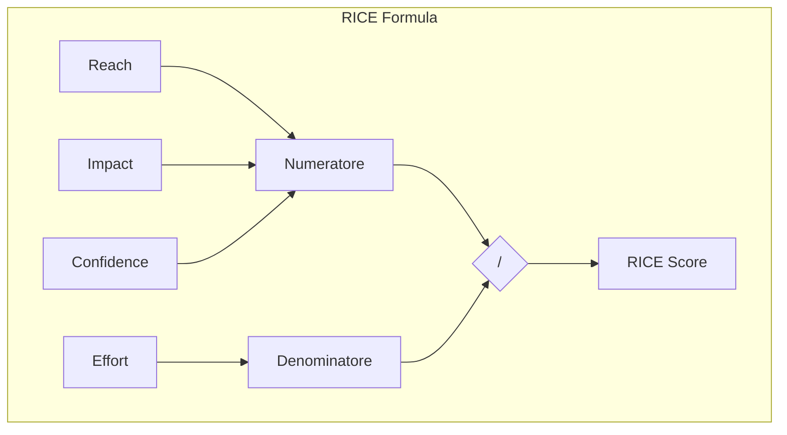

## Prioritizzazione delle Feature — Lezione Completa

Una roadmap di prodotto è essenzialmente una lista di cose che *non* faremo. Ogni "sì" a una feature è un "no" implicito a tutte le altre. La risorsa più scarsa in un'azienda tecnologica non sono i soldi, ma il tempo degli sviluppatori. In questa lezione, impareremo a usare framework matematici e strategici per decidere cosa costruire prima, massimizzando l'impatto con il minimo sforzo.

### Obiettivi di Apprendimento

Al termine di questa lezione, lo studente sarà in grado di:
1.  Applicare il framework RICE per calcolare un punteggio di priorità oggettivo.
2.  Utilizzare la matrice Impatto/Sforzo per identificare i "Quick Wins".
3.  Distinguere tra requisiti Must-Have e Nice-to-Have con il metodo MoSCoW.
4.  Gestire gli stakeholder quando le loro richieste vengono deprioritizzate.
5.  Evitare la trappola della "Feature Factory" (costruire cose che nessuno usa).

### Timeline della Lezione

| Fase | Argomento | Durata |
|------|-----------|--------|
| 1 | Introduzione: L'arte di dire No | 5 min |
| 2 | Framework Quantitativo: RICE Score | 10 min |
| 3 | Framework Strategico: Matrice Impatto/Sforzo | 10 min |
| 4 | Framework di Requisiti: MoSCoW | 8 min |
| 5 | Esercizi: Prioritizzare un Backlog | 10 min |
| 6 | Riepilogo e Domande | 2 min |
| **Totale** | | **45 min** |

### Fase 1 — Introduzione: L'arte di dire No (5 min)

Immagina di essere il Product Manager di Spotify.
*   Il CEO vuole i podcast video.
*   Il team Sales vuole una feature per le aziende.
*   Gli utenti vogliono i testi delle canzoni in tempo reale.
*   Gli ingegneri vogliono rifattorizzare il codice del player.

Se dici di sì a tutti, fallisci. Se dici di no a caso, ti licenziano. Devi dire di no *con i dati*.

La prioritizzazione serve a rimuovere l'opinione personale (e la politica) dal processo decisionale. Non vince chi urla più forte, vince chi dimostra il ROI (Return on Investment) migliore.

### Fase 2 — Framework Quantitativo: RICE Score (10 min)

Sviluppato da Intercom, il RICE è il gold standard per confrontare idee diverse in modo omogeneo.

La formula è:
**(Reach × Impact × Confidence) / Effort = RICE Score**

1.  **Reach (R):** Quante persone impatterà in un trimestre?
    *   *Esempio:* 1.000 utenti / mese × 3 mesi = 3.000.
2.  **Impact (I):** Quanto impatterà *ogni singola persona* sull'obiettivo (es. conversione)?
    *   3 = Massiccio (cambia la vita)
    *   2 = Alto
    *   1 = Medio
    *   0.5 = Basso
    *   0.25 = Minimo
3.  **Confidence (C):** Quanto siamo sicuri delle nostre stime su Reach e Impact? (Percentuale).
    *   100% = Ho dati storici / User research solida.
    *   80% = Ho qualche dato / Parere esperto.
    *   50% = "Ci spero" / Stima a naso.
    *   *Sotto il 50%, non dovresti nemmeno considerarlo.*
4.  **Effort (E):** Quanto costa costruirlo? (In "Persone-Mese").
    *   *Esempio:* 1 sviluppatore per 2 settimane = 0.5.

**Esempio di Calcolo:**
*   *Idea A:* Reach 500, Impact 2, Conf 80%, Effort 2.
    *   (500 × 2 × 0.8) / 2 = **400**
*   *Idea B:* Reach 2000, Impact 0.5, Conf 100%, Effort 1.
    *   (2000 × 0.5 × 1) / 1 = **1000**

*Vincitore:* Idea B. Anche se l'impatto per persona è basso, raggiunge molta più gente con metà dello sforzo.

### Fase 3 — Framework Strategico: Matrice Impatto/Sforzo (10 min)

A volte non hai dati precisi per il RICE. La matrice 2x2 è ottima per workshop rapidi con il team.

Disegna un asse cartesiano:
*   Asse X: **Sforzo** (Basso → Alto)
*   Asse Y: **Impatto** (Basso → Alto)

Si creano 4 quadranti:

1.  **Alto Impatto / Basso Sforzo (Quick Wins):**
    *   *Azione:* FALLE SUBITO! Sono oro.
    *   *Esempio:* Cambiare il testo di una CTA che non converte.

2.  **Alto Impatto / Alto Sforzo (Big Bets / Progetti Strategici):**
    *   *Azione:* Pianificale. Richiedono risorse e tempo, ma trasformano l'azienda.
    *   *Esempio:* Rifare l'app mobile da zero.

3.  **Basso Impatto / Basso Sforzo (Fill-ins):**
    *   *Azione:* Falle nei ritagli di tempo o come task per i junior. Non sono prioritarie.
    *   *Esempio:* Aggiungere un'icona carina nel footer.

4.  **Basso Impatto / Alto Sforzo (Time Sinks / Money Pit):**
    *   *Azione:* EVITALE COME LA PESTE. Cancellale dal backlog.
    *   *Esempio:* Supportare Internet Explorer 6 nel 2025.

### Fase 4 — Framework di Requisiti: MoSCoW (8 min)

Quando definisci l'ambito (scope) di una release o di un MVP (Minimum Viable Product), usa MoSCoW per negoziare cosa entra e cosa esce.

*   **M - Must Have:** Non negoziabili. Senza questi, il prodotto non ha senso (es. "Login" in un'app bancaria). Se non si fanno, si cancella il rilascio.
*   **S - Should Have:** Importanti, ma non vitali. Se mancano, è doloroso ma l'app funziona (es. "Reset Password automatico" - potresti farlo manuale via email all'inizio).
*   **C - Could Have:** Desiderabili ("Nice to have"). Solo se avanza tempo e budget (es. "Dark Mode").
*   **W - Won't Have:** Esplicitamente esclusi *per ora*. Saranno riconsiderati in futuro (es. "Versione iPad").

*Regola pratica:* I "Must Have" non devono mai superare il 60% dello sforzo totale disponibile, per lasciare margine agli imprevisti.

### Fase 5 — Esercizi: Prioritizzare un Backlog (10 min)

**Scenario:** Sei PM di un'app di food delivery. Hai risorse per 4 settimane-uomo (1 mese di 1 dev).
Devi scegliere tra queste feature:

1.  **Integrazione Apple Pay**
    *   Reach: Alto (tutti hanno iPhone)
    *   Impact: Medio (velocizza il checkout)
    *   Effort: 1 settimana
2.  **Recensioni Video dei piatti**
    *   Reach: Basso (pochi le guardano)
    *   Impact: Alto (chi guarda compra)
    *   Effort: 3 settimane
3.  **Chatbot per supporto clienti**
    *   Reach: Medio
    *   Impact: Basso (risolve solo problemi semplici)
    *   Effort: 4 settimane

*Esercizio:*
*   Calcola un punteggio RICE approssimativo (o usa la matrice Impatto/Sforzo).
*   Quale feature scegli?
*   Qual è un "Money Pit" qui? (Probabilmente il Chatbot: alto sforzo, basso impatto reale se non fatto benissimo).

### Fase 6 — Riepilogo e Domande (2 min)

1.  **RICE** per decisioni oggettive e documentate.
2.  **Matrice 2x2** per decisioni rapide in gruppo.
3.  **MoSCoW** per definire cosa entra nella release.
4.  **Confidence.** Se non sei sicuro, abbassa il punteggio. Non mentire a te stesso.

### Domande di Verifica

1.  In un calcolo RICE, perché il fattore "Confidence" è cruciale?
2.  Qual è la differenza tra una feature "Must Have" e una "Should Have" secondo il metodo MoSCoW?
3.  Dove posizioneresti una feature che richiede 6 mesi di lavoro e porta un incremento di fatturato dello 0,1% nella Matrice Impatto/Sforzo?
4.  Come gestiresti uno stakeholder (es. il CEO) che insiste per una feature con RICE score basso?
5.  Perché i "Quick Wins" dovrebbero essere affrontati prima delle "Big Bets"?

### Riferimenti Bibliografici

-   Sean McBride, "RICE: Simple prioritization for product managers", Intercom Blog.
-   Dan Olsen, "The Lean Product Playbook", Wiley, 2015.
-   Melissa Perri, "Escaping the Build Trap", O'Reilly Media, 2018.
