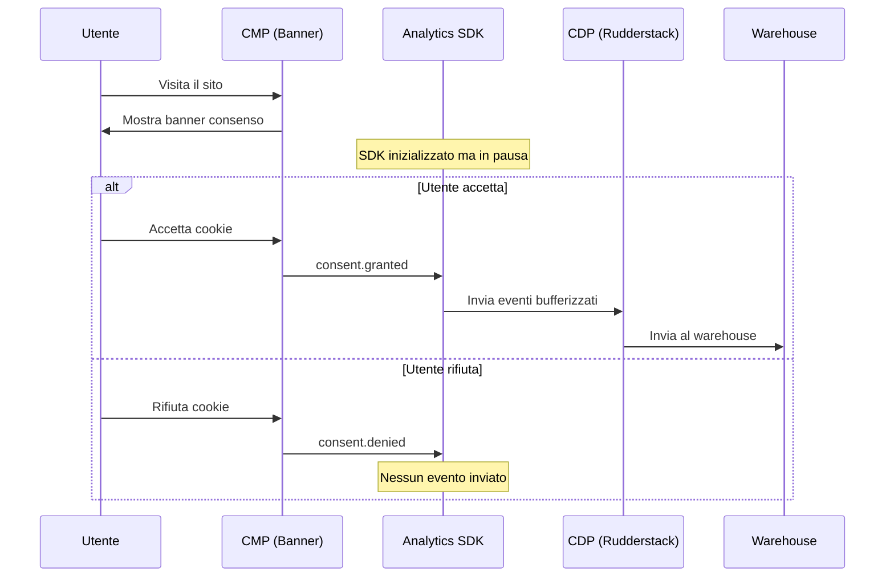

import { Aside, Steps, Tabs, TabItem } from '@astrojs/starlight/components';

# Privacy, GDPR e Consent Mode

<Aside type="caution">
Questa lezione non sostituisce una consulenza legale. Le normative sulla privacy sono complesse e in continua evoluzione. L'obiettivo è darti una comprensione operativa sufficiente per progettare sistemi di raccolta dati compliant, ma per questioni specifiche consulta sempre un DPO (Data Protection Officer) o un avvocato specializzato.
</Aside>

## Perché la Privacy è un Problema Tecnico

Per anni, la privacy è stata considerata "roba da legali" — qualcosa da delegare all'ufficio compliance e dimenticare. Questa mentalità ha prodotto disastri: banner cookie che non funzionano, dati raccolti senza consenso, sanzioni milionarie, e — peggio ancora — la perdita di fiducia degli utenti.

La realtà è che la privacy è un **problema tecnico** tanto quanto legale. Il GDPR non dice solo "chiedi il consenso" — dice *come* devi chiederlo, *quando* devi interrompere la raccolta, *dove* devi archiviare i dati, e *come* devi cancellarli su richiesta. Implementare tutto questo richiede architettura software, non solo un banner popup.

## Il Panorama Normativo

### GDPR (General Data Protection Regulation)

Il GDPR è il regolamento europeo sulla protezione dei dati, in vigore dal maggio 2018. Si applica a **qualsiasi azienda** che tratta dati di residenti nell'UE, indipendentemente da dove ha sede l'azienda.

**Principi fondamentali del GDPR:**

1. **Legalità, correttezza e trasparenza**: Devi avere una base giuridica per trattare i dati e devi spiegare chiaramente cosa fai.

2. **Limitazione delle finalità**: Puoi usare i dati solo per lo scopo per cui li hai raccolti. Se raccogli l'email per inviare la fattura, non puoi usarla per il marketing (senza consenso separato).

3. **Minimizzazione dei dati**: Raccogli solo i dati strettamente necessari. Non serve l'indirizzo di casa per un'app di to-do list.

4. **Accuratezza**: I dati devono essere corretti e aggiornati.

5. **Limitazione della conservazione**: Non conservare i dati più del necessario. Definisci una data retention policy.

6. **Integrità e riservatezza**: I dati devono essere protetti da accessi non autorizzati, perdita o distruzione.

### Le 6 Basi Giuridiche del GDPR

Il GDPR prevede 6 basi giuridiche per il trattamento dei dati. Per il tracking analytics, le più rilevanti sono:

| Base Giuridica | Descrizione | Uso nel Tracking |
|---------------|-------------|-----------------|
| **Consenso** | L'utente accetta esplicitamente | Cookie analytics, marketing |
| **Legittimo Interesse** | Il trattamento è necessario per interessi legittimi | Analytics aggregati, sicurezza |
| **Contratto** | Il trattamento è necessario per eseguire un contratto | Dati transazionali, ordini |
| **Obbligo legale** | Il trattamento è richiesto dalla legge | Fatturazione, audit |
| **Interesse vitale** | Per proteggere la vita di una persona | Emergenze mediche |
| **Interesse pubblico** | Per compiti di interesse pubblico | Ricerca scientifica |

<Aside type="tip">
Per il tracking analytics, la base giuridica più comune è il **consenso**. Il legittimo interesse può applicarsi in casi limitati (analytics aggregati, strettamente necessari per il funzionamento del servizio), ma è un terreno scivoloso e dipende molto dall'interpretazione delle autorità garanti locali.
</Aside>

### ePrivacy Directive (Cookie Law)

La ePrivacy Directive (spesso chiamata "Cookie Law") è una direttiva europea separata dal GDPR che regola specificamente l'uso di cookie e tecnologie di tracciamento simili. È stata recepita in modo diverso da ogni stato membro dell'UE.

**Regola chiave**: Prima di installare cookie non strettamente necessari sul dispositivo dell'utente, devi ottenere il **consenso preventivo e informato**.

**Cookie esenti dal consenso (strettamente necessari):**
- Cookie di sessione per il carrello acquisti
- Cookie di autenticazione
- Cookie per le preferenze di lingua
- Cookie di sicurezza (CSRF token)

**Cookie che richiedono consenso:**
- Cookie analytics (Google Analytics, Mixpanel)
- Cookie di marketing/retargeting (Facebook Pixel, Google Ads)
- Cookie di profilazione
- Cookie di terze parti

### CCPA (California Consumer Privacy Act)

Il CCPA è la legge sulla privacy della California, spesso considerata il "GDPR americano". Le differenze principali:

| Aspetto | GDPR | CCPA |
|---------|------|------|
| **Approccio** | Opt-in (consenso preventivo) | Opt-out (puoi raccogliere, l'utente può opporsi) |
| **Ambito** | Tutti i residenti UE | Residenti California |
| **Diritto alla cancellazione** | Completo | Con eccezioni più ampie |
| **Penalità** | Fino al 4% del fatturato globale | $7.500 per violazione intenzionale |
| **DPO obbligatorio** | Sì (in certi casi) | No |

## Consent Mode v2 di Google

A partire da marzo 2024, Google richiede che tutti i siti web che usano i suoi servizi (Google Analytics, Google Ads) implementino il **Consent Mode v2**. Questo è un requisito tecnico, non solo legale.

### Come Funziona

Il Consent Mode v2 introduce una serie di flag che comunicano a Google lo stato del consenso dell'utente:

```javascript
// Configurazione iniziale (prima del banner)
gtag('consent', 'default', {
  'ad_storage': 'denied',        // Cookie pubblicitari
  'ad_user_data': 'denied',      // Dati utente per ads
  'ad_personalization': 'denied', // Personalizzazione ads
  'analytics_storage': 'denied',  // Cookie analytics
  'wait_for_update': 500          // Attendi il CMP per 500ms
});

// Dopo che l'utente accetta (callback dal CMP)
gtag('consent', 'update', {
  'ad_storage': 'granted',
  'ad_user_data': 'granted',
  'ad_personalization': 'granted',
  'analytics_storage': 'granted'
});
```

### I 4 Flag del Consent Mode v2

| Flag | Controlla | Default consigliato |
|------|----------|-------------------|
| `ad_storage` | Cookie per pubblicità (Google Ads, remarketing) | `denied` |
| `ad_user_data` | Invio dati utente a Google per ads | `denied` |
| `ad_personalization` | Personalizzazione degli annunci | `denied` |
| `analytics_storage` | Cookie di Google Analytics | `denied` |

### Modalità Base vs Avanzata

- **Modalità Base**: Quando il consenso è `denied`, nessun dato viene inviato a Google. Semplice, ma perdi tutti i dati degli utenti che rifiutano.

- **Modalità Avanzata**: Quando il consenso è `denied`, Google invia comunque dei "ping" senza cookie (cookieless pings) che permettono di stimare le conversioni tramite modellazione statistica. Questo recupera circa il 60-70% dei dati persi.

```
Utente accetta → Dati completi (cookie + eventi)
Utente rifiuta (modalità avanzata) → Ping cookieless → Google modella i dati mancanti
Utente rifiuta (modalità base) → Nessun dato
```

## Architettura del Consenso: Il CMP

Un **CMP (Consent Management Platform)** è lo strumento che gestisce il banner cookie e comunica lo stato del consenso al tuo stack di tracking.

### CMP Popolari

| CMP | Tipo | Pro | Contro |
|-----|------|-----|--------|
| **Cookiebot** | SaaS | Facile, auto-scan cookie | Costoso a scala |
| **OneTrust** | SaaS Enterprise | Completo, multi-jurisdiction | Complesso, costoso |
| **Iubenda** | SaaS | Buon supporto italiano | Meno flessibile |
| **Klaro** | Open Source | Gratuito, personalizzabile | Richiede manutenzione |
| **Cookie Consent by Osano** | SaaS | Semplice, free tier | Funzionalità limitate |

### Integrazione CMP + CDP

L'integrazione tra CMP e CDP è il punto critico dell'architettura del consenso. Il flusso corretto è:



**Punti chiave:**
1. L'SDK deve essere **inizializzato ma in pausa** prima del consenso
2. Gli eventi generati prima del consenso devono essere **bufferizzati**, non persi
3. Se l'utente accetta, il buffer viene svuotato e inviato
4. Se l'utente rifiuta, il buffer viene cancellato

### Implementazione Pratica con Rudderstack

```javascript
// 1. Inizializza Rudderstack in modalità "consent pending"
rudderanalytics.load(WRITE_KEY, DATA_PLANE_URL, {
  consentManagement: {
    enabled: true,
    provider: 'custom',
  },
});

// 2. Callback dal CMP quando l'utente fa una scelta
function onConsentUpdate(consentState) {
  if (consentState.analytics === true) {
    // L'utente ha accettato gli analytics
    rudderanalytics.consentHandler.updateConsentsForInstance({
      consentManagement: {
        allowedConsentIds: ['analytics', 'functional'],
        deniedConsentIds: ['marketing'],
      },
    });
  }
}
```

## Server-Side: La Soluzione al Cookie Apocalypse

Con l'aumento degli AdBlockers (oltre il 30% degli utenti desktop), ITP di Safari (che limita i cookie a 7 giorni), e il crescente rifiuto dei cookie da parte degli utenti, il tracking client-side sta diventando sempre meno affidabile.

Il **tracking server-side** è la risposta a questa crisi:

### Vantaggi del Server-Side Tracking per la Privacy

1. **Nessun cookie di terze parti**: I dati passano dal tuo server, non da cookie di terze parti
2. **Non bloccato da AdBlockers**: Gli AdBlockers bloccano le richieste verso domini noti (google-analytics.com), non verso il tuo dominio
3. **Controllo completo**: Puoi filtrare i dati PII prima di inviarli a destinazioni terze
4. **First-party data**: I cookie sono impostati dal tuo dominio (first-party), non da terzi

### Architettura Server-Side

```
Browser → Tuo Server (first-party domain)
                ↓ (filtro PII, arricchimento)
           ├──→ Google Analytics (Measurement Protocol)
           ├──→ Facebook CAPI (Conversion API)
           └──→ Data Warehouse
```

### Google Analytics 4 + Server-Side Tagging

```javascript
// Invece di inviare direttamente a GA4:
// gtag('event', 'purchase', { ... })

// Invii al tuo server-side GTM container:
fetch('https://sgtm.tuodominio.com/collect', {
  method: 'POST',
  body: JSON.stringify({
    event: 'purchase',
    value: 99.99,
    currency: 'EUR',
  }),
});
```

Il server-side GTM container poi:
1. Riceve l'evento
2. Rimuove i dati PII (email, IP) se necessario
3. Arricchisce con dati server-side (user ID dal database)
4. Inoltra a GA4, Facebook, e il warehouse

## Data Retention e Diritto alla Cancellazione

### Data Retention Policy

Il GDPR richiede che i dati non siano conservati più del necessario. Definisci una policy chiara:

| Tipo di dato | Retention suggerita | Motivazione |
|-------------|-------------------|-------------|
| Eventi raw (con PII) | 13 mesi | Analisi di coorte annuale + 1 mese |
| Eventi aggregati (senza PII) | 5 anni | Analisi trend a lungo termine |
| Dati di sessione | 6 mesi | Analisi UX |
| Log di consenso | 5 anni | Prova di compliance |
| Dati di fatturazione | 10 anni | Obblighi fiscali |

### Diritto alla Cancellazione (Right to Erasure)

L'articolo 17 del GDPR dà agli utenti il diritto di richiedere la cancellazione dei propri dati. Implementare questo diritto richiede:

1. **Mapping dei dati**: Sapere dove sono i dati dell'utente in tutti i sistemi
2. **API di cancellazione**: Endpoint per cancellare o anonimizzare i dati
3. **Propagazione**: La cancellazione deve propagarsi a tutti i sistemi downstream
4. **Verifica**: Conferma che la cancellazione è stata completata

```sql
-- Esempio: anonimizzazione in ClickHouse
-- (ClickHouse non supporta UPDATE, quindi si usa una nuova tabella)

INSERT INTO events_anonymized
SELECT
    event_name,
    properties,
    timestamp,
    message_id,
    '' AS user_id,           -- Rimosso
    sipHash64(anonymous_id) AS anonymous_id,  -- Hash
    page_url,
    page_path,
    '' AS user_agent,        -- Rimosso
    received_at
FROM raw_events
WHERE user_id = 'user-to-delete';
```

## Checklist di Compliance

<Steps>
1. **Banner Cookie**: Implementa un CMP che blocca i cookie non necessari prima del consenso.

2. **Consent Mode v2**: Configura i flag di consenso per Google Analytics e Google Ads.

3. **Informativa Privacy**: Aggiorna la privacy policy con tutti gli strumenti di tracking usati.

4. **Data Retention**: Definisci e implementa una policy di retention per ogni tipo di dato.

5. **Diritto alla Cancellazione**: Implementa un processo per gestire le richieste di cancellazione entro 30 giorni.

6. **Server-Side Tracking**: Valuta il server-side tagging per ridurre la dipendenza dai cookie di terze parti.

7. **PII Filtering**: Assicurati che nessun dato PII venga inviato a destinazioni terze senza necessità.

8. **Log del Consenso**: Conserva i log delle scelte di consenso come prova di compliance.

9. **DPA (Data Processing Agreement)**: Firma DPA con tutti i processori di dati terzi (GA4, Segment, ecc.).

10. **Test Regolari**: Verifica periodicamente che il banner funzioni, che i cookie siano bloccati correttamente, e che il Consent Mode sia configurato.
</Steps>

## L'Impatto della Privacy sugli Analytics

La privacy non è solo un vincolo — cambia fondamentalmente come facciamo analytics:

| Prima (pre-GDPR) | Dopo (post-GDPR + cookie apocalypse) |
|---|---|
| Cookie di terze parti ovunque | First-party data + modeling |
| Tracking cross-site | Walled gardens separati |
| ID deterministico (cookie) | ID probabilistico + coorti |
| 100% dei dati raccolti | 40-70% dei dati (consenso-dipendente) |
| Attribuzione precisa | Attribuzione modellata |
| User-level targeting | Cohort-based targeting |

### Come Adattarsi

1. **Investi nel first-party data**: I dati che gli utenti ti danno volontariamente (registrazione, acquisti) non richiedono cookie
2. **Server-side tracking**: Per recuperare i dati persi dagli AdBlockers
3. **Modellazione statistica**: Per stimare ciò che non puoi misurare direttamente
4. **Privacy by Design**: Progetta i sistemi con la privacy come requisito, non come afterthought

---

*Nella prossima lezione, vedremo come collegare le sorgenti dati alle destinazioni attraverso integrazioni e pipeline ELT.*
