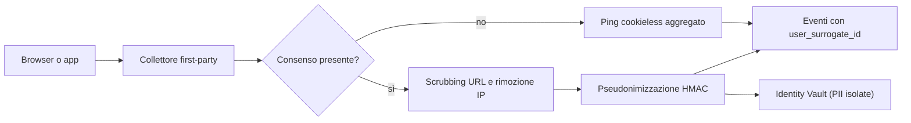

Un portale B2C italiano invia nell'URL della pagina di conferma i dati del cliente in chiaro, per esempio `?email=mario.rossi@esempio.it&cf=RSSMRA80A01H501U`. Lo script di tracking cattura in automatico `page_url` e `referrer`, e così email e codice fiscale si disperdono nelle tabelle di clickstream, nei log di Kafka e nei server dei pixel pubblicitari, anche quando l'utente aveva premuto "Rifiuta tutti" sul banner. Questo è un caso ricostruito con numeri di esempio, ma il meccanismo è reale: la privacy si decide nel punto in cui l'evento nasce, non nel banner.

## Email negli URL e due miliardi di righe impossibili da ripulire

Nello scenario costruito l'azienda raccoglie 60 milioni di eventi web al mese in ClickHouse e su S3, con una conservazione del clickstream di 5 anni, cioè circa 3,6 miliardi di righe a regime (60 milioni × 60 mesi). Durante un audit del Data Protection Officer emergono tre violazioni del Regolamento (UE) 2016/679.

La prima riguarda il consenso: il banner compare, ma i tag di marketing partono al caricamento della pagina prima della scelta, oppure le chiamate server-side ignorano `consent_marketing = 0`. La seconda riguarda gli URL: il flusso di registrazione passa l'email in query string e il collettore salva l'URL completo nella tabella immutabile degli eventi, senza alcuna base giuridica per tenere identificativi diretti in un log comportamentale. La terza riguarda i diritti: quando 40 utenti chiedono accesso (Art. 15) e cancellazione (Art. 17), il regolamento impone di rispondere senza ingiustificato ritardo e comunque entro un mese, ma l'azienda scopre che le PII sono copiate in 18 tabelle diverse e che nessun catalogo dice dove.

Il rischio sanzionatorio è alto (le violazioni più gravi arrivano a 20 milioni di euro o al 4% del fatturato mondiale annuo, se superiore), ma la radice è tecnica: i dati identificativi diretti non sono stati separati dai dati comportamentali nel punto di ingresso. Quanto segue è un metodo ingegneristico, non una consulenza legale: le decisioni sulla base giuridica spettano al DPO e al consulente dell'azienda.

## Una base giuridica per ogni campo del tracking plan

> **Idea chiave:** una raccolta rispetta il GDPR senza perdere precisione analitica quando ogni campo ha una base giuridica dichiarata, il consenso viene applicato alla fonte e i dati identificativi vivono in un solo posto, separato dagli eventi.

Il tracking plan diventa lo strumento di conformità se ogni proprietà è classificata come `PII_DIRECT`, `PII_INDIRECT` o `NON_PII` e abbinata a una base giuridica dell'Art. 6. Tre sono quelle che incontri più spesso nella raccolta dati. L'esecuzione del contratto o l'obbligo legale (Art. 6.1.b e 6.1.c) coprono l'ordine pagato e la fattura, che la normativa fiscale impone di conservare per dieci anni. Il legittimo interesse (Art. 6.1.f) può coprire misure tecniche e conteggi aggregati senza identificativi persistenti, sempre nei limiti indicati dal Garante. Il consenso (Art. 6.1.a) serve per la profilazione individuale e per l'invio a piattaforme pubblicitarie: ogni evento porta nel payload il vettore `consent_analytics` e `consent_marketing`, e il collettore scarta alla fonte i campi per cui manca.

| Campo | Classe | Base giuridica | Conservazione | Dove vive |
|---|---|---|---|---|
| `email_clean` | PII_DIRECT | Contratto (Art. 6.1.b) | Durata del rapporto | Solo Identity Vault |
| `user_surrogate_id` | PII_INDIRECT | Consenso o contratto | 13 mesi nel clickstream | Tabelle eventi |
| `page_path_scrubbed` | NON_PII dopo scrubbing | Legittimo interesse | 13 mesi | Tabelle eventi |
| `revenue_eur` | NON_PII (fatto contabile) | Obbligo legale (Art. 6.1.c) | 10 anni | Tabelle ordini |

La tabella mostra la regola che regge tutta l'architettura: una colonna contenente dati personali ha una sola casa. Tutto ciò che sta altrove usa una chiave surrogata opaca e un tempo di conservazione scritto sulla tabella, non in un documento.



## Pulire l'evento prima che tocchi il disco

Il primo punto di controllo è il collettore, prima di Kafka e ClickHouse. Qui si applica una allowlist dei parametri ammessi negli URL e si scarta l'indirizzo IP dopo aver ricavato nazione e regione. L'allowlist è più sicura di una blacklist perché cattura anche i parametri che nessuno aveva previsto: lo sviluppatore che domani aggiunge `?token=` all'URL non può rompere la conformità.

```javascript
// Scrubbing in ingresso: tiene solo i parametri in allowlist, tutto il resto diventa [REDACTED]
const ALLOWED_PARAMS = new Set(["utm_source", "utm_medium", "utm_campaign", "page"]);

function scrubUrl(rawUrl) {
  const url = new URL(rawUrl);
  for (const key of [...url.searchParams.keys()]) {
    if (!ALLOWED_PARAMS.has(key)) {
      url.searchParams.set(key, "[REDACTED]");
    }
  }
  // Il valore del path può contenere email: ultima rete di sicurezza con espressione regolare
  const path = url.pathname.replace(/[\w.%+-]+@[\w.-]+\.[a-zA-Z]{2,}/g, "[EMAIL_REDACTED]");
  return path + url.search;
}

// scrubUrl("https://sito.it/benvenuto?email=a@b.it&utm_source=newsletter")
// -> "/benvenuto?email=%5BREDACTED%5D&utm_source=newsletter"
```

Dopo lo scrubbing l'evento che entra nel sistema ha questa forma: nessun IP, nessun identificativo diretto, consenso dichiarato e identità sostituita da una chiave opaca.

```json
{
  "_comment": "Evento dopo il collettore: nessuna PII diretta, consenso esplicito, chiave surrogata",
  "event_id": "evt_7c1a",
  "event": "page_viewed",
  "occurred_at": "2026-11-12T08:31:07.000Z",
  "user_surrogate_id": "u_3f9c21ab",
  "consent": { "analytics": 1, "marketing": 0 },
  "context": { "page_path_scrubbed": "/benvenuto", "utm_source": "newsletter", "country_code": "IT" }
}
```

## Pseudonimizzare con una chiave segreta, non con un hash nudo

Per generare `user_surrogate_id` da un identificativo come l'email si usa un HMAC con una chiave segreta custodita fuori dal database, non un semplice SHA-256. L'algoritmo SHA-256 è deterministico e pubblico: chiunque abbia una lista di email note calcola gli hash e li confronta per risalire all'identità in pochi millisecondi. Con HMAC e una chiave segreta, l'attaccante senza la chiave non può rifare il calcolo.

```python
import hmac, hashlib, os

# Chiave segreta (pepper) letta da un secret manager, mai salvata nel database analitico
PEPPER = os.environ["TRACKING_PEPPER"].encode("utf-8")

def surrogate_id(email: str) -> str:
    # Normalizza prima di calcolare, altrimenti Mario@x.it e mario@x.it producono due utenti
    clean = email.strip().lower().encode("utf-8")
    digest = hmac.new(PEPPER, clean, hashlib.sha256).hexdigest()
    return "u_" + digest[:16]

print(surrogate_id("Mario.Rossi@esempio.it"))  # stesso output a ogni esecuzione, irriproducibile senza PEPPER
```

Va ricordato che un dato pseudonimizzato resta un dato personale: il considerando 26 del GDPR lo chiarisce. L'HMAC riduce il rischio di re-identificazione, non porta il dato fuori dal regolamento. Per questo serve anche l'Identity Vault, che permette di cancellare davvero il legame tra persona e chiave.

## Cancellare un utente senza toccare cinquanta tabelle

Il pattern dell'Identity Vault concentra email, nome e telefono in una sola tabella a accesso ristretto, mentre le tabelle degli eventi contengono solo `user_surrogate_id`. Una richiesta di cancellazione modifica una riga del vault. Da quel momento i miliardi di eventi storici non sono più riconducibili a nessuna persona fisica tramite il collettore, mentre i conteggi aggregati di visite e fatturato restano identici.

Il confronto numerico, con numeri di esempio, rende evidente il vantaggio. Se 40 utenti chiedono la cancellazione e le PII sono sparse in 18 tabelle, servono 40 × 18 = 720 operazioni di cancellazione da pianificare, eseguire e verificare, ciascuna su tabelle da centinaia di milioni di righe. Con il vault le operazioni sono 40, una per utente. Il costo delle verifiche scende della stessa proporzione: da 720 a 40 operazioni è una riduzione di 680 operazioni, pari a 680 / 720 = 94,4%.

Lo stesso ragionamento vale per la conservazione. Con un TTL di 13 mesi sulle tabelle di eventi, il volume a regime è 60 milioni × 13 mesi = 780 milioni di righe, contro 3,6 miliardi di una conservazione di 5 anni: una riduzione di 2,82 miliardi di righe, cioè del 78,3%. Meno dati personali conservati significano meno superficie da proteggere e da cancellare.

L'implementazione in ClickHouse separa vault ed eventi, applica il TTL e verifica la cancellazione.

```sql
-- 1. Identity Vault: unico posto con PII dirette, accesso ristretto
CREATE TABLE privacy_vault.user_pii_lookup
(
    user_surrogate_id String,
    email_clean String,
    full_name String,
    phone_number String,
    consent_analytics UInt8,
    consent_marketing UInt8,
    gdpr_status LowCardinality(String), -- 'active' oppure 'erased_art17'
    updated_at DateTime64(3, 'UTC') DEFAULT now64(3)
)
ENGINE = ReplacingMergeTree(updated_at)
ORDER BY user_surrogate_id;

-- 2. Tabella eventi senza PII dirette e con scadenza automatica a 13 mesi
CREATE TABLE analytics_prod.fct_web_events_gdpr_safe
(
    event_date Date,
    occurred_at DateTime64(3, 'UTC'),
    event_id String,
    user_surrogate_id String,
    event_name LowCardinality(String),
    page_path_scrubbed String,
    utm_source LowCardinality(String),
    country_code LowCardinality(String),
    revenue_eur Decimal(12, 2)
)
ENGINE = MergeTree
PARTITION BY toYYYYMM(event_date)
ORDER BY (event_date, event_name, user_surrogate_id)
TTL event_date + INTERVAL 13 MONTH DELETE;

-- 3. Cancellazione Art. 17: nuova riga con PII vuote e stato erased_art17 (la versione più recente vince)
INSERT INTO privacy_vault.user_pii_lookup
    (user_surrogate_id, email_clean, full_name, phone_number, consent_analytics, consent_marketing, gdpr_status)
VALUES ('u_3f9c21ab', '', '', '', 0, 0, 'erased_art17');

-- 4. Audit: nessuna PII residua per gli utenti cancellati, nessuna email negli URL, fatturato intatto
SELECT
    (SELECT countIf(gdpr_status = 'erased_art17' AND (email_clean != '' OR full_name != ''))
       FROM privacy_vault.user_pii_lookup FINAL) AS cancellazioni_incomplete,
    (SELECT countIf(match(page_path_scrubbed, '[a-zA-Z0-9._%+-]+@[a-zA-Z0-9.-]+\\.[a-zA-Z]{2,}'))
       FROM analytics_prod.fct_web_events_gdpr_safe
      WHERE event_date >= today() - 30) AS email_residue_negli_url,
    (SELECT sum(revenue_eur)
       FROM analytics_prod.fct_web_events_gdpr_safe
      WHERE event_date >= today() - 30) AS fatturato_30gg_eur;
```

L'esito atteso è `cancellazioni_incomplete = 0` e `email_residue_negli_url = 0`, mentre `fatturato_30gg_eur` coincide con il valore calcolato prima della cancellazione. Se invece le PII fossero rimaste anche in altre tabelle, il vault non basterebbe: il catalogo dei campi PII e il registro dei trattamenti (Art. 30) servono proprio a sapere che non è così.

## Utenti che rifiutano il consenso: buio totale o misurazione aggregata

In molti siti europei una quota consistente di visitatori rifiuta i cookie di profilazione. Con numeri di esempio, il 40% dei 60 milioni di eventi mensili arriva da utenti senza consenso: sono 24 milioni di eventi senza consenso e 36 milioni con consenso, e 24 + 36 = 60 milioni. Spegnere tutta la telemetria per quel 40% significherebbe perdere due eventi su cinque anche nei conteggi anonimi.

La scelta tecnica è separare due cose. Il tracciamento individuale persistente richiede consenso e non parte senza. Il conteggio statistico aggregato first-party, privo di identificatori persistenti, può continuare entro i limiti della normativa ePrivacy e delle indicazioni del Garante: un ping con solo `timestamp`, `page_path_scrubbed`, `utm_source` e `country_code`, con `user_surrogate_id = 'ANONYMOUS_NO_CONSENT'`. Alle conversioni reali si affiancano ordini registrati server-side sulla base del contratto. Il perimetro esatto di ciò che è ammesso senza consenso dipende dal caso e dalla giurisdizione, quindi la configurazione va concordata con il DPO.

## Tre errori che espongono il warehouse

### URL e indirizzi IP salvati in chiaro

Il sintomo è una tabella di pagine viste che contiene email, token e nomi nei parametri GET e indirizzi IP completi conservati per anni. Succede perché `window.location.href` è la scelta più comoda e perché gli sviluppatori usano la query string per passare dati tra pagine. Se manca l'allowlist, i dati personali finiscono anche nei backup su S3, dove ripulirli è molto più difficile. La correzione è lo scrubbing in ingresso mostrato sopra, con IP scartato dopo la geolocalizzazione.

### SHA-256 dell'email scambiato per anonimizzazione

Il sintomo è la dichiarazione "il dato è hashato, quindi è fuori dal GDPR". Sembra ragionevole perché l'hash è illeggibile a occhio, ma un join con una qualsiasi lista di email ricostruisce l'identità di ogni riga. Dal punto di vista del regolamento il dato è pseudonimizzato e resta soggetto alle regole. La correzione è un HMAC con chiave segreta, oppure un identificativo casuale mappato nel vault, accompagnati dal riconoscimento che il dato resta personale.

### DELETE sui fatti contabili per rispondere a una richiesta di cancellazione

Il sintomo è un `DELETE FROM fct_orders WHERE customer_id = 12345` eseguito per rispondere al cliente. Sembra la risposta letterale alla richiesta, ma elimina scritture che la legge fiscale obbliga a conservare (l'Art. 17.3.b prevede proprio questa eccezione) e altera il fatturato di mesi già chiusi a bilancio. La correzione è anonimizzare il collegamento alla persona nel vault e lasciare intatti i fatti aggregati.

## Controllo prima di superare un audit sulla raccolta

1. Un URL di conferma contiene `?email=...` e il collettore salva `page_url` per intero. Quale controllo lo impedisce e dove va applicato?

<details>
<summary>Mostra risposta</summary>

Una allowlist dei parametri ammessi applicata nel collettore, prima di Kafka e ClickHouse, che sostituisce tutto il resto con `[REDACTED]`. Applicarla dopo, nel warehouse, lascerebbe le email già copiate in log e backup.

</details>

2. Un collega propone di sostituire l'email con `SHA256(email)` e di considerare il dato anonimo. Che cosa gli rispondi e quale alternativa proponi?

<details>
<summary>Mostra risposta</summary>

L'hash senza chiave si inverte con un join su liste di email note, e comunque il dato resta pseudonimizzato e quindi personale. L'alternativa è un HMAC con chiave segreta custodita in un secret manager, oppure un identificativo casuale conservato nel vault, insieme alla cancellazione del legame quando l'utente la chiede.

</details>

3. Con 40 richieste di cancellazione e PII in 18 tabelle, quante operazioni servono senza vault e quante con il vault?

<details>
<summary>Mostra risposta</summary>

Senza vault 40 × 18 = 720 operazioni; con il vault 40, una per utente. La differenza è 680 operazioni, il 94,4% in meno.

</details>

4. Un utente cancellato ha ordini per 1.200 euro nei mesi chiusi. Cosa succede ai 1.200 euro dopo la cancellazione Art. 17 e perché?

<details>
<summary>Mostra risposta</summary>

Restano nel fatturato storico. La cancellazione azzera i dati identificativi nel vault ma non elimina il fatto contabile, che deve essere conservato per obbligo di legge. Le righe degli ordini contengono solo la chiave surrogata, quindi il totale non cambia e l'utente non è più identificabile tramite i sistemi analitici.

</details>

5. Il 40% dei 60 milioni di eventi mensili arriva da utenti che hanno rifiutato il consenso. Quanti eventi sono e che cosa puoi continuare a raccogliere?

<details>
<summary>Mostra risposta</summary>

Sono 60 milioni × 0,40 = 24 milioni di eventi. Puoi continuare a raccogliere ping aggregati first-party senza identificatori persistenti, con solo pagina pulita, sorgente della campagna e nazione, più gli ordini conclusi registrati server-side. Nessun cookie persistente e nessun invio a terze parti, nei limiti confermati dal DPO.

</details>
