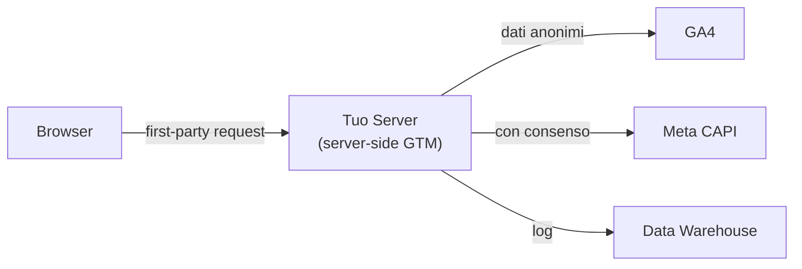

# Privacy, GDPR e Consent Mode

> **Obiettivo:** Implementare la raccolta dati nel rispetto di GDPR, ePrivacy e Consent Mode di Google, senza perdere insight fondamentali.

## 1. Il Framework Legale

| Normativa | Ambito | Requisiti Chiave |
|:---|:---|:---|
| **GDPR** | Dati personali EU | Consenso, diritto all'oblio, DPO |
| **ePrivacy** | Cookie e tracking | Cookie banner, consent |
| **CCPA/CPRA** | Dati personali California | Opt-out, do not sell |
| **DMA** | Digital Markets Act | Interoperabilità, scelta |

## 2. Consent Mode v2 di Google

```javascript
// Configurazione Consent Mode v2
window.dataLayer = window.dataLayer || [];
function gtag(){dataLayer.push(arguments);}

// Stato iniziale: tutto negato fino al consenso
gtag('consent', 'default', {
    'analytics_storage': 'denied',
    'ad_storage': 'denied',
    'ad_user_data': 'denied',
    'ad_personalization': 'denied',
    'functionality_storage': 'granted',
    'security_storage': 'granted',
    'wait_for_update': 500
});

// Dopo il consenso dell'utente
function onConsentGranted(preferences) {
    gtag('consent', 'update', {
        'analytics_storage': preferences.analytics ? 'granted' : 'denied',
        'ad_storage': preferences.marketing ? 'granted' : 'denied',
        'ad_user_data': preferences.marketing ? 'granted' : 'denied',
        'ad_personalization': preferences.marketing ? 'granted' : 'denied'
    });
}
```

## 3. Tracking Server-Side per rispettare la Privacy



```python
# Server-side tracking: pseudonimizzazione
import hashlib

def pseudonymize_user(user_id: str, salt: str) -> str:
    """Genera un ID pseudonimizzato per analytics senza consenso."""
    return hashlib.sha256(f"{user_id}{salt}".encode()).hexdigest()[:16]

def track_event(event: dict, consent: dict) -> dict:
    """Applica le regole di privacy prima del tracking."""
    clean_event = {
        "event_type": event["event_type"],
        "timestamp": event["timestamp"],
        "page_url": event["page_url"]
    }
    
    if consent.get("analytics"):
        clean_event["user_id"] = pseudonymize_user(event["user_id"], DAILY_SALT)
        clean_event["session_id"] = event["session_id"]
    
    if consent.get("marketing"):
        clean_event["user_id_raw"] = event["user_id"]
        clean_event["utm_source"] = event.get("utm_source")
    
    # MAI senza consenso:
    # - IP address completo
    # - Email in chiaro
    # - Device fingerprint dettagliato
    
    return clean_event
```

## 4. Impatto sui Dati e Soluzioni

| Problema | Impatto | Soluzione |
|:---|:---|:---|
| 30-40% utenti rifiuta i cookie | Dati incompleti | Modelling statistico (GA4 lo fa) |
| No cross-site tracking | Attribution rotta | Server-side tracking + CAPI |
| Diritto all'oblio | Cancellare dati utente | Privacy-by-design nello schema |
| Cookie wall illegale | Rischio sanzioni | Offri alternativa senza cookie |

## 5. Checklist GDPR per Data Collection

- [ ] Cookie banner con opt-in granulare (analytics, marketing, funzionali)
- [ ] Consent Mode v2 implementato
- [ ] Privacy policy aggiornata con lista completa dei tool
- [ ] DPA firmato con ogni fornitore (Google, Meta, ecc.)
- [ ] Processo di data deletion implementato
- [ ] Data retention policy definita (es. 25 mesi per GA4)
- [ ] Server-side tracking valutato se opt-in rate sotto il 50%

## Risorse
- **Framework:** Consent Mode v2, Google Tag Manager Server-Side
- **Tool:** Cookiebot, iubenda, OneTrust per consent management
- **Normativa:** Garante della Privacy italiano, EDPB guidelines
