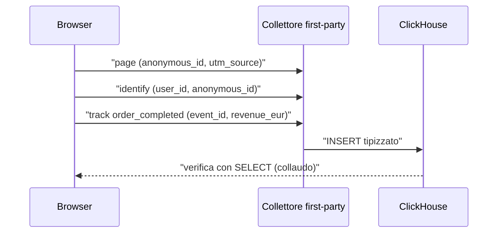

Un team rilascia una nuova funzionalità con le chiamate `page()`, `identify()` e `track()` inserite direttamente nel ramo principale, convinto che la console del browser senza errori significhi dati in arrivo in ClickHouse. Questo è uno scenario costruito con numeri di esempio. Due settimane dopo, al momento di analizzare il lancio, si scopre che la chiave di scrittura di produzione aveva uno spazio finale e il collettore scartava ogni pacchetto, che il prezzo dell'ordine viaggiava come stringa `"49,90"` e che `identify()` non portava con sé l'`anonymous_id` precedente. Nessuno di questi difetti è difficile da correggere: tutti sono invisibili finché non si collauda la catena dal browser alla tabella finale.

## Due settimane di lancio perse per uno spazio e un prezzo stringa

Il laboratorio conclude il Modulo 2 e prende come riferimento il caso appena descritto. Senza una procedura di verifica punto-punto, le stesse tre sviste si ripetono quasi sempre. La prima è non aprire il pannello Network del browser né il Live Debugger del collettore (RudderStack, Segment o Snowplow Micro): una Content Security Policy può bloccare le richieste `POST` verso `collect.azienda.it`, oppure la `writeKey` può essere sbagliata, e la pagina funziona lo stesso. La seconda è leggere i valori numerici dal testo dei campi HTML: in JavaScript `innerText` restituisce sempre una stringa, quindi `"120.50"` al posto di `120.50`. La terza è non provare la sequenza completa `page`, `identify`, `track` e scoprire solo dopo che l'`anonymous_id` generato alla prima pagina non resta collegato all'utente fino all'acquisto.

Il metodo del laboratorio è semplice: ogni passo ha un tempo, un'uscita verificabile e un controllo.

## I quattro passi cronometrati

> **Idea chiave:** un tracking è finito solo quando hai visto un evento di prova attraversare il debugger e comparire in tabella con i tipi di colonna esatti e l'identità cucita.

La sequenza si divide in tre blocchi da dieci minuti. Nel primo si configura la sorgente e il dominio first-party. Nel secondo si implementano le tre chiamate canoniche. Nel terzo si fa un acquisto di prova, si controlla che i pacchetti rispondano con `HTTP 200` e si interroga la tabella di destinazione.

| Minuti | Passo | Uscita verificabile |
|---|---|---|
| 0 - 10 | Source `web_app_prod`, `writeKey`, dominio `collect.azienda.it`, destination ClickHouse | Chiamata di prova con risposta 200 |
| 10 - 20 | Implementazione di `page`, `identify`, `track` con tipi corretti | Tre pacchetti visibili nel Live Debugger |
| 20 - 30 | Acquisto di prova `TEST-QUICKSTART-001` e query di collaudo | Verdetto di certificazione positivo |



## Source, writeKey e primo ping dal terminale

Il passo 1 crea una sorgente nel pannello del collettore e ne ricava la `writeKey`. L'endpoint va esposto su un sottodominio first-party tramite un record DNS, per esempio `https://collect.azienda.it`, così le richieste non vengono bloccate come traffico di terze parti. Prima di toccare il frontend conviene provare la catena con una chiamata da terminale. Un collettore compatibile con lo schema Segment accetta l'autenticazione Basic con la `writeKey` come utente.

```bash
# Ping di prova: la writeKey è l'utente Basic, la password resta vuota
# Il flag -w stampa lo status HTTP: deve essere 200, altrimenti la chiave o la rete sono sbagliate
WRITE_KEY="$(printf '%s' "$TRACKING_WRITE_KEY" | tr -d '[:space:]')"   # elimina spazi finali nascosti

curl -sS -o /dev/null -w "%{http_code}\n" \
  -u "${WRITE_KEY}:" \
  -H "Content-Type: application/json" \
  -d '{"userId":"usr_test","event":"quickstart_ping","properties":{"is_test_event":true}}' \
  https://collect.azienda.it/v1/track
```

La riga con `tr -d` è la risposta diretta al guasto dello scenario: una chiave copiata con uno spazio finale fa scartare il 100% dei pacchetti, e l'errore si vede solo se qualcuno guarda lo status. Se il comando stampa 401 o 403 la chiave è sbagliata; se non risponde, la rete o il DNS first-party non sono configurati.

## Le tre chiamate canoniche con tipi corretti

La chiamata `page` registra l'atterraggio e cattura `anonymous_id`, `path`, `referrer` e i parametri UTM. La chiamata `identify` scatta alla registrazione o al login e associa l'`anonymous_id` corrente al `user_id` immutabile del database, insieme ai tratti dell'account come `plan_tier` e `company_id`. La chiamata `track` registra le azioni del job, con un `event_id` univoco e proprietà numeriche passate come numeri.

```javascript
// Le tre chiamate canoniche. Il cookie first-party sul dominio radice mantiene lo stesso anonymous_id
analytics.load("WRITE_KEY_DI_PRODUZIONE", {
  dataPlaneUrl: "https://collect.azienda.it",
  cookieDomain: ".azienda.it", // vale per www, app e shop
});

analytics.page("Pricing", { utm_source: "linkedin_b2b" });

// Al login: user_id tecnico e immutabile, mai l'email
analytics.identify("usr_8841", { plan_tier: "pro", company_id: "acc_300" });

const rawPrice = document.getElementById("price").innerText; // "299,00" è una stringa
const revenue = Number(rawPrice.replace(",", "."));            // 299 è un numero
if (Number.isNaN(revenue)) throw new Error("revenue_eur non numerico: " + rawPrice);

analytics.track("order_completed", {
  event_id: "evt_ord_9001",
  order_id: "ORD-QS-9001",
  revenue_eur: revenue,
  items_count: 2,
  currency: "EUR",
  is_test_event: true,
});
```

Il payload che arriva al collettore, con tipi corretti, è questo. Nota che `revenue_eur` non ha virgolette e che `is_test_event` è un booleano.

```json
{
  "_comment": "Payload di track dopo la conversione: revenue_eur numerico, booleano reale, anonymous_id e user_id insieme",
  "type": "track",
  "event": "order_completed",
  "anonymousId": "anon_qs_777",
  "userId": "usr_8841",
  "properties": {
    "event_id": "evt_ord_9001",
    "order_id": "ORD-QS-9001",
    "revenue_eur": 299.0,
    "items_count": 2,
    "currency": "EUR",
    "is_test_event": true
  }
}
```

## Collaudo end-to-end in ClickHouse

La verifica finale si fa sul dato, non sull'interfaccia. Si crea una tabella di destinazione tipizzata, si invia la sequenza completa di quattro chiamate più un retry duplicato dello stesso ordine, e si interroga il risultato.

```sql
-- 1. Tabella di destinazione tipizzata per il quickstart
CREATE TABLE raw_tracking.quickstart_events
(
    event_date Date DEFAULT toDate(occurred_at),
    occurred_at DateTime64(3, 'UTC'),
    ingested_at DateTime64(3, 'UTC') DEFAULT now64(3),
    call_type LowCardinality(String), -- 'page', 'identify', 'track'
    event_name LowCardinality(String),
    event_id String,
    anonymous_id String,
    user_id String,
    group_id String,
    page_path String,
    utm_source LowCardinality(String),
    plan_tier LowCardinality(String),
    order_id String,
    revenue_eur Decimal(12, 2),
    currency LowCardinality(String),
    is_test_event UInt8 DEFAULT 0
)
ENGINE = ReplacingMergeTree(ingested_at)
PARTITION BY toYYYYMM(event_date)
ORDER BY (event_date, call_type, event_name, event_id);

-- 2. Sequenza di collaudo: page, identify, due track e un retry duplicato dell'ordine
INSERT INTO raw_tracking.quickstart_events
(occurred_at, call_type, event_name, event_id, anonymous_id, user_id, group_id, page_path, utm_source, plan_tier, order_id, revenue_eur, currency, is_test_event)
VALUES
('2026-11-13 10:00:01.000', 'page', 'page_viewed', 'evt_p_01', 'anon_qs_777', '', '', '/pricing', 'linkedin_b2b', '', '', 0.00, 'EUR', 1),
('2026-11-13 10:01:15.000', 'identify', 'user_identified', 'evt_i_01', 'anon_qs_777', 'usr_8841', 'acc_300', '/signup', '', 'pro', '', 0.00, 'EUR', 1),
('2026-11-13 10:02:30.000', 'track', 'checkout_started', 'evt_t_01', 'anon_qs_777', 'usr_8841', 'acc_300', '/checkout', '', 'pro', 'ORD-QS-9001', 299.00, 'EUR', 1),
('2026-11-13 10:03:10.000', 'track', 'order_completed', 'evt_ord_9001', 'anon_qs_777', 'usr_8841', 'acc_300', '/thank-you', '', 'pro', 'ORD-QS-9001', 299.00, 'EUR', 1),
-- Retry dello stesso ordine due secondi dopo, con lo stesso event_id
('2026-11-13 10:03:12.000', 'track', 'order_completed', 'evt_ord_9001', 'anon_qs_777', 'usr_8841', 'acc_300', '/thank-you', '', 'pro', 'ORD-QS-9001', 299.00, 'EUR', 1);

-- 3. Certificazione: un colpo solo per arrivo, deduplicazione, identità e attribuzione
SELECT
    count() AS eventi_unici,                                                         -- atteso 4
    uniqExact(anonymous_id) AS anonymous_id_distinti,                                -- atteso 1
    argMaxIf(user_id, occurred_at, call_type = 'identify') AS user_id_identificato,  -- atteso usr_8841
    argMinIf(utm_source, occurred_at, call_type = 'page') AS primo_contatto,         -- atteso linkedin_b2b
    sumIf(revenue_eur, event_name = 'order_completed') AS ricavo_eur,                -- atteso 299.00
    if(eventi_unici = 4 AND user_id_identificato = 'usr_8841'
       AND primo_contatto = 'linkedin_b2b' AND ricavo_eur = 299.00,
       'QUICKSTART_PASSED', 'QUICKSTART_FAILED') AS verdetto
FROM raw_tracking.quickstart_events FINAL
WHERE anonymous_id = 'anon_qs_777' AND is_test_event = 1;
```

Il calcolo atteso è semplice. Dei 5 pacchetti inviati, il retry ha lo stesso `event_id` e la stessa chiave di ordinamento: `ReplacingMergeTree` con `FINAL` ne conserva uno solo, e restano 5 − 1 = 4 eventi unici. Il ricavo è 299,00 euro e non 598,00 euro, perché il duplicato non viene sommato: la differenza di 299 euro è esattamente il doppio conteggio evitato, pari a un errore del 100% sul fatturato dell'ordine. L'`anonymous_id` resta uno solo lungo la sequenza, quindi l'acquisto di `usr_8841` si attribuisce alla campagna `linkedin_b2b` vista quando era ancora anonimo.

## Consegna dal browser: fetch, keepalive o sendBeacon

Quando l'utente clicca un link che cambia pagina, il browser avvia la navigazione e può annullare le richieste asincrone ancora aperte. Nel Network compaiono come richieste cancellate. La scelta riguarda come trasmettere l'evento in quel momento.

| Metodo | Sopravvive alla navigazione | Note |
|---|---|---|
| `fetch()` standard | No, può essere annullata | Va bene per eventi emessi senza cambio pagina |
| `fetch(url, { keepalive: true })` | Sì | Mantiene metodo e header, limite di dimensione del body |
| `navigator.sendBeacon()` | Sì | Solo POST, nessun header personalizzato |

Con numeri di esempio, su 1.000 clic su link di navigazione, una `fetch()` standard perde il 20%: 1.000 × 0,20 = 200 eventi persi e 800 consegnati. Con `keepalive` la consegna sale vicino a 1.000 su 1.000. Per gli eventi emessi sui clic che portano a una nuova pagina conviene quindi configurare l'SDK, o il wrapper `fetch`, con `keepalive: true` oppure usare `sendBeacon`.

## Tre errori del primo setup

### Numeri e booleani passati come stringhe

Sintomo: nella tabella `revenue_eur` vale 0 o il record finisce in quarantena. Succede perché `inputElement.value` restituisce testo e un occhio umano non nota le virgolette nel log. Una colonna `Decimal(12, 2)` non accetta `"149,00"`, e `JSONExtractFloat` su una virgola decimale italiana può restituire 0. Si corregge convertendo con `Number()` prima dell'invio e controllando `Number.isNaN`, e verificando in tabella con `JSONType(raw_properties_json, 'revenue_eur')`.

```sql
-- Verifica del tipo JSON di revenue_eur: 'Double' o 'Int64' va bene, 'String' è l'errore
SELECT JSONType(raw_properties_json, 'revenue_eur') AS tipo, count() AS eventi
FROM raw_tracking.quickstart_debug_stream
WHERE test_session_tag = 'quickstart_broken_attempt'
GROUP BY tipo;
```

### anonymous_id che cambia tra pagine e sottodomini

Sintomo: `page` ha `anon_aaa`, `identify` due secondi dopo ha `anon_bbb` e `track` su `shop.azienda.it` ha `anon_ccc`. Il cookie first-party non è configurato sul dominio radice, quindi ogni sottodominio ne crea uno nuovo. Il grafo delle identità si spezza e l'attribuzione tra landing page e prodotto si perde. Si corregge impostando `cookieDomain: ".azienda.it"` e ripetendo il collaudo, controllando che `anonymous_id_distinti` valga 1.

### Eventi di collaudo mescolati ai dati veri

Sintomo: il fatturato del giorno include venti ordini di prova da 99.999 euro. Succede quando l'ambiente di test scrive nella tabella di produzione senza marcare i payload. Venti ordini da 99.999 euro valgono 20 × 99.999 = 1.999.980 euro di ricavo fittizio. Si corregge con `is_test_event: true` su ogni evento di collaudo e con una regola fissa nel primo modello `stg_` di dbt che filtra o isola i record con `is_test_event = 1`.

## Controllo prima di chiudere il quickstart

1. Il Live Debugger mostra tre pacchetti ma la tabella è vuota. Da dove parti a cercare?

<details>
<summary>Mostra risposta</summary>

Dalla destination: il collettore ha accettato i pacchetti, quindi `writeKey` e rete funzionano. Controlli la connessione alla destination ClickHouse, i permessi sul database `raw_tracking`, gli errori di tipo che mandano i record in quarantena e il filtro `is_test_event` della query con cui stai guardando la tabella.

</details>

2. Un ordine da 299 euro viene inviato due volte con lo stesso `event_id`. Che cosa devi vedere in tabella e perché?

<details>
<summary>Mostra risposta</summary>

Un solo evento e un ricavo di 299 euro, non 598 euro. `ReplacingMergeTree` con `FINAL` tiene una riga per chiave di ordinamento, e `event_id` fa parte della chiave. Senza `event_id` stabile il retry non sarebbe riconoscibile.

</details>

3. `identify` invia come `user_id` l'indirizzo email dell'utente. Quale problema crea e che valore usi?

<details>
<summary>Mostra risposta</summary>

L'email può cambiare, e allora la storia dell'utente si spezza in due identità; inoltre è un dato personale che finisce in ogni tabella. Usa l'identificativo tecnico immutabile del database, per esempio `usr_8841`, e tieni l'email come tratto nel vault.

</details>

4. Su 2.500 clic di navigazione una `fetch()` standard perde il 20%. Quanti eventi consegna e quanti ne perde?

<details>
<summary>Mostra risposta</summary>

Ne perde 2.500 × 0,20 = 500 e ne consegna 2.500 − 500 = 2.000. Con `keepalive: true` o `sendBeacon` la consegna si avvicina a 2.500.

</details>
