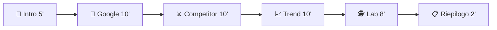

## Ricerca Desk: L'arte di trovare informazioni esistenti — Lezione Completa

Prima di intervistare un solo cliente (Ricerca Primaria), devi sapere cosa il mondo sa già (Ricerca Secondaria o Desk). La Ricerca Desk non è "googlare". È un processo sistematico di intelligence per mappare il mercato, i competitor e i trend senza spendere un euro. In questa lezione, impareremo a diventare investigatori digitali, estraendo oro da report PDF, forum di nicchia e bilanci aziendali.

### Obiettivi di Apprendimento

Al termine di questa lezione, lo studente sarà in grado di:
1.  Strutturare un piano di ricerca desk definendo le "Key Intelligence Questions" (KIQ).
2.  Utilizzare operatori di ricerca avanzati (Google Dorks) per trovare documenti nascosti.
3.  Analizzare i competitor usando strumenti come SimilarWeb, Wayback Machine e le Librerie Ads.
4.  Valutare l'affidabilità delle fonti (Triangolazione dei dati).
5.  Sintetizzare enormi quantità di informazioni in una matrice SWOT o un Competitive Landscape.

### Timeline della Lezione

| Fase | Argomento | Durata |
|------|-----------|--------|
| 1 | Introduzione: Primaria vs Secondaria | 5 min |
| 2 | Tecnica: Google Hacking per Marketer | 10 min |
| 3 | Strumenti: Competitive Intelligence | 10 min |
| 4 | Metodologia: Analisi dei Trend | 10 min |
| 5 | Esercizi: Mappare un Competitor in 15 min | 8 min |
| 6 | Riepilogo e Domande | 2 min |
| **Totale** | | **45 min** |

### Fase 1 — Introduzione: Primaria vs Secondaria (5 min)

La ricerca è costosa. Parlare con 100 persone richiede 100 ore. Leggere un report che riassume l'opinione di 10.000 persone richiede 1 ora.
La **Ricerca Desk** (Secondaria) deve *sempre* precedere la ricerca sul campo (Primaria).
*   *Desk:* Cosa sappiamo già? (Report Istat, Statista, Competitor).
*   *Field:* Cosa dobbiamo scoprire di nuovo? (Le motivazioni profonde dei *nostri* clienti).

Se fai domande ai clienti le cui risposte sono già su Google, stai sprecando il loro tempo e il tuo.

### Fase 2 — Tecnica: Google Hacking per Marketer (10 min)

Google indicizza molto più di quello che vedi. Usa gli operatori avanzati (Dorks).

1.  **`filetype:pdf`**: Cerca solo documenti.
    *   *Query:* `settore moda report 2023 filetype:pdf` -> Trovi report di consulenza costosi gratis.
2.  **`site:`**: Cerca dentro un sito specifico.
    *   *Query:* `site:reddit.com "miglior crm"` -> Trovi opinioni vere, non marchette.
3.  **`intitle:`**: La parola deve essere nel titolo.
    *   *Query:* `intitle:"marketing plan" filetype:ppt` -> Trovi presentazioni reali.
4.  **`-` (Meno):** Escludi parole.
    *   *Query:* `tesla -motors` -> Cerca Nikola Tesla, non le auto.

### Fase 3 — Strumenti: Competitive Intelligence (10 min)

Spiare i competitor (legalmente) è facile.

1.  **Meta Ads Library / Google Ads Transparency Center:**
    *   Vedi *tutte* le pubblicità attive di un competitor.
    *   *Insight:* Se un annuncio è attivo da 6 mesi, *funziona*. Copia la struttura (l'angolo, non il contenuto).
2.  **Wayback Machine (Archive.org):**
    *   Guarda il sito del competitor 1 anno fa. Cosa hanno cambiato?
    *   *Insight:* Hanno cambiato la Headline da "Veloce" a "Sicuro"? Hanno capito che la sicurezza vende di più.
3.  **SimilarWeb (Versione Free):**
    *   Da dove arriva il loro traffico? (SEO? Social? Referral?).

### Fase 4 — Metodologia: Analisi dei Trend (10 min)

Non guardare solo oggi. Guarda domani.

1.  **Google Trends:**
    *   Cerca "Vegan" vs "Keto". Guarda la stagionalità e la direzione.
2.  **AnswerThePublic:**
    *   Inserisci una keyword. Ti mostra tutte le domande che la gente fa su Google ("Come...", "Perché..."). È una miniera per il Content Marketing.
3.  **Recensioni Amazon (1-3 stelle):**
    *   Leggi le recensioni negative dei prodotti best-seller.
    *   *Insight:* "Il prodotto è ottimo ma il manuale è incomprensibile". -> *Opportunità:* Fai un prodotto con un manuale fantastico.

### Fase 5 — Esercizi: Mappare un Competitor in 15 min (8 min)

**Scenario:** Devi lanciare un nuovo brand di caffè online. Competitor: "CaffèX".

**Task:**
1.  Vai su **Meta Ads Library**: Che tipo di video usano? (Baristi esperti o gente comune in cucina?).
2.  Vai su **SimilarWeb**: Hanno più traffico da Desktop o Mobile?
3.  Vai su **Google** (`site:caffex.it inurl:blog`): Di cosa scrivono?
4.  Vai su **Trustpilot**: Di cosa si lamentano i clienti?

*Risultato:* In 15 minuti hai una SWOT analysis (Strengths, Weaknesses, Opportunities, Threats) preliminare.

### Fase 6 — Riepilogo e Domande (2 min)

1.  **Parti da qui.** Mai iniziare un progetto senza aver "pulito" Google.
2.  **Operatori.** Impara `site:`, `filetype:`, `intitle:`.
3.  **Storia.** La Wayback Machine ti insegna l'evoluzione della strategia altrui.
4.  **Ads Library.** Il copy che funziona è pubblico.

### Domande di Verifica

1.  Qual è la differenza tra Ricerca Primaria e Secondaria?
2.  Come useresti l'operatore `filetype:pdf` per trovare ricerche di mercato gratuite?
3.  Cosa puoi dedurre se un competitor ha una Landing Page attiva ininterrottamente da 12 mesi (visibile su Wayback Machine o Ads Library)?
4.  Perché le recensioni negative (1-2 stelle) dei competitor sono più utili di quelle positive per la ricerca desk?
5.  Quale strumento useresti per stimare le fonti di traffico di un sito web concorrente?

### Riferimenti Bibliografici

-   Ben Fleishhacker, "The Urban Detective's Handbook".
-   Google Search Central, "Advanced Search Operators".
-   Michael E. Porter, "Competitive Strategy", Free Press, 1980 (Per i framework di analisi).
