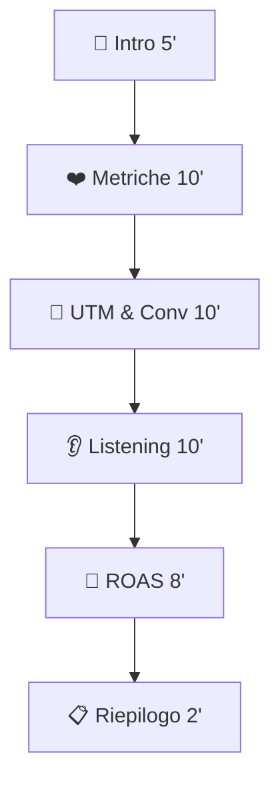
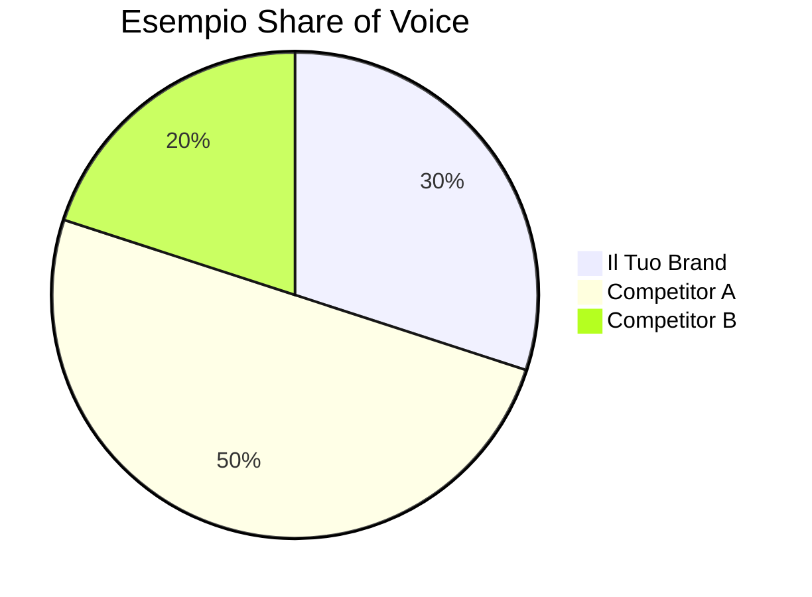

## Social Media Analytics: Oltre le Vanity Metrics — Lezione Completa

Ottenere un "Like" è facile. Ottenere un cliente fedele è difficile. Nel mondo dei social media, è troppo facile farsi distrarre dalle metriche di vanità (Follower, Like) e perdere di vista l'obiettivo reale: l'impatto sul business. In questa lezione, impareremo a misurare l'efficacia della strategia social con rigore scientifico, usando framework avanzati di attribuzione e analisi del sentiment.

### Obiettivi di Apprendimento

Al termine di questa lezione, lo studente sarà in grado di:
1.  Calcolare il "True Engagement Rate" ponderando le interazioni per valore (es. Save > Like).
2.  Implementare un sistema di tagging UTM rigoroso per misurare il traffico social in Google Analytics.
3.  Utilizzare l'analisi di coorte per confrontare il Lifetime Value (LTV) degli utenti acquisiti da TikTok vs LinkedIn.
4.  Eseguire un'analisi competitiva della "Share of Voice" e del "Sentiment".
5.  Costruire un report mensile che collega le metriche "Top of Funnel" (Reach) con le metriche "Bottom of Funnel" (Revenue).

### Timeline della Lezione

| Fase | Argomento | Durata |
|------|-----------|--------|
| 1 | Introduzione: Organic vs Paid vs Earned | 5 min |
| 2 | Metriche: Engagement Ponderato e Reach | 10 min |
| 3 | Conversione: Dal Social al Sito (UTM) | 10 min |
| 4 | Strategia: Social Listening e Sentiment | 10 min |
| 5 | Esercizi: Calcolo del ROAS Social | 8 min |
| 6 | Riepilogo e Domande | 2 min |
| **Totale** | | **45 min** |

### Fase 1 — Introduzione: Organic vs Paid vs Earned (5 min)

Non tutti i dati social sono uguali. Dobbiamo distinguere tre fonti:
1.  **Owned/Organic:** I tuoi canali ufficiali. Costo media = 0. Costo produzione = Alto. Metrica chiave: Engagement Rate.
2.  **Paid:** Pubblicità (Facebook Ads, LinkedIn Ads). Costo media = Alto. Metrica chiave: ROAS / CPA.
3.  **Earned:** Ciò che gli altri dicono di te (UGC, PR, Recensioni). Costo = 0. Credibilità = Massima. Metrica chiave: Share of Voice.

L'errore comune è misurare l'Organic con le metriche del Paid (Conversioni immediate) o viceversa. L'organico costruisce fiducia (Brand), il paid raccoglie la domanda (Performance).

### Fase 2 — Metriche: Engagement Ponderato e Reach (10 min)

"Engagement Rate = (Interazioni / Follower) * 100". Questa formula è obsoleta.
Primo, perché l'algoritmo non mostra il post a tutti i follower (Reach rate < 10%).
Secondo, perché un Like vale 1 centesimo, un Save vale 1 euro.

**Nuova Formula: Weighted Engagement Rate (WER)**
Assegna un peso a ogni azione:
*   Like = 1 punto
*   Commento = 5 punti
*   Share = 10 punti (Viralità)
*   Save = 10 punti (Intento d'acquisto)

`WER = (Like*1 + Comm*5 + Share*10 + Save*10) / Reach Reale`

**Reach vs Impressions**
*   **Reach:** Persone uniche (Teste).
*   **Impressions:** Visualizzazioni totali (Occhi).
*   **Frequenza:** Impressions / Reach.
    *   Se Frequenza > 4 in una settimana, rischi la "Ad Fatigue" (la gente si stufa).

### Fase 3 — Conversione: Dal Social al Sito (UTM) (10 min)

Il "Dark Social" (link condivisi in DM, WhatsApp) è il buco nero dell'analytics. Spesso appare come "Direct" in GA4.
Per illuminarlo, devi usare i **parametri UTM** ovunque.

Link in Bio: `tuosito.com?utm_source=instagram&utm_medium=social&utm_campaign=linkinbio`
Link nelle Stories: `...&utm_campaign=story_natale`

**Analisi del Flusso:**
1.  **Click-Through Rate (CTR):** Il contenuto è interessante? (Benchmark: 1-2%).
2.  **Bounce Rate da Social:** Se è alto (es. 80%), l'utente si aspettava una cosa e ne ha trovata un'altra (Clickbait?).
3.  **Conversion Rate:** Gli utenti da LinkedIn comprano più di quelli da TikTok? (Spesso sì, perché hanno un intento professionale).

### Fase 4 — Strategia: Social Listening e Sentiment (10 min)

Il tuo brand esiste nelle conversazioni degli altri.
Strumenti come Brandwatch, Talkwalker o anche semplici script Python possono scaricare menzioni e commenti.

**Analisi del Sentiment (NLP):**
Classifica ogni commento come Positivo, Neutro o Negativo.
*   *Esempio:* Lanci una nuova feature.
    *   Volume menzioni: +500% (Sembra bene).
    *   Sentiment: -80% (Disastro).
    *   Senza Sentiment, festeggeresti il disastro.

**Share of Voice (SOV):**
`Tue Menzioni / (Tue Menzioni + Menzioni Competitor)`
Se la tua SOV è il 20% ma la tua quota di mercato è il 10%, probabilmente crescerai (Excess SOV).

### Fase 5 — Esercizi: Calcolo del ROAS Social (8 min)

**Scenario:** Hai speso 1.000€ per creare contenuti (Videomaker) + 500€ di Ads su Instagram.
Risultati:
*   Nuovi Follower: 1.000
*   Traffico al sito: 2.000 visite.
*   Vendite tracciate (Last Click): 2.000€.

**Calcolo:**
1.  **Costo Totale:** 1.500€.
2.  **ROAS (Return on Ad Spend):** 2.000€ / 500€ (Ads) = 4.0x. (Sembra ottimo).
3.  **ROI (Return on Investment):** (2.000€ - 1.500€) / 1.500€ = 33%. (Buono, ma meno esplosivo).

**Domanda critica:**
Quanto valgono i 1.000 nuovi follower? Se il LTV di un follower è 10€ (perché comprerà in futuro), hai generato un valore latente di 10.000€. Il ROI reale è molto più alto.

### Fase 6 — Riepilogo e Domande (2 min)

1.  **Pesa le interazioni.** Un Save vale oro.
2.  **Tagga tutto.** Niente UTM, niente dati.
3.  **Ascolta.** Il Social Listening previene le crisi PR.
4.  **Oltre il ROAS.** Considera il valore a lungo termine della community.

### Domande di Verifica

1.  Perché l'Engagement Rate calcolato sulla Reach è più accurato di quello calcolato sui Follower?
2.  Cos'è il "Dark Social" e come impatta l'accuratezza dei dati di acquisizione?
3.  Qual è la differenza tra "Share of Voice" e "Share of Market"?
4.  In che modo un'alta Frequenza (Frequency) può danneggiare la performance di una campagna social?
5.  Come useresti l'analisi del Sentiment per valutare il lancio di un nuovo prodotto?

### Riferimenti Bibliografici

-   Avinash Kaushik, "Social Media Analytics Framework", Occam's Razor Blog.
-   Hootsuite, "Social Media Trends Report 2024".
-   Meta Blueprint (corsi ufficiali di metrica).
