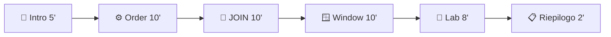

## SQL per Analisti Dati: Oltre la SELECT * — Lezione Completa

Excel è ottimo, ma quando le righe diventano milioni, Excel muore. SQL (Structured Query Language) è la lingua franca dei dati. Non serve essere programmatori per usarlo: è l'abilità con il ROI più alto per chiunque lavori nel marketing o nel prodotto. In questa lezione, passeremo dalle basi alle tecniche avanzate come le Window Functions e le CTE, trasformandoti da "utente Excel" a "Data Analyst autonomo".

### Obiettivi di Apprendimento

Al termine di questa lezione, lo studente sarà in grado di:
1.  Scrivere query SQL performanti evitando gli errori comuni (`SELECT *`, `OR`, `LIKE %...%`).
2.  Utilizzare le CTE (Common Table Expressions) per rendere il codice leggibile e modulare.
3.  Padroneggiare le Window Functions (`RANK`, `LEAD`, `LAG`) per calcoli complessi come "la differenza rispetto al mese scorso".
4.  Unire tabelle con `JOIN` (Inner, Left, Cross) capendo esattamente cosa succede ai dati.
5.  Formattare e commentare il codice SQL come un professionista.

### Timeline della Lezione

| Fase | Argomento | Durata |
|------|-----------|--------|
| 1 | Introduzione: Perché SQL è eterno | 5 min |
| 2 | Teoria: L'ordine di esecuzione di una query | 10 min |
| 3 | Pratica: JOIN e Aggregazioni | 10 min |
| 4 | Avanzato: Window Functions & CTE | 10 min |
| 5 | Esercizi: Risolvere problemi di business | 8 min |
| 6 | Riepilogo e Domande | 2 min |
| **Totale** | | **45 min** |



### Fase 1 — Introduzione: Perché SQL è eterno (5 min)

SQL è stato inventato nel 1974. Oggi, 50 anni dopo, è ancora lo standard. Perché? Perché è dichiarativo.
Tu dici al computer *cosa* vuoi (`SELECT names`), non *come* ottenerlo (apri file, leggi riga, se name, stampa...).
Che tu usi Google BigQuery, Snowflake, ClickHouse o Postgres, la sintassi è la stessa al 90%. Impara una volta, usalo ovunque.

### Fase 2 — Teoria: L'ordine di esecuzione di una query (10 min)

L'errore numero 1 dei principianti è pensare che SQL esegua le istruzioni nell'ordine in cui le scrivi. Non è vero.

**Ordine di Scrittura:**
`SELECT` -> `FROM` -> `WHERE` -> `GROUP BY` -> `HAVING` -> `ORDER BY` -> `LIMIT`.

**Ordine di Esecuzione (Logico):**
1.  `FROM` (Prendi la tabella).
2.  `WHERE` (Filtra le righe prima di fare calcoli).
3.  `GROUP BY` (Crea i gruppi).
4.  `HAVING` (Filtra i gruppi, es. "solo chi ha speso > 100").
5.  `SELECT` (Scegli le colonne e fai i calcoli finali).
6.  `ORDER BY` (Ordina).
7.  `LIMIT` (Taglia).

*Perché è importante?*
Perché non puoi usare un alias definito nella `SELECT` dentro la `WHERE`.
*Sbagliato:* `SELECT price * 1.22 AS ivato FROM products WHERE ivato > 100`. (Il DB non sa ancora cos'è "ivato" quando fa la WHERE).

### Fase 3 — Pratica: JOIN e Aggregazioni (10 min)

I dati vivono in tabelle separate (Clienti, Ordini, Prodotti). Le `JOIN` servono a riunirli.

*   **INNER JOIN:** Solo le righe che hanno una corrispondenza in entrambe. (Perdi i clienti senza ordini).
*   **LEFT JOIN:** Tutte le righe della tabella sinistra, e le corrispondenze della destra (o NULL). (Tieni i clienti, vedi NULL se non hanno ordini).
*   **CROSS JOIN:** Tutte le combinazioni possibili (Prodotto Cartesiano). Pericoloso se non voluto (es. 1000 utenti * 1000 prodotti = 1 milione di righe).

**Aggregazioni:** `COUNT`, `SUM`, `AVG`, `MAX`.
Ricorda: Se usi una funzione di aggregazione, tutto ciò che non è aggregato deve finire nel `GROUP BY`.

### Fase 4 — Avanzato: Window Functions & CTE (10 min)

Qui si distingue l'amatore dal pro.

**CTE (Common Table Expressions - `WITH`)**
Invece di fare subquery illeggibili (`SELECT * FROM (SELECT * FROM ...)`), usa le CTE per creare tabelle temporanee logiche.
```sql
WITH vendite_mensili AS (
    SELECT mese, sum(revenue) as totale
    FROM orders
    GROUP BY mese
)
SELECT * FROM vendite_mensili WHERE totale > 10000;
```
Leggibile. Pulito. Debuggabile.

**Window Functions (`OVER`)**
Permettono di fare calcoli su un gruppo di righe mantenendo le righe originali.
*   `RANK() OVER (PARTITION BY category ORDER BY sales DESC)`: Classifica i prodotti per vendite *dentro ogni categoria*.
*   `LEAD(sales) OVER (ORDER BY month)`: Prendi il valore del mese prossimo (per calcolare la crescita mese su mese).

### Fase 5 — Esercizi: Risolvere problemi di business (8 min)

**Esercizio 1: Chi sono i top 3 clienti per città?**
Usa `RANK()`.
```sql
WITH classifica AS (
    SELECT
        city,
        customer_name,
        total_spend,
        RANK() OVER (PARTITION BY city ORDER BY total_spend DESC) as posizione
    FROM customers
)
SELECT * FROM classifica WHERE posizione <= 3;
```

**Esercizio 2: Calcola la crescita MoM (Month over Month)**
Usa `LAG()`.
```sql
SELECT
    mese,
    revenue,
    LAG(revenue) OVER (ORDER BY mese) as mese_precedente,
    (revenue - LAG(revenue) OVER (ORDER BY mese)) / LAG(revenue) OVER (ORDER BY mese) as growth_pct
FROM monthly_sales;
```

### Fase 6 — Riepilogo e Domande (2 min)

1.  **Formatta.** Indenta il codice. SQL è codice.
2.  **CTE.** Non scrivere "spaghetti code" con subquery annidate.
3.  **Verifica.** Fai sempre una `COUNT(*)` prima e dopo una JOIN per vedere se hai duplicato righe (fan-out).
4.  **Window Functions.** Imparale, ti salveranno la vita in analisi di trend.

### Domande di Verifica

1.  Perché non è possibile usare un alias di colonna definito nella `SELECT` all'interno della clausola `WHERE`?
2.  Qual è la differenza tra `UNION` e `UNION ALL` e quale è più performante?
3.  Spiega la differenza tra `RANK()`, `DENSE_RANK()` e `ROW_NUMBER()`.
4.  Cosa succede se fai una `LEFT JOIN` e nella tabella di destra ci sono più righe corrispondenti per una riga di sinistra?
5.  A cosa serve una CTE (`WITH` clause) e perché migliora la leggibilità del codice?

### Riferimenti Bibliografici

-   Ben Forta, "SQL in 10 Minutes", Sams Teach Yourself.
-   Mode Analytics, "SQL Tutorial" (Ottima risorsa online gratuita).
-   PostgreSQL Documentation (La bibbia per la sintassi standard).
