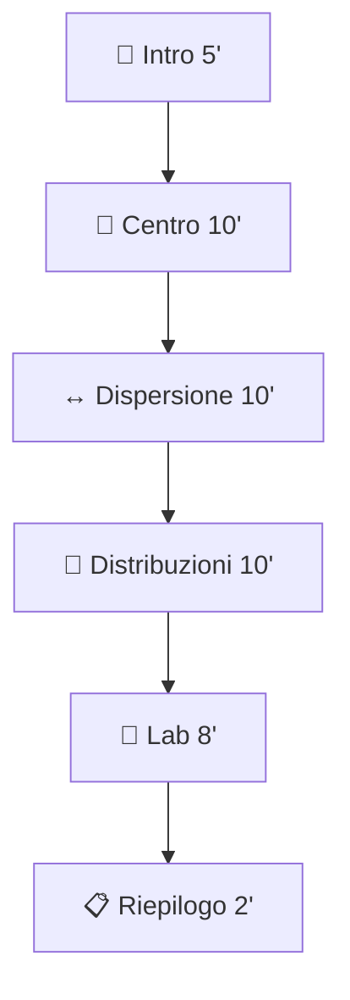
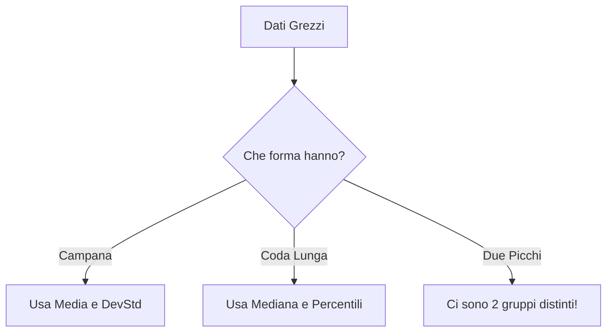

## Fondamenti di Statistica per Data Analyst — Lezione Completa

La statistica è la grammatica della Data Science. Non puoi scrivere poesie (Machine Learning) se non sai coniugare i verbi (Statistica Descrittiva). Molti errori di business nascono non da dati sbagliati, ma da un'interpretazione statistica errata. In questa lezione, costruiremo le fondamenta matematiche necessarie per analizzare i dati con confidenza e scetticismo sano.

### Obiettivi di Apprendimento

Al termine di questa lezione, lo studente sarà in grado di:
1.  Distinguere quando usare la Media (Mean) e quando la Mediana per descrivere un dataset.
2.  Interpretare la Deviazione Standard come misura di rischio e volatilità.
3.  Comprendere la differenza tra Correlazione e Causalità (e gli esperimenti per provarla).
4.  Identificare i principali tipi di distribuzione (Normale, Asimmetrica, bimodale).
5.  Applicare il Teorema del Limite Centrale per capire perché i campioni funzionano.

### Timeline della Lezione

| Fase | Argomento | Durata |
|------|-----------|--------|
| 1 | Introduzione: Perché la statistica mente | 5 min |
| 2 | Teoria: Misure di Tendenza Centrale | 10 min |
| 3 | Teoria: Misure di Dispersione (Varianza) | 10 min |
| 4 | Concetto: Distribuzioni e Probabilità | 10 min |
| 5 | Esercizi: Analisi di un Dataset | 8 min |
| 6 | Riepilogo e Domande | 2 min |
| **Totale** | | **45 min** |

### Fase 1 — Introduzione: Perché la statistica mente (5 min)

"Ci sono tre tipi di bugie: le bugie, le sfacciate bugie, e le statistiche." (Benjamin Disraeli).
Un analista può "torturare i dati finché non confessano".
Esempio: "Lo stipendio medio in questo bar è 1 milione di euro". (Vero, se nel bar c'è Bill Gates).
Il nostro lavoro è usare la statistica per rivelare la verità, non per nasconderla.

### Fase 2 — Teoria: Misure di Tendenza Centrale (10 min)

Dove si trova il "centro" dei dati?

1.  **Media (Mean):** Somma / N.
    *   *Pro:* Include tutti i dati.
    *   *Contro:* Sensibilissima agli outlier. Bill Gates nel bar alza la media a livelli irreali.
2.  **Mediana (Median):** Il valore che divide i dati a metà (50% sopra, 50% sotto).
    *   *Pro:* Robusta. Se entra Bill Gates, la mediana non cambia quasi nulla.
    *   *Uso:* Stipendi, Prezzi delle case, Tempo sul sito.
3.  **Moda (Mode):** Il valore più frequente.
    *   *Uso:* Categorie ("Il colore più venduto").

**Regola:** Se Media >> Mediana, la distribuzione è asimmetrica a destra (Coda lunga, es. Ricchezza).

### Fase 3 — Teoria: Misure di Dispersione (10 min)

Sapere la media non basta. "Se metto la testa nel forno e i piedi nel freezer, in media sto bene".

1.  **Range:** Max - Min. (Troppo semplice).
2.  **Varianza ($\sigma^2$):** Media degli scarti al quadrato.
3.  **Deviazione Standard ($\sigma$):** Radice della varianza. È nella stessa unità di misura dei dati.
    *   *Interpretazione:* Se $\sigma$ è alta, i dati sono "sparpagliati". Nel business, $\sigma$ = Rischio / Incertezza.

**Coefficiente di Variazione (CV):** $\sigma / \mu$.
Utile per confrontare la volatilità di cose diverse (es. Azioni vs Titoli di Stato).

### Fase 4 — Concetto: Distribuzioni e Probabilità (10 min)

La forma dei dati conta.

1.  **Distribuzione Normale (Gaussiana):** A campana. Simmetrica.
    *   *Esempi:* Altezza persone, Errori di misurazione, QI.
    *   *Regola 68-95-99.7:* Il 68% dei dati sta entro 1 $\sigma$ dalla media. Il 95% entro 2 $\sigma$.
2.  **Distribuzione Power Law (Pareto):** Coda lunga.
    *   *Esempi:* Ricchezza, Follower su Twitter, Vendite di libri.
    *   *Caratteristica:* Pochi giganti, tantissimi nani. Qui la media non ha senso.

**Teorema del Limite Centrale (CLT):**
Anche se i dati originali non sono normali, la distribuzione delle *medie dei campioni* tende alla normale se il campione è grande (>30). Questo è il motivo per cui possiamo fare sondaggi e A/B test.

### Fase 5 — Esercizi: Analisi di un Dataset (8 min)

**Scenario:** Analizziamo i tempi di caricamento del sito (Load Time).
Dati (ms): `200, 210, 190, 205, 5000`.

1.  **Calcola la Media:** (200+210+190+205+5000) / 5 = **1161 ms**.
    *   *Interpretazione:* "Il sito è lento (1 secondo)".
2.  **Calcola la Mediana:** Ordina: 190, 200, **205**, 210, 5000. Mediana = **205 ms**.
    *   *Interpretazione:* "Per la maggior parte degli utenti il sito è veloce (0.2 secondi)".
3.  **Analisi:** L'outlier (5000) distorce la media. Probabilmente un errore del server o una connessione lenta. La mediana è la metrica corretta da riportare al team tecnico.

### Fase 6 — Riepilogo e Domande (2 min)

1.  **Contesto.** Un numero senza contesto è rumore.
2.  **Mediana.** Il miglior amico dell'analista business.
3.  **Dispersione.** La media nasconde il rischio. Guarda la Deviazione Standard.
4.  **Distribuzione.** Disegna sempre l'istogramma prima di calcolare la media.

### Domande di Verifica

1.  In quale situazione preferiresti usare la Mediana invece della Media per descrivere un dataset?
2.  Cosa indica una Deviazione Standard molto alta rispetto alla media?
3.  Spiega la "Regola del 68-95-99.7" in una distribuzione normale.
4.  Perché la frase "Correlation does not imply causation" è fondamentale nell'analisi dati? Fai un esempio.
5.  Cos'è un "Outlier" e come può influenzare le tue analisi?

### Riferimenti Bibliografici

-   Charles Wheelan, "Naked Statistics", W. W. Norton & Company, 2013.
-   Darrell Huff, "How to Lie with Statistics", W. W. Norton & Company, 1954.
-   Khan Academy, "Statistics and Probability" (Corso online).
