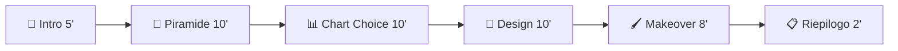

## Storytelling con i Dati: Convincere, non solo Informare — Lezione Completa

Hai passato 40 ore a pulire i dati, costruire il modello e trovare l'insight perfetto. Presenti al CEO. Dopo 5 minuti, lui guarda il telefono e dice: "Quindi? Cosa dobbiamo fare?". Il tuo lavoro è fallito. Non per colpa dell'analisi, ma della comunicazione. Un analista brillante che non sa raccontare una storia è inutile quanto un'auto senza ruote. In questa lezione, impareremo a trasformare i fogli di calcolo in narrazioni che muovono le persone all'azione.

### Obiettivi di Apprendimento

Al termine di questa lezione, lo studente sarà in grado di:
1.  Applicare la struttura narrativa in 3 atti (Contesto, Conflitto, Risoluzione) a un report aziendale.
2.  Utilizzare il principio della Piramide di Minto per comunicare con gli executive (Bottom-Line Up Front).
3.  Progettare slide che superano il "Glance Test" (comprensibili in 3 secondi).
4.  Scegliere il grafico giusto per ogni messaggio (Bar vs Line vs Scatter).
5.  Eliminare il "Chart Junk" (rumore visivo) per focalizzare l'attenzione sull'insight.

### Timeline della Lezione

| Fase | Argomento | Durata |
|------|-----------|--------|
| 1 | Introduzione: Perché le storie vincono sui fatti | 5 min |
| 2 | Struttura: La Piramide di Minto e i 3 Atti | 10 min |
| 3 | Visualizzazione: Scegliere il grafico giusto | 10 min |
| 4 | Design: De-cluttering e Attenzione | 10 min |
| 5 | Esercizi: "Makeover" di una Slide | 8 min |
| 6 | Riepilogo e Domande | 2 min |
| **Totale** | | **45 min** |



### Fase 1 — Introduzione: Perché le storie vincono sui fatti (5 min)

Il cervello umano dimentica i fatti ("Il fatturato è cresciuto del 2%"), ma ricorda le storie ("Abbiamo rischiato di fallire, ma grazie al nuovo prodotto siamo salvi").
Lo Storytelling non significa inventare. Significa dare *contesto* e *significato* ai dati.

**Exploratory vs Explanatory**
*   **Exploratory (Esplorativa):** Sei tu che scavi nei dati cercando perle. È disordinato. È il tuo lavoro "dietro le quinte".
*   **Explanatory (Esplicativa):** È la presentazione. Mostri *solo* le perle che hai trovato. Non mostrare tutte le ostriche vuote che hai aperto!

### Fase 2 — Struttura: La Piramide di Minto e i 3 Atti (10 min)

Come strutturi la presentazione? Se stai parlando a un manager occupato, non iniziare dalla cronistoria.

**La Piramide di Minto (McKinsey Standard):**
1.  **S.C.Q.A.**
    *   **Situation:** "Il mercato sta crescendo del 10%." (Tutti d'accordo).
    *   **Complication:** "Ma la nostra quota di mercato è ferma." (Il problema).
    *   **Question:** "Come possiamo sbloccare la crescita?" (La domanda implicita).
    *   **Answer (BLUF - Bottom Line Up Front):** "Dobbiamo investire nel canale TikTok." (La tua tesi).

Dopo aver dato la risposta subito, la supporti con 3 argomenti chiave.
1.  TikTok è dove sono i nostri futuri clienti.
2.  Il CAC su TikTok è la metà di Facebook.
3.  Abbiamo già i contenuti pronti.

**I 3 Atti Aristotelici:**
1.  **Setup:** Il mondo com'è oggi.
2.  **Conflitto:** Il problema che minaccia questo mondo (Il cattivo = Churn, Competitor).
3.  **Risoluzione:** Il nuovo mondo migliore se seguiamo la tua raccomandazione.

### Fase 3 — Visualizzazione: Scegliere il grafico giusto (10 min)

Non usare il grafico che ti piace. Usa quello che serve.

*   **Confronto (Chi è meglio?):** Bar Chart orizzontale.
*   **Trend (Come cambia?):** Line Chart.
*   **Relazione (C'è correlazione?):** Scatter Plot.
*   **Composizione (Di cosa è fatto?):** Stacked Bar (Evita le torte! Il cervello umano fatica a confrontare gli angoli).

**La Regola d'Oro:** Se devi spiegarlo, è sbagliato.
Se un grafico richiede 2 minuti per essere capito, hai perso l'audience.

```mermaid
graph TD
    Start{Cosa vuoi mostrare?}
    Start --> Confronto[Confronto tra categorie]
    Start --> Trend[Evoluzione nel tempo]
    Start --> Relazione[Relazione tra 2 variabili]
    Start --> Parte[Parte del tutto]

    Confronto --> Bar[Bar Chart]
    Trend --> Line[Line Chart]
    Relazione --> Scatter[Scatter Plot]
    Parte --> Stack[Stacked Bar (o Pie se < 3 fette)]
```

### Fase 4 — Design: De-cluttering e Attenzione (10 min)

Cole Nussbaumer Knaflic (autrice di *Storytelling with Data*) insegna a rimuovere il "Chart Junk".

1.  **Rimuovi:** Griglie di sfondo pesanti, bordi 3D, ombreggiature, legende separate (metti le etichette vicino ai dati).
2.  **Enfatizza:** Usa il colore strategicamente.
    *   *Sbagliato:* 10 barre di colori diversi (Arcobaleno).
    *   *Giusto:* 9 barre grigie e 1 barra blu scuro (quella su cui vuoi focalizzarti).
3.  **Titoli Attivi:**
    *   *Passivo:* "Andamento Ricavi Q1".
    *   *Attivo:* "I Ricavi sono calati a Marzo a causa della rottura di stock".

Il titolo deve essere l'insight. Se il grafico sparisce, il titolo deve bastare a capire il messaggio.

### Fase 5 — Esercizi: "Makeover" di una Slide (8 min)

**Slide Originale (Brutta):**
*   Titolo: "Dati Vendite".
*   Grafico: Torta 3D con 15 fette colorate.
*   Legenda minuscola a destra.
*   Nessun commento.

**Il tuo compito:**
1.  Trasformala in un Bar Chart orizzontale (più facile leggere le etichette).
2.  Ordina le barre dalla più grande alla più piccola.
3.  Colora di grigio tutte le barre tranne "Prodotto A" (che è crollato). Colora "Prodotto A" di rosso.
4.  Cambia il titolo in: "Le vendite del Prodotto A sono crollate del 40%: ecco perché".
5.  Aggiungi una freccia sul grafico che indica il momento del crollo.

### Fase 6 — Riepilogo e Domande (2 min)

1.  **Inizia dalla fine.** Dì subito la conclusione.
2.  **Elimina il rumore.** Se non serve, toglilo.
3.  **Il colore è attenzione.** Usalo per guidare l'occhio, non per decorare.
4.  **Tu sei la presentazione.** Le slide sono solo un supporto.

### Domande di Verifica

1.  Cosa si intende per approccio "Exploratory" vs "Explanatory" nell'analisi dati?
2.  Qual è la struttura "S.C.Q.A." di Barbara Minto e perché è efficace con i dirigenti?
3.  Perché i grafici a torta (Pie Charts) sono sconsigliati dalla maggior parte degli esperti di visualizzazione?
4.  Qual è la differenza tra un "Titolo Descrittivo" e un "Titolo Attivo/Insight"?
5.  Cos'è il "Chart Junk" e puoi farne tre esempi comuni?

### Riferimenti Bibliografici

-   Cole Nussbaumer Knaflic, "Storytelling with Data", Wiley, 2015.
-   Barbara Minto, "The Minto Pyramid Principle", 1996.
-   Gene Zelazny, "Say It With Charts", McGraw-Hill, 2001.
