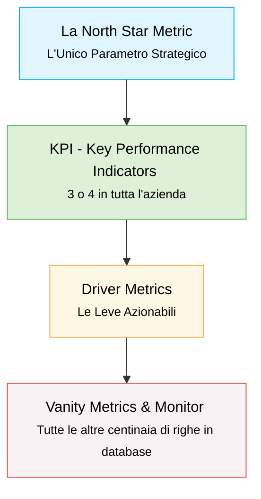

import { Aside, Steps, Tabs, TabItem, CardGrid, Card } from '@astrojs/starlight/components'

# Terminologia: Smetti di chiamare KPI qualsiasi numero

Nel mondo Corporate, e purtroppo anche in molte agenzie e startup mal guidate, regna un'anarchia linguistica che distrugge il decision-making. 
Le riunioni diventano ostaggi di frasi del tipo: *"Il nostro KPI sulle impressions è aumentato, ma il Driver di conversione è stabile, quindi le metriche generali non tornano"*.

È supercazzola. Non significa nulla.

Questa lezione ha l'obiettivo di "resettare" il tuo vocabolario. **Quando non sappiamo dare un nome preciso ai numeri, trattiamo azioni inutili con la stessa priorità di azioni vitali per l'azienda.**

Capiremo la piramide concettuale che separa i **Driver** (Causali) dalle **Metriche** (Gli indicatori misurabili) e dai **KPI** (Il fine ultimo).

---

## La Piramide Gerarchica dei Numeri

Esiste un dogma invalicabile nell'Analisi Dati: **Ogni KPI è una metrica, ma solo il 2% delle metriche merita di essere chiamato KPI**.

Analizziamola, partendo dal basso verso l'altare della strategia.

---

## 1. Vanity Metrics (Le Metriche di Vanità)

Sono i numeri che ti fanno sentire bene in sala riunioni ma non pagano gli stipendi. Sono numeri assoluti, quasi sempre cumulativi, che salgono per forza o sono totalmente slegati dalla redditività.

<CardGrid>
  <Card title="Esempi Classici" icon="close">
    - Impressions su una Campagna
    - Followers su Instagram
    - Utenti Totali Iscritti (Mai attivi)
    - Pagine viste totali
  </Card>
  <Card title="Il Test Acido" icon="pencil">
    Se questo numero raddoppiasse domani mattina, posso affermare con certezza matematica che il mio fatturato o profitto è aumentato? 
    *Se la risposta è No: È una Vanity Metric.*
  </Card>
</CardGrid>

---

## 2. Metriche (e Driver Metrics)

Una **Metrica** è qualsiasi numero tracciabile quantitativamente. Ma a noi interessano i **Driver** (o *Input Metrics*).
Un **Driver** è una metrica *che tu puoi influenzare direttamente o indirettamente col tuo lavoro* e che, muovendosi, ha un impatto matematico sul livello superiore (il KPI).

Ad esempio, in un e-commerce, il "Tasso di Click sulla Email del Carrello Abbandonato" è un Driver. Il reparto Email Marketing può modificarne l'oggetto e fare test A/B. Se quel numero sale, algebricamente porterà a un aumento delle conversioni.

<Tabs>
  <TabItem label="Input Metrics (I Driver)" icon="setting">
    Sono misurazioni delle leve operative. Puoi toccarle. Il tuo team ci lavora sopra ogni giorno.
    *Esempio:* 
    - Tempo medio prima della prima risposta (SaaS Support)
    - Tasso di completamento form (Lead Gen)
  </TabItem>
  <TabItem label="Output Metrics" icon="approve-check">
    Misurano il risultato finale di qualcosa. Sono inerti, non le puoi modificare agendo direttamente su di esse, puoi solo sperare che il lavoro fatto sui "Driver" sposti in alto questi "Output".
    *Esempio:*
    - Churn Rate mensile (Tasso di abbandono)
    - ROAS (Ritorno sulla spesa pubblicitaria)
  </TabItem>
</Tabs>

<Aside type="caution" title="L'illusione del lavoro sull'Output">
Vietato dire "Il nostro obiettivo di questo sprint è abbassare il Churn Rate a -2%". Sbagliato. 
Il Churn Rate (Output Metric) è il risultato. L'obiettivo sarà ad esempio: "Aumentare dal 10% al 25% la percentuale di utenti che guardano il video tutorial nei primi 3 giorni dall'iscrizione (Input Metric/Driver)", con la speranza algebrica che questo abbassi il Churn Rate.
</Aside>

---

## 3. I KPI (Key Performance Indicators)

Questa è la parola più abusata del ventunesimo secolo. Un **KPI** non è "una metrica molto importante".
Un Indicator è *Key* (Chiave) per la *Performance* solo se ha le seguenti spietate caratteristiche:

1. È limitato numericamente (Massimo 3 o 4 KPI in tutta l'azienda/progetto).
2. Ha un **Target Esplicito** legato a un budget temporale (Es: 1M€ ARR entro Q3).
3. Rappresenta la bussola tra Successo e Morte aziendale.
4. Ogni dipartimento ne comprende il significato e l'impatto sul business globale.

<CardGrid>
  <Card title="CEO SaaS B2B " icon="rocket">
    **KPI:** Net Revenue Retention (NRR) > 115%  
    *(Se ci riescono, scaleranno. Se falliscono, i margini saltano).*
  </Card>
  <Card title="VP Marketing E-commerce" icon="chart">
    **KPI:** Customer Acquisition Cost Blended (CAC) < 22€ 
    *(Se costa di più, l'azienda vende in perdita operativa).*
  </Card>
</CardGrid>

---

## 4. OMTM e North Star Metric (La Stella Polare)

Sopra i KPI, nelle aziende ad altissima crescita della Silicon Valley, vige il concetto di **North Star Metric (NSM)** o **One Metric That Matters (OMTM)**.

È un singolo numero magico. È l'intersezione perfetta tra il **valore che ottiene l'utente** e il **valore economico che incassa l'azienda**. Regola l'orizzonte ad almeno 2 anni.
Se tutta l'azienda spinge questo unico numero verso l'alto, ogni altro KPI e Driver si aggiusterà positivamente in cascata.

### Esempi celebri (Hard Data)
* **Spotify:**  *(Ascolto in ore di utenti premium in trial vs free - Un numero che dice se l'interfaccia funziona, se i brani ci sono, se l'utente capisce il valore).*
* **Airbnb:**  *(Numero di notti prenotate - Riassume host acquisiti, UX dei guest, pricing competitivo, trust del mercato).*
* **Facebook (Primi 5 anni):** *(Utenti con 7 amici entro 10 giorni dall'iscrizione - Zuckerberg scoprì che oltre quella soglia l'utente diventava tossico-dipendente dalla piattaforma e non l'abbandonava mai più).*

---

## Esercizio di Sintesi: Costruiamo l'Albero per Netflix

In questo preciso istante, il team direttivo di Netflix guarda i numeri dividendo rigorosamente il linguaggio in questo modo:

<Steps>
1. **Vanity Metric (Ignorata nei Board importanti):** "Numero totale di utenti registrati (anche quelli disiscritti da 5 anni)". Numero gigante, non paga il server Amazon AWS di quel mese.
2. **Driver/Input Metric (Ci lavorano Product Manager & Designer):** "Click-through rate sulle Thumbnail della Homepage" e "Percentuale di Completamento del 1° Episodio". Da qui si decide che copertina mostrati o quali algoritmi pushare.
3. **KPI Mese/Quarter (Ci lavorano i VP/Manager):** MRR (Monthly Recurring Revenue), Cost of Content Acquisition vs Views.
4. **North Star Metric (Misura il Core Value):** "Percentuale di utenti attivi nel mese che assistono ai contenuti per più di 10 ore a settimana". *Perché? Perché se guardano contenuti 10 ore, il Churn rate crollerà e rinnoveranno la carta di credito in totale passività. Vincita matematica.*
</Steps>

## Conclusione del Modulo 2

Con questa lezione si conclude il **Modulo 2: Data Collection & Tracking**. 
Abbiamo esplorato l'infrastruttura di codice puro, il legal design (Consensi, Cookie), la Data Integration (Fivetran/Reverse ETL) e ora padroneggiamo anche l'aspetto semantico del management, unendo finalmente l'ingegneria al puro Business Strategico.

Da qui passiamo alla pancia dell'infrastruttura: il **Modulo 3: Infrastructure & Engineering** in cui progetteremo i palazzi dove questi dati finiranno (Object Storage, Clickhouse e Datalakes).
