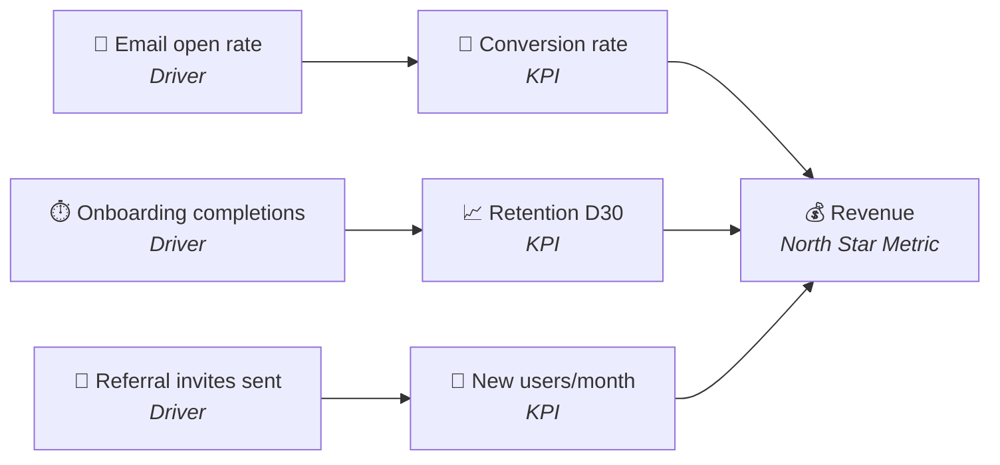

# Terminologia: Metriche, KPI e Driver

> **Obiettivo:** Padroneggiare la differenza tra metriche, KPI e driver — il vocabolario essenziale per chiunque lavori con i dati.

## 1. Il Problema: Tutti Parlano di "Metriche", Nessuno si Intende

In una sala riunioni tipica accade questo:

- Il **CEO** dice: "La nostra metrica principale è il fatturato"
- Il **VP Marketing** dice: "Il nostro KPI è il costo per acquisizione"
- Il **Product Manager** dice: "Il driver è l'activation rate"
- Il **Data Analyst** pensa: "State confondendo tre concetti diversi..."

Confondere metriche, KPI e driver porta a **decisioni sbagliate**, dashboard inutili e team disallineati. Facciamo chiarezza.

## 2. Le Definizioni

### Metrica

Una **metrica** è qualsiasi valore misurabile che descrive un aspetto del business.

```sql
-- Esempi di metriche
SELECT 
    COUNT(DISTINCT user_id) AS total_users,          -- Metrica
    COUNT(*) AS total_orders,                         -- Metrica
    SUM(revenue) AS total_revenue,                    -- Metrica
    AVG(session_duration) AS avg_session_duration,    -- Metrica
    COUNT(DISTINCT CASE WHEN is_new THEN user_id END) AS new_users  -- Metrica
FROM events
WHERE event_date = CURRENT_DATE;
```

> **Regola:** Ogni KPI è una metrica, ma non ogni metrica è un KPI.

### KPI (Key Performance Indicator)

Un **KPI** è una metrica **scelta strategicamente** per misurare il progresso verso un obiettivo specifico. È "Key" perché:

- È legato a un **obiettivo aziendale** concreto
- Ha un **target** definito (es. "raggiungere 10.000 utenti attivi")
- Ha un **responsabile** che ne risponde
- Viene **monitorato regolarmente** (daily, weekly)

```python
# Definizione strutturata di un KPI
kpi_definition = {
    "name": "Monthly Active Users (MAU)",
    "formula": "COUNT(DISTINCT user_id) WHERE last_active >= 30 days ago",
    "objective": "Crescita della base utenti",
    "target_q1": 50_000,
    "target_q2": 75_000,
    "owner": "VP Product",
    "review_frequency": "weekly",
    "data_source": "events.user_activity",
    "threshold_red": "<40_000",
    "threshold_yellow": "40_000-48_000", 
    "threshold_green": ">48_000"
}
```

### Driver

Un **driver** è una metrica che **influenza causalmente** un KPI. È la leva su cui puoi agire.



## 3. La Gerarchia: North Star → KPI → Driver → Metrica

```
                    ┌─────────────────────┐
                    │   NORTH STAR METRIC  │  ← 1 sola per azienda
                    │   (es. Weekly Active  │
                    │    Qualified Users)   │
                    └──────────┬──────────┘
                               │
              ┌────────────────┼────────────────┐
              │                │                │
        ┌─────┴─────┐   ┌─────┴─────┐   ┌─────┴─────┐
        │   KPI 1    │   │   KPI 2    │   │   KPI 3    │  ← 3-5 per team
        │ Activation │   │ Retention  │   │  Revenue   │
        │   Rate     │   │    D30     │   │   ARPU     │
        └─────┬─────┘   └─────┬─────┘   └─────┬─────┘
              │                │                │
        ┌─────┴─────┐   ┌─────┴─────┐   ┌─────┴─────┐
        │  Driver A  │   │  Driver C  │   │  Driver E  │  ← Leve operative
        │ Onboarding │   │ Feature    │   │ Upsell     │
        │ Completion │   │ Adoption   │   │ Conversion │
        └───────────┘   └───────────┘   └───────────┘
```

### Esempio Concreto: E-commerce

| Livello | Nome | Valore | Target |
|:---|:---|:---|:---|
| **North Star** | Revenue mensile | €450K | €500K |
| **KPI** | Conversion Rate | 2.8% | 3.5% |
| **KPI** | AOV (Average Order Value) | €85 | €95 |
| **KPI** | Repeat Purchase Rate | 22% | 30% |
| **Driver** | Cart Abandonment Rate | 68% | meno di 60% |
| **Driver** | Product Page → Add to Cart | 12% | 15% |
| **Driver** | Email CTR (carrello abbandonato) | 3.2% | 5% |
| **Metrica** | Pageviews | 1.2M | — |
| **Metrica** | Avg. Load Time | 2.1s | — |

```sql
-- Dashboard KPI con driver per e-commerce
WITH daily_metrics AS (
    SELECT
        event_date,
        COUNT(DISTINCT session_id) AS sessions,
        COUNT(DISTINCT CASE WHEN event = 'purchase' THEN session_id END) AS purchases,
        SUM(CASE WHEN event = 'purchase' THEN revenue END) AS revenue,
        COUNT(DISTINCT CASE WHEN event = 'add_to_cart' THEN session_id END) AS add_to_carts,
        COUNT(DISTINCT CASE WHEN event = 'cart_abandoned' THEN session_id END) AS cart_abandonments
    FROM events
    WHERE event_date >= CURRENT_DATE - INTERVAL 30 DAY
    GROUP BY event_date
)
SELECT
    event_date,
    -- KPI
    ROUND(purchases * 100.0 / NULLIF(sessions, 0), 2) AS conversion_rate_pct,
    ROUND(revenue / NULLIF(purchases, 0), 2) AS aov,
    -- Driver
    ROUND(add_to_carts * 100.0 / NULLIF(sessions, 0), 2) AS add_to_cart_rate_pct,
    ROUND(cart_abandonments * 100.0 / NULLIF(add_to_carts, 0), 2) AS cart_abandon_rate_pct,
    -- Metrica di contesto
    sessions,
    revenue
FROM daily_metrics
ORDER BY event_date DESC;
```

## 4. Vanity Metrics vs Actionable Metrics

Non tutte le metriche sono utili. Alcune sono **vanity metrics**: numeri che fanno bella figura ma non guidano decisioni.

| Vanity Metric 🚫 | Actionable Metric ✅ | Perché |
|:---|:---|:---|
| Utenti registrati totali | Utenti attivi settimanali (WAU) | Un utente registrato che non torna è irrilevante |
| Pageviews totali | Pages per session | Il volume totale dipende dal traffico, non dal valore |
| Download dell'app | Activation rate (D1) | Scaricare ≠ usare |
| Follower sui social | Engagement rate | 100K follower con 0.1% engagement < 10K con 5% |
| "Numero di feature rilasciate" | Feature adoption rate | Rilasciare ≠ usare |

```python
# Funzione per classificare le metriche
def classify_metric(metric: dict) -> str:
    """
    Classifica una metrica come Vanity o Actionable.
    
    Criteri per Actionable:
    1. Legata a un obiettivo di business
    2. Puoi agire su di essa (cambiare un comportamento)
    3. Misura un rapporto, non un valore assoluto
    """
    score = 0
    if metric.get('has_target'):        score += 1
    if metric.get('has_owner'):         score += 1
    if metric.get('is_ratio'):          score += 1
    if metric.get('drives_decision'):   score += 1
    if metric.get('is_comparative'):    score += 1
    
    if score >= 3:
        return "✅ Actionable"
    elif score >= 2:
        return "🟡 Borderline — aggiungi un target"
    else:
        return "🚫 Vanity — ripensa questa metrica"
```

## 5. Costruire il Proprio Albero delle Metriche

### Step-by-step

1. **Definisci la North Star Metric** → la singola metrica che cattura il valore che generi per i clienti
2. **Identifica 3-5 KPI** → metriche chiave per team (Product, Marketing, Sales)
3. **Per ogni KPI, trova 2-3 Driver** → le leve su cui puoi agire concretamente
4. **Assegna owner e target** a ogni KPI e driver
5. **Traccia tutto nel tracking plan** → collega ogni metrica agli eventi necessari

```python
# Template per l'albero delle metriche
metrics_tree = {
    "north_star": {
        "name": "Weekly Qualified Active Users",
        "definition": "Utenti che completano almeno 1 azione di valore a settimana",
        "current": 12_500,
        "target": 20_000,
        "owner": "CEO"
    },
    "kpis": [
        {
            "name": "Activation Rate",
            "definition": "% nuovi utenti che completano l'onboarding in 7gg",
            "current": 0.35,
            "target": 0.50,
            "owner": "PM Onboarding",
            "drivers": [
                {"name": "Onboarding Step 1 Completion", "current": 0.80, "target": 0.90},
                {"name": "Time to First Value", "current": "4.2 min", "target": "< 3 min"},
                {"name": "Tutorial Engagement", "current": 0.45, "target": 0.65}
            ]
        },
        {
            "name": "Retention D30",
            "definition": "% utenti attivi al giorno 30 dopo la registrazione",
            "current": 0.18,
            "target": 0.28,
            "owner": "PM Engagement",
            "drivers": [
                {"name": "Feature Adoption (core)", "current": 0.40, "target": 0.60},
                {"name": "Push Notification CTR", "current": 0.03, "target": 0.06},
                {"name": "Weekly Email Open Rate", "current": 0.22, "target": 0.30}
            ]
        }
    ]
}
```

## 6. Errori Comuni

| Errore | Conseguenza | Soluzione |
|:---|:---|:---|
| Troppi KPI (>7) | Nessuno è davvero "Key" | Seleziona 3-5 max per team |
| KPI senza target | Non sai se stai migliorando | Ogni KPI deve avere un numero target |
| KPI senza owner | Nessuno è responsabile | Ogni KPI ha un nome e cognome |
| Confondere correlazione e causalità nei driver | Intervieni sulla leva sbagliata | Usa A/B test per validare i driver |
| Cambiare KPI ogni mese | Impossibile misurare trend | Mantieni i KPI per almeno 1 quarter |

## Riepilogo

| Termine | Definizione | Esempio |
|:---|:---|:---|
| **Metrica** | Qualsiasi valore misurabile | Pageviews, session duration |
| **KPI** | Metrica chiave con target e owner | Conversion Rate → target 3.5% |
| **Driver** | Metrica che influenza un KPI | Cart abandonment rate |
| **North Star** | L'unica metrica che conta di più | Weekly Active Qualified Users |
| **Vanity Metric** | Numero che sembra bello ma non guida azioni | "1M download" |

## Risorse

- **Libro:** *Lean Analytics* — Alistair Croll & Benjamin Yoskovitz
- **Framework:** Pirate Metrics (AARRR) — Dave McClure
- **Articolo:** "How to Choose the Right KPIs" — Amplitude Blog
