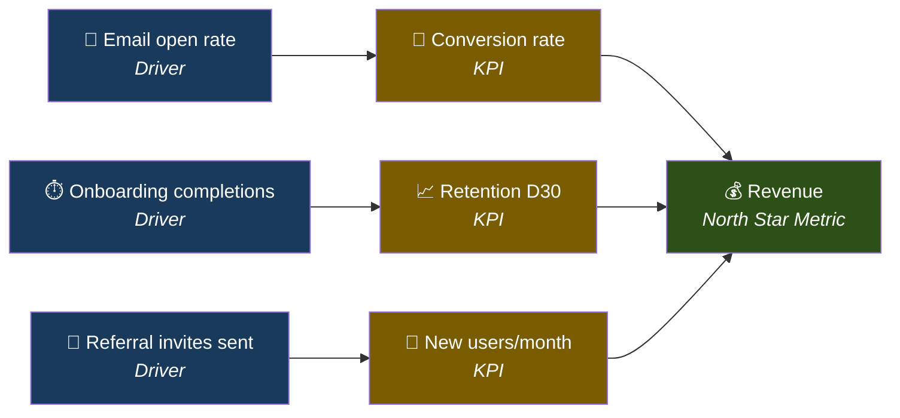

# Terminologia: Metriche, KPI e Driver

> **Obiettivo:** Padroneggiare la differenza tra metriche, KPI e driver — il vocabolario essenziale per chiunque lavori con i dati.

## 1. Il Problema: Tutti Parlano di "Metriche", Nessuno si Intende

In una sala riunioni tipica accade questo:

- Il **CEO** dice: "La nostra metrica principale è il fatturato"
- Il **VP Marketing** dice: "Il nostro KPI è il costo per acquisizione"
- Il **Product Manager** dice: "Il driver è l'activation rate"
- Il **Data Analyst** pensa: "State confondendo tre concetti diversi..."

Confondere metriche, KPI e driver porta a **decisioni sbagliate**, dashboard inutili e team disallineati. Facciamo chiarezza.

## 2. Le Definizioni

### Metrica

Una **metrica** è qualsiasi valore misurabile che descrive un aspetto del business.

```sql
-- Esempi di metriche
SELECT 
    COUNT(DISTINCT user_id) AS total_users,          -- Metrica
    COUNT(*) AS total_orders,                         -- Metrica
    SUM(revenue) AS total_revenue,                    -- Metrica
    AVG(session_duration) AS avg_session_duration,    -- Metrica
    COUNT(DISTINCT CASE WHEN is_new THEN user_id END) AS new_users  -- Metrica
FROM events
WHERE event_date = CURRENT_DATE;
```

> **Regola:** Ogni KPI è una metrica, ma non ogni metrica è un KPI.

### KPI (Key Performance Indicator)

Un **KPI** è una metrica **scelta strategicamente** per misurare il progresso verso un obiettivo specifico. È "Key" perché:

- È legato a un **obiettivo aziendale** concreto
- Ha un **target** definito (es. "raggiungere 10.000 utenti attivi")
- Ha un **responsabile** che ne risponde
- Viene **monitorato regolarmente** (daily, weekly)

```python
# Definizione strutturata di un KPI
kpi_definition = {
    "name": "Monthly Active Users (MAU)",
    "formula": "COUNT(DISTINCT user_id) WHERE last_active >= 30 days ago",
    "objective": "Crescita della base utenti",
    "target_q1": 50_000,
    "target_q2": 75_000,
    "owner": "VP Product",
    "review_frequency": "weekly",
    "data_source": "events.user_activity",
    "threshold_red": "<40_000",
    "threshold_yellow": "40_000-48_000", 
    "threshold_green": ">48_000"
}
```

### Driver

Un **driver** è una metrica che **influenza causalmente** un KPI. È la leva su cui puoi agire.



## 3. La Gerarchia: North Star → KPI → Driver → Metrica

```
                    ┌─────────────────────┐
                    │   NORTH STAR METRIC  │  ← 1 sola per azienda
                    │   (es. Weekly Active  │
                    │    Qualified Users)   │
                    └──────────┬──────────┘
                               │
              ┌────────────────┼────────────────┐
              │                │                │
        ┌─────┴─────┐   ┌─────┴─────┐   ┌─────┴─────┐
        │   KPI 1    │   │   KPI 2    │   │   KPI 3    │  ← 3-5 per team
        │ Activation │   │ Retention  │   │  Revenue   │
        │   Rate     │   │    D30     │   │   ARPU     │
        └─────┬─────┘   └─────┬─────┘   └─────┬─────┘
              │                │                │
        ┌─────┴─────┐   ┌─────┴─────┐   ┌─────┴─────┐
        │  Driver A  │   │  Driver C  │   │  Driver E  │  ← Leve operative
        │ Onboarding │   │ Feature    │   │ Upsell     │
        │ Completion │   │ Adoption   │   │ Conversion │
        └───────────┘   └───────────┘   └───────────┘
```

### Esempio Concreto: E-commerce

| Livello | Nome | Valore | Target |
|:---|:---|:---|:---|
| **North Star** | Revenue mensile | €450K | €500K |
| **KPI** | Conversion Rate | 2.8% | 3.5% |
| **KPI** | AOV (Average Order Value) | €85 | €95 |
| **KPI** | Repeat Purchase Rate | 22% | 30% |
| **Driver** | Cart Abandonment Rate | 68% | meno di 60% |
| **Driver** | Product Page → Add to Cart | 12% | 15% |
| **Driver** | Email CTR (carrello abbandonato) | 3.2% | 5% |
| **Metrica** | Pageviews | 1.2M | — |
| **Metrica** | Avg. Load Time | 2.1s | — |

```sql
-- Dashboard KPI con driver per e-commerce
WITH daily_metrics AS (
    SELECT
        event_date,
        COUNT(DISTINCT session_id) AS sessions,
        COUNT(DISTINCT CASE WHEN event = 'purchase' THEN session_id END) AS purchases,
        SUM(CASE WHEN event = 'purchase' THEN revenue END) AS revenue,
        COUNT(DISTINCT CASE WHEN event = 'add_to_cart' THEN session_id END) AS add_to_carts,
        COUNT(DISTINCT CASE WHEN event = 'cart_abandoned' THEN session_id END) AS cart_abandonments
    FROM events
    WHERE event_date >= CURRENT_DATE - INTERVAL 30 DAY
    GROUP BY event_date
)
SELECT
    event_date,
    -- KPI
    ROUND(purchases * 100.0 / NULLIF(sessions, 0), 2) AS conversion_rate_pct,
    ROUND(revenue / NULLIF(purchases, 0), 2) AS aov,
    -- Driver
    ROUND(add_to_carts * 100.0 / NULLIF(sessions, 0), 2) AS add_to_cart_rate_pct,
    ROUND(cart_abandonments * 100.0 / NULLIF(add_to_carts, 0), 2) AS cart_abandon_rate_pct,
    -- Metrica di contesto
    sessions,
    revenue
FROM daily_metrics
ORDER BY event_date DESC;
```

## 4. Vanity Metrics vs Actionable Metrics

Non tutte le metriche sono utili. Alcune sono **vanity metrics**: numeri che fanno bella figura ma non guidano decisioni.

| Vanity Metric 🚫 | Actionable Metric ✅ | Perché |
|:---|:---|:---|
| Utenti registrati totali | Utenti attivi settimanali (WAU) | Un utente registrato che non torna è irrilevante |
| Pageviews totali | Pages per session | Il volume totale dipende dal traffico, non dal valore |
| Download dell'app | Activation rate (D1) | Scaricare ≠ usare |
| Follower sui social | Engagement rate | 100K follower con 0.1% engagement < 10K con 5% |
| "Numero di feature rilasciate" | Feature adoption rate | Rilasciare ≠ usare |

```python
# Funzione per classificare le metriche
def classify_metric(metric: dict) -> str:
    """
    Classifica una metrica come Vanity o Actionable.
    
    Criteri per Actionable:
    1. Legata a un obiettivo di business
    2. Puoi agire su di essa (cambiare un comportamento)
    3. Misura un rapporto, non un valore assoluto
    """
    score = 0
    if metric.get('has_target'):        score += 1
    if metric.get('has_owner'):         score += 1
    if metric.get('is_ratio'):          score += 1
    if metric.get('drives_decision'):   score += 1
    if metric.get('is_comparative'):    score += 1
    
    if score >= 3:
        return "✅ Actionable"
    elif score >= 2:
        return "🟡 Borderline — aggiungi un target"
    else:
        return "🚫 Vanity — ripensa questa metrica"
```

## 5. Costruire il Proprio Albero delle Metriche

### Step-by-step

1. **Definisci la North Star Metric** → la singola metrica che cattura il valore che generi per i clienti
2. **Identifica 3-5 KPI** → metriche chiave per team (Product, Marketing, Sales)
3. **Per ogni KPI, trova 2-3 Driver** → le leve su cui puoi agire concretamente
4. **Assegna owner e target** a ogni KPI e driver
5. **Traccia tutto nel tracking plan** → collega ogni metrica agli eventi necessari

```python
# Template per l'albero delle metriche
metrics_tree = {
    "north_star": {
        "name": "Weekly Qualified Active Users",
        "definition": "Utenti che completano almeno 1 azione di valore a settimana",
        "current": 12_500,
        "target": 20_000,
        "owner": "CEO"
    },
    "kpis": [
        {
            "name": "Activation Rate",
            "definition": "% nuovi utenti che completano l'onboarding in 7gg",
            "current": 0.35,
            "target": 0.50,
            "owner": "PM Onboarding",
            "drivers": [
                {"name": "Onboarding Step 1 Completion", "current": 0.80, "target": 0.90},
                {"name": "Time to First Value", "current": "4.2 min", "target": "< 3 min"},
                {"name": "Tutorial Engagement", "current": 0.45, "target": 0.65}
            ]
        },
        {
            "name": "Retention D30",
            "definition": "% utenti attivi al giorno 30 dopo la registrazione",
            "current": 0.18,
            "target": 0.28,
            "owner": "PM Engagement",
            "drivers": [
                {"name": "Feature Adoption (core)", "current": 0.40, "target": 0.60},
                {"name": "Push Notification CTR", "current": 0.03, "target": 0.06},
                {"name": "Weekly Email Open Rate", "current": 0.22, "target": 0.30}
            ]
        }
    ]
}
```

## 6. Errori Comuni

| Errore | Conseguenza | Soluzione |
|:---|:---|:---|
| Troppi KPI (>7) | Nessuno è davvero "Key" | Seleziona 3-5 max per team |
| KPI senza target | Non sai se stai migliorando | Ogni KPI deve avere un numero target |
| KPI senza owner | Nessuno è responsabile | Ogni KPI ha un nome e cognome |
| Confondere correlazione e causalità nei driver | Intervieni sulla leva sbagliata | Usa A/B test per validare i driver |
| Cambiare KPI ogni mese | Impossibile misurare trend | Mantieni i KPI per almeno 1 quarter |

## Riepilogo

| Termine | Definizione | Esempio |
|:---|:---|:---|
| **Metrica** | Qualsiasi valore misurabile | Pageviews, session duration |
| **KPI** | Metrica chiave con target e owner | Conversion Rate → target 3.5% |
| **Driver** | Metrica che influenza un KPI | Cart abandonment rate |
| **North Star** | L'unica metrica che conta di più | Weekly Active Qualified Users |
| **Vanity Metric** | Numero che sembra bello ma non guida azioni | "1M download" |

## Risorse

- **Libro:** *Lean Analytics* — Alistair Croll & Benjamin Yoskovitz
- **Framework:** Pirate Metrics (AARRR) — Dave McClure
- **Articolo:** "How to Choose the Right KPIs" — Amplitude Blog

---

## Glossario Tecnico di Data Engineering

Il vocabolario del data engineering è spesso usato in modo impreciso. Ecco le definizioni tecniche precise dei termini più importanti, con esempi concreti e distinzioni che fanno differenza nel lavoro quotidiano.

### CDC — Change Data Capture

Il **CDC** è una tecnica per catturare le modifiche (INSERT, UPDATE, DELETE) che avvengono in un database sorgente, in tempo reale o quasi. Invece di copiare l'intero database a intervalli (batch), il CDC trasmette solo i cambiamenti.

Il meccanismo più comune è il **WAL (Write-Ahead Log)**: ogni database relazionale scrive le modifiche nel WAL prima di applicarle. Debezium legge il WAL di PostgreSQL (o MySQL binlog) e pubblica le modifiche su Kafka.

```
PostgreSQL WAL → Debezium → Kafka Topic → ClickHouse (MV) → Warehouse
```

La differenza con il batch ETL: con CDC la latenza è di secondi, non ore. Il costo di replica è proporzionale alle modifiche, non alla dimensione totale della tabella.

### ELT vs ETL

**ETL (Extract, Transform, Load)**: i dati vengono estratti dalla sorgente, trasformati in un sistema separato (spesso Spark), e poi caricati nel warehouse già trasformati. Pattern tradizionale: i trasformazioni avvengono prima del caricamento.

**ELT (Extract, Load, Transform)**: i dati vengono caricati nel warehouse RAW, e le trasformazioni avvengono all'interno del warehouse usando SQL (e dbt). Pattern moderno: il warehouse è abbastanza potente da fare le trasformazioni internamente.

La rivoluzione di BigQuery, Snowflake e ClickHouse ha reso ELT il pattern dominante perché elimina il layer Spark intermedio e permette a chi conosce SQL di fare trasformazioni senza dover scrivere codice Python/Scala.

### CDP — Customer Data Platform

Una **CDP** (Customer Data Platform) è una piattaforma che:
1. Raccoglie eventi da ogni touchpoint (web, mobile, offline, CRM)
2. Unifica l'identità dell'utente attraverso tutti i canali (identity resolution)
3. Crea un profilo unificato del cliente
4. Attiva i dati verso destinazioni (marketing tools, warehouse, BI)

Segment, RudderStack e Amplitude Data sono CDP. Si distinguono dai DMP (Data Management Platform, focalizzati su segmentazione per advertising) e dai CRM (focalizzati sulla relazione commerciale).

La distinzione chiave: una CDP raccoglie dati **first-party** (tuoi clienti), un DMP lavora principalmente con dati **third-party** (segmenti audience di terze parti).

### ROAS, LTV, CAC, MRR/ARR

**ROAS (Return on Ad Spend)**: revenue generato per ogni euro speso in pubblicità.

```
ROAS = Revenue Attribuito / Spesa Pubblicitaria
```

Un ROAS di 3x significa: per ogni €1 speso in ads, hai generato €3 di revenue. Il ROAS target varia enormemente per settore: e-commerce fashion può funzionare con ROAS 3x, marketplace SaaS enterprise lavora su cicli più lunghi e i ROAS iniziali sono negativi.

**LTV (Lifetime Value)**: il valore totale che un cliente genera durante tutta la relazione con l'azienda.

```
LTV = ARPU * Gross Margin * (1 / Churn Rate)
```

Esempio: un SaaS con ARPU €50/mese, margin 80%, churn 5%/mese → LTV = 50 * 0.8 * (1/0.05) = **€800**

**CAC (Customer Acquisition Cost)**: il costo medio per acquisire un nuovo cliente.

```
CAC = (Costo Marketing + Costo Sales) / Nuovi Clienti nel Periodo
```

Il ratio LTV/CAC è il health indicator fondamentale: LTV/CAC > 3 indica un business sostenibile; < 1 significa che stai perdendo denaro su ogni cliente.

**MRR (Monthly Recurring Revenue)**: il revenue ricorrente mensile normalizzato. Fondamentale per SaaS.

```
MRR = Σ (revenue mensile normalizzato di ogni abbonamento attivo)
```

Un cliente che paga €120/anno contribuisce €10/mese all'MRR. L'MRR si decompone in: New MRR (nuovi clienti), Expansion MRR (upgrade), Churned MRR (cancellazioni), Contraction MRR (downgrade).

**ARR (Annual Recurring Revenue)**: semplicemente MRR × 12. È la metrica che gli investitori usano per valutare le startup SaaS.

### Event Schema e Canonical Model

Un **Event Schema** definisce la struttura di un evento: quali campi contiene, quali tipi di dato, quali campi sono obbligatori.

```json
{
  "event": "purchase",
  "properties": {
    "order_id": "string (required)",
    "revenue": "number (required, > 0)",
    "currency": "string (required, ISO 4217)",
    "products": "array (required, min 1 item)"
  }
}
```

Il **Canonical Model** (o Event Taxonomy) è il vocabolario condiviso tra tutti i team su come nominare gli eventi e le loro proprietà. Invece di avere `order_completed` (web), `purchase_done` (mobile), `transaction` (backend) — tutti che significano la stessa cosa — il Canonical Model definisce un nome univoco (`purchase`) con proprietà standardizzate.

Senza Canonical Model, ogni team traccia gli eventi con nomi e proprietà diversi, rendendo impossibile l'analisi cross-platform.

### Data Contract

Un **Data Contract** è un accordo formale tra il produttore di dati (chi inserisce) e il consumatore (chi legge). Specifica: schema, formato, frequenza di aggiornamento, SLO di qualità, e politica di breaking changes.

```yaml
# Esempio di Data Contract in formato YAML
name: "events.purchases"
version: "2.1"
owner: "platform-team@company.com"
consumers:
  - "data-team"
  - "finance-team"
schema:
  order_id:
    type: string
    required: true
    description: "UUID dell'ordine (non riusabile)"
  revenue:
    type: decimal(10,2)
    required: true
    description: "Revenue netto dopo sconti e resi, in EUR"
sla:
  freshness: "< 30 minuti"
  completeness: "> 99.5%"
breaking_change_policy: "30 giorni di preavviso via email"
```

Il Data Contract è il fondamento della **Data Mesh**: ogni team è responsabile dei propri dati e li pubblica con un contratto che i consumer possono sottoscrivere.

### SLO, SLI, SLA

**SLI (Service Level Indicator)**: la metrica misurata. "Percentuale di tabelle aggiornate nelle ultime 2 ore."

**SLO (Service Level Objective)**: il target interno per l'SLI. "Il 99.5% delle tabelle deve essere aggiornato nelle ultime 2 ore."

**SLA (Service Level Agreement)**: l'accordo contrattuale con l'esterno. "Garantiamo ai team consumer dati aggiornati entro 4 ore, con penali in caso di violazione."

La relazione: SLO è sempre più stringente dell'SLA. Se il tuo SLA promette 4 ore di freshness, il tuo SLO interno è 2 ore — così hai margine per reagire prima di violare il contratto esterno.

### WAL — Write-Ahead Log

Il **WAL** (Write-Ahead Log) è il registro delle transazioni di un database relazionale. Ogni modifica (INSERT, UPDATE, DELETE) viene scritta nel WAL prima di essere applicata ai dati reali. Questo garantisce la durabilità: se il server crasha, il WAL permette il ripristino.

Il WAL è la base del CDC: Debezium (per PostgreSQL) e Maxwell's Daemon (per MySQL) leggono il WAL in streaming e pubblicano le modifiche su Kafka. Questo permette di replicare in tempo reale qualsiasi cambiamento nel database sorgente verso il data warehouse senza impattare il database stesso.

### Partition Key e Consumer Group

In Kafka, la **Partition Key** determina in quale partition di un topic viene scritto un messaggio. Due messaggi con la stessa partition key finiscono sempre nella stessa partition, garantendo l'ordinamento per quella chiave.

```python
producer.produce(
    topic="events",
    key="user-12345",    # ← Partition Key
    value=json.dumps(event)
)
# Tutti gli eventi di user-12345 finiscono nella stessa partition
# → ordinamento garantito per utente
```

Il **Consumer Group** è un gruppo di consumer che condividono la lettura di un topic. Kafka distribuisce le partition tra i consumer del gruppo, garantendo che ogni partition sia letta da un solo consumer alla volta. Se aggiungi consumer al gruppo, Kafka ribalancia automaticamente le partition.

```
Topic: events (6 partitions)
Consumer Group: clickhouse-cdc (3 consumers)
→ Consumer 1: partitions 0, 1
→ Consumer 2: partitions 2, 3
→ Consumer 3: partitions 4, 5
```

### Kafka Offset

L'**Offset** è il numero sequenziale che identifica la posizione di un messaggio in una partition di Kafka. Il Consumer Group salva il suo offset corrente su Kafka (o ZooKeeper). Se il consumer si riavvia, riprende dall'ultimo offset salvato.

Questo è fondamentale per la semantica "at-least-once": in caso di crash dopo l'elaborazione ma prima del commit dell'offset, il messaggio viene rielaborato (potenzialmente duplicato). Per garantire "exactly-once" serve deduplicazione lato consumer.

### Schema Registry

Lo **Schema Registry** (Confluent Schema Registry) è un servizio centralizzato che gestisce le versioni degli schemi Avro, Protobuf o JSON Schema per i topic Kafka. Ogni messaggio contiene un ID schema invece dell'intero schema inline, riducendo il payload e garantendo la compatibilità.

Modalità di compatibilità:
- `BACKWARD`: il nuovo schema può deserializzare messaggi scritti col vecchio schema
- `FORWARD`: il vecchio schema può deserializzare messaggi scritti col nuovo schema
- `FULL`: entrambe le direzioni

### Materialized View

Una **Materialized View** (MV) è una vista il cui risultato è pre-calcolato e materializzato fisicamente su disco, invece di essere calcolato ad ogni query. In ClickHouse, le MV funzionano come trigger sugli INSERT: ogni inserimento nella tabella sorgente triggera l'esecuzione della query della MV e il risultato viene scritto nella tabella destinazione.

Differenza fondamentale: una view normale ricalcola il risultato a ogni query (lenta); una materialized view ha il risultato già calcolato (istantanea).

### Medallion Architecture

La **Medallion Architecture** (introdotta da Databricks) organizza il data lake in tre layer:

- **Bronze**: dati grezzi, immutabili, copiati 1:1 dalla sorgente. Nessuna trasformazione.
- **Silver**: dati puliti, validati, de-duplicati. Schema standardizzato.
- **Gold**: dati aggregati e ottimizzati per il consumo finale (BI, ML, API).

Equivalente nella terminologia dbt: Raw (Bronze), Staging (Silver), Marts (Gold).

### Data Lakehouse

Il **Data Lakehouse** combina i vantaggi del data lake (storage economico, dati raw, formati aperti) con quelli del data warehouse (transazioni ACID, query ottimizzate, governance).

Tecnologie abilitanti: Apache Iceberg e Delta Lake aggiungono la gestione delle transazioni (ACID) e il time-travel ai file Parquet su S3, permettendo UPDATE e DELETE che tradizionalmente non sono possibili su un data lake.

Snowflake e BigQuery implementano il Lakehouse esponendo storage esterno (S3/GCS) tramite external tables con governance integrata.

### Reverse ETL

Il **Reverse ETL** è il processo inverso all'ELT classico: invece di portare dati dalle sorgenti operative al warehouse, porta dati dal warehouse verso le applicazioni operative (CRM, sales tool, marketing automation).

Esempio: calcoli il LTV dei clienti nel warehouse con dbt → Reverse ETL (Census, Hightouch) → sincronizza il LTV su Salesforce → il team sales vede i clienti ad alto LTV prioritizzati.

Il Reverse ETL chiude il loop tra analytics e azione: le insight prodotte nel warehouse diventano dati operativi che guidano le azioni del team.

### Identity Resolution

L'**Identity Resolution** è il processo di unificare i diversi identificatori di uno stesso utente (anonymousId, userId, email, device ID, cookie ID) in un'unica identity.

Scenario tipico:
1. Utente visita il sito → riceve `anonymousId: abc-123`
2. Si registra → riceve `userId: user-456`
3. Accede da mobile → ha `device_id: ios-789`
4. Clicca su una email → ha `email: mario@example.com`

L'Identity Graph mappa tutte queste identità all'utente reale "Mario", permettendo di analizzare il customer journey completo attraverso tutti i touchpoint.

CDPs come Segment e RudderStack implementano l'identity resolution. ClickHouse può implementarla con tabelle di mapping `(anonymous_id, user_id)` aggiornate dal `$identify` event.
