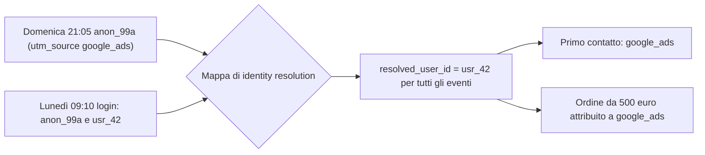

Una domenica sera un utente clicca un annuncio Google Ads dallo smartphone e visita il sito da ospite, con `anonymous_id = 'anon_99a'`. Il lunedì mattina riapre la pagina, fa login come `usr_42` e completa un acquisto da 500 euro per conto della sua società, `company_800`. Il team usa una sola colonna `id_utente` che viene sovrascritta al login. Nel warehouse compaiono due persone: un visitatore anonimo che ha consumato budget senza comprare e un cliente apparso dal nulla, attribuito al "Traffico Diretto". Questo è un caso ricostruito con numeri di esempio, e la sua causa non è la navigazione in due momenti, ma un vocabolario di tracking che confonde identità, proprietà e tratti.

## Un acquisto dopo il login e Google Ads a zero conversioni

L'azienda dell'esempio investe 40.000 euro al mese in campagne di acquisizione per un software B2B e scopre che l'85% delle conversioni risulta attribuito a `Direct / None`. L'analisi trova tre errori concettuali. Il primo: ogni evento ha un solo campo `visitor_id`, che contiene il cookie anonimo finché l'utente non si autentica e poi viene sostituito dall'ID del database. Se l'evento di login non conserva entrambi gli identificativi, tutto ciò che è accaduto prima del login resta orfano e il canale di primo contatto si perde.

Il secondo errore riguarda il B2B. Cinque colleghi della stessa azienda usano il prodotto: uno ha avviato la prova gratuita, uno ha inserito la carta, tre lo usano ogni giorno. Guardando solo `user_id`, senza l'entità superiore `group_id`, chi paga sembra inattivo e chi usa il prodotto sembra non pagante. Il terzo errore: il piano tariffario viene salvato solo come attributo mutabile dell'anagrafica. Quando il cliente passa da `basic` a `pro` a novembre, tutte le sue azioni di gennaio sembrano compiute da un utente `pro`.

Per correggere questi tre difetti serve fissare nel tracking plan un vocabolario rigoroso, dove ogni termine ha un significato e un posto.

## Le primitive del tracking: evento, proprietà, tratto, identità, sessione

> **Idea chiave:** ciò che è accaduto in un istante va registrato come evento con le sue proprietà e non cambia mai; ciò che una persona o un'azienda è oggi va registrato come tratto e può cambiare.

La tabella riassume le cinque primitive con un esempio per ciascuna.

| Primitiva | Definizione operativa | Esempio | Mutabile |
|---|---|---|---|
| Evento (`track`, `page`) | Fatto avvenuto in un istante preciso, `occurred_at` | `order_completed` | No |
| Event property | Contesto del fatto nell'istante in cui accade | `plan_at_event_time = 'basic'` | No, è fotografia |
| Trait (`identify`, `group`) | Stato corrente di un utente o di un'azienda | `current_plan = 'pro'` | Sì |
| Identità | Chiave che lega gli eventi a una persona o a un account | `anonymous_id`, `user_id`, `group_id` | No, chiavi tecniche |
| Sessione | Sequenza contigua di eventi con pause sotto soglia | `usr_42_s2` | Derivata |

La distinzione tra proprietà e tratti ha una conseguenza pratica. Salvare le informazioni storiche critiche come event properties garantisce che un cambio di stato futuro non riscriva il passato. Il piano al momento dell'acquisto va nel payload dell'evento, non solo nell'anagrafica.

```json
{
  "_comment": "Evento track con proprietà immutabili e contesto: il piano al momento del fatto resta scritto nell'evento",
  "type": "track",
  "event": "order_completed",
  "event_id": "evt_a91",
  "anonymousId": "anon_99a",
  "userId": "usr_42",
  "groupId": "company_800",
  "timestamp": "2026-11-09T09:12:40.000Z",
  "properties": {
    "order_amount_eur": 500.0,
    "plan_at_event_time": "basic",
    "utm_campaign": "autunno_2026"
  }
}
```

Il tratto corrispondente, invece, descrive lo stato attuale e viene aggiornato con una chiamata `identify`.

```json
{
  "_comment": "Identify: collega anonymous_id e user_id e aggiorna i tratti correnti",
  "type": "identify",
  "anonymousId": "anon_99a",
  "userId": "usr_42",
  "traits": { "current_plan": "pro", "company_id": "company_800" }
}
```

## La triade delle identità e il legame retroattivo

L'`anonymous_id` è l'UUID generato sul dispositivo, in un cookie first-party, al primo atterraggio: esiste prima e dopo il login. Lo `user_id` è l'identificativo immutabile della persona nel database autenticato, valorizzato dopo registrazione o login, e non deve mai essere l'email, perché l'email cambia. Il `group_id` identifica l'azienda o il team nel B2B. Nell'evento di login compaiono insieme `anonymous_id = 'anon_99a'` e `user_id = 'usr_42'`, e una tabella ponte, la mappa di identity resolution, lega i due ID. Con quella mappa le azioni precedenti al login si possono attribuire retroattivamente al profilo reale.



## Quanto costa l'identità spezzata: un calcolo

Con numeri di esempio, la campagna Google Ads dell'azienda ha un budget mensile di 12.000 euro e genera 30 ordini da 500 euro, per un ricavo reale di 30 × 500 = 15.000 euro. Il ROAS corretto è 15.000 / 12.000 = 1,25. Ora supponi che l'80% di quegli ordini avvenga dopo un login in una sessione successiva alla visita anonima: 30 × 0,80 = 24 ordini. Con la colonna unica sovrascritta al login, quei 24 ordini non hanno più il canale di primo contatto e finiscono in `Direct`. Alla campagna restano 30 − 24 = 6 ordini, cioè 6 × 500 = 3.000 euro, e il ROAS apparente diventa 3.000 / 12.000 = 0,25.

La differenza tra 1,25 e 0,25 è un fattore 5. Un responsabile marketing che legge 0,25 spegne una campagna che rende. Il difetto non sta nei dati raccolti, che erano completi, ma nel modello che non ha conservato `anonymous_id` accanto a `user_id`.

## Sessione: soglia di 30 minuti su identità risolta

Una sessione è una sequenza contigua di eventi dello stesso utente in cui il tempo tra due eventi consecutivi non supera la soglia di inattività, convenzionalmente 30 minuti, cioè 1.800 secondi. Il calcolo si fa dopo aver risolto l'identità, altrimenti un login a metà navigazione spezza una visita unica in due.

Applicalo ai tuoi eventi di esempio: domenica alle 21:05 e alle 21:20, lunedì alle 09:10 e alle 09:15. Il primo intervallo è di 15 min, sotto soglia, quindi i due eventi di domenica appartengono alla stessa sessione. Il secondo intervallo va dalle 21:20 alle 09:10, cioè 11 ore e 50 minuti, pari a 710 min, molto oltre i 30 min: apre una nuova sessione. L'ultimo, di 5 min, resta nella sessione di lunedì. Il totale è di 2 sessioni, `usr_42_s1` (scoperta) e `usr_42_s2` (acquisto).

La stessa logica si verifica con poche righe di Python, utili come controllo indipendente della query SQL.

```python
from datetime import datetime, timedelta

# Sessionizzazione di controllo: nuova sessione se la pausa supera 30 minuti
SOGLIA = timedelta(minutes=30)
eventi = [datetime(2026, 11, 8, 21, 5), datetime(2026, 11, 8, 21, 20),
          datetime(2026, 11, 9, 9, 10), datetime(2026, 11, 9, 9, 15)]

sessioni, corrente = [], [eventi[0]]
for prec, att in zip(eventi, eventi[1:]):
    if att - prec > SOGLIA:
        sessioni.append(corrente)
        corrente = []
    corrente.append(att)
sessioni.append(corrente)
print(len(sessioni))  # 2
```

## Identity stitching e sessioni in ClickHouse

La query seguente costruisce la mappa, risolve l'identità su tutti gli eventi, calcola le sessioni e attribuisce il ricavo al primo contatto. La guardia contro i dispositivi condivisi esclude dalla mappa gli `anonymous_id` associati a più di 3 `user_id` distinti, per non fondere clienti diversi che usano lo stesso computer.

```sql
-- Mappa anonymous_id -> user_id, con guardia sui dispositivi condivisi (più di 3 utenti distinti)
WITH identity_map AS (
    SELECT
        anonymous_id,
        argMax(user_id, occurred_at) AS mapped_user_id
    FROM raw_tracking.events_valid
    WHERE user_id != '' AND anonymous_id != ''
    GROUP BY anonymous_id
    HAVING uniqExact(user_id) <= 3
),
-- Identità risolta su tutti gli eventi, anche quelli precedenti al login
resolved AS (
    SELECT
        e.event_id,
        e.occurred_at,
        e.event_name,
        e.utm_source,
        e.revenue_eur,
        coalesce(nullIf(e.user_id, ''), nullIf(m.mapped_user_id, ''), e.anonymous_id) AS resolved_user_id
    FROM raw_tracking.events_valid AS e
    LEFT JOIN identity_map AS m ON e.anonymous_id = m.anonymous_id
    WHERE e.event_date >= today() - 30
),
-- Confine di sessione: primo evento dell'utente oppure pausa oltre 1800 secondi
flagged AS (
    SELECT
        *,
        row_number() OVER (PARTITION BY resolved_user_id ORDER BY occurred_at) AS rn,
        lagInFrame(occurred_at, 1, occurred_at) OVER (
            PARTITION BY resolved_user_id ORDER BY occurred_at
            ROWS BETWEEN UNBOUNDED PRECEDING AND UNBOUNDED FOLLOWING
        ) AS prev_at
    FROM resolved
),
sessionized AS (
    SELECT
        *,
        sum(if(rn = 1 OR dateDiff('second', prev_at, occurred_at) > 1800, 1, 0)) OVER (
            PARTITION BY resolved_user_id ORDER BY occurred_at
            ROWS BETWEEN UNBOUNDED PRECEDING AND CURRENT ROW
        ) AS session_n
    FROM flagged
)
-- Attribuzione first touch cucita attraverso il login
SELECT
    argMinIf(utm_source, occurred_at, utm_source != '') AS primo_contatto,
    uniqExact(resolved_user_id) AS utenti_unici,
    uniqExact((resolved_user_id, session_n)) AS sessioni_totali,
    countIf(event_name = 'order_completed') AS ordini,
    sum(revenue_eur) AS ricavo_eur
FROM sessionized
GROUP BY resolved_user_id
ORDER BY ricavo_eur DESC
LIMIT 50;
```

Il risultato per `usr_42` è un solo utente risolto, due sessioni e 500 euro di ricavo con primo contatto `google_ads`. Per avere il totale per canale basta sommare queste righe per `primo_contatto` in un secondo passaggio.

## Perché il vocabolario va scritto prima del codice

Un glossario condiviso sembra un documento di cortesia, ma in un progetto di tracking è lo strumento che evita le discussioni più costose. Quando due team usano lo stesso termine con significati diversi, i numeri non tornano e nessuno sa chi ha ragione. Un esempio frequente è la parola "utente": per il prodotto è chi ha un account, per il marketing è chi ha visitato il sito, per la finanza è chi ha pagato almeno una fattura. Se il tracking plan non fissa che cosa è un utente, ciascun reparto costruisce la propria definizione nelle query e i report dello stesso mese divergono.

Per questo ogni voce del glossario deve avere tre elementi: la definizione operativa, il campo o l'evento in cui compare e il proprietario che può cambiarla. Le definizioni approvate vanno congelate nel tracking plan versionato, così che una modifica passi da una revisione e non da un cambio silenzioso in una query. Lo stesso vale per la soglia di sessione: se i 30 minuti sono scritti una sola volta nel modello dbt, tutti i reparti leggono le stesse sessioni; se ciascuno li ricalcola, un'analisi di marketing e una di prodotto sullo stesso periodo possono dare conteggi diversi senza che nessuno abbia sbagliato.

## Sessione calcolata nel browser o nel warehouse

Il `session_id` generato dallo script client, di solito un cookie che scade dopo 30 minuti, serve per analisi in tempo quasi reale e per collegare i log di una singola visita. Per attribuzione, tassi di conversione e funnel multi-sessione conviene ricalcolare le sessioni nel warehouse sopra `resolved_user_id`, perché così si uniscono anche gli eventi server-side, che non conoscono il `session_id` temporaneo del browser, e i passaggi tra stato anonimo e autenticato.

| Criterio | Sessione client | Sessione nel warehouse |
|---|---|---|
| Disponibilità | Immediata | Dopo l'elaborazione |
| Eventi server-side | Non coperti | Coperti |
| Login a metà visita | Spezza la sessione | Resta continua |
| Definizione | Dipende dallo script | Scritta una volta nel modello dbt |

La confusione tipica è dividere gli ordini server-side per le sessioni client-side, che hanno basi diverse e producono un tasso di conversione incoerente.

## Tre errori di modellazione

### coalesce riga per riga senza tabella di stitching

Sintomo: Google Ads risulta con zero acquisti e `usr_42` sembra nato al login. Succede scrivendo `coalesce(nullIf(user_id, ''), anonymous_id)` direttamente sulla riga. Alle 21:05 `user_id` è vuoto e il risultato è `anon_99a`, lunedì il risultato è `usr_42`, e il `GROUP BY` crea due gruppi. Si corregge costruendo prima la mappa di identity resolution e applicandola a tutti gli eventi.

### Un attributo mutabile come user_id o group_id

Sintomo: la storia di una persona si spezza quando cambia email. Sembra comodo passare `mario.rossi@vecchiaazienda.it` come `user_id` perché è leggibile, ma l'email e la ragione sociale cambiano. Si corregge usando chiavi tecniche immutabili e senza significato, e tenendo email e ragione sociale come tratti.

### Contare utenti invece di account nel B2B

Sintomo: un account pagante sembra a rischio abbandono. In un cliente da 20 dipendenti l'amministratore che ha inserito la carta spesso non usa il software, lo usano i suoi 19 collaboratori, quindi guardando solo `user_id` l'account appare inattivo. Si corregge aggiungendo `group_id` a ogni evento e calcolando attivazione e retention a livello di account.

## Controllo del vocabolario nel tracking plan

1. Un evento di login contiene solo `user_id`. Quale informazione perdi e quale effetto ha sull'attribuzione?

<details>
<summary>Mostra risposta</summary>

Perdi `anonymous_id`, cioè il legame con gli eventi precedenti al login. Quegli eventi restano orfani e le conversioni successive finiscono nel canale diretto, anche se la visita nasceva da una campagna.

</details>

2. Una campagna da 12.000 euro genera 30 ordini da 500 euro, ma 24 ordini perdono il primo contatto. Quali ROAS ottieni, corretto e apparente?

<details>
<summary>Mostra risposta</summary>

Corretto: 30 × 500 = 15.000 euro, quindi 15.000 / 12.000 = 1,25. Apparente: restano 6 ordini, 6 × 500 = 3.000 euro, quindi 3.000 / 12.000 = 0,25.

</details>

3. Un utente cambia piano da basic a pro a novembre. Dove deve essere scritto il piano per non alterare le analisi di gennaio?

<details>
<summary>Mostra risposta</summary>

Come event property `plan_at_event_time` su ogni evento rilevante, oltre al tratto corrente `current_plan`. Il tratto cambia con l'upgrade, la proprietà dell'evento di gennaio resta quella scritta allora.

</details>

4. Un chiosco in negozio fa autenticare 5 clienti diversi con lo stesso `anonymous_id`. Che cosa fa la mappa di stitching?

<details>
<summary>Mostra risposta</summary>

Con la guardia `HAVING uniqExact(user_id) <= 3` quell'`anonymous_id` viene escluso dalla mappa, perché è associato a più di 3 utenti. Così gli eventi pre-login non vengono attribuiti a una sola persona sbagliata.

</details>
