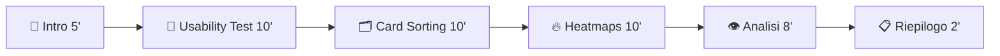
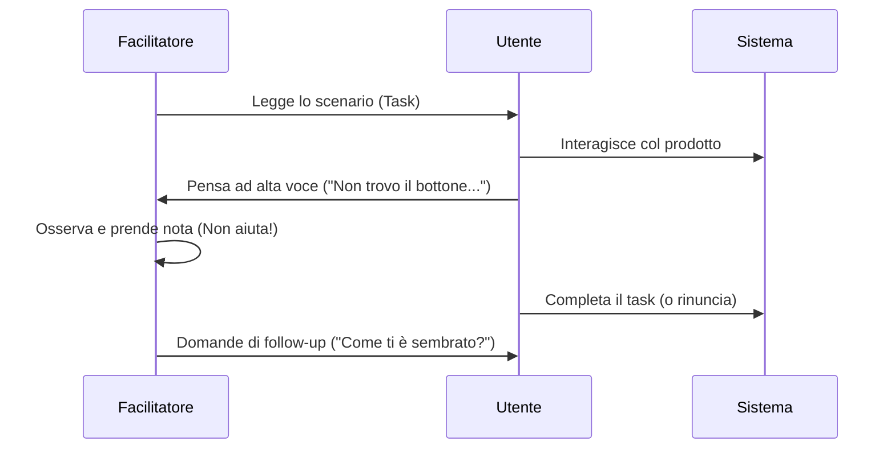

## UX Research (User Experience) — Lezione Completa

La UX Research non è "rendere le cose carine". È il processo sistematico di comprendere i comportamenti, i bisogni e le motivazioni degli utenti attraverso l'osservazione e il feedback. Senza ricerca, il design è solo decorazione basata su ipotesi. In questa lezione, impareremo a trasformare le opinioni soggettive in dati oggettivi sull'usabilità.

### Obiettivi di Apprendimento

Al termine di questa lezione, lo studente sarà in grado di:
1.  Pianificare ed eseguire un test di usabilità moderato.
2.  Utilizzare tecniche come il Card Sorting per organizzare l'architettura dell'informazione.
3.  Analizzare heatmaps e registrazioni di sessione per identificare colli di bottiglia.
4.  Distinguere tra ricerca generativa (scoprire bisogni) e valutativa (testare soluzioni).
5.  Calcolare metriche di usabilità standard come il SUS (System Usability Scale).

### Timeline della Lezione

| Fase | Argomento | Durata |
|------|-----------|--------|
| 1 | Introduzione: Generativa vs Valutativa | 5 min |
| 2 | Metodologia: Usability Testing | 10 min |
| 3 | Metodologia: Architettura dell'Info (Card Sorting) | 10 min |
| 4 | Strumenti: Analytics Visivi (Heatmaps) | 10 min |
| 5 | Esercizi: Analisi di un'interfaccia | 8 min |
| 6 | Riepilogo e Domande | 2 min |
| **Totale** | | **45 min** |

### Fase 1 — Introduzione: Generativa vs Valutativa (5 min)

La ricerca UX si divide in due grandi famiglie, a seconda di *quando* viene fatta nel ciclo di sviluppo del prodotto.

1.  **Ricerca Generativa (Discovery):**
    *   *Quando:* Prima di progettare o scrivere codice.
    *   *Obiettivo:* Capire il problema. "Cosa dovremmo costruire?"
    *   *Metodi:* Interviste (viste nel modulo precedente), Diari, Osservazione sul campo (Ethnography).

2.  **Ricerca Valutativa (Testing):**
    *   *Quando:* Durante o dopo la progettazione.
    *   *Obiettivo:* Capire se la soluzione funziona. "L'abbiamo costruito bene?"
    *   *Metodi:* Usability Testing, A/B Testing, Tree Testing.

*Errore comune:* Molte aziende saltano la fase generativa e passano subito a quella valutativa, ottimizzando benissimo un prodotto che nessuno vuole.

### Fase 2 — Metodologia: Usability Testing (10 min)

L'Usability Test è il "gold standard" della UX Research. Consiste nell'osservare un utente mentre cerca di completare un compito (Task) con il tuo prodotto.

**I 5 Componenti di un Usability Test:**
1.  **Il Partecipante:** Deve rappresentare il tuo utente target (persona). Non testare con i colleghi!
2.  **Il Facilitatore:** Tu. Dai le istruzioni e osservi, ma non aiuti.
3.  **Il Prototipo/Prodotto:** Può essere uno schizzo su carta (low-fidelity) o il sito reale (high-fidelity).
4.  **I Task (Scenari):** Compiti realistici da svolgere.
    *   *Sbagliato:* "Clicca sul menu e vai su Impostazioni." (Troppo guidato).
    *   *Giusto:* "Hai appena cambiato indirizzo di casa. Aggiorna il tuo profilo con i nuovi dati." (Obiettivo).
5.  **Think Aloud Protocol:** Chiedi all'utente di "pensare ad alta voce" mentre agisce. "Cosa stai cercando? Cosa ti aspettavi succedesse cliccando lì?".

**Metriche di Usabilità:**
*   **Success Rate:** % di utenti che completano il task.
*   **Time on Task:** Tempo impiegato.
*   **Error Rate:** Numero di click sbagliati o vicoli ciechi.
*   **SUS (System Usability Scale):** Un questionario standardizzato post-test per misurare la facilità d'uso percepita (punteggio 0-100).

### Fase 3 — Metodologia: Architettura dell'Informazione (10 min)

Se gli utenti non trovano le cose, non le usano. L'Architettura dell'Informazione (IA) è la scienza di organizzare e etichettare i contenuti.

**Card Sorting (Ordinamento delle Carte)**
È una tecnica per capire come gli utenti raggruppano mentalmente le informazioni.
1.  Scrivi ogni funzionalità o contenuto su un cartellino (o post-it virtuale).
2.  Chiedi agli utenti di raggruppare i cartellini in categorie che per loro hanno senso.
3.  Chiedi di dare un nome a ogni categoria.

*   **Open Card Sort:** L'utente crea le categorie. (Generativo).
*   **Closed Card Sort:** Le categorie sono predefinite, l'utente ci mette dentro le carte. (Valutativo).

**Tree Testing**
È il contrario del Card Sorting. Dai all'utente solo il menu di navigazione (senza design) e gli chiedi: "Dove cliccheresti per trovare la politica di reso?". Se sbagliano strada, la tua IA è confusa.

### Fase 4 — Strumenti: Analytics Visivi (Heatmaps) (10 min)

Quando hai migliaia di utenti, non puoi intervistarli tutti. Strumenti come Hotjar, CrazyEgg o Microsoft Clarity ti mostrano il comportamento aggregato.

**Tipi di Mappe di Calore:**
1.  **Click Maps:** Dove cliccano gli utenti?
    *   *Insight:* Cliccano su elementi non cliccabili (Rage Clicks)? Ignorano la CTA principale?
2.  **Scroll Maps:** Fino a dove scorrono la pagina?
    *   *Insight:* Se il 50% degli utenti abbandona prima di vedere il pulsante "Acquista" (Average Fold), devi spostarlo più in alto.
3.  **Move Maps:** Dove muovono il mouse? (Correlato con l'attenzione visiva).

**Session Recordings (Replay)**
Video anonimizzati delle sessioni utente. Guardarne 10-20 può rivelare bug o frizioni che i numeri non mostrano.
*   *Esempio:* Un utente compila un form, riceve un errore, non capisce l'errore, prova 3 volte e poi chiude la pagina.

### Fase 5 — Esercizi: Analisi di un'interfaccia (8 min)

**Scenario:** Immagina la homepage di un sito di e-commerce di vestiti.
Il tasso di conversione è basso.

**Esercizio 1: Ipotesi di Usabilità**
*   Osservando una Scroll Map, noti che solo il 20% degli utenti arriva al footer, ma le informazioni sulla "Spedizione Gratuita" sono solo lì.
*   *Consegna:* Formula un'ipotesi di test per migliorare la conversione basata su questo dato.

**Esercizio 2: Scrivere un Task**
*   Obiettivo del business: Vendere più carte regalo.
*   *Consegna:* Scrivi un task per un Usability Test che verifichi se gli utenti riescono a trovare e comprare una carta regalo, senza guidarli troppo.

### Fase 6 — Riepilogo e Domande (2 min)

1.  **Non sei l'utente.** Ciò che è ovvio per te, è oscuro per l'utente.
2.  **Osserva, non chiedere.** Gli utenti non sanno cosa vogliono finché non lo vedono (o non riescono a usarlo).
3.  **Testa presto.** Un test su un prototipo di carta costa 0€. Cambiare il codice dopo il lancio costa 10.000€.
4.  **Contesto.** Un test in laboratorio è diverso dall'uso reale in metropolitana con una mano sola.

### Domande di Verifica

1.  Qual è la differenza principale tra Card Sorting "Aperto" e "Chiuso"?
2.  In un Usability Test, perché il facilitatore non deve mai spiegare come funziona l'interfaccia?
3.  Cosa indica un "Rage Click" in una mappa di calore e cosa suggerisce riguardo alla UI?
4.  Cos'è il "Think Aloud Protocol" e perché è essenziale nei test qualitativi?
5.  Perché una "Scroll Map" è utile per decidere dove posizionare le Call to Action (CTA)?

### Riferimenti Bibliografici

-   Steve Krug, "Don't Make Me Think, Revisited: A Common Sense Approach to Web Usability", New Riders, 2014.
-   Donald A. Norman, "The Design of Everyday Things", Basic Books, 2013.
-   Jakob Nielsen & Raluca Budiu, "Mobile Usability", New Riders, 2012.
