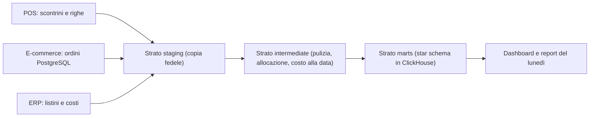

Una catena italiana con 35 negozi e un e-commerce vuole sapere ogni lunedì qual è il margine netto per categoria e come si distribuisce tra i quintili di clientela. È uno scenario costruito con numeri di esempio: 28 milioni di euro di fatturato annuo, di cui 20 milioni nei negozi fisici e 8 milioni online. Il primo prototipo unisce le tabelle grezze di cassa, e-commerce ed ERP in una sola vista. Gli scontrini senza carta fedeltà spariscono, i costi di acquisto cambiano retroattivamente e la query del lunedì va in timeout dopo dieci minuti.

> **Idea chiave:** un data warehouse regge il confronto con il bilancio solo se fissa il grain alla riga articolo, mappa gli sconosciuti su chiavi surrogate esplicite e congela dentro la tabella dei fatti costi e sconti allocati.

## Tre sistemi scollegati e un prototipo che perde il 38% degli scontrini

I punti vendita emettono scontrini sul gestionale di cassa, l'e-commerce registra gli ordini su PostgreSQL e l'ufficio acquisti aggiorna i costi standard su un ERP separato. La direzione pone tre domande ogni settimana: qual è il margine netto per categoria dopo sconti e resi, come si distribuisce il margine tra i cinque quintili di clientela, quali negozi generano più riacquisti online.

Il primo tentativo carica le tre basi dati in un unico schema e costruisce una vista con `INNER JOIN` tra testate scontrino, righe, anagrafica prodotti e clienti. Produce tre difetti misurabili.

1. Il 38% degli scontrini di cassa è pagato senza carta fedeltà, quindi `customer_id` è nullo. L'`INNER JOIN` con la tabella clienti scarta quel 38%: 20.000.000 × 0,38 = 7.600.000 euro di fatturato dei negozi spariscono dai totali.
2. A marzo il fornitore alza del 12% il costo di una linea di giacche, da 50 a 56 euro, e l'ERP sovrascrive `unit_cost_eur`. La vista ricalcola con il costo nuovo le vendite di gennaio e febbraio: se in quei due mesi sono state vendute 16.000 giacche, il margine storico scende di 16.000 × 6 euro = 96.000 euro, senza che sia cambiato nulla.
3. Un buono sconto di 20 euro applicato al totale di uno scontrino da cinque articoli viene sottratto per ogni riga: 5 × 20 = 100 euro invece di 20.

La causa comune è costruire i report direttamente sulle strutture applicative, senza uno schema dimensionale con grain atomico, chiavi per gli sconosciuti e congelamento del costo al momento della vendita. Il resto della lezione costruisce quello schema.

## Dalle domande alla matrice dei processi

Il lavoro comincia dalle domande, non dalle tabelle. Ogni domanda del business indica un processo da misurare e le dimensioni con cui tagliare i numeri. Incrociando i processi sulle righe e le dimensioni sulle colonne ottieni la matrice dei processi (*enterprise bus matrix* nel metodo di Ralph Kimball, [The Data Warehouse Toolkit](https://www.kimballgroup.com/data-warehouse-business-intelligence-resources/books/data-warehouse-dw-toolkit/)).

| Processo | dim_date | dim_product | dim_customer | dim_channel_store |
|---|---|---|---|---|
| Vendite di cassa ed e-commerce | sì | sì | sì | sì |
| Resi | sì | sì | sì | sì |
| Movimenti di magazzino | sì | sì | no | sì |
| Acquisti e listini | sì | sì | no | no |

La matrice ha due scopi. Dice in quale ordine costruire i processi, partendo da quello che risponde alle domande settimanali (le vendite). E dichiara quali dimensioni devono essere condivise: `dim_product` e `dim_date` compaiono in ogni riga, quindi marketing, finanza e logistica devono usare le stesse definizioni. Una dimensione condivisa con attributi e chiavi identici tra più processi si chiama dimensione conforme, ed è ciò che permette di confrontare numeri nati in sistemi diversi.



Il percorso a tre strati è quello che si usa con dbt: staging fedele alle sorgenti, intermediate dove si integrano le entità e si calcolano allocazioni e costi, marts modellati a stella. Il grain della fact table principale è fissato al livello più basso disponibile: **una riga per ogni linea articolo di uno scontrino o di un ordine**. Il numero di scontrino non ha attributi descrittivi propri ma raggruppa le righe dello stesso carrello, e per questo resta nella fact table come dimensione degenerata.

## Integrità e misure congelate

Due decisioni di progetto risolvono i difetti 1 e 2.

La prima è l'integrità referenziale totale. Nelle chiavi esterne della fact table non esiste mai un `NULL` e non esistono chiavi orfane. Ogni scontrino anonimo riceve `customer_sk = 0`, che punta a una riga esplicita 'Cliente Anonimo' in `dim_customer`. La stessa riga di default esiste in ogni dimensione per i valori non classificati. Con questa regola l'`INNER JOIN` non scarta più niente e i 7.600.000 euro tornano nei totali di negozio.

La seconda è congelare dentro il fatto i valori economici che appartengono all'evento: quantità, ricavo lordo, sconto allocato, ricavo netto e costo del venduto alla data della vendita. Il margine `net_line_eur - cogs_line_eur` diventa una misura additiva lungo qualsiasi asse e non dipende più dal listino di oggi.

### Ripartizione dello sconto e costo alla data, con i numeri

Prendi lo scontrino da cinque articoli con un buono da 20 euro.

1. Le righe hanno ricavo lordo 50, 30, 10, 6 e 4 euro. Totale: 50 + 30 + 10 + 6 + 4 = 100 euro.
2. Il tasso di sconto è 20 / 100 = 20%.
3. Le quote sono 50 × 20% = 10 euro, 30 × 20% = 6 euro, 10 × 20% = 2 euro, 6 × 20% = 1,20 euro, 4 × 20% = 0,80 euro. Somma: 10 + 6 + 2 + 1,20 + 0,80 = 20 euro.
4. Il netto è 100 − 20 = 80 euro, non i 100 − 100 = 0 euro del prototipo.

Per il costo, ogni riga legge nello storico dei listini la versione valida alla data della vendita. Una giacca venduta il 20 febbraio ha `cogs_line_eur` calcolato con 50 euro per unità, anche se oggi il listino dice 56. Con 16.000 giacche vendute a gennaio-febbraio, il costo congelato è 16.000 × 50 = 800.000 euro e resta tale dopo qualsiasi rincaro.

## Il prototipo difettoso

Il blocco seguente mostra la query del prototipo, da non replicare, con i tre difetti segnati.

```sql
-- ERRORE 1: INNER JOIN su customer_id che elimina gli scontrini anonimi.
-- ERRORE 2: current_unit_cost_eur letto dall'anagrafica corrente.
-- ERRORE 3: receipt_discount_eur di testata sottratto per ogni riga.
SELECT
    p.category_name,
    sum(l.qty * l.unit_price_eur - h.receipt_discount_eur) AS ricavo_netto_sbagliato,
    sum(l.qty * p.current_unit_cost_eur) AS costo_venduto_sbagliato
FROM raw_pos.receipt_lines AS l
INNER JOIN raw_pos.receipt_headers AS h ON l.receipt_id = h.receipt_id
INNER JOIN raw_crm.customers AS c ON h.customer_id = c.customer_id
INNER JOIN raw_erp.products AS p ON l.product_id = p.product_id
GROUP BY p.category_name;
```

### Scartare gli anonimi con un INNER JOIN

Il sintomo è un fatturato di negozio inferiore agli incassi di cassa. La join sulla chiave naturale del CRM sembra normale a chi lavora dove ogni ordine ha un utente registrato. Nel commercio fisico una quota enorme delle transazioni non ha identificativo, e l'`INNER JOIN` la elimina in silenzio. La correzione è `customer_sk = 0` con la riga di default, e una query di controllo che confronta il conteggio delle righe prima e dopo la join.

### Leggere il costo corrente invece di congelarlo

Il sintomo è un margine di gennaio che cambia a marzo. Leggere `current_unit_cost_eur` risparmia una colonna nella fact table, e sembra un vantaggio. In realtà riscrive retroattivamente i margini a ogni aggiornamento del listino. La correzione è una colonna `cogs_line_eur` valorizzata al caricamento con il costo valido alla data della riga.

### Importi di testata senza allocazione

Il sintomo è una commessa che appare in perdita. Portare `receipt_discount_eur` in una query a grain di riga senza ripartirlo è l'errore classico di grain non rispettato: quattro magliette con un buono da 20 euro risultano scontate di 80 euro. La correzione è la ripartizione pro-quota vista sopra, con il resto di arrotondamento assegnato alla prima riga.

## Lo star schema in ClickHouse

Le dimensioni ricevono tutte la riga predefinita, e la fact table porta le misure congelate. Il partizionamento è mensile e la chiave di ordinamento segue i filtri dei report.

```sql
-- Dimensione cliente con il membro anonimo.
CREATE TABLE dim_customer
(
    customer_sk UInt64,
    customer_id String,
    customer_segment LowCardinality(String),
    is_anonymous UInt8
)
ENGINE = MergeTree
ORDER BY customer_sk;

-- Riga predefinita obbligatoria per gli scontrini senza carta fedeltà.
INSERT INTO dim_customer VALUES (0, 'ANON', 'Scontrino Anonimo', 1);

-- Storico dei listini: una riga per ogni variazione di costo.
CREATE TABLE dim_product_cost
(
    product_sk UInt64,
    valid_from Date,
    unit_cost_eur Decimal(12, 2)
)
ENGINE = MergeTree
ORDER BY (product_sk, valid_from);

-- Fact table a grain di riga articolo, con misure additive congelate.
CREATE TABLE fct_sales_lines
(
    sale_date Date,
    receipt_id UInt64,
    line_num UInt16,
    channel_store_sk UInt32,
    product_sk UInt64,
    customer_sk UInt64,
    qty UInt32,
    gross_line_eur Decimal(12, 2),
    allocated_discount_eur Decimal(12, 2),
    net_line_eur Decimal(12, 2),
    cogs_line_eur Decimal(12, 2),
    margin_line_eur Decimal(12, 2)
)
ENGINE = MergeTree
PARTITION BY toYYYYMM(sale_date)
ORDER BY (sale_date, channel_store_sk, product_sk, customer_sk);
```

Il caricamento dallo strato intermediate è un `INSERT ... SELECT` che fa tre cose: sostituisce i `NULL` con la chiave zero, alloca lo sconto con una window function e legge il costo alla data con `ASOF JOIN`.

```sql
-- Caricamento: chiave zero per gli anonimi, sconto allocato, costo valido alla data di vendita.
INSERT INTO fct_sales_lines
SELECT
    l.sale_date,
    l.receipt_id,
    l.line_num,
    l.channel_store_sk,
    l.product_sk,
    ifNull(l.customer_sk, 0) AS customer_sk,
    l.qty,
    l.gross_line_eur,
    round(h.receipt_discount_eur * l.gross_line_eur / sum(l.gross_line_eur) OVER (PARTITION BY l.receipt_id), 2) AS allocated_discount_eur,
    l.gross_line_eur - allocated_discount_eur AS net_line_eur,
    l.qty * c.unit_cost_eur AS cogs_line_eur,
    net_line_eur - cogs_line_eur AS margin_line_eur
FROM stg_receipt_lines AS l
INNER JOIN stg_receipt_headers AS h ON l.receipt_id = h.receipt_id
ASOF LEFT JOIN dim_product_cost AS c
    ON l.product_sk = c.product_sk
   AND l.sale_date >= c.valid_from;
```

## Quintili di clientela e riconciliazione

Il quintile si calcola in due passi: aggrega il margine per cliente identificato, poi assegna ciascun cliente a uno dei cinque gruppi con `ntile(5)`. Il filtro `customer_sk != 0` esclude gli anonimi dalla segmentazione, che resta comunque nei totali per categoria e negozio.

```sql
-- Margine per quintile di clientela identificata, dal più redditizio al meno.
WITH margine_per_cliente AS (
    SELECT
        customer_sk,
        countDistinct(receipt_id) AS scontrini_totali,
        sum(net_line_eur) AS ricavo_netto_eur,
        sum(margin_line_eur) AS margine_netto_eur
    FROM fct_sales_lines
    WHERE sale_date >= '2026-01-01'
      AND customer_sk != 0
    GROUP BY customer_sk
),
quintili AS (
    SELECT
        customer_sk,
        scontrini_totali,
        ricavo_netto_eur,
        margine_netto_eur,
        ntile(5) OVER (ORDER BY margine_netto_eur DESC) AS quintile_profittabilita
    FROM margine_per_cliente
)
SELECT
    quintile_profittabilita,
    count() AS numero_clienti,
    round(avg(scontrini_totali), 1) AS media_scontrini,
    sum(ricavo_netto_eur) AS ricavo_quintile_eur,
    sum(margine_netto_eur) AS margine_quintile_eur
FROM quintili
GROUP BY quintile_profittabilita
ORDER BY quintile_profittabilita ASC;

-- Quadratura contabile: il netto delle righe deve coincidere con l'incassato delle testate.
SELECT
    toStartOfMonth(f.sale_date) AS mese,
    sum(f.net_line_eur) AS netto_righe_eur,
    any(t.incassato_eur) AS incassato_testate_eur,
    sum(f.net_line_eur) - any(t.incassato_eur) AS scostamento_eur
FROM fct_sales_lines AS f
INNER JOIN (
    SELECT toStartOfMonth(sale_date) AS mese, sum(receipt_total_eur) AS incassato_eur
    FROM stg_receipt_headers
    GROUP BY mese
) AS t ON toStartOfMonth(f.sale_date) = t.mese
GROUP BY mese
ORDER BY mese;
```

Con numeri di esempio, il primo quintile può generare il 64% del margine dei clienti identificati. Se il margine complessivo identificato è 3.000.000 euro, il quintile 1 vale 3.000.000 × 0,64 = 1.920.000 euro e i quattro quintili restanti dividono 1.080.000 euro, in media 270.000 euro ciascuno. Il dato guida le campagne di fidelizzazione, ed è affidabile solo perché costo e sconto sono congelati e allocati.

La quadratura è il vero collaudo. Lo scostamento mensile tra somma del netto delle righe e totale incassato nelle testate deve essere zero. Se non lo è, il problema è quasi sempre un resto di arrotondamento non assegnato, un reso non caricato o una riga duplicata.

## Kimball, Inmon o l'approccio ibrido

Resta da scegliere come stratificare l'intero warehouse. Il modello dimensionale bottom-up di Kimball parte dai processi di business e costruisce data mart a stella collegati da dimensioni conformi. L'approccio top-down di Bill Inmon prevede un database centrale normalizzato in terza forma normale da cui derivare i mart.

Il criterio pratico è questo: se devi consegnare valore verificabile in poche settimane e iterare un processo alla volta, usa l'ibrido descritto sopra, con staging fedele, intermediate normalizzato e marts a stella con dimensioni conformi. Riserva Data Vault o 3NF pura ai contesti regolamentati con decine di sistemi legacy che cambiano struttura e richiedono tracciabilità forense di ogni caricamento.

I due modi di sbagliare sono simmetrici. Il primo è passare dodici mesi a disegnare un modello aziendale astratto da duecento tabelle senza consegnare un solo cruscotto. Il secondo è creare mart isolati per reparto, con `dim_customer` diversa tra marketing e finanza, fino ad avere riunioni in cui ogni direzione porta un numero incompatibile con gli altri. Questa lezione non tratta l'ingestione dalle casse tramite code di messaggi né i cambi valuta in tempo reale.

## Verifica finale del progetto

1. Uno scontrino ha tre righe da 60, 30 e 10 euro e un buono di 10 euro. Quale sconto alloci sulla seconda riga e qual è il netto totale?

<details>
<summary>Mostra risposta</summary>

Il totale lordo è 100 euro e il tasso è 10 / 100 = 10%. La seconda riga riceve 30 × 10% = 3 euro di sconto. Le quote sono 6, 3 e 1 euro, la somma è 10 euro e il netto totale è 100 − 10 = 90 euro.

</details>

2. Il 38% degli scontrini di un negozio da 5.000.000 euro annui non ha carta fedeltà. Quanto fatturato perde un INNER JOIN con la tabella clienti?

<details>
<summary>Mostra risposta</summary>

Perde 5.000.000 × 0,38 = 1.900.000 euro. Con `customer_sk = 0` e la riga 'Cliente Anonimo' in `dim_customer` quei 1.900.000 euro restano nei totali.

</details>

3. Il costo di un prodotto passa da 40 a 44 euro il primo aprile. Quanto costa il venduto di 1.000 unità vendute a marzo, calcolato a marzo e riletto a maggio con la tabella dei fatti?

<details>
<summary>Mostra risposta</summary>

Il costo congelato è 1.000 × 40 = 40.000 euro, in entrambe le letture. Leggendo il costo corrente della dimensione si otterrebbe 1.000 × 44 = 44.000 euro a maggio, cioè 4.000 euro di margine sparito dal passato.

</details>

4. Lo scostamento di marzo tra netto delle righe e incassato delle testate è di 0,03 euro. Quale causa controlli per prima?

<details>
<summary>Mostra risposta</summary>

I resti di arrotondamento dell'allocazione dello sconto: tre centesimi indicano righe i cui valori arrotondati non sommano allo sconto di testata. Verifica che il resto sia assegnato alla prima riga di ogni scontrino.

</details>

5. Un reparto crea una propria `dim_customer` con attributi diversi da quella della finanza. Che conseguenza hai e come la eviti?

<details>
<summary>Mostra risposta</summary>

Ogni direzione raggruppa su attributi diversi e porta in riunione numeri incompatibili. Si evita con dimensioni conformi, una sola `dim_customer` per tutta l'azienda dichiarata nella matrice dei processi.

</details>
