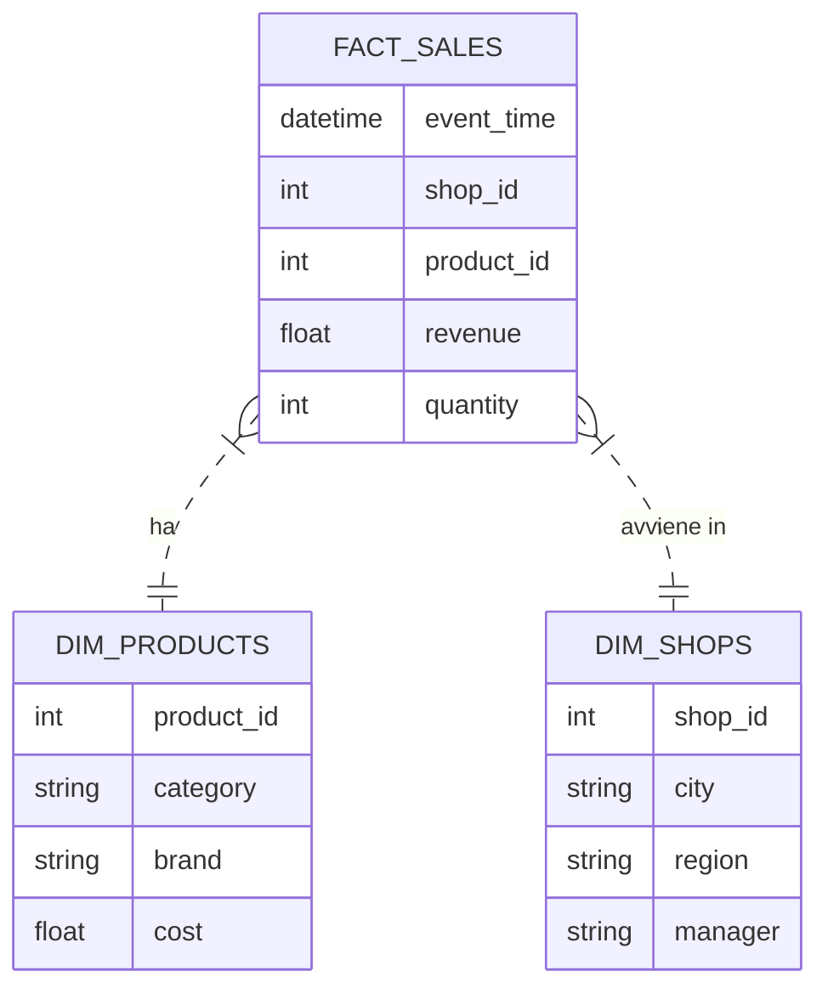
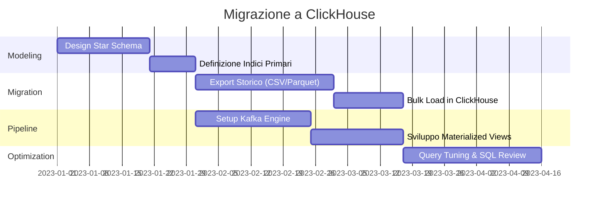
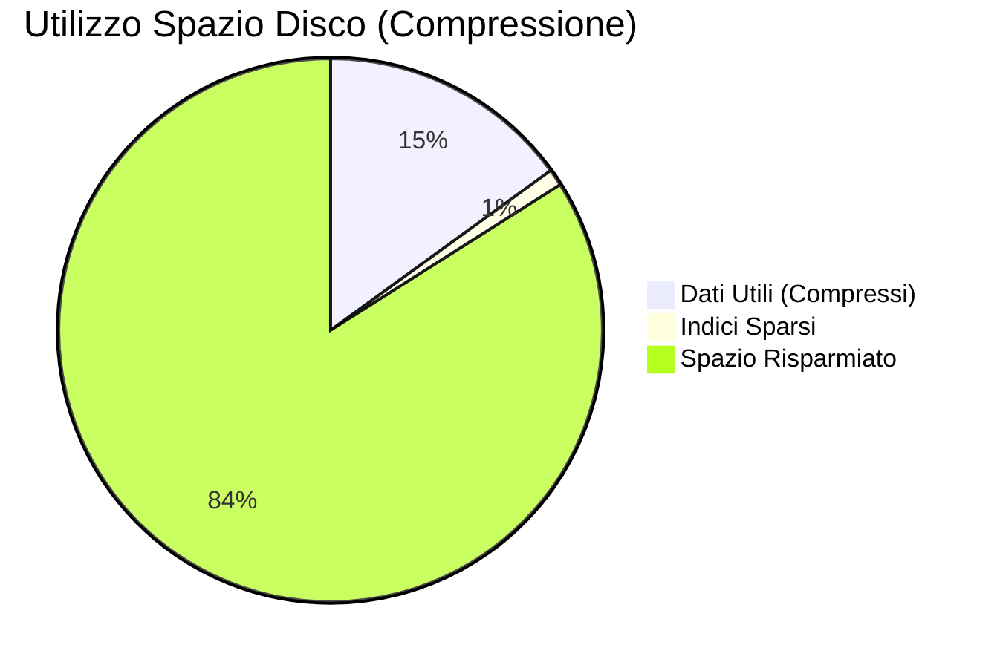

## Contesto Aziendale

**Azienda:** *BigRetail S.p.A.* (nome fittizio)
**Settore:** Retail GDO & E-commerce
**Volume Dati:** 50 Milioni di eventi/giorno, 50 TB storico
**Stack Attuale:** Legacy Oracle DWH (on-premise) + ETL batch notturni

BigRetail ha un problema di performance. Il Data Warehouse attuale, modellato in Terza Forma Normale (3NF), collassa sotto il peso delle query analitiche complesse. Durante il Black Friday, i manager non hanno visibilità sulle vendite fino al giorno successivo perché l'ETL impiega 12 ore a girare.
Le query di analisi basket (quali prodotti vengono comprati insieme) vanno in timeout.

### Dati Iniziali

| Metrica | Legacy DWH (Oracle) | Obiettivo (ClickHouse) | Note |
| :--- | :--- | :--- | :--- |
| **Tempo Risposta Query** | 5-10 minuti | < 500 ms | Necessaria interattività |
| **Latenza Dati** | 24 ore (T+1) | < 1 minuto (Real-time) | Decisioni intra-day |
| **Costo Storage** | €20.000 / TB / anno | €500 / TB / anno | Compressione colonnare |
| **Concorrenza** | Max 5 query simultanee | 100+ query simultanee | Self-service analytics |
| **Flessibilità Schema** | Rigida (mesi per modifiche) | Flessibile (giorni) | Schema Evolution |

**Problema Principale:** L'architettura Row-Oriented (Oracle) non è adatta ai carichi di lavoro OLAP (Online Analytical Processing) su Big Data. Serve passare a un database Colonnare.

## Obiettivi del Progetto

Il progetto "SpeedOfLight" mira a:

1.  **Accelerare le query di 100x**, portando i tempi di risposta sotto il secondo per il 99% delle query analitiche.
2.  **Abilitare l'Analytics Real-Time**, eliminando il batch notturno a favore dello streaming ingestion.
3.  **Ridurre i costi di infrastruttura dell'80%** sfruttando la compressione avanzata di ClickHouse.
4.  **Garantire Schema Evolution senza downtime**, permettendo al business di aggiungere nuove metriche agilmente.

## Analisi e Strategia

### 1. Cambio di Paradigma: Row vs Column
Abbandoniamo la logica transazionale (OLTP). In ClickHouse, i dati sono salvati per colonna. Questo permette di leggere solo le colonne necessarie per la query (es. `SUM(revenue)`) ignorando le altre 100 colonne, riducendo drasticamente l'I/O.

### 2. Data Modeling: Star Schema & OBT
Passiamo da uno schema a "fiocco di neve" (Snowflake) iper-normalizzato a:
*   **Fact Tables:** Enormi tabelle contenenti gli eventi (vendite, click).
*   **Dimension Tables:** Tabelle piccole (prodotti, negozi) replicate su tutti i nodi.
*   **OBT (One Big Table):** Per le query più frequenti, denormalizziamo tutto in un'unica tabella piatta per evitare JOIN costose a runtime.

### 3. ClickHouse Engineering
Sfrutteremo il motore `MergeTree` con un indice primario (`ORDER BY`) ottimizzato per le query di filtraggio temporale e per negozio (es. `ORDER BY (ShopID, EventDate)`). Useremo **Materialized Views** per pre-calcolare i totali orari e giornalieri all'inserimento.

### Diagramma dello Schema (Star Schema Semplificato)



**Decisioni Chiave:**
*   **Niente Update:** In OLAP, gli aggiornamenti sono costosi. Tratteremo i dati come immutabili (append-only). Le correzioni avverranno inserendo righe di rettifica (sign -1).
*   **Compressione Codec:** Useremo `Delta` e `ZSTD` per comprimere timestamp e interi, riducendo lo spazio su disco da 50TB a 5TB.

## Implementazione

### Timeline (4 Mesi)



### Dati Intermedi: Ottimizzazione Query SQL

Una query tipica per il report vendite mensile impiegava 8 minuti su Oracle.
Su ClickHouse, dopo l'ottimizzazione:

**Versione 1 (Naive):** 15 secondi.
**Versione 2 (Pre-where):** 5 secondi (usando `PREWHERE` per filtrare prima di leggere colonne pesanti).
**Versione 3 (Materialized View):** 0.05 secondi (leggendo dati pre-aggregati).

```sql
-- Query ottimizzata su Materialized View
SELECT
    toStartOfDay(timestamp) as day,
    sum(revenue_state) as daily_revenue
FROM sales_daily_mv
WHERE timestamp >= now() - INTERVAL 30 DAY
GROUP BY day
ORDER BY day;
```

**Problema Incontrato:** Schema Evolution. Aggiungere una colonna `payment_method` ha richiesto una strategia precisa.
**Soluzione:** Pattern "Expand and Contract".
1. Aggiunta colonna `payment_method` (nullable).
2. Aggiornamento pipeline per popolare la nuova colonna.
3. Backfill storico (opzionale).
4. Aggiornamento viste.
Tutto fatto con `ALTER TABLE` che in ClickHouse è leggero e non blocca le letture.

## Risultati

### KPI Prima vs Dopo

| KPI | Legacy Oracle | Modern ClickHouse | Miglioramento |
| :--- | :--- | :--- | :--- |
| **Tempo Query Media** | 450 sec | 0.8 sec | 560x |
| **Spazio su Disco** | 50 TB | 6.5 TB | -87% |
| **Costo HW/Licenze** | €1.2M / anno | €150k / anno | -88% |
| **Freschezza Dati** | 24 Ore | 2 Secondi | Real-time |

### Analisi ROI

Il risparmio sulle licenze Oracle da solo ha ripagato il progetto in 2 mesi.
Il valore di business generato dall'analisi real-time durante il Black Friday è stato stimato in +€500k di fatturato grazie al re-stocking rapido dei prodotti bestseller.

### Grafico Compressione



## Lezioni Apprese

1.  **SELECT * è il male:** In un DB colonnare, selezionare colonne inutili uccide le performance. Educare gli analisti a selezionare solo ciò che serve.
2.  **L'ordine conta:** L'indice primario (`ORDER BY`) determina come i dati sono fisicamente ordinati. Sbagliarlo significa scansionare tutto il DB ad ogni query.
3.  **Denormalizzare conviene:** Le JOIN in ClickHouse sono possibili ma meno efficienti che in un DB relazionale. Una "One Big Table" spesso batte uno schema a stella complesso in pura velocità.
4.  **Batch Insert:** Mai inserire riga per riga. ClickHouse ama batch da 10.000+ righe.
5.  **Monitoring:** Monitorare le "parts" di MergeTree. Troppe parti piccole degradano le performance (necessaria ottimizzazione dei merge).

## Domande di Discussione

1.  In quale scenario consiglieresti ancora uno schema a Stella (Star Schema) rispetto a una singola tabella denormalizzata (OBT) in ClickHouse?
2.  Come gestiresti la GDPR "Right to be Forgotten" in un database OLAP immutabile come ClickHouse? (Hint: `ALTER TABLE DELETE` è pesante).
3.  Qual è il trade-off tra l'uso di Materialized Views (pre-calcolo) e la flessibilità di query sui dati grezzi?
4.  Perché l'uso di `Nullable` in ClickHouse ha un impatto negativo sulle performance e come lo eviteresti?
5.  Come progetteresti la chiave di partizionamento (`PARTITION BY`) per massimizzare la velocità di cancellazione dei dati vecchi (TTL)?

**Cosa faresti diversamente?**
*   *Se i dati fossero pochi (< 10GB):* ClickHouse sarebbe overkill. Un semplice PostgreSQL ben indicizzato sarebbe bastato e sarebbe stato più facile da gestire.
*   *Se servissero update frequenti:* ClickHouse non è adatto a carichi con molti aggiornamenti di singole righe. Avrei considerato un'architettura ibrida o un altro motore.
