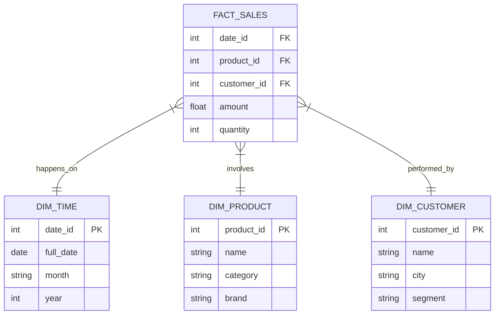
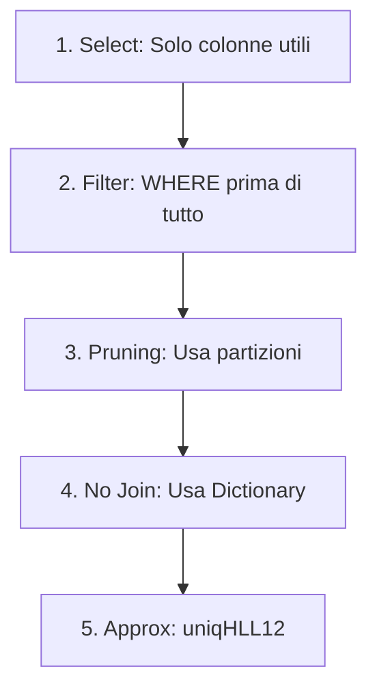

## Concetti Chiave

- **OLAP vs OLTP**: *Online Analytical Processing* (Columnar, per analisi) vs *Online Transaction Processing* (Row-based, per transazioni).
- **Columnar Storage**: Salva i dati per colonne, non per righe. Leggere una colonna su 1 miliardo di righe è istantaneo. Fondamentale per Analytics.
- **Star Schema**: Modello dati standard di Kimball. Una *Fact Table* centrale (eventi) collegata a *Dimension Tables* (contesto).
- **Denormalizzazione**: In OLAP, duplicare i dati (es. scrivere il nome del prodotto nella tabella ordini) è bene per evitare JOIN costose.
- **ClickHouse MergeTree**: Il motore di storage di ClickHouse. Scrive dati in parti immutabili e le fonde (merge) in background.
- **Partitioning**: Dividere una tabella in pezzi fisici (es. per mese). Permette di leggere solo i dati necessari (`WHERE date > ...`).
- **Materialized Views**: Tabelle che pre-calcolano i risultati di una query all'inserimento dei dati. Velocità di lettura estrema.
- **Slowly Changing Dimensions (SCD)**: Come gestire i cambiamenti nelle dimensioni (es. un utente cambia indirizzo). Tipo 1 (sovrascrivi), Tipo 2 (tieni storico).

## SQL & ClickHouse Optimization

| Tecnica | Esempio / Sintassi | Perché usarla |
|---------|--------------------|-----------------|
| **Approssimazione** | `uniqHLL12(user_id)` | Conta elementi unici con errore < 1% ma 100x più veloce di `COUNT(DISTINCT)`. |
| **Dictionaries** | `dictGet('user_dict', 'name', id)` | Sostituisce le JOIN con lookup in-memory ultra-veloci. |
| **Array Functions** | `groupArray(prodotto)` | Aggrega valori in una lista invece di righe separate. Potente per path analysis. |
| **Window Funnel** | `windowFunnel(window)(timestamp, step1, step2...)` | Calcola conversioni sequenziali (Funnel) nativamente. |
| **Pre-Aggregazione** | `SummingMergeTree` | Engine che somma automaticamente le righe con la stessa chiave primaria. |

## Framework e Modelli

### Dimensional Modeling (Kimball)
Il design pattern standard per Data Warehouse.



### Data Modeling Lifecycle
Da idea a produzione.

```mermaid
flowchart TD
    Req[Requisiti Business] --> Concept[Modello Concettuale<br/>(Entità e Relazioni)]
    Concept --> Logical[Modello Logico<br/>(Attributi e Chiavi)]
    Logical --> Physical[Modello Fisico<br/>(Tipi dati, Partitioning, Engine)]
    Physical --> ETL[Sviluppo Pipeline (dbt)]
```

## Processo Step-by-Step: Ottimizzazione Query OLAP

1.  **Select Specific**: Rimuovi `SELECT *`. Leggi solo le colonne che servono (Columnar benefit).
2.  **Filter Early**: Applica i filtri `WHERE` prima delle aggregazioni e delle JOIN.
3.  **Partition Pruning**: Assicurati che il filtro sulla data (o chiave di partizione) sia presente per saltare interi blocchi di dati.
4.  **Join Minimization**: Se possibile, usa Dictionaries o denormalizza per evitare JOIN su tabelle giganti.
5.  **Approximate**: Se il business accetta l'1% di errore, usa funzioni come `uniq` o `quantiles` approssimati.



## Errori da Evitare

-   ❌ **Usare Postgres per Analytics** → ✅ Postgres (row-based) muore su aggregazioni di milioni di righe. Usa ClickHouse/Snowflake.
-   ❌ **Normalizzare troppo (3NF)** → ✅ La Terza Forma Normale è per OLTP. In OLAP, le JOIN costano. Denormalizza (Star Schema).
-   ❌ **Ignorare l'ORDER BY (Primary Key)** → ✅ In ClickHouse, l'indice primario è sparso. Se non filtri per la chiave di ordinamento, fai Full Table Scan.
-   ❌ **Mutazioni frequenti (UPDATE/DELETE)** → ✅ I DW colonnari odiano gli update. Sono ottimizzati per INSERT massivi (Append-only).
-   ❌ **Mancanza di Idempotenza** → ✅ Se rilanci la pipeline, duplichi i dati? Usa `ReplacingMergeTree` o logica di deduplica.

## Quick Reference

| Strumento | A cosa serve | Quando usarlo |
|-----------|--------------|---------------|
| **ClickHouse** | Real-time OLAP DB | Analytics ad alta velocità, log analysis, time-series. |
| **Snowflake** | Cloud Data Warehouse | DW gestito, facile da usare, separazione storage/compute. |
| **BigQuery** | Serverless DW | Analisi su scala petabyte senza gestione infrastruttura (Google). |
| **dbt** | Transformation | Gestire la logica SQL, i test e la documentazione come codice. |
| **Superset / Metabase** | BI Open Source | Visualizzare i dati direttamente dal DW. |
