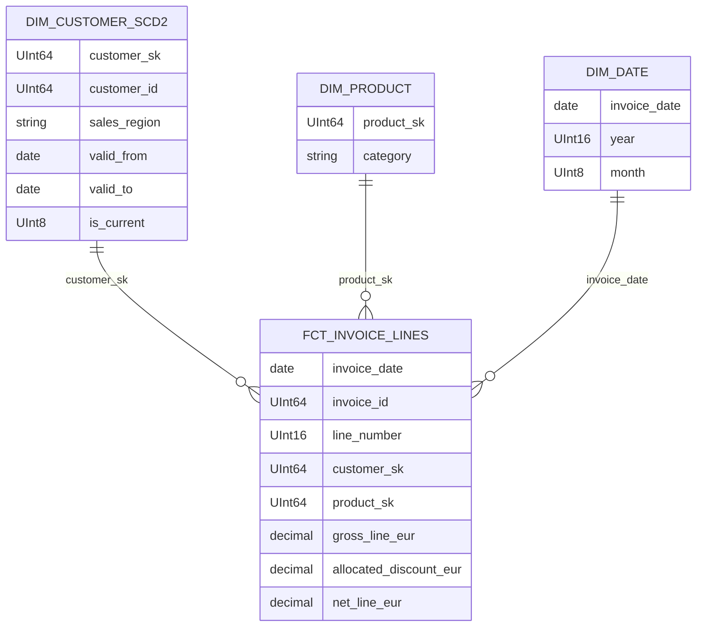

Un distributore di componenti meccanici riorganizza i territori commerciali a ottobre. Il lunedì dopo, il cruscotto del controllo di gestione mostra che il fatturato di gennaio-settembre della zona `NORD-OVEST` è sceso di 1,4 milioni di euro, e che lo stesso importo è comparso sotto `LOMBARDIA-EST`. Con una provvigione del 10% sul fatturato di zona, sono 140.000 euro di premi che cambiano mano senza che nessuno abbia venduto niente. È uno scenario costruito con numeri di esempio. Il calcolo è corretto: ciò che manca è un modello che ricordi com'era il mondo quando la vendita è avvenuta.

> **Idea chiave:** una tabella dei fatti registra eventi a un grain dichiarato, le dimensioni descrivono il contesto, e ogni attributo che può cambiare va storicizzato con una chiave surrogata, altrimenti il passato si riscrive a ogni anagrafica aggiornata.

## Come si è rotto il cruscotto

Nel database gestionale la tabella `customers` ha una riga per cliente e una colonna `sales_region`. La direzione sposta 180 clienti da `NORD-OVEST` a `LOMBARDIA-EST` con un `UPDATE` diretto. Il cruscotto unisce le righe fattura dell'anno all'anagrafica corrente, quindi ogni fattura di gennaio eredita la regione di ottobre. Una seconda query, che unisce testate d'ordine e righe, moltiplica per il numero di righe lo sconto fisso di testata e fa apparire in perdita commesse che erano in utile.

Le due anomalie hanno cause diverse. La prima riguarda il tempo: un attributo cambia e nessuno conserva il valore precedente. La seconda riguarda la granularità: un importo che appartiene all'ordine è stato scritto su ogni riga. Il metodo dimensionale di Ralph Kimball ([Kimball e Ross, The Data Warehouse Toolkit](https://www.kimballgroup.com/data-warehouse-business-intelligence-resources/books/data-warehouse-dw-toolkit/)) nasce per prevenire entrambe con regole semplici.

## Fact table, dimension table e il grain

Uno schema a stella ha al centro una tabella dei fatti e intorno le dimensioni. La tabella dei fatti contiene le misure (quantità, ricavo) e le chiavi che puntano alle dimensioni. Le dimensioni contengono gli attributi descrittivi con cui filtri e raggruppi: cliente, prodotto, data, canale.



Prima di scegliere una colonna devi scrivere in una frase che cosa rappresenta una riga della tabella dei fatti: "una riga per ogni linea di prodotto di una fattura emessa". Questa frase è il grain. Da lì discende tutto: ogni misura deve valere per quella unità e nessun'altra, e ogni dimensione deve avere un solo valore per quella unità. Se una colonna ha senso solo a livello di ordine, non può stare in una tabella a livello di riga.

Il grain dà anche la forma della tabella. Esistono tre tipi fondamentali, e la domanda di business sceglie quale usare.

| Tipo di fact table | Cosa rappresenta una riga | Domanda tipica |
|---|---|---|
| Transazionale | Un evento puntuale (riga fattura, clic) | Quanto abbiamo venduto per prodotto e regione? |
| Snapshot periodico | Lo stato a intervalli regolari (giacenza a fine giorno) | Quante scorte avevamo a fine mese? |
| Snapshot cumulativo | Una pratica che attraversa fasi, con una data per fase | Quanti giorni passano tra ordine e consegna? |

## Misure additive, semi-additive e non additive

Non tutte le misure si sommano allo stesso modo. Le additive (quantità venduta, ricavo netto in euro) si sommano lungo qualsiasi dimensione. Le semi-additive, come una giacenza o il saldo di un conto, si sommano tra prodotti o filiali allo stesso istante ma non lungo il tempo. Le non additive (prezzo unitario, percentuale di margine) non si sommano mai: si ricalcolano come rapporto tra la somma del numeratore e quella del denominatore.

Il caso più insidioso è la giacenza. Un magazzino ha 100 pezzi di un componente fermi per 30 giorni. Se salvi uno snapshot ogni sera e fai `sum(stock_qty)` sul mese ottieni 100 × 30 = 3.000 pezzi, un valore privo di significato fisico che trasforma merce invenduta in abbondanza di scorte. Per il tempo servono tre operatori: media (100 pezzi di media giornaliera), ultimo valore (100 pezzi a fine mese) o massimo.

```sql
-- Snapshot periodico di magazzino: una riga per prodotto e per giorno.
CREATE TABLE fct_stock_daily
(
    snapshot_date Date,
    product_sk UInt64,
    warehouse_sk UInt32,
    stock_qty Int32
)
ENGINE = MergeTree
PARTITION BY toYYYYMM(snapshot_date)
ORDER BY (product_sk, snapshot_date);

-- Giacenza a fine mese (ultimo valore) e media giornaliera, mai la somma sul tempo.
SELECT
    toStartOfMonth(snapshot_date) AS mese,
    product_sk,
    argMax(stock_qty, snapshot_date) AS giacenza_fine_mese,
    round(avg(stock_qty), 1) AS giacenza_media
FROM fct_stock_daily
GROUP BY mese, product_sk
ORDER BY mese, product_sk;
```

La somma tra magazzini nello stesso giorno resta valida: 60 pezzi a Piacenza e 40 a Verona fanno 100 pezzi. Quello che non puoi fare è sommare i giorni.

## Allocare lo sconto di testata sulle righe

Torniamo al secondo errore del cruscotto. Un ordine ha quattro righe e un buono sconto di 50 euro sull'intero ordine. Se scrivi 50 euro su ciascuna riga, `sum(order_header_discount_eur)` restituisce 200 euro e il margine di ogni ordine multi-prodotto è falsato. La regola è ripartire l'importo di testata pro-quota prima di caricare la fact table, in proporzione al ricavo lordo di ciascuna riga.

### Ripartizione pro-quota, passo per passo

1. Le quattro righe hanno ricavo lordo 400, 300, 200 e 100 euro. Totale lordo: 400 + 300 + 200 + 100 = 1.000 euro.
2. Lo sconto di testata è 50 euro, quindi il tasso di sconto sull'ordine è 50 / 1.000 = 5%.
3. Applicato a ogni riga: 400 × 5% = 20 euro, 300 × 5% = 15 euro, 200 × 5% = 10 euro, 100 × 5% = 5 euro.
4. Verifica: 20 + 15 + 10 + 5 = 50 euro, uguale allo sconto di partenza, e il ricavo netto totale è 1.000 − 50 = 950 euro.

Con importi decimali compaiono resti di arrotondamento al centesimo. La prassi è assegnare il resto alla prima riga, così che la somma delle parti coincida sempre con il totale. In ClickHouse l'allocazione si esprime con una window function sulla testata.

```sql
-- Allocazione pro-quota dello sconto di testata sulle righe, in fase di trasformazione.
SELECT
    l.invoice_id,
    l.line_number,
    l.gross_line_eur,
    round(
        h.header_discount_eur * l.gross_line_eur / sum(l.gross_line_eur) OVER (PARTITION BY l.invoice_id),
        2
    ) AS allocated_discount_eur
FROM stg_invoice_lines AS l
INNER JOIN stg_invoice_headers AS h ON l.invoice_id = h.invoice_id;
```

## Slowly Changing Dimensions: ricordare com'era

Resta il primo errore, quello delle regioni. Hai tre strategie. Il Tipo 1 sovrascrive il valore e perde la storia: va bene per correggere un refuso nel nome di un cliente. Il Tipo 2 conserva la storia aggiungendo una nuova riga a ogni cambio rilevante. Il Tipo 3 aggiunge una colonna con il valore precedente e conserva una sola generazione di storia, quindi serve poco.

In una dimensione di Tipo 2 la chiave naturale (`customer_id`) resta uguale, mentre la chiave surrogata (`customer_sk`) cambia a ogni versione. La validità è delimitata da `valid_from` e `valid_to`, più un flag `is_current`. Le vendite puntano alla chiave surrogata valida il giorno della fattura, e così la geografia storica resta congelata.

ClickHouse non ama gli aggiornamenti puntuali, quindi la chiusura della riga vecchia si fa inserendo una nuova versione della stessa riga con `ReplacingMergeTree`, che tiene l'ultima per chiave di ordinamento.

```sql
-- Dimensione cliente SCD Tipo 2: una riga per ogni versione dell'attributo.
CREATE TABLE dim_customer_scd2
(
    customer_sk UInt64,
    customer_id UInt64,
    sales_region LowCardinality(String),
    valid_from Date,
    valid_to Date,
    is_current UInt8,
    version UInt32
)
ENGINE = ReplacingMergeTree(version)
ORDER BY customer_sk;

-- Stato iniziale: il cliente 5001 è in NORD-OVEST dal 2025-01-01, senza data di fine.
INSERT INTO dim_customer_scd2 VALUES
    (101, 5001, 'NORD-OVEST', '2025-01-01', '9999-12-31', 1, 1);

-- Cambio territorio a ottobre: si chiude la versione 101 e si apre la 102, senza UPDATE.
INSERT INTO dim_customer_scd2 VALUES
    (101, 5001, 'NORD-OVEST', '2025-01-01', '2026-09-30', 0, 2),
    (102, 5001, 'LOMBARDIA-EST', '2026-10-01', '9999-12-31', 1, 1);
```

La riga 101 inserita due volte ha la stessa chiave di ordinamento, quindi alla prossima fusione in background resta quella con `version` più alta. Finché la fusione non è avvenuta, le query che devono essere esatte leggono con `FINAL`.

```sql
-- Fact table a grain di riga fattura, con la chiave surrogata storica.
CREATE TABLE fct_invoice_lines
(
    invoice_date Date,
    invoice_id UInt64,
    line_number UInt16,
    customer_sk UInt64,
    customer_id UInt64,
    product_sk UInt64,
    gross_line_eur Decimal(12, 2),
    allocated_discount_eur Decimal(12, 2),
    net_line_eur Decimal(12, 2)
)
ENGINE = MergeTree
PARTITION BY toYYYYMM(invoice_date)
ORDER BY (invoice_date, customer_sk, invoice_id);

-- Vista as-was: la regione è quella valida il giorno della fattura.
SELECT
    d.sales_region AS regione_al_momento_vendita,
    sum(f.gross_line_eur) AS ricavo_lordo_eur,
    sum(f.allocated_discount_eur) AS sconto_allocato_eur,
    sum(f.net_line_eur) AS ricavo_netto_eur
FROM fct_invoice_lines AS f
INNER JOIN dim_customer_scd2 AS d FINAL ON f.customer_sk = d.customer_sk
GROUP BY regione_al_momento_vendita;
```

Se i fatti arrivano senza la chiave surrogata, la ricostruisci con una join per intervallo. ClickHouse offre `ASOF JOIN`, che per ogni fattura cerca la versione del cliente con `valid_from` più vicino senza superare la data.

```sql
-- Assegnazione della chiave surrogata in caricamento: ultima versione valida alla data fattura.
SELECT
    s.invoice_id,
    s.line_number,
    s.invoice_date,
    d.customer_sk,
    d.sales_region
FROM stg_invoice_lines AS s
ASOF LEFT JOIN dim_customer_scd2 AS d
    ON s.customer_id = d.customer_id
   AND s.invoice_date >= d.valid_from;
```

Con questo modello, le fatture di gennaio-settembre puntano a `customer_sk = 101` con regione `NORD-OVEST`, quelle da ottobre a `customer_sk = 102` con regione `LOMBARDIA-EST`. L'1,4 milioni di euro e i 140.000 euro di provvigioni restano dove sono nati.

## Tre errori di modellazione che sembrano ragionevoli

### Misure di testata e di riga nella stessa tabella

Il sintomo è un margine che cambia a seconda del numero di righe dell'ordine. Scrivere lo sconto di ordine su ogni riga sembra comodo, perché evita una seconda tabella. Succede perché si è saltata la dichiarazione del grain. Per correggere, ripartisci pro-quota prima del caricamento come mostrato sopra, oppure sposta le misure d'ordine in una fact table a grain d'ordine e collegale con la chiave `invoice_id`.

### Sommare una giacenza lungo il tempo

Il sintomo è un'abbondanza di scorte che nessuno in magazzino riconosce. Succede perché la sintassi SQL non distingue le misure: `sum()` somma qualunque colonna numerica. La correzione è tenere gli snapshot in una tabella separata e documentare, per ogni misura, l'aggregazione ammessa lungo il tempo (ultimo valore, media, massimo).

### Join sulla chiave naturale di una dimensione sovrascritta

Il sintomo è il passato che cambia: un bilancio chiuso viene rieseguito e dà un numero diverso. Succede perché l'`UPDATE` del Tipo 1 riscrive l'anagrafica e la join sulla chiave naturale la applica a tutte le fatture. La correzione è un Tipo 2 con chiave surrogata. Cercare il cambio a posteriori, dopo due anni, non è recuperabile: le date esatte dei vecchi passaggi di regione sono andate perse.

## Star schema o One Big Table

Sui motori colonnari come ClickHouse hai due modi di servire le query. Lo star schema mantiene fact e dimensioni separate e le unisce a lettura. La One Big Table copia gli attributi delle dimensioni dentro la tabella dei fatti, così le query non fanno join.

La One Big Table è adatta a flussi di eventi immutabili dove conta la velocità di scansione e la compressione dizionario di `LowCardinality` annulla il costo degli attributi ripetuti. Lo star schema è adatto quando le dimensioni sono condivise tra molte fact table (dimensioni conformi) o cambiano spesso: aggiornare la gerarchia commerciale di un prodotto in cinque OBT da dieci terabyte è un'operazione pesante, in una dimensione sola è una riga.

Un compromesso comune tiene lo star schema e gli snapshot SCD2 nello strato intermedio di dbt e materializza una OBT finale solo per i cruscotti più frequenti. Con dbt, la dimensione di Tipo 2 si genera con `dbt snapshot`. Questa lezione non copre il Data Vault 2.0 né le gerarchie ricorsive di profondità variabile.

## Verifica sul tuo modello dimensionale

1. Un ordine ha tre righe con ricavo lordo 600, 300 e 100 euro e un trasporto di testata di 30 euro. Quanto trasporto allochi su ciascuna riga?

<details>
<summary>Mostra risposta</summary>

Il totale lordo è 600 + 300 + 100 = 1.000 euro, quindi il tasso è 30 / 1.000 = 3%. Le quote sono 18, 9 e 3 euro, che sommano a 30 euro.

</details>

2. Una giacenza di 80 pezzi resta invariata per 31 giorni. Quale valore riporti per il mese e quale è un errore?

<details>
<summary>Mostra risposta</summary>

Riporti 80 pezzi come ultimo valore o come media giornaliera. Il valore 80 × 31 = 2.480 ottenuto sommando i giorni è un errore, perché la giacenza è semi-additiva sul tempo.

</details>

3. Un cliente cambia regione il 1 ottobre. Con una SCD Tipo 2, a quale regione appartiene una fattura del 15 settembre e a quale una del 15 ottobre?

<details>
<summary>Mostra risposta</summary>

La fattura del 15 settembre punta alla chiave surrogata con `valid_from` precedente e `valid_to` del 30 settembre, quindi alla vecchia regione. Quella del 15 ottobre punta alla nuova versione, valida dal 1 ottobre.

</details>

4. Quando scegli una One Big Table al posto di uno star schema su ClickHouse?

<details>
<summary>Mostra risposta</summary>

Quando i dati sono eventi immutabili, la latenza di scansione è la priorità, gli attributi anagrafici cambiano di rado e non sono condivisi con altre fact table. Se le dimensioni sono conformi tra più processi o cambiano spesso, resta lo star schema.

</details>
