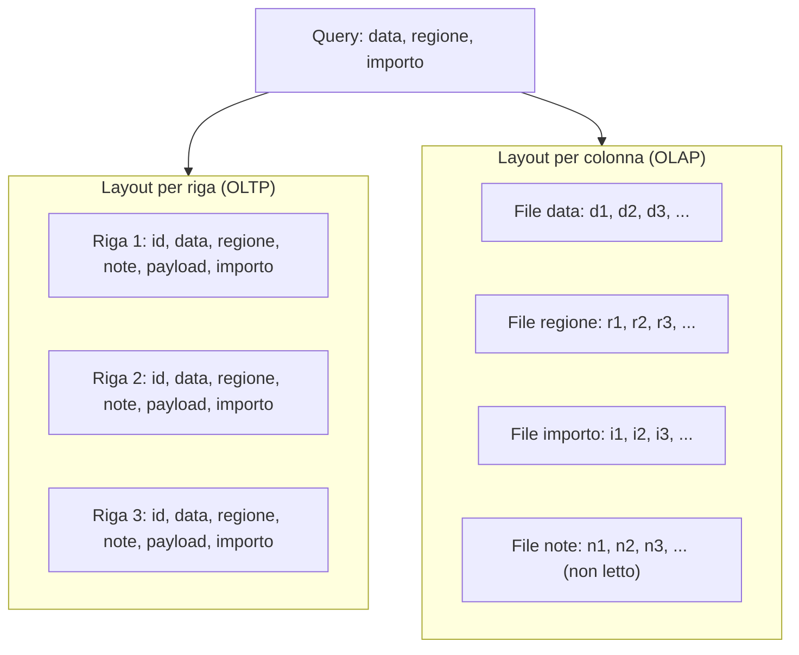

Il lunedì alle nove un e-commerce B2B lancia sul PostgreSQL di produzione la query settimanale del margine per regione. Per quattro minuti il disco resta saturo, la CPU sale al 98% e chi prova a pagare riceve un timeout al checkout. È uno scenario costruito con numeri di esempio: la tabella `orders` ha 50 milioni di righe, 60 colonne e circa 800 byte per riga, quindi 40 GB su disco. Nessun indice è mancante e il server non è sottodimensionato. Il problema è il tipo di lavoro che stai chiedendo a un motore nato per un altro mestiere.

> **Idea chiave:** un database transazionale è ottimizzato per leggere e scrivere poche righe intere, un data warehouse per leggere poche colonne di moltissime righe. Cambia il layout fisico, e con il layout cambia il costo di ogni query.

## Cosa chiede un carico transazionale e cosa chiede uno analitico

Il checkout del sito esegue operazioni brevi: inserisce un ordine, legge un cliente per identificativo, aggiorna lo stato di una spedizione. Ognuna tocca una manciata di righe e ha bisogno di tutti i loro campi. Un carico di questo tipo si chiama OLTP (*online transaction processing*) e pretende garanzie forti: isolamento tra transazioni concorrenti, scritture durevoli, latenze di pochi millisecondi.

Il report del lunedì fa l'opposto. Scorre dodici mesi di ordini, usa tre campi, restituisce una ventina di righe aggregate. È un carico OLAP (*online analytical processing*): letture enormi, quasi nessuna scrittura puntuale, tolleranza a latenze di secondi. Le due richieste differiscono su ogni asse che conta per l'architettura.

| Aspetto | OLTP (PostgreSQL, MySQL) | OLAP (data warehouse colonnare) |
|---|---|---|
| Operazione tipica | Leggere o scrivere 1-100 righe intere | Aggregare milioni di righe su 3-10 colonne |
| Layout su disco | Una riga dopo l'altra, tutte le colonne contigue | Un file per colonna, valori omogenei contigui |
| Scritture | Aggiornamenti puntuali, transazioni ACID | Caricamenti a blocchi, in sola aggiunta |
| Indice principale | B-tree sulla chiave primaria | Indice sparso su una chiave di ordinamento |
| Metrica di successo | Latenza per transazione, concorrenza | Byte letti per risposta, throughput di scansione |

Quando carichi un report analitico su un motore OLTP non stai usando male uno strumento valido: stai pagando una struttura pensata per la lettura di righe intere in un caso in cui ti servono soltanto tre numeri per riga.

## Perché il layout per riga spreca la lettura

PostgreSQL salva le righe dentro pagine da 8 KB. Dentro una pagina i campi di una riga sono contigui, seguiti dai campi della riga successiva. Per estrarre `net_amount_eur` da una riga il disco deve caricare l'intera pagina, quindi anche le note del corriere, gli indirizzi e i codici promozionali. Nel nostro scenario la query usa `created_at`, `region_code` e `net_amount_eur`, in tutto 20 byte per riga su 800.

Il confronto tra i due layout si vede meglio disegnato.



Con il layout per riga, la query legge tutte le pagine che contengono righe del periodo, cioè tutta la tabella. Con il layout per colonna legge soltanto i tre file richiesti e ignora gli altri.

### Calcolo dei byte letti, passo per passo

Facciamo il conto con i numeri di esempio. La tabella ha 50.000.000 righe da 800 byte.

1. Layout per riga: il motore legge tutte le pagine, quindi 50.000.000 × 800 byte = 40.000.000.000 byte, pari a 40 GB.
2. Layout per colonna, nessun altro accorgimento: servono 3 colonne da 20 byte per riga in totale, quindi 50.000.000 × 20 byte = 1.000.000.000 byte, pari a 1 GB.
3. Il rapporto tra i due risultati è 40 GB / 1 GB = 40x di lettura in meno, solo per avere scelto le colonne.
4. Con un disco che sostiene 500 MB/s, la prima lettura richiede 40.000 MB / 500 MB/s = 80 secondi di solo I/O, la seconda 1.000 MB / 500 MB/s = 2 secondi.

I quattro minuti del lunedì includono la contesa con le transazioni, l'espulsione delle pagine calde da `shared_buffers` e il calcolo riga per riga, ma il peso dominante è quel 40x che il layout per riga non può evitare.

## Compressione, ordinamento e salto dei blocchi

Il layout per colonna ha un secondo vantaggio, meno visibile. In un file di colonna tutti i valori hanno lo stesso tipo e spesso la stessa distribuzione, quindi si comprimono bene. Una colonna `region_code` con venti valori distinti si riduce con un dizionario o con una codifica a ripetizioni (*run-length encoding*) di un fattore molto alto. Una colonna di timestamp ordinati si comprime con la codifica delle differenze (*delta*) perché due valori consecutivi si distinguono di pochi secondi. Su dati reali un fattore da 5 a 10 sulle colonne numeriche e testuali a bassa cardinalità è normale, anche se il valore effettivo dipende dall'entropia dei dati e dal codec scelto.

L'ordinamento fisico moltiplica l'effetto. ClickHouse, che useremo come motore di riferimento in tutto il modulo, divide ogni parte di tabella in granuli da 8.192 righe e conserva per ogni granulo un riferimento nell'indice sparso (la chiave di ordinamento della prima riga). Se la tabella è ordinata per `(region_code, created_at)`, le righe di una regione sono adiacenti e al loro interno le date crescono. Una query con `WHERE region_code = 'IT-LOM' AND created_at >= '2026-01-01'` consulta l'indice, individua il tratto di granuli che può contenere quelle righe e salta tutti gli altri senza decomprimerli. La documentazione di ClickHouse descrive questo meccanismo nella sezione sugli indici primari sparsi ([guida all'indice primario](https://clickhouse.com/docs/guides/best-practices/sparse-primary-indexes)).

> L'indice sparso non individua una riga. Individua un intervallo di granuli. Più i valori del filtro sono raggruppati nella chiave di ordinamento, più l'intervallo si stringe.

### Stima dei granuli letti con la chiave giusta

Riprendiamo lo scenario e aggiungiamo ipotesi dichiarate: la tabella contiene 5 anni di storia (60 mesi), 10 regioni equidistribuite e il report interroga 1 regione e gli ultimi 12 mesi.

1. Dimensione di partenza delle 3 colonne: 1 GB (calcolo precedente).
2. Partizionamento mensile: i 48 mesi più vecchi non vengono nemmeno aperti. Restano 12 mesi su 60, cioè 20% → 1 GB × 0,20 = 200 MB.
3. Chiave `(region_code, created_at)`: dentro ogni partizione le righe di `IT-LOM` sono un tratto contiguo pari a 1/10 → 200 MB × 0,10 = 20 MB non compressi.
4. Compressione 5x sulle colonne lette: 20 MB / 5 = 4 MB effettivamente letti dal disco.
5. Tempo di I/O a 500 MB/s: 4 MB / 500 MB/s = 8 ms.

Da 40 GB a 4 MB: un fattore 10.000 combinando tre meccanismi indipendenti (40x per le colonne, 5x per le partizioni, 10x per la chiave, 5x per la compressione, per un totale di 40 × 5 × 10 × 5 = 10.000). Nessuno dei tre è magico. Ognuno richiede però una decisione presa alla creazione della tabella.

## Esecuzione vettorializzata

Quando i byte sono arrivati in memoria, resta il costo del calcolo. Un motore a righe valuta l'espressione `net_amount_eur * 1.22` una riga alla volta, con una catena di chiamate a funzione per ogni record. Un motore vettorializzato prende un blocco di alcune migliaia di valori della stessa colonna, che stanno contigui in memoria e quindi nella cache della CPU, e applica l'operazione a tutto il blocco con istruzioni SIMD (*single instruction, multiple data*): un registro a 256 bit contiene quattro valori a 64 bit e li somma in un solo ciclo.

Il vantaggio è composto. Meno chiamate di funzione per riga, accessi sequenziali alla memoria che sfruttano la prefetch del processore, un singolo ciclo per più valori. Non devi scrivere nulla di speciale per ottenerlo, ma ci sono scelte di schema che lo rendono possibile: tipi numerici a larghezza fissa (`UInt32`, `Decimal(12, 2)`) si vettorializzano bene, stringhe di lunghezza variabile molto meno, e le `LowCardinality(String)` ritrovano una rappresentazione numerica interna.

Per verificare quanto lavoro fa davvero una query non serve intuire. ClickHouse registra le statistiche di ogni esecuzione.

```sql
-- Righe e byte letti dalle ultime query del report, confrontati con le righe restituite.
SELECT
    query_id,
    read_rows,
    formatReadableSize(read_bytes) AS letti,
    result_rows,
    round(read_rows / greatest(result_rows, 1)) AS righe_lette_per_riga_restituita,
    query_duration_ms
FROM system.query_log
WHERE type = 'QueryFinish'
  AND event_date = today()
  AND query ILIKE '%ordini_analytics_corretto%'
ORDER BY event_time DESC
LIMIT 10;
```

Il rapporto `righe_lette_per_riga_restituita` è il termometro della progettazione: un report settimanale che restituisce 52 righe e ne legge 50 milioni segnala che indice e partizionamento non stanno lavorando.

## Tre errori importati dal mondo transazionale

Chi arriva da PostgreSQL porta con sé abitudini corrette nel loro contesto e dannose qui. Il blocco seguente le riunisce in una sola tabella e una sola query.

```sql
-- Schema modellato come un database transazionale, da non copiare.
CREATE TABLE ordini_analytics_errato
(
    order_uuid String,
    created_at DateTime,
    region_code String,
    customer_notes String,
    raw_payload_json String,
    net_amount_eur Float64
)
ENGINE = MergeTree
ORDER BY order_uuid;

-- Query del report: SELECT * e filtro lontano dalla chiave di ordinamento.
SELECT *
FROM ordini_analytics_errato
WHERE created_at >= '2026-01-01 00:00:00'
  AND region_code = 'IT-LOM';
```

### SELECT * nelle viste di reporting

Il sintomo è una dashboard che peggiora a ogni colonna aggiunta alla tabella, anche se nessun grafico la usa. Succede perché nei database a righe leggere tre o sessanta campi della stessa pagina costa quasi uguale, e l'abitudine passa al warehouse intatta. In un motore colonnare ogni colonna elencata è un file in più da aprire, leggere e decomprimere, inclusi note testuali e payload JSON da kilobyte per riga. La correzione è elencare le colonne necessarie e, nei modelli condivisi, vietare l'asterisco con una regola di lint.

### Chiave di ordinamento su un UUID casuale

Il sintomo è una query temporale che legge il 100% delle righe pur filtrando un solo mese. Un UUID come prima colonna della chiave sembra naturale perché è la chiave primaria dell'ordine. Ma gli UUID sono distribuiti uniformemente, quindi in ogni granulo finiscono date e regioni di tutti i periodi, e il minimo e il massimo di ogni blocco coprono l'intero intervallo di cinque anni. Il filtro non scarta nulla. La compressione peggiora per lo stesso motivo: valori vicini non sono simili. La correzione è mettere in chiave le colonne dei filtri più frequenti e tenere l'identificativo come ultima colonna, utile solo per i rari lookup puntuali.

### UPDATE puntuali per sincronizzare lo stato

Il sintomo è una coda di mutation che cresce e scritture nuove che rallentano. Mandare migliaia di `UPDATE ordini SET status = 'shipped' WHERE ...` al minuto sembra il modo più diretto per riflettere lo stato dell'ordine. Ma i file colonnari compressi sono immutabili: ogni mutation riscrive la colonna modificata in tutte le parti che contengono le righe toccate. La correzione è inserire una nuova riga con lo stato aggiornato e leggere l'ultima versione, con motori come `ReplacingMergeTree` o con una tabella di eventi, e caricare a blocchi di migliaia di righe.

## La tabella analitica corretta

Mettiamo insieme i criteri in ordine di priorità.

1. Isola il carico analitico dal database di produzione: il warehouse si alimenta in micro-batch o in streaming append-only, mai con report lanciati sul database che serve i clienti.
2. Scegli la chiave di ordinamento dai filtri dominanti, dalle colonne con meno valori distinti a quelle con più valori distinti: prima la regione, poi il timestamp, poi l'identificativo.
3. Usa tipi compatti e a larghezza fissa: `LowCardinality(String)` per le stringhe ripetute, `Decimal(12, 2)` o interi per gli importi, e lascia fuori dalla tabella calda blob testuali che non servono ai raggruppamenti.
4. Scrivi query che elencano le sole colonne necessarie.

```sql
-- Schema corretto: partizione mensile, chiave dai filtri, tipi compatti.
CREATE TABLE ordini_analytics_corretto
(
    region_code LowCardinality(String),
    order_status LowCardinality(String),
    created_at DateTime,
    order_id UInt64,
    customer_id UInt64,
    net_amount_eur Decimal(12, 2)
)
ENGINE = MergeTree
PARTITION BY toYYYYMM(created_at)
ORDER BY (region_code, created_at, order_id);

-- Legge 2 colonne di dati più le 2 della chiave, salta partizioni e blocchi fuori intervallo.
SELECT
    toStartOfWeek(created_at) AS settimana,
    count() AS numero_ordini,
    sum(net_amount_eur) AS ricavo_netto_eur
FROM ordini_analytics_corretto
WHERE region_code = 'IT-LOM'
  AND created_at >= '2026-01-01 00:00:00'
GROUP BY settimana
ORDER BY settimana ASC;
```

Il costo delle correzioni è asimmetrico. Riscrivere una `SELECT` è gratis. Cambiare chiave di ordinamento o partizionamento su una tabella che ha già accumulato cinque terabyte richiede di creare una tabella nuova e ricaricarla. Per questo la chiave va scelta prima, guardando le query che il business lancia davvero.

## Warehouse cloud a consumo o motore colonnare dedicato

Dopo avere scelto lo storage colonnare resta da scegliere la famiglia di motore. Da una parte i data warehouse cloud con tariffazione a consumo, per byte scansionato o per crediti di calcolo (BigQuery, Snowflake). Dall'altra i motori colonnari con risorse dedicate e latenza bassa, come ClickHouse.

Il criterio è questo: se il carico è fatto di trasformazioni batch notturne e report consultati da poche decine di analisti, il modello a consumo paga solo quando lavori e non ti chiede di gestire un cluster. Se invece servi cruscotti esposti a clienti esterni, centinaia di query al secondo sotto i 100 ms o flussi continui di eventi, un motore dedicato costa meno e risponde prima, perché non paghi a ogni ricarica di pagina.

### Un conto di esempio

Con numeri di esempio, supponi che un grafico dentro la tua applicazione faccia 100.000 ricariche al giorno e che ciascuna scansioni 200 MB di colonne.

1. Dati scansionati al giorno: 100.000 × 200 MB = 20.000.000 MB, cioè 20 TB.
2. In un mese di 30 giorni: 20 TB × 30 = 600 TB scansionati.
3. A una tariffa ipotetica di 5 dollari per TB scansionato: 600 × 5 = 3.000 dollari al mese solo per quel grafico.

Sullo stesso grafico un servizio dedicato ha un costo fisso, indipendente dal numero di ricariche entro la sua capacità. Il risultato inverte la scelta quando le ricariche aumentano, e la inverte nell'altro verso quando il grafico viene guardato cinque volte al giorno da tre persone. Non si tratta di quale prodotto sia migliore, ma di quale curva di costo segue il tuo carico. I rapporti di compressione e le tariffe reali variano per fornitore e per contratto, quindi rifai il calcolo con i tuoi numeri prima di decidere.

Questa lezione non tratta i formati di tabella aperti su object storage come Apache Iceberg e Delta Lake, né la modellazione dimensionale a stella, che compaiono nelle lezioni successive del modulo.

## Verifica sulla tua prima tabella analitica

1. Una tabella ha 20 milioni di righe da 500 byte e un report usa 2 colonne da 8 byte ciascuna. Quanti GB legge un layout per riga e quanti uno per colonna, ignorando compressione e partizioni?

<details>
<summary>Mostra risposta</summary>

Per riga: 20.000.000 × 500 byte = 10.000.000.000 byte, cioè 10 GB. Per colonna: 20.000.000 × 16 byte = 320.000.000 byte, cioè 320 MB. Il rapporto è 10.000 MB / 320 MB, circa 31x di lettura in meno solo per la scelta delle colonne.

</details>

2. Una tabella è ordinata per `(created_at, region_code)` e una query filtra soltanto `region_code = 'IT-LOM'` su 10 regioni equidistribuite. Il pruning funziona bene?

<details>
<summary>Mostra risposta</summary>

No. La regione compare come seconda colonna della chiave, quindi le righe di `IT-LOM` sono sparse in ogni intervallo di date e quasi ogni granulo ne contiene qualcuna. Il motore salta poco o niente. Con la chiave `(region_code, created_at)` il filtro individua un tratto contiguo pari a circa 1/10 della tabella.

</details>

3. Perché sommare la giacenza di magazzino su un intero mese con `sum()` dà un risultato sbagliato anche se il motore è velocissimo?

<details>
<summary>Mostra risposta</summary>

La velocità del motore non cambia la semantica della misura. Una giacenza è una fotografia a un istante: 100 pezzi fermi per 30 giorni diventano 3.000 pezzi se sommi i giorni. Per il tempo servono media, ultimo valore o massimo, e la lezione sulla modellazione dimensionale tratta le misure semi-additive.

</details>

4. Un report restituisce 40 righe e legge 80 milioni di righe. Quale rapporto calcoli e cosa ti suggerisce?

<details>
<summary>Mostra risposta</summary>

Il rapporto è 80.000.000 / 40 = 2.000.000 righe lette per riga restituita. Un valore così alto non è un errore in sé, perché un'aggregazione deve leggere molto, ma se il filtro riguarda una regione e un mese deve far scendere `read_rows` di uno o due ordini di grandezza. Controlla chiave di ordinamento, partizionamento e colonne selezionate.

</details>
