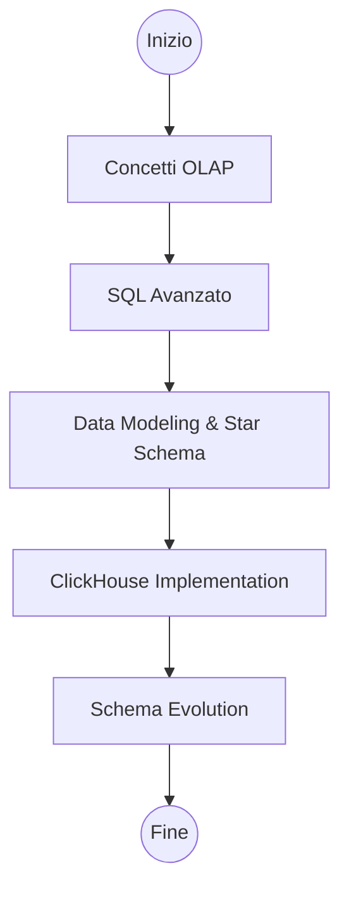

## Panoramica del Modulo

Il **Data Warehousing** non è solo un deposito di dati: è il processo di trasformazione dei dati grezzi in informazioni strutturate e interrogabili. In questo modulo esploreremo l'evoluzione delle architetture analitiche, dai classici database relazionali ai moderni motori colonnari come ClickHouse.
Imparerai i principi del *Dimensional Modeling* (Star Schema) e come scrivere query SQL ottimizzate per analizzare miliardi di righe in millisecondi.

## Obiettivi di Apprendimento

Al termine di questo modulo sarai in grado di:

- **Comprendere** la differenza architetturale tra OLTP (database transazionali) e OLAP (analitici).
- **Progettare** modelli dati a stella (Star Schema) ottimizzati per le performance di lettura.
- **Scrivere** query SQL avanzate (Window Functions, CTE) per analisi complesse.
- **Utilizzare** ClickHouse per l'analisi di big data in tempo reale.
- **Gestire** l'evoluzione dello schema dei dati nel tempo senza rompere le pipeline esistenti.

## Prerequisiti

- Conoscenza base di SQL (SELECT, WHERE, JOIN).
- Concetti fondamentali di database (tabelle, colonne, tipi di dato).

## Percorso delle Lezioni

| N° | Lezione | Argomento Principale | Durata | Difficoltà |
| :-- | :--- | :--- | :--- | :--- |
| 1 | **OLAP vs OLTP** | Fondamenti delle architetture database | 30 min | ⭐ |
| 2 | **SQL Avanzato** | Window functions e query analitiche | 60 min | ⭐⭐⭐ |
| 3 | **ClickHouse** | Introduzione al database colonnare più veloce | 50 min | ⭐⭐⭐ |
| 4 | **Data Modeling** | Star Schema e modellazione dimensionale | 50 min | ⭐⭐ |
| 5 | **Schema Evolution** | Gestire i cambiamenti nella struttura dati | 40 min | ⭐⭐ |

## Competenze Acquisite

**Competenze Tecniche:**
- Ottimizzazione di query SQL per database analitici.
- Design di tabelle e viste materializzate in ClickHouse.
- Strategie di partizionamento e indicizzazione dei dati.

**Competenze Analitiche:**
- Capacità di strutturare i dati in modo da rispondere velocemente alle domande di business.
- Comprensione dei trade-off tra normalizzazione e denormalizzazione.

## Tempo Stimato

- **Durata Totale:** Circa 4-5 ore.
- **Tempo Consigliato:** 1-2 settimane.

## Come Usare Questo Modulo

Il SQL è la lingua franca dei dati. Non accontentarti di saper fare una SELECT. Esercitati con le **Window Functions** (LEAD, LAG, RANK) perché sono quelle che ti distingueranno da un analista junior.
Quando studi **ClickHouse**, prova a caricare un dataset pubblico (es. viaggi taxi NY) e sperimenta la velocità delle query su milioni di righe.
