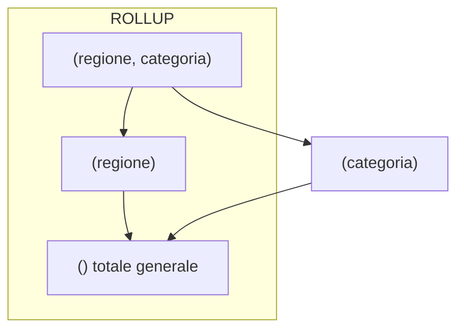

Scenario costruito con numeri di esempio: una catena retail con 120 punti vendita, quattro regioni e otto categorie merceologiche prepara ogni mese il prospetto per il comitato direttivo. L'analista incolla quattro `SELECT ... GROUP BY` con `UNION ALL`: la prima per regione e categoria, la seconda per sola regione, la terza per sola categoria, la quarta per il totale. La tabella dei fatti ha 200 milioni di righe, quindi ogni esecuzione la legge quattro volte. Il prospetto riporta poi un margine aziendale del 28% fatto con la media dei margini dei singoli negozi, mentre il bilancio dice 22%. Nessun dato in ingresso era sporco: erano sbagliati l'operatore e il modo di combinare le misure.

> **Idea chiave:** un cubo OLAP è corretto quando ogni livello di aggregazione nasce da una sola lettura dei dati e ogni rapporto viene ricalcolato come somma del numeratore diviso somma del denominatore, mai come media di rapporti.

## Perché quattro query incollate non sono un cubo

Un report multidimensionale chiede lo stesso numero a granularità diverse: dettaglio per regione e categoria, subtotale di regione, subtotale di categoria, totale generale. Con `UNION ALL` ogni livello è una query indipendente. Su un motore colonnare il costo si somma: se una scansione completa delle colonne necessarie richiede 12 secondi, quattro scansioni richiedono 4 × 12 = 48 secondi, mentre un'aggregazione multilivello in un solo passaggio ne richiede circa 14, perché legge i dati una volta e aggiorna più tabelle di aggregazione in memoria. Il filtro `WHERE` va inoltre copiato in quattro punti, e basta dimenticarne uno per avere subtotali calcolati su un periodo diverso dal dettaglio.

Esiste poi un problema di significato. Nel blocco dei subtotali le colonne collassate vengono riempite con `NULL` o con una stringa fissa come `'TOTALE'`. Se nei dati reali esiste un prodotto senza categoria, la sua riga di dettaglio ha già `categoria IS NULL` e il report non sa più distinguerla dalla riga di riepilogo.

SQL ha risolto questi due problemi con operatori di raggruppamento multidimensionale, introdotti nello standard SQL:1999 e ispirati al lavoro sul cubo di dati di Gray e colleghi ([Gray et al., 1997](https://doi.org/10.1023/A:1009726021843)). ClickHouse li supporta tutti e tre, con una particolarità sui valori mancanti che vediamo più sotto.

## Il reticolo dei raggruppamenti: GROUPING SETS, ROLLUP e CUBE

Un raggruppamento su due dimensioni, regione e categoria, può avere quattro forme: entrambe le colonne, solo la regione, solo la categoria, nessuna. Queste combinazioni formano un reticolo, e ciascun operatore sceglie quali nodi calcolare.



`GROUPING SETS` è la forma generale: elenchi tu le combinazioni esatte, per esempio `GROUP BY GROUPING SETS ((regione, categoria), (regione), ())`. `ROLLUP(a, b, c)` è una scorciatoia per una gerarchia ordinata e genera $N+1$ livelli: `(a, b, c)`, `(a, b)`, `(a)` e `()`. Si usa per percorsi come anno, trimestre, mese oppure paese, regione, città. `CUBE(a, b, c)` genera tutte le $2^N$ combinazioni e serve quando ogni dimensione va incrociata con tutte le altre.

| Operatore | Livelli generati con 2 dimensioni | Livelli con 3 dimensioni | Uso tipico |
|---|---|---|---|
| `GROUPING SETS` | quelli elencati | quelli elencati | pochi tagli scelti dal business |
| `ROLLUP(a, b)` | 3 | 4 | gerarchie ordinate (tempo, geografia) |
| `CUBE(a, b)` | 4 | 8 | esplorazione libera su poche dimensioni |

Un piccolo esempio numerico rende il conteggio concreto. Prendi due regioni e due categorie con questi ricavi in migliaia di euro: Nord-Food 400, Nord-Home 200, Sud-Food 250, Sud-Home 150. Con `ROLLUP(regione, categoria)` il risultato ha 4 righe di dettaglio, 2 subtotali di regione (Nord = 400 + 200 = 600 e Sud = 250 + 150 = 400) e 1 totale (600 + 400 = 1.000), cioè 7 righe. Con `CUBE(regione, categoria)` si aggiungono i 2 subtotali di categoria (Food = 400 + 250 = 650 e Home = 200 + 150 = 350) e si arriva a 9 righe. Il totale tornato da entrambe le vie è lo stesso, 650 + 350 = 1.000, ed è il primo controllo di quadratura da fare.

## grouping() e il problema dei NULL

Le righe di subtotale hanno le colonne collassate vuote. Per sapere se un vuoto significa "tutte le regioni" oppure "regione non assegnata" serve un metadato, ed è il compito della funzione `grouping(colonna)`: restituisce 1 quando la colonna è stata collassata dal raggruppamento e 0 quando il valore, anche se `NULL`, appartiene a una riga di dettaglio. Sommando `grouping(regione) + grouping(categoria)` ottieni un indice di livello, 0 per il dettaglio, 1 per i subtotali di `ROLLUP`, 2 per il totale.

In ClickHouse c'è una regola da conoscere. Per impostazione predefinita le colonne collassate non diventano `NULL` ma assumono il valore di default del tipo, cioè stringa vuota per `String` e zero per i numeri. Con `SETTINGS group_by_use_nulls = 1` il motore restituisce `NULL`, come fanno altri database. In entrambi i casi `grouping()` resta l'unico modo affidabile per riconoscere un subtotale: confrontare con `''` o con `NULL` è fragile, perché un dato reale può avere lo stesso valore.

Nelle query dei report conviene dunque etichettare le righe con un `CASE` su `grouping()` e trattare il `NULL` genuino con un'etichetta separata, per esempio `'CATEGORIA MANCANTE'`. Il lettore del report vede due righe diverse con nomi diversi, e il test di quadratura tra livelli continua a funzionare.

## Misure additive, semi-additive e non additive

Un cubo somma lungo le dimensioni, ma non tutte le misure possono essere sommate lungo ogni dimensione. Prima di costruire il cubo classifica ciascuna misura.

| Misura | Tipo | Regola sul subtotale |
|---|---|---|
| ricavo netto (euro) | additiva | `sum(ricavo)` su ogni dimensione |
| giacenza di magazzino (pezzi) | semi-additiva | somma tra negozi, ma non nel tempo: usa l'ultimo valore o la media |
| margine percentuale | non additiva | `sum(margine) / sum(ricavo)` a ogni livello |
| clienti unici | non additiva | `uniqExact(customer_id)` calcolato sull'insieme di ogni livello |

Il calcolo seguente mostra perché la media dei rapporti fallisce. La regione Nord ha tre negozi: A con ricavo 600.000 euro e margine 15%, B con 300.000 euro e margine 30%, C con 100.000 euro e margine 40%. I margini assoluti sono 600.000 × 0,15 = 90.000 euro, 300.000 × 0,30 = 90.000 euro e 100.000 × 0,40 = 40.000 euro. Il ricavo totale è 600.000 + 300.000 + 100.000 = 1.000.000 euro e il margine totale 90.000 + 90.000 + 40.000 = 220.000 euro, quindi il margine corretto è 220.000 / 1.000.000 = 22%. La media semplice dei tre rapporti dà (15 + 30 + 40) / 3 = 28,33%, cioè 6,33 punti percentuali di troppo. Il negozio C pesa un terzo del risultato pur generando un decimo del ricavo.

Lo stesso accade con i conteggi distinti. Se a gennaio comprano 1.000 clienti, a febbraio 900 e 300 comprano in entrambi i mesi, i clienti unici del bimestre sono 1.000 + 900 − 300 = 1.600. La somma dei due mesi dà 1.900 e conta 300 persone due volte, con un errore del 18,75% (300 / 1.600). Per le giacenze il problema è diverso: 500 pezzi a fine gennaio e 520 a fine febbraio non fanno 1.020 pezzi a fine bimestre, ma 520, perché la giacenza è un livello e non un flusso.

## La query corretta in ClickHouse

La query seguente produce dettaglio, subtotale di regione e totale generale in un'unica lettura di `fct_vendite_negozi`, etichetta le righe con `grouping()` e ricalcola margine e clienti unici a ogni livello.

```sql
-- Un solo passaggio sulla tabella dei fatti: dettaglio, subtotali di regione e totale.
SELECT
    CASE
        WHEN grouping(regione) = 1 THEN 'TOTALE AZIENDA'
        ELSE coalesce(regione, 'REGIONE NON ASSEGNATA')
    END AS regione_report,
    CASE
        WHEN grouping(categoria) = 1 THEN 'SUBTOTALE REGIONE'
        ELSE coalesce(categoria, 'CATEGORIA MANCANTE')
    END AS categoria_report,
    grouping(regione) + grouping(categoria) AS livello,
    sum(ricavo_netto_eur) AS ricavo_eur,
    sum(margine_netto_eur) AS margine_eur,
    -- Rapporto ricalcolato a ogni livello: somma del numeratore su somma del denominatore.
    round(sum(margine_netto_eur) * 100.0 / nullIf(sum(ricavo_netto_eur), 0), 2) AS margine_pct,
    -- Cardinalità esatta sull'insieme di ciascun livello, non somma dei livelli sotto.
    uniqExact(customer_id) AS clienti_unici
FROM fct_vendite_negozi
WHERE data_vendita >= '2026-01-01'
  AND data_vendita < '2027-01-01'
GROUP BY ROLLUP(regione, categoria)
ORDER BY grouping(regione), regione_report, grouping(categoria), ricavo_eur DESC
SETTINGS group_by_use_nulls = 1;
```

Il controllo di quadratura è un risultato che puoi verificare a occhio. La somma di `ricavo_eur` sulle righe con `livello = 1` deve coincidere con la riga `livello = 2`. Nei numeri dell'esempio precedente 600 + 400 = 1.000. Per il margine, il totale dell'azienda non è la media dei margini regionali: se il Nord ha ricavo 600 e margine 22% e il Sud ricavo 400 e margine 18%, i margini assoluti sono 132 e 72, la loro somma è 204 e il margine aziendale è 204 / 1.000 = 20,4%, mentre la media semplice (22 + 18) / 2 = 20% sarebbe già sbagliata.

Il passaggio da `UNION ALL` a `ROLLUP` richiede pochi minuti di riscrittura e porta il tempo da circa 48 a circa 14 secondi nei numeri di esempio: il costo cala per un fattore di 48 / 14 ≈ 3,4.

## Quote, ranking e cumulati con le window function

Dopo l'aggregazione servono spesso quote sul totale padre, classifiche e progressivi. Le window function lavorano sulle righe già aggregate e non ne cambiano il numero. Conviene calcolarle su un risultato di solo dettaglio, in una CTE, perché mescolare righe di dettaglio e subtotali nella stessa partizione conta due volte lo stesso ricavo.

```sql
-- Quota di categoria sul ricavo della regione, ranking e cumulato mensile.
WITH vendite_mese AS (
    SELECT
        regione,
        categoria,
        toStartOfMonth(data_vendita) AS mese,
        sum(ricavo_netto_eur) AS ricavo_eur
    FROM fct_vendite_negozi
    WHERE data_vendita >= '2026-01-01'
      AND data_vendita < '2027-01-01'
    GROUP BY regione, categoria, mese
)
SELECT
    regione,
    categoria,
    mese,
    ricavo_eur,
    -- Quota sul totale padre: la finestra ha come partizione regione e mese.
    round(ricavo_eur * 100.0 / sum(ricavo_eur) OVER (PARTITION BY regione, mese), 1) AS quota_regione_pct,
    -- Classifica delle categorie dentro la regione per ciascun mese.
    rank() OVER (PARTITION BY regione, mese ORDER BY ricavo_eur DESC) AS posizione,
    -- Cumulato da inizio anno con frame esplicito, per ogni coppia regione e categoria.
    sum(ricavo_eur) OVER (
        PARTITION BY regione, categoria
        ORDER BY mese
        ROWS BETWEEN UNBOUNDED PRECEDING AND CURRENT ROW
    ) AS cumulato_anno_eur
FROM vendite_mese
ORDER BY regione, mese, posizione;
```

Con i dati del Nord a gennaio, Food 400 e Home 200 mila euro, la quota di Food è 400 / 600 = 66,7% e quella di Home 200 / 600 = 33,3%. Le due quote sommano a 100%, un secondo controllo di quadratura facile da automatizzare.

## Tre errori che falsano un cubo

### Costruire i subtotali con UNION ALL

Sintomo: il prospetto impiega un multiplo del tempo atteso e i subtotali differiscono dal dettaglio di pochi euro. Succede perché ogni ramo è una query a sé, con il proprio `WHERE`, e chi modifica un filtro in un punto solo non aggiorna gli altri. Correzione: sostituisci la catena con `ROLLUP` o `GROUPING SETS`, così il filtro è scritto una volta e la tabella è letta una volta.

### Mediare percentuali o sommare conteggi distinti lungo i livelli

Sintomo: il margine del totale non coincide con il bilancio, i clienti unici dell'anno superano il numero di clienti in anagrafica. Succede perché `avg(margine_pct_riga)` dà lo stesso peso a un ordine da 5 euro e a una commessa da 500.000 euro, e perché un cliente attivo in due mesi viene contato due volte. Correzione: calcola `sum(margine) / sum(ricavo)` a ogni livello e usa `uniqExact` dentro lo stesso raggruppamento. Se il motore di BI espone le misure non additive, imposta l'aggregazione di default a "non sommare" per impedire che sommi i subtotali.

### Etichettare i subtotali con COALESCE invece di grouping()

Sintomo: nel report compaiono due righe chiamate `SUBTOTALE` con cifre diverse. Succede perché `coalesce(categoria, 'SUBTOTALE')` tratta allo stesso modo il `NULL` prodotto dal roll-up e il `NULL` di un prodotto senza categoria. Correzione: decidi il significato con `grouping()` e usa `coalesce` solo dentro il ramo `ELSE`, con un'etichetta diversa per il dato mancante.

## CUBE completo o GROUPING SETS mirati

Con due o tre dimensioni `CUBE` è comodo: 2² = 4 oppure 2³ = 8 livelli sono pochi e l'utente può incrociare ogni asse. Con più dimensioni il numero di livelli cresce in modo esponenziale e le celle intermedie esplodono. Prendi sei dimensioni, regione (20 valori), categoria (50), canale (10), segmento (5), mese (12) e dispositivo (4). Il dettaglio più fine può avere fino a 20 × 50 × 10 × 5 × 12 × 4 = 2.400.000 combinazioni, e `CUBE` ne calcola le proiezioni su 2⁶ = 64 livelli. Gran parte di quelle viste non viene mai letta da nessun report.

La regola pratica è questa. Usa `CUBE` fino a tre dimensioni quando l'esplorazione libera è l'obiettivo. Oltre, elenca con `GROUPING SETS` solo i quattro o cinque tagli che il cruscotto mostra davvero, per esempio `(regione, mese)`, `(categoria, mese)`, `(canale, mese)` e `()`. La memoria cresce in modo lineare con il numero di tagli scelti e non con le combinazioni possibili.

Due note sui limiti. Se ti serve soltanto la riga del totale generale, il modificatore `WITH TOTALS` di ClickHouse è più leggero di un `ROLLUP`. Se i conteggi distinti sono molto costosi e puoi accettare un errore di circa l'1%, `uniq` o `uniqHLL12` al posto di `uniqExact` riducono memoria e tempo, ma allora il subtotale non quadra al centesimo e va dichiarato nel report.

## Verifica sulle tue query OLAP

1. Un report ha quattro `SELECT` unite da `UNION ALL` per ottenere dettaglio, subtotale di regione, subtotale di categoria e totale. Con quale operatore lo riscrivi e quanti livelli genera con due dimensioni?

<details>
<summary>Mostra risposta</summary>

Usi `GROUP BY CUBE(regione, categoria)`, che genera 2² = 4 livelli: dettaglio, regione, categoria e totale. In alternativa `GROUPING SETS ((regione, categoria), (regione), (categoria), ())` dà lo stesso risultato con l'elenco esplicito. La tabella viene letta una volta e il `WHERE` è scritto una volta.

</details>

2. Tre negozi hanno ricavi di 200.000, 300.000 e 500.000 euro e margini del 10%, 20% e 30%. Quanto vale il margine aziendale e di quanto differisce dalla media dei tre margini?

<details>
<summary>Mostra risposta</summary>

I margini assoluti sono 200.000 × 0,10 = 20.000 euro, 300.000 × 0,20 = 60.000 euro e 500.000 × 0,30 = 150.000 euro. Il totale è 20.000 + 60.000 + 150.000 = 230.000 euro su 1.000.000 euro di ricavo, cioè 23%. La media semplice (10 + 20 + 30) / 3 = 20% sottostima di 3 punti percentuali perché dà al negozio più piccolo lo stesso peso di quello più grande.

</details>

3. In una query con `ROLLUP(regione, categoria)` compaiono due righe con la categoria vuota nella regione Nord. Come distingui il subtotale dal dato mancante?

<details>
<summary>Mostra risposta</summary>

La riga con `grouping(categoria) = 1` è il subtotale di regione, quella con `grouping(categoria) = 0` e categoria vuota o `NULL` è un dato di dettaglio senza categoria. Etichettali con un `CASE` su `grouping()` e dai al dato mancante un nome diverso, per esempio `'CATEGORIA MANCANTE'`. Ricorda che in ClickHouse le colonne collassate valgono la stringa vuota se non imposti `group_by_use_nulls = 1`.

</details>

4. A gennaio comprano 1.200 clienti, a febbraio 1.000, e 400 comprano in entrambi i mesi. Quanti sono i clienti unici del bimestre e di quanto sbaglia la somma dei due mesi?

<details>
<summary>Mostra risposta</summary>

I clienti unici sono 1.200 + 1.000 − 400 = 1.800. La somma dei due mesi dà 2.200, con un eccesso di 400 clienti, pari a 400 / 1.800 ≈ 22,2%. Il valore corretto si ottiene con `uniqExact(customer_id)` nello stesso raggruppamento del bimestre.

</details>

5. Una proposta chiede `CUBE` su otto dimensioni per "avere tutte le viste pronte". Quanti livelli genera e che cosa proponi al suo posto?

<details>
<summary>Mostra risposta</summary>

Genera 2⁸ = 256 livelli. Proponi `GROUPING SETS` con i quattro o cinque tagli che i cruscotti leggono davvero, verificandoli in `system.query_log`, così il costo di memoria resta proporzionale ai tagli scelti e non alle 256 combinazioni possibili.

</details>
