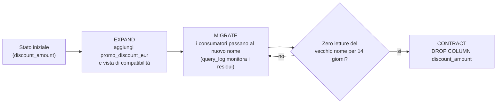

Caso ricostruito con numeri di esempio: la tabella `analytics.fct_orders` di un'azienda retail ha 300 milioni di righe e alimenta 14 modelli dbt, 8 report di Business Intelligence e 2 estrazioni verso la pianificazione finanziaria, in tutto 24 consumatori. Il giovedì pomeriggio un ingegnere ripulisce i nomi: esegue `RENAME COLUMN discount_amount TO promo_discount_eur` e converte `is_b2b` da `UInt8` a `String`. Il venerdì alle 07:00, 17 dei 24 consumatori leggono ancora il vecchio nome o il vecchio tipo e falliscono con `Unknown identifier` o con un errore di tipo. Il team passa tre ore a ripristinare lo schema e a rilanciare i calcoli arretrati prima che i negozi aprano.

> **Idea chiave:** le colonne di una tabella analitica sono un'interfaccia pubblica. Si cambia un'interfaccia pubblica aggiungendo, migrando i chiamanti con prove oggettive e solo alla fine rimuovendo, mai sostituendo in un colpo solo.

## Che cosa si può cambiare senza avvisare nessuno

Il codice che legge una tabella non vive tutto nel tuo repository. Oltre ai modelli dbt ci sono query salvate negli strumenti di BI, fogli della finanza collegati al warehouse, notebook dei data scientist. Per decidere quanto è rischiosa una modifica serve una classificazione netta.

| Modifica | Tipo | Effetto sui consumatori che elencano le colonne |
|---|---|---|
| `ADD COLUMN` in coda, con default | additiva | nessuno |
| Nuova tabella o nuova vista | additiva | nessuno |
| `RENAME COLUMN` o `DROP COLUMN` | distruttiva | errore immediato di identificatore |
| Restringere il tipo (`Int64` a `Int32`, `String` a `Date`) | distruttiva | errore o perdita di dati |
| Cambiare formula o unità con lo stesso nome | distruttiva (silenziosa) | numeri diversi senza alcun errore |
| Cambiare il grain (una riga per ordine invece che per riga d'ordine) | distruttiva (silenziosa) | somme moltiplicate o dimezzate |

Le ultime due righe sono le più pericolose, perché nessun job fallisce e i cruscotti continuano a mostrare numeri plausibili. Una modifica distruttiva rumorosa si scopre in un'ora, una silenziosa dopo il quarto trimestre.

In ClickHouse esiste un vincolo fisico in più: le colonne della chiave `ORDER BY` e della chiave di partizione non si possono modificare né rinominare. Cambiare la chiave significa creare una tabella nuova, copiarci i dati e scambiare i nomi. Quella è sempre una migrazione a versione esplicita.

## Il ciclo expand, migrate, contract

La procedura che trasforma una modifica distruttiva in una sequenza sicura ha tre fasi, e ciascuna può essere rilasciata e annullata indipendentemente dalle altre.



Nella fase di espansione aggiungi la nuova colonna accanto alla vecchia e fai in modo che entrambe siano disponibili, direttamente o tramite una vista. Nessun consumatore se ne accorge. Nella fase di migrazione i team aggiornano i propri modelli e i propri report secondo il proprio calendario, e tu misuri chi legge ancora il vecchio nome. Nella fase di contrazione, solo quando la misura dice zero per un periodo concordato, rimuovi la colonna vecchia. Se qualcosa va storto prima di quel punto il rilascio è reversibile con una riga, perché la colonna originale è ancora lì.

La disciplina richiede anche un responsabile per ogni fase. Chi propone la modifica possiede l'espansione e la contrazione, mentre i proprietari dei consumatori possiedono la migrazione; senza questa divisione la fase centrale si allunga all'infinito, perché nessuno si sente autorizzato a chiuderla e la colonna vecchia resta in produzione per anni.

Il principio operativo si riassume così: non rinominare né cancellare mai una colonna nello stesso rilascio in cui introduci la sua sostituta.

## Fase expand: nuova colonna e vista di compatibilità

In ClickHouse `ADD COLUMN` è un'operazione sui metadati: non riscrive i dati esistenti, quindi è immediata anche su 300 milioni di righe. Se la nuova colonna ha come default un'espressione sulla vecchia, per le parti già scritte il valore viene calcolato in lettura, e non serve nessun backfill immediato.

```sql
-- FASE 1 (EXPAND): la nuova colonna deriva dalla vecchia per le righe già scritte.
ALTER TABLE analytics.fct_orders
    ADD COLUMN IF NOT EXISTS promo_discount_eur Decimal(12, 2) DEFAULT discount_amount;

-- Vista di transizione: espone entrambi i nomi, così nessun report esistente si rompe.
CREATE OR REPLACE VIEW analytics.v_fct_orders_compat AS
SELECT
    order_id,
    order_date,
    customer_id,
    promo_discount_eur,
    promo_discount_eur AS discount_amount
FROM analytics.fct_orders;

-- Il job di caricamento dei nuovi ordini deve scrivere entrambe le colonne
-- finché esiste almeno un consumatore sul vecchio nome.
INSERT INTO analytics.fct_orders (order_id, order_date, customer_id, discount_amount, promo_discount_eur)
SELECT order_id, order_date, customer_id, discount_eur, discount_eur
FROM staging.orders_incoming;
```

La vista di compatibilità è il punto debole del ciclo se la usi senza accorgerti di una conseguenza: chi legge `discount_amount` attraverso la vista finisce nel log come lettore della colonna `promo_discount_eur`, perché è quella la colonna fisica toccata. Per misurare davvero chi usa il vecchio nome devi quindi guardare il testo delle query, oltre alle colonne.

## Fase migrate: leggere system.query_log

`system.query_log` registra ogni query terminata con testo, utente, tabelle e colonne lette. Su un cluster va interrogato su ogni nodo, per esempio con `clusterAllReplicas`. La query seguente elenca chi usa ancora il vecchio nome, sia leggendo la colonna direttamente sia passando dalla vista di compatibilità.

```sql
-- FASE 2 (MIGRATE): chi legge ancora discount_amount negli ultimi 14 giorni?
SELECT
    user,
    count() AS esecuzioni,
    max(event_time) AS ultima_lettura,
    any(substring(query, 1, 120)) AS esempio
FROM system.query_log
WHERE type = 'QueryFinish'
  AND event_date >= today() - 14
  AND query_kind = 'Select'
  AND (
        has(columns, 'analytics.fct_orders.discount_amount')
        OR positionCaseInsensitive(query, 'discount_amount') > 0
      )
  AND NOT positionCaseInsensitive(query, 'system.query_log') > 0
GROUP BY user
ORDER BY ultima_lettura DESC;

-- FASE 3 (CONTRACT): eseguire solo se la query sopra restituisce 0 righe.
-- Il default di promo_discount_eur dipende da discount_amount: va prima scritto su disco e poi staccato.
ALTER TABLE analytics.fct_orders MATERIALIZE COLUMN promo_discount_eur;
ALTER TABLE analytics.fct_orders MODIFY COLUMN promo_discount_eur REMOVE DEFAULT;
ALTER TABLE analytics.fct_orders DROP COLUMN IF EXISTS discount_amount;
```

Il passaggio di materializzazione è facile da dimenticare. Finché `promo_discount_eur` ha come default un'espressione su `discount_amount`, ClickHouse rifiuta di eliminare la colonna da cui dipende, e per le parti vecchie il valore esiste solo come calcolo in lettura. `MATERIALIZE COLUMN` lo scrive fisicamente con una mutazione sulle sole parti che ne hanno bisogno, quindi va programmato in una finestra a basso carico.

Ogni utente che compare nella lista è un consumatore da avvisare, con la data prevista di spegnimento. La query non è infallibile: copre la finestra di retention del log, quindi un report trimestrale che gira una volta ogni novanta giorni può non comparire in 14. Il periodo di osservazione va deciso in base al ciclo più lungo dei tuoi consumatori, non a una cifra fissa.

## Contratti dbt e versioni dei modelli

La misura dopo il fatto non basta, serve un freno prima. Un modello dbt pubblico con `contract.enforced: true` dichiara nome e tipo di ogni colonna, e la build fallisce se la tabella prodotta non corrisponde. Il blocco seguente mostra il contratto sulla versione 1 e la versione 2 che toglie la vecchia colonna con una data di deprecazione.

```yaml
# models/marts/fct_orders.yml: contratto di schema e versioni del modello.
models:
  - name: fct_orders
    latest_version: 2
    config:
      contract:
        enforced: true
    columns:
      - name: order_id
        data_type: UInt64
      - name: order_date
        data_type: Date
      - name: discount_amount
        data_type: Decimal(12, 2)
      - name: promo_discount_eur
        data_type: Decimal(12, 2)
    versions:
      - v: 1
        deprecation_date: 2027-01-31   # data dopo la quale v1 viene rimossa
      - v: 2
        columns:
          - include: all
            exclude: [discount_amount]
```

Ogni modifica distruttiva dopo questo punto produce un errore in CI e non una chiamata alle sette del mattino. La scelta tra evolvere sul posto e pubblicare `v2` segue una regola semplice. Se aggiungi attributi opzionali che non cambiano il grain né il significato delle colonne esistenti, basta `ADD COLUMN` sulla tabella in uso. Se cambi il grain, rimuovi o rinomini colonne, o modifichi la formula di una metrica consolidata, pubblica una versione nuova con finestra di deprecazione. Creare una `v2`, `v3` e `v4` per ogni colonna in più moltiplica storage e calcolo, mentre alterare la formula del margine dentro `v1` fa cambiare i numeri storici sotto lo stesso nome.

## Un conto svolto: doppia colonna contro rollback

Si può stimare il costo della procedura sicura con i numeri dell'esempio. La colonna `Decimal(12, 2)` occupa 8 byte per riga (è un `Decimal64`). Su 300 milioni di righe sono 300.000.000 × 8 byte = 2,4 GB non compressi. Con un rapporto di compressione di 4 a 1, tipico per colonne numeriche con molti valori ripetuti, restano 2,4 / 4 = 0,6 GB. Tenere quella colonna in più per la durata del ciclo è quindi un costo dell'ordine di mezzo gigabyte.

La durata si calcola dal calendario. L'espansione dura 1 giorno. I 17 consumatori da migrare hanno ciascuno un proprietario diverso: a un ritmo di circa 4 consumatori a settimana servono 17 / 4 ≈ 4,3 settimane, quindi 5 settimane arrotondando per eccesso, cioè 35 giorni. A quel punto segue la finestra di sola osservazione di 14 giorni a zero letture. Il ciclo completo dura 1 + 35 + 14 = 50 giorni, con una colonna extra di 0,6 GB.

L'alternativa è il rename in-place: costo di storage nullo, ma 17 consumatori su 24 fermi, 3 ore di recupero con almeno 2 persone coinvolte, cioè 6 ore di lavoro in emergenza, più la perdita di fiducia nei numeri del cruscotto. Con una cifra di 0,6 GB contro 17 report spenti la scelta è scontata.

## Tre errori che si pagano il venerdì mattina

### Rinominare o cancellare una colonna sulla tabella esposta

Sintomo: poche ore dopo il rilascio arrivano segnalazioni da persone che non sapevi leggessero quella tabella. Succede perché il rename sembra il modo più pulito per non lasciare duplicati, e i test del tuo repository passano. Il codice che si rompe sta fuori: query salvate in Metabase o Superset, fogli elettronici, script di data science. Correzione: applica expand-migrate-contract e misura i lettori con `system.query_log` prima del `DROP`.

### Cambiare il significato di una colonna mantenendo il nome

Sintomo: nessun errore, ma a ottobre le vendite sembrano calare. Succede perché qualcuno ha fatto passare `total_revenue_eur` da lordo a netto IVA con la stessa etichetta. Con aliquota 22%, un lordo di 1.220.000 euro diventa un netto di 1.220.000 / 1,22 = 1.000.000 euro, e il cruscotto mostra una variazione di (1.000.000 − 1.220.000) / 1.220.000 = −18,0% senza che sia cambiato un solo ordine. Correzione: una colonna con significato nuovo ha nome nuovo (`net_revenue_eur`), con la vecchia mantenuta fino alla fine della migrazione.

### Convertire il tipo di una colonna storica sporca

Sintomo: `ALTER TABLE ... MODIFY COLUMN channel_code UInt16` parte e poi resta bloccato. Succede perché la colonna era `String` e nel 2023 qualcuno ha scritto `'WEB_01'`: la conversione fallisce su quel valore. In ClickHouse la modifica è una mutazione che riscrive le parti, e una mutazione fallita resta in coda in `system.mutations` con il motivo in `latest_fail_reason`, bloccando le successive sulla stessa tabella. Correzione: prima di convertire cerca i valori non conformi con una query di profilazione, aggiungi una colonna nuova del tipo giusto e popola il valore con `toUInt16OrZero` o con una mappa esplicita, poi segui il ciclo normale.

## Verifica prima di toccare una tabella pubblica

1. Devi aggiungere a `fct_orders` la colonna `coupon_code String DEFAULT ''`. Serve una `v2` del modello?

<details>
<summary>Mostra risposta</summary>

No. È una modifica additiva: i consumatori che elencano le colonne non la vedono e il grain non cambia. Basta `ALTER TABLE ... ADD COLUMN IF NOT EXISTS` e l'aggiunta della colonna al file YAML del contratto.

</details>

2. Dopo un `RENAME COLUMN` in produzione, 17 consumatori su 24 falliscono. Quale percentuale della flotta si è fermata e che cosa avrebbe evitato il guasto?

<details>
<summary>Mostra risposta</summary>

17 / 24 ≈ 70,8% dei consumatori. Il guasto sarebbe stato evitato dal ciclo expand-migrate-contract: aggiungere la nuova colonna, tenere la vecchia per tutta la migrazione e cancellarla solo dopo 14 giorni di zero letture in `system.query_log`.

</details>

3. Hai creato una vista di compatibilità che espone `discount_amount` come alias di `promo_discount_eur`. Perché la sola ricerca su `columns` in `system.query_log` non basta a sapere chi usa ancora il vecchio nome?

<details>
<summary>Mostra risposta</summary>

Chi legge attraverso la vista tocca la colonna fisica `promo_discount_eur`, non `discount_amount`, quindi non compare nell'elenco delle colonne lette della tabella. Va aggiunta la ricerca del nome nel testo della query, oppure il controllo dell'utilizzo della vista nella colonna `views`.

</details>

4. Un team cambia la formula di `total_revenue_eur` da lordo a netto IVA al 22% senza cambiare il nome. Su un lordo di 1.220.000 euro, di quanto sembra calare il fatturato e come si corregge?

<details>
<summary>Mostra risposta</summary>

Il netto è 1.220.000 / 1,22 = 1.000.000 euro e la variazione apparente è (1.000.000 − 1.220.000) / 1.220.000 = −18,0%. Si corregge introducendo una colonna con nome nuovo (`net_revenue_eur`) e tenendo `total_revenue_eur` con il vecchio significato fino al termine della migrazione.

</details>
