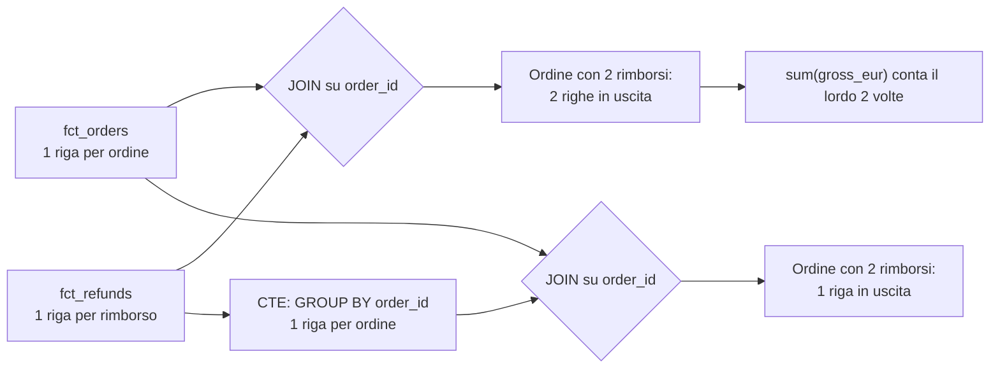

Scenario costruito con numeri di esempio: la tabella `fct_orders` ha 120 milioni di righe, ordinate per `(order_date, customer_id)`, e accanto c'è `fct_refunds` con i rimborsi parziali dell'assistenza. Per la chiusura trimestrale un analista scrive una sola query con tre difetti. Filtra l'anno con `toString(order_date) LIKE '2026-%'`. Unisce gli ordini ai rimborsi con un `LEFT JOIN` prima di sommare il lordo. Confronta ogni mese con quello di dodici mesi prima usando un auto-join. La query impiega minuti invece di secondi, e i 4.500 ordini che hanno ricevuto due rimborsi parziali contribuiscono due volte al ricavo.

> **Idea chiave:** una query analitica è solida quando lascia nuda la colonna su cui il motore salta i blocchi, porta ogni tabella allo stesso grain prima di unirla alle altre e dichiara in modo esplicito la finestra su cui calcola cumulati e confronti.

## Perché il motore colonnare cambia le regole

Un database transazionale legge poche righe per volta usando indici su molte colonne. Un motore colonnare come ClickHouse fa il contrario: legge poche colonne su molte righe, in blocchi compressi, e saltare i blocchi inutili vale più di qualsiasi ottimizzazione del singolo calcolo. Il salto è guidato dall'indice primario, che non punta alle singole righe ma ai granuli, gruppi di 8.192 righe nella configurazione predefinita. Per ogni granulo l'indice conserva il valore della chiave di ordinamento da cui parte, e un filtro che confronta la colonna di ordinamento con costanti permette di scartare interi granuli senza leggerli.

La conseguenza è che tre abitudini nate nei database piccoli diventano costose o sbagliate su questa scala: applicare funzioni alle colonne nel `WHERE`, unire tabelle senza controllare quante righe corrispondono a ogni chiave, usare finestre con frame lasciati ai valori predefiniti. Le sezioni seguenti le affrontano una alla volta, con la query corretta in ClickHouse e il calcolo che mostra quanto cambia il risultato.

## Predicati sargable e granuli letti

Un predicato è *sargable* quando il motore può usarlo per cercare dentro l'indice. Confrontare la colonna nuda con costanti dello stesso tipo, come `order_date >= '2026-01-01' AND order_date < '2027-01-01'`, lo è. Avvolgere la colonna in una funzione come `toString(order_date)` o `toMonth(order_date) = 3` fa perdere al motore la relazione d'ordine tra i valori, e il filtro diventa una condizione da valutare riga per riga.

Calcoliamo l'effetto. Le 120.000.000 righe, divise in granuli da 8.192, fanno 120.000.000 / 8.192 ≈ 14.649 granuli. Se la tabella copre otto anni in modo uniforme, il filtro sul solo 2026 riguarda circa un ottavo dei dati, cioè 14.649 / 8 ≈ 1.831 granuli. Il motore legge il 12,5% della tabella invece del 100%, con una riduzione dell'87,5% dell'I/O. Con la funzione sulla colonna i granuli letti restano 14.649 e a ciascuna riga si aggiunge una conversione in testo.

Quando devi filtrare per mese o per anno di calendario, riscrivi il filtro come intervallo: invece di `toYear(order_date) = 2026` scrivi i due estremi del periodo. ClickHouse è in grado di sfruttare certe funzioni monotone sulla chiave primaria, ma affidarsi a questa proprietà è fragile, mentre l'intervallo esplicito funziona sempre.

## Grain e join: perché la somma si gonfia

Il *grain* di una tabella è ciò che rappresenta una sua riga: in `fct_orders` un ordine, in `fct_refunds` un rimborso. Se unisci due tabelle con grain diversi lungo la chiave che le collega, ogni riga del lato "uno" viene ripetuta per tutte le corrispondenze del lato "molti", e qualsiasi somma sul lato "uno" si moltiplica.



L'esempio numerico svolto passo per passo. L'ordine 1001 ha un lordo di 80 euro e due rimborsi parziali da 10 e 15 euro. Con il join diretto la query produce due righe, ciascuna con `gross_eur = 80`. La somma del lordo diventa 80 + 80 = 160 euro invece di 80, mentre la somma dei rimborsi è 10 + 15 = 25 euro, corretta. Su scala, i 4.500 ordini con due rimborsi hanno un lordo medio di 80 euro, quindi l'eccesso è 4.500 × 80 = 360.000 euro di vendite che non esistono. Se prima raggruppi i rimborsi per ordine, l'ordine 1001 ha una sola riga con `total_refund_eur = 25`, il join non duplica nulla, e il netto è 80 − 25 = 55 euro.

Il controllo che intercetta questo errore costa una query: `count()` sulla tabella prima e dopo il `LEFT JOIN` di arricchimento deve dare lo stesso numero. Se il rapporto tra i due conteggi è diverso da 1, c'è una moltiplicazione di righe da cercare prima di pubblicare qualsiasi cifra.

## La query mensile corretta: CTE, pivot e cumulato

La query seguente applica i tre principi insieme. Filtra le date con intervalli sulla colonna nuda, porta i rimborsi al grain dell'ordine in una CTE, ruota i metodi di pagamento in colonne con `sumIf` e calcola cumulato annuo e confronto con l'anno precedente sulla serie mensile.

```sql
WITH resi_per_ordine AS (
    -- Passo 1: i rimborsi arrivano a una riga per order_id prima di qualsiasi join.
    SELECT
        order_id,
        sum(refund_eur) AS total_refund_eur
    FROM fct_refunds
    WHERE refund_date >= '2025-01-01'
    GROUP BY order_id
),
mensile AS (
    -- Passo 2: join N:1 sicuro e pivot condizionale nella stessa scansione.
    SELECT
        toStartOfMonth(o.order_date) AS mese,
        sum(o.gross_eur) AS ricavo_lordo_eur,
        sum(r.total_refund_eur) AS rimborsi_eur,
        sum(o.gross_eur - r.total_refund_eur) AS ricavo_netto_eur,
        sumIf(o.gross_eur, o.payment_method = 'card') AS ricavo_carte_eur,
        sumIf(o.gross_eur, o.payment_method = 'bank_transfer') AS ricavo_bonifico_eur
    FROM fct_orders AS o
    LEFT JOIN resi_per_ordine AS r
        ON o.order_id = r.order_id
    WHERE o.order_date >= '2025-01-01'
      AND o.order_date < '2027-01-01'
    GROUP BY mese
)
-- Passo 3: finestre con frame dichiarato, cumulato annuo e valore di 12 righe prima.
SELECT
    mese,
    ricavo_netto_eur,
    ricavo_carte_eur,
    ricavo_bonifico_eur,
    sum(ricavo_netto_eur) OVER (
        PARTITION BY toYear(mese)
        ORDER BY mese
        ROWS BETWEEN UNBOUNDED PRECEDING AND CURRENT ROW
    ) AS progressivo_annuo_eur,
    lagInFrame(ricavo_netto_eur, 12) OVER (
        ORDER BY mese
        ROWS BETWEEN UNBOUNDED PRECEDING AND UNBOUNDED FOLLOWING
    ) AS ricavo_netto_anno_prec_eur
FROM mensile
ORDER BY mese;
```

Un dettaglio di ClickHouse da conoscere: per le colonne dell'ultimo lato di un `LEFT JOIN` senza corrispondenza, con l'impostazione predefinita `join_use_nulls = 0` il motore restituisce il valore di default del tipo, cioè 0, e non `NULL`. Nella CTE sopra un ordine senza rimborsi ha quindi `total_refund_eur = 0` e `o.gross_eur - r.total_refund_eur` è il lordo intero. Se vuoi distinguere "nessun rimborso" da "rimborso a zero euro", imposta `join_use_nulls = 1` e usa `coalesce` esplicito.

Il frame di `lagInFrame` richiede attenzione. In ClickHouse questa funzione guarda solo le righe comprese nel frame, e il frame predefinito di una finestra con `ORDER BY` arriva fino alla riga corrente. Con `UNBOUNDED PRECEDING AND UNBOUNDED FOLLOWING` la finestra comprende l'intera partizione, e lo spostamento di 12 righe funziona come atteso.

## Confronti anno su anno su una serie densa

Il confronto `lagInFrame(x, 12)` funziona solo se ogni mese ha una riga. Una linea di prodotto lanciata a metà anno, o un mese senza vendite, lascia dei buchi nella sequenza, e lo spostamento di 12 righe non corrisponde più a 12 mesi di calendario.

Un esempio numerico lo mostra. La linea `outdoor` non ha venduto nulla ad aprile 2025 e quindi non ha riga per quel mese; a maggio 2025 ha ricavo 380.000 euro e ad aprile 2026 395.000 euro. Senza riga mancante, la riga di aprile 2026 si trova a 12 posizioni di distanza da quella di maggio 2025 e la query calcola (395.000 − 380.000) / 380.000 = 3,9%, un confronto tra mesi diversi. Con la serie densa, aprile 2025 vale 0, il confronto corretto non è definibile e deve restare `NULL`, non diventare 3,9% o un infinito.

ClickHouse ha una clausola dedicata per riempire i buchi, `ORDER BY ... WITH FILL`, che inserisce le righe mancanti con i valori di default.

```sql
-- Serie mensile densa per la linea outdoor e variazione anno su anno.
WITH mensile AS (
    SELECT
        toStartOfMonth(order_date) AS mese,
        sum(gross_eur) AS ricavo_eur
    FROM fct_orders
    WHERE product_line = 'outdoor'
      AND order_date >= '2025-01-01'
      AND order_date < '2027-01-01'
    GROUP BY mese
    ORDER BY mese
        WITH FILL FROM toDate('2025-01-01') TO toDate('2027-01-01') STEP INTERVAL 1 MONTH
),
con_lag AS (
    SELECT
        mese,
        ricavo_eur,
        lagInFrame(ricavo_eur, 12) OVER (
            ORDER BY mese
            ROWS BETWEEN UNBOUNDED PRECEDING AND UNBOUNDED FOLLOWING
        ) AS ricavo_anno_prec_eur
    FROM mensile
)
SELECT
    mese,
    ricavo_eur,
    ricavo_anno_prec_eur,
    -- nullIf evita la divisione per zero: un mese a base zero non ha variazione definita.
    round((ricavo_eur - ricavo_anno_prec_eur) * 100.0 / nullIf(ricavo_anno_prec_eur, 0), 1) AS yoy_pct
FROM con_lag
WHERE mese >= '2026-01-01'
ORDER BY mese;
```

Con una serie densa il calcolo diventa verificabile a mano. Se a marzo 2025 il ricavo è 410.000 euro e a marzo 2026 è 451.000 euro, la variazione è (451.000 − 410.000) / 410.000 = 41.000 / 410.000 = 10,0%. Quando la query restituisce un valore, puoi controllare la riga del mese corrispondente in `ricavo_anno_prec_eur` e rifare questo calcolo.

## Finestre al volo o colonne materializzate

Molte metriche derivate si possono calcolare con una window function al momento della lettura oppure materializzare in una tabella durante la build. Il criterio dipende da che cosa determina la finestra. Se dipende dai filtri scelti dall'utente nel cruscotto, come la classifica dei prodotti nella sola categoria e nell'intervallo selezionati, calcola la finestra al volo: una colonna precalcolata sarebbe valida solo per un filtro. Se dipende dalla storia immutabile di un'entità, come la data del primo acquisto di un cliente o il numero progressivo del suo ordine, materializza il valore in una colonna della tabella dbt: ricalcolare `min(order_date) OVER (PARTITION BY customer_id)` a ogni apertura del cruscotto, su cento milioni di ordini, spreca memoria su un risultato che non cambia.

Entrambe le scelte sbagliate si riconoscono dal sintomo. Un rango statico che resta fisso quando l'utente filtra una regione mostra classifiche incoerenti con la pagina. Una finestra di storia ricalcolata a ogni clic satura la RAM su partizioni giganti.

## Tre errori ricorrenti nelle query analitiche

### Funzione sulla colonna di filtro

Sintomo: la query dà il risultato giusto su un campione ma impiega minuti sulla tabella intera. Succede perché `WHERE toString(order_date) LIKE '2026-%'` sembra equivalente al filtro per anno, ma obbliga il motore a leggere tutti i granuli e a convertire ogni data in testo. Correzione: scrivi `order_date >= '2026-01-01' AND order_date < '2027-01-01'` e, per verificare, leggi con `EXPLAIN indexes = 1` quanti granuli sono selezionati.

### Join 1:N prima di sommare

Sintomo: il ricavo del report supera quello della contabilità di una cifra che dipende dal numero di rimborsi. Succede perché il join ripete la riga dell'ordine per ogni rimborso e `sum(gross_eur)` somma la ripetizione. Correzione: porta la tabella dal lato "molti" al grain della chiave con una CTE `GROUP BY order_id` e confronta `count()` prima e dopo il join, che deve restare identico.

### Window function con frame implicito

Sintomo: `last_value(order_date)` restituisce la data della riga corrente invece dell'ultimo ordine del cliente. Succede perché con `ORDER BY` dentro `OVER` il frame predefinito va dall'inizio della partizione alla riga corrente. Per un cliente con ordini da 10, 20 e 30 euro, l'ultimo valore calcolato in ogni riga è 10, poi 20, poi 30, e non 30 per tutte e tre. Correzione: dichiara `ROWS BETWEEN UNBOUNDED PRECEDING AND UNBOUNDED FOLLOWING` quando vuoi l'estremo dell'intera partizione, e `... AND CURRENT ROW` quando vuoi un cumulato.

## Verifica prima di mettere in produzione una query

1. Una tabella da 240.000.000 di righe usa granuli da 8.192 righe. Un filtro su un solo anno di sei, distribuiti in modo uniforme, quanti granuli seleziona circa?

<details>
<summary>Mostra risposta</summary>

I granuli totali sono 240.000.000 / 8.192 ≈ 29.297. Un anno su sei corrisponde a circa 29.297 / 6 ≈ 4.883 granuli, cioè il 16,7% della tabella, e questo vale solo se il filtro è scritto con la colonna di ordinamento nuda.

</details>

2. Un ordine da 120 euro ha tre rimborsi da 20, 20 e 10 euro. Che valore assume `sum(o.gross_eur)` se fai il join diretto con `fct_refunds`, e quale dopo la CTE pre-aggregata?

<details>
<summary>Mostra risposta</summary>

Con il join diretto l'ordine compare su 3 righe, quindi 120 × 3 = 360 euro invece di 120. Dopo la CTE i rimborsi diventano una sola riga da 20 + 20 + 10 = 50 euro, il lordo resta 120 euro e il netto è 120 − 50 = 70 euro.

</details>

3. Una linea di prodotto ha ricavi a maggio 2025 pari a 200.000 euro e a maggio 2026 pari a 230.000 euro. Qual è la variazione anno su anno e cosa devi garantire perché `lagInFrame(x, 12)` la calcoli correttamente?

<details>
<summary>Mostra risposta</summary>

La variazione è (230.000 − 200.000) / 200.000 = 15,0%. La serie deve avere una riga per ogni mese di calendario, per esempio generata con `ORDER BY mese WITH FILL`, così che la riga 12 posizioni prima sia davvero maggio 2025.

</details>

4. Un `LEFT JOIN` di arricchimento fa passare il conteggio da 5.000.000 a 5.600.000 righe. Cosa indica il rapporto e come lo risolvi?

<details>
<summary>Mostra risposta</summary>

Il rapporto 5.600.000 / 5.000.000 = 1,12 indica che il lato destro ha più di una riga per chiave: 600.000 righe sono duplicati. Si risolve raggruppando il lato destro alla chiave del join in una CTE, oppure scegliendo una sola riga per chiave, finché il rapporto torna a 1,0000.

</details>
