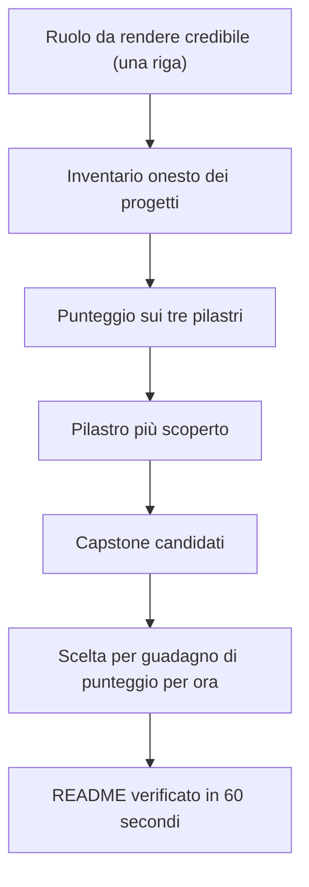

Scenario costruito: Giulia lavora da tre anni come analista in un e-commerce di medie dimensioni e ha deciso di candidarsi come Marketing Analyst in un'azienda con un team dati di dodici persone. Sul suo profilo GitHub ci sono cinque repository. Quattro sono esercizi di SQL e visualizzazione sugli stessi due dataset pubblici, il quinto è un notebook sulla segmentazione RFM con un solo grafico e nessuna raccomandazione. Quando una recruiter tecnica apre il profilo, in venti secondi capisce che Giulia conosce gli strumenti, ma non riesce a dire quale problema abbia mai risolto. Il portfolio dimostra competenza tecnica, non valore.

Questa è la situazione tipica di chi ha completato le basi di SQL, dashboard e statistica e deve ora scegliere quale direzione raccontare tra prodotto, marketing, finanza, operations e analytics engineering. La scelta non ha una risposta corretta in astratto: esiste solo la risposta che rende credibile il ruolo che vuoi ottenere, con prove che un estraneo può ispezionare.

> **Idea chiave:** un portfolio non è una vetrina di strumenti ma un insieme di prove su tre pilastri (competenza tecnica, impatto sul business, comunicazione), e il capstone è il progetto che li dimostra tutti e tre sullo stesso problema, riconoscibile per il ruolo che vuoi ottenere.

## Dal ruolo ai progetti: l'ordine giusto per decidere

Il riflesso comune è partire dagli strumenti: si impara dbt, poi Streamlit, poi un pizzico di causal inference, e solo alla fine ci si chiede che cosa raccontare. Funziona meglio l'ordine inverso. Prima scegli il ruolo che vuoi rendere credibile nei prossimi sei mesi, e lo scrivi in una riga. Poi guardi i progetti che hai già e segni per ciascuno quale pilastro dimostra davvero. Infine individui il pilastro più scoperto e scegli un solo progetto per colmarlo. Ogni passaggio produce un output verificabile, e nessuno richiede di imparare uno strumento nuovo prima di aver deciso a quale domanda risponde.

Il motivo è che un recruiter tecnico non assume una lista di tecnologie. Assume una persona che ha già risolto un problema simile a quello del suo team. Dichiarare «conosco SQL, Python e Tableau» non cambia la probabilità di essere chiamati al colloquio, perché lo dichiarano tutti i candidati. Cambia invece mostrare un repository in cui dalla domanda di business si arriva a una raccomandazione con un numero.

Il trade-off, cioè la rinuncia esplicita, va dichiarato fin dall'inizio. Un portfolio che parla a un ruolo ne esclude altri, e va bene così: un portfolio generico, che non parla a nessuno, è più rischioso di uno specifico che non piace a una parte del mercato.

## I tre pilastri e come si dimostrano

La competenza tecnica è ciò che sai costruire, e deve essere verificabile con codice eseguibile e non con dichiarazioni. I formati più efficaci sono tre: un repository dbt pubblico con cinque o dieci modelli, test e documentazione, che mostra software engineering applicato ai dati; un notebook Jupyter su GitHub o Kaggle con un'analisi end-to-end, dalla pulizia alla raccomandazione; oppure una dashboard interattiva in Streamlit, Shiny o Dash che chi valuta può esplorare da solo.

L'impatto sul business è ciò che hai cambiato, ed esige numeri. Ogni progetto dovrebbe dichiarare quattro elementi: il problema di business originale, la decisione che l'analisi ha supportato, l'impatto quantificato (ricavo incrementale, costo risparmiato, tempo recuperato) e lo scenario controfattuale, cioè che cosa avrebbe fatto l'azienda senza quell'analisi. Se lavori su dati pubblici l'impatto è ipotetico, ma va comunque stimato con un'assunzione dichiarata, altrimenti il progetto resta un esercizio.

La comunicazione è il modo in cui racconti la storia. Il lavoro migliore è inutile se è illeggibile, quindi serve un README con un executive summary di quattro frasi comprensibile anche senza aprire il codice, grafici con titoli che anticipano la conclusione e un write-up in forma di articolo breve piuttosto che di relazione accademica. Un gergo tecnico lasciato senza spiegazione è un costo che paga chi legge, e chi legge ha poco tempo.

| Pilastro | Domanda a cui risponde | Prova ispezionabile | Segnale di debolezza |
| --- | --- | --- | --- |
| Competenza tecnica | Cosa sai costruire? | Repository eseguibile con test e istruzioni | Solo screenshot e dichiarazioni |
| Impatto sul business | Cosa hai cambiato? | Decisione supportata e numero con baseline | Descrizione del metodo senza risultato |
| Comunicazione | Come racconti la storia? | README di quattro frasi, grafici con titolo-conclusione | Notebook senza testo né raccomandazione |

## Il capstone: tre proprietà e quattro idee

Il capstone è il progetto più completo del portfolio e ha tre proprietà. È end-to-end, perché va dalla definizione del problema alla raccomandazione. È cross-funzionale, perché tocca più domini, per esempio marketing, prodotto e finanza. È riproducibile, nel senso che chiunque può clonare il repository ed eseguirlo. I dati possono essere reali o realistici: i dataset pubblici di Kaggle, Google Dataset Search o data.gov vanno bene, purché il contesto di business sia plausibile e dichiarato.

Quattro idee funzionano bene e coprono direzioni diverse. La prima è un mini progetto di analytics engineering per un e-commerce, con quindici o venti modelli dbt costruiti sul Brazilian E-Commerce Dataset di Olist pubblicato su Kaggle, con layering a strati, test, documentazione e una dashboard finale. La seconda misura l'impatto causale di campagne di marketing con difference-in-differences o propensity score matching: pochi analisti lo sanno fare con rigore, ed è il motivo per cui il profilo si distingue. La terza unisce un modello finanziario di un'azienda SaaS a una pipeline dbt che trasforma dati grezzi in KPI finanziari, dimostrando insieme competenza tecnica e senso del business. La quarta costruisce un framework di valutazione automatica di A/B test, con calcolo del sample size, significatività, rilevamento del novelty effect e segmentazione.

La scelta tra le quattro non si fa per gusto. Il passo successivo la trasforma in un calcolo.

## Scegliere il capstone con i numeri: un esempio svolto

Torniamo a Giulia, che vuole candidarsi come Marketing Analyst. Per quel ruolo i tre pilastri non pesano allo stesso modo: l'impatto conta il 45%, la competenza tecnica il 30% e la comunicazione il 25%. Valuta onestamente i suoi progetti attuali con un voto da 0 a 10 per ogni pilastro: tecnica 7, impatto 3, comunicazione 5. Il suo punteggio pesato di partenza è 7 × 0,30 + 3 × 0,45 + 5 × 0,25 = 2,10 + 1,35 + 1,25 = 4,70 punti su 10. Il pilastro più scoperto, ponderato per il peso del ruolo, è l'impatto.

Giulia ha 5 ore a settimana per 26 settimane, quindi 130 ore disponibili. Stima tre capstone candidati, con i voti attesi a lavoro concluso e le ore necessarie.

| Candidato | Ore | Tecnica | Impatto | Comunicazione | Punteggio pesato | Guadagno | Guadagno per ora |
| --- | --- | --- | --- | --- | --- | --- | --- |
| A. Modelli dbt su e-commerce | 110 | 9 | 4 | 5 | 5,75 | 1,05 | 0,0095 |
| B. Effetto causale di campagne (DiD) | 90 | 8 | 7 | 6 | 7,05 | 2,35 | 0,0261 |
| C. Framework di valutazione A/B | 70 | 8 | 5 | 6 | 6,15 | 1,45 | 0,0207 |

Le colonne si calcolano così. Per A: 9 × 0,30 + 4 × 0,45 + 5 × 0,25 = 2,70 + 1,80 + 1,25 = 5,75, quindi un guadagno di 5,75 - 4,70 = 1,05 punti, pari a 1,05 / 110 ore = 0,0095 punti per ora. Per B: 8 × 0,30 + 7 × 0,45 + 6 × 0,25 = 2,40 + 3,15 + 1,50 = 7,05, guadagno di 2,35 punti, pari a 2,35 / 90 ore = 0,0261 punti per ora. Per C: 2,40 + 2,25 + 1,50 = 6,15, guadagno di 1,45 punti, pari a 1,45 / 70 ore = 0,0207 punti per ora.

La scelta ricade su B: guadagna più punti in assoluto e anche più punti per ora, e consuma 90 delle 130 ore, lasciandone 40 per rifinire il README, i grafici e la versione ridotta da raccontare in colloquio. Il candidato A, che a prima vista sembra il più solido perché è il più impegnativo dal punto di vista tecnico, è il peggiore: aggiunge punti dove Giulia è già forte e ne aggiunge pochi dove il ruolo pesa di più. Il calcolo non sostituisce il giudizio, ma impedisce di scegliere il progetto che sembra più impressionante invece di quello che chiude il gap. Se i pesi cambiassero, per esempio con un ruolo da Analytics Engineer in cui la tecnica pesa il 50%, l'ordine potrebbe ribaltarsi, ed è esattamente il motivo per cui i pesi vanno dichiarati prima di fare i conti.

## Specializzarsi o restare generalisti

La scelta più difficile non è marketing contro prodotto contro finanza, ma specialista contro generalista. Il confronto dipende dal tipo di azienda che vuoi come datore di lavoro, perché i due profili vengono valutati con criteri diversi.

| Profilo | Vantaggio | Rischio | Contesto tipico |
| --- | --- | --- | --- |
| Specialista | Retribuzione più alta, ricercato nelle aziende grandi | Se il dominio si contrae, la ricollocazione è difficile | Oltre 500 dipendenti, team dati sopra le 10 persone |
| Generalista | Più opzioni di carriera, più vicino al business | Meno expertise profonda, più esposto ai tagli | Sotto i 200 dipendenti, team dati sotto le 5 persone |
| Specialista con progetto laterale | Credibilità nel dominio e piano B pronto | Richiede ore extra costanti | Qualsiasi, soprattutto nei primi cinque anni |

Per i primi cinque anni la strategia più robusta è una sola: specializzarsi in una direzione e mantenere vivo un progetto in un'altra. Chi sceglie product analytics può tenere un progetto open source in dbt per non perdere competenza tecnica, chi sceglie finanza può tenere un esperimento di causal inference. Se il mercato rallenta, il piano B esiste già e non va costruito sotto pressione. La regola pratica è specializzarsi per farsi assumere da un team grande, restare ampi per guidare le decisioni in un team piccolo.

## Il piano a sei mesi e la prova dei sessanta secondi

Dopo aver scelto, il piano si scrive in sei righe: la competenza attuale più forte, il progetto che la dimostra, il gap principale, il progetto che lo colma entro sei mesi, il titolo del portfolio e il capstone scelto. Se una riga non si riempie con un nome di progetto o un numero, la decisione non è ancora presa.

La verifica finale è la prova dei sessanta secondi: un recruiter tecnico che legge solo il README deve capire problema, decisione e impatto. Un modello di apertura del README che regge la prova è questo.

> **Problema:** il team marketing spendeva 42.000 euro al mese su tre canali senza sapere quanta parte delle vendite fosse incrementale.
> **Decisione supportata:** spostare il 15% del budget dal canale con il minor effetto stimato a quello con il maggiore.
> **Impatto stimato:** circa 9.000 euro di ricavo incrementale al mese, con intervallo di confidenza dichiarato e scenario senza intervento come baseline.
> **Come riprodurlo:** clone del repository, installazione dei requisiti e un comando per rigenerare tutte le tabelle e i grafici.

Quattro righe, un numero, una baseline e un percorso di riproduzione. Se il lettore deve aprire il notebook per capire di che cosa tratta il progetto, il README ha fallito il suo compito.

La pratica del portfolio pubblico è diventata uno standard proprio perché rende la competenza ispezionabile da chiunque. GitHub ha annunciato a gennaio 2023 di aver superato i 100 milioni di sviluppatori, e i recruiter tecnici aprono abitualmente i repository dei candidati prima del colloquio. Un progetto dbt con test e documentazione o un notebook end-to-end dice più di qualsiasi elenco di strumenti.

## Trappole nella costruzione del portfolio

### Cinque varianti della stessa analisi

Il sintomo è un profilo con cinque repository che mostrano tutti la stessa tecnica sullo stesso dataset, senza una sola prova di impatto. Succede perché ripetere un esercizio che già si sa fare è il modo meno faticoso di sentirsi produttivi. Il rimedio è fare l'inventario onesto con il punteggio sui tre pilastri: se quattro progetti su cinque dimostrano solo la tecnica, se ne tiene uno e si dedica il tempo a un lavoro che colmi il pilastro scoperto.

### Il capstone che prova a dimostrare tutto

Il sintomo è un progetto da 300 ore che unisce cinque strumenti e che nessuno finisce o legge. Sembra una scelta ambiziosa e invece diluisce il messaggio: chi valuta non capisce quale ruolo il candidato voglia ricoprire. La correzione è limitare il capstone a un problema riconoscibile per il ruolo e a un budget di ore dichiarato in anticipo, come nel calcolo del caso di Giulia, dove 90 ore su 130 lasciano margine per la comunicazione.

### Il mercato letto come una media

Il sintomo è una decisione di carriera basata su una cifra unica, per esempio lo stipendio medio di un data analyst. La media aggregata non dice nulla perché il valore cambia per settore, dimensione dell'azienda, paese e maturità del team dati, e quando due segmenti si muovono in direzioni opposte la media non rappresenta nessuno dei due. Si corregge segmentando: guarda le offerte del ruolo che vuoi, nella fascia di azienda che ti interessa, e ricava da lì i requisiti.

## Controllo prima di decidere

1. Quale ruolo vuoi rendere credibile nei prossimi sei mesi, e quale dei tuoi progetti lo dimostra oggi meglio di un elenco di strumenti?

Mostra risposta

La risposta è una riga che nomina il ruolo (per esempio Marketing Analyst in un team da dieci a quindici persone) e un singolo progetto con decisione e numero di impatto. Se il progetto dimostra solo la tecnica, il ruolo non è ancora credibile e il gap va dichiarato.

2. Nel caso di Giulia, perché il candidato A (dbt su e-commerce) ha il guadagno per ora più basso pur essendo il più impegnativo tecnicamente?

Mostra risposta

Perché aumenta soprattutto la tecnica, che per il ruolo pesa il 30% e in cui Giulia ha già 7 punti su 10. Il suo guadagno è 5,75 - 4,70 = 1,05 punti su 110 ore, cioè 0,0095 punti per ora, contro 0,0261 del candidato B, che alza l'impatto da 3 a 7 su un pilastro che pesa il 45%.

3. Se Giulia cambiasse bersaglio e puntasse a un ruolo da Analytics Engineer con pesi 50% tecnica, 30% impatto, 20% comunicazione, cosa succede al punteggio del candidato A rispetto al punto di partenza?

Mostra risposta

Il punto di partenza diventa 7 × 0,50 + 3 × 0,30 + 5 × 0,20 = 3,50 + 0,90 + 1,00 = 5,40. Il candidato A vale 9 × 0,50 + 4 × 0,30 + 5 × 0,20 = 4,50 + 1,20 + 1,00 = 6,70, con un guadagno di 1,30 punti su 110 ore, cioè 0,0118 punti per ora. Migliora rispetto al caso precedente, e il confronto con B e C va ricalcolato con i nuovi pesi: i pesi dichiarati prima dei conti decidono l'esito.

4. Perché un capstone cross-funzionale convince più di cinque analisi isolate sullo stesso tema, e quando invece conviene restare specialisti?

Mostra risposta

Perché mostra che sai tenere insieme dato, decisione e comunicazione su un problema riconoscibile, mentre cinque analisi isolate dimostrano solo ripetizione della stessa tecnica. Conviene restare specialisti quando punti a un team grande, sopra le 10 persone di area dati, dove il valore sta nella profondità; in un team piccolo pesa di più l'ampiezza.

