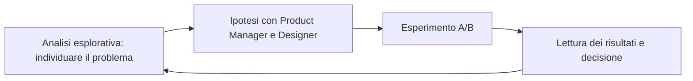

Scenario costruito: in un colloquio per una posizione da analista dati, il responsabile chiede a una candidata di descrivere in due minuti il progetto di cui va più fiera. Lei elenca gli strumenti, SQL, Python, Looker, un po' di dbt, e si ferma. Il responsabile annuisce e passa alla domanda successiva senza aver capito se quel lavoro abbia cambiato qualcosa. Un secondo candidato, con gli stessi strumenti, racconta di aver scoperto che il 40% degli utenti abbandonava il checkout al modulo dati, di aver proposto di accorciarlo e di aver stimato 576 ordini in più al mese. La differenza tra i due non sta nel curriculum ma nel punto di partenza: il primo parte dagli strumenti, il secondo dalla decisione.

Questa scheda serve a tenere a portata di mano le distinzioni tra i ruoli analitici più comuni, perché `Data Analyst`, `Product Analyst`, `Business Analyst` e `Analytics Engineer` suonano simili finché non si guarda che cosa producono davvero. La usi per orientare lo studio, il portfolio o la preparazione di un colloquio.

> **Idea chiave:** ogni ruolo analitico si riconosce da tre elementi, la domanda guida, il deliverable e la decisione che rende possibile, e la seniority si misura sulla capacità di passare da un segnale a una decisione difendibile, non sul numero di strumenti conosciuti.

## Mappa rapida dei quattro ruoli

Per orientarti in fretta, fissa per ciascun ruolo la domanda guida e il deliverable riconoscibile. Il `Product Analyst` parte dal perché di un comportamento e consegna ipotesi testabili e letture di esperimenti. Il `Marketing Analyst` parte dall'efficacia della spesa e consegna stime di impatto incrementale e modelli di attribuzione. Il `Financial Analyst` parte dalla sostenibilità economica e consegna modelli di KPI legati a margine e cash flow. L'`Analytics Engineer` parte dall'affidabilità del dato e consegna modelli, test e documentazione su cui tutti gli altri costruiscono.

| Ruolo | Domanda guida | Deliverable tipico | Decisione che rende possibile | Metrica ricorrente |
| --- | --- | --- | --- | --- |
| Product Analyst | Perché gli utenti si comportano così? | Lettura di funnel ed esperimenti A/B | Rilasciare, modificare o ritirare una funzione | Retention a 30 giorni, conversione per passo |
| Marketing Analyst | La spesa produce vendite che non ci sarebbero state? | Stima di impatto incrementale e attribuzione | Spostare budget tra canali | CAC, ROAS, CPA |
| Financial Analyst | L'iniziativa regge sul piano economico? | Modello di KPI con margine e cash flow | Finanziare, rimandare o tagliare | EBITDA, margine di contribuzione |
| Analytics Engineer | Il numero che tutti usano è affidabile? | Modelli, test e documentazione dei dati | Fidarsi di una metrica condivisa | Percentuale di test superati, freschezza dei dati |

La riga che conta per te è quella la cui domanda guida ti dà energia e il cui deliverable sai già produrre con prove. Il titolo più alla moda è un criterio debole, perché cambia da un'azienda all'altra e spesso nasconde mansioni diverse.

## Come leggere un ruolo con cinque controlli

Prima di scegliere quale direzione raccontare, fissa tre domande. Quale decisione vuoi rendere possibile con il tuo profilo? Quale dato o progetto la rende osservabile a chi ti valuta? Rispetto a quale baseline ti stai confrontando, cioè quali altri candidati o quale stato precedente definiscono il tuo valore?

Le tre domande si traducono in cinque controlli da applicare a qualsiasi esempio, formula o frammento tecnico incontrato nello studio. Se un dettaglio non chiarisce almeno uno dei cinque, trattalo come materiale secondario e non costruirci sopra il racconto del tuo profilo.

| Controllo | Che cosa verifica |
| --- | --- |
| Domanda | Quale scelta deve cambiare dopo l'analisi |
| Dato | Quale evento, tabella o metrica rende osservabile il problema |
| Qualità | Quale errore di raccolta, modellazione o interpretazione può alterare il risultato |
| Baseline | Quale confronto impedisce una lettura isolata |
| Azione | Quale raccomandazione diventa più difendibile |

Applicati in sequenza, i controlli trasformano un'etichetta («sono un Product Analyst») in un'affermazione verificabile («ho ridotto un abbandono del 40% individuando il passo in cui avveniva»).

## Il Product Analyst e la domanda perché

Il `Product Analyst` vive attorno a una sola domanda: perché. Perché gli utenti si iscrivono ma non completano l'onboarding? Perché adottano la funzione A e ignorano la B? Perché una coorte di maggio ha una retention a 30 giorni superiore di 5 punti percentuali rispetto a quella di aprile? Il ruolo sta all'intersezione tra data science, esperienza utente e strategia di prodotto, e l'obiettivo non è descrivere che cosa accade ma spiegare il perché e formulare ipotesi verificabili su come migliorare il prodotto.

Il ciclo di lavoro è un anello in quattro passi. Si parte da un'analisi esplorativa per individuare un'opportunità o un problema, per esempio un abbandono del 40% in un funnel di checkout. Poi si lavora con `Product Manager` e Designer per formulare un'ipotesi, per esempio che riducendo i campi del modulo aumenti la conversione. Si progetta un A/B test per validarla e infine si leggono i risultati per decidere se estendere la modifica a tutti gli utenti.

Gli strumenti sono piattaforme di event tracking come Amplitude o Mixpanel, utili per ricostruire sequenze di azioni, e piattaforme di sperimentazione come Statsig o Optimizely. SQL resta la lingua comune per accedere ai dati grezzi, mentre Python, con Pandas e SciPy, serve per analisi statistiche più complesse come test di significatività o stime causali.

## Presentare un progetto in colloquio: dal segnale alla decisione

Il candidato credibile collega una metrica a una decisione. Il passaggio più utile è mostrare il calcolo che porta dal segnale a un valore, con numeri di esempio che chiunque può controllare. Riprendiamo il checkout dell'apertura: 12.000 sessioni al mese arrivano al passo del modulo dati, e il 40% abbandona lì.

Primo passo, la baseline. Se il 40% abbandona, il 60% prosegue, quindi 12.000 × 0,60 = 7.200 sessioni arrivano al pagamento. Dal pagamento all'ordine converte l'80%, quindi 7.200 × 0,80 = 5.760 ordini al mese.

Secondo passo, l'ipotesi. Accorciare il modulo da otto a cinque campi dovrebbe portare la quota di chi prosegue dal 60% al 66%, cioè 12.000 × 0,66 = 7.920 sessioni al pagamento. Con lo stesso 80% di conversione si ottengono 7.920 × 0,80 = 6.336 ordini al mese.

Terzo passo, la differenza e il valore. L'incremento è 6.336 - 5.760 = 576 ordini al mese. Con un margine di contribuzione di 14 euro per ordine il valore è 576 × 14 = 8.064 euro al mese, circa 96.800 euro all'anno. Quarto passo, il rischio: il 66% è un'ipotesi, quindi il numero va presentato come stima e accompagnato da un A/B test che ne verifichi l'effetto prima di generalizzarlo.

Nel colloquio la sequenza da raccontare è la stessa, in quattro frasi: il segnale (il 40% abbandona al modulo), la baseline (5.760 ordini al mese), la decisione resa possibile (accorciare il modulo previo test) e il valore stimato (8.064 euro al mese, con il rischio dichiarato). Lo stesso schema vale per gli altri ruoli. Un `Marketing Analyst` lega la spesa di una campagna all'impatto incrementale, un `Financial Analyst` lega un KPI operativo al cash flow, un `Analytics Engineer` lega un modello dati alla fiducia con cui i consumatori usano i numeri. In tutti i casi il segnale di seniority è nominare la decisione e non elencare gli strumenti: un profilo junior descrive che cosa è successo, uno senior dice che cosa conviene fare e perché.

## Errori tipici da evitare

### L'etichetta usata come decorazione

Il sintomo è un profilo che dichiara il titolo del ruolo ma non dice quale decisione sia stata cambiata. Sembra ragionevole perché i titoli sono ciò che i recruiter cercano nelle ricerche per parola chiave. Il rimedio è accompagnare sempre il titolo con una frase che contenga decisione, baseline e rischio aperto, come nell'esempio del checkout.

### L'aggregato troppo presto

Il sintomo è una conclusione basata su una media globale che nasconde segmenti opposti: la conversione complessiva è stabile mentre il mobile peggiora e il desktop migliora. Succede perché l'aggregato è il primo numero disponibile e si legge in un secondo. Si corregge scomponendo per segmento prima di formulare l'ipotesi.

### Correlazione scambiata per causa

Il sintomo è un'affermazione del tipo «chi usa la funzione converte di più, quindi la funzione fa convertire». Gli utenti che la usano potrebbero convertire di più perché erano già più motivati. La correzione è un confronto con un gruppo di controllo, o almeno un A/B test, prima di attribuire l'effetto alla funzione. Un esempio noto è la playlist Discover Weekly, lanciata da Spotify a luglio 2015: l'intuizione parte da un segnale osservato nei dati, ma il valore si dimostra solo dopo aver testato una funzione reale.

## Verifica per il colloquio

1. Quale domanda guida distingue il Product Analyst dal Marketing Analyst e quale deliverable rende riconoscibile ciascuno?

Mostra risposta

Il Product Analyst chiede perché gli utenti si comportano in un certo modo e consegna letture di funnel ed esperimenti A/B; il Marketing Analyst chiede se la spesa produca vendite che non ci sarebbero state e consegna stime di impatto incrementale e attribuzione.

2. Nell'esempio del checkout, quanti ordini al mese ci sono prima della modifica e quanti dopo, se la quota che prosegue passa dal 60% al 66%?

Mostra risposta

Prima: 12.000 × 0,60 × 0,80 = 5.760 ordini. Dopo: 12.000 × 0,66 × 0,80 = 6.336 ordini. La differenza è di 576 ordini al mese.

3. Con un margine di 14 euro per ordine, quanto vale la modifica in un anno e perché il numero va presentato come stima?

Mostra risposta

576 × 14 = 8.064 euro al mese, quindi 8.064 × 12 = 96.768 euro all'anno. Va presentato come stima perché il 66% è un'ipotesi e l'effetto reale si conosce solo dopo un A/B test.

4. Quale dei tre errori sui dati invalida più spesso un'analisi e come lo intercetti?

Mostra risposta

Dipende dal contesto, ma il più frequente è l'aggregato letto troppo presto. Si intercetta scomponendo ogni metrica per almeno due dimensioni (dispositivo, canale, coorte) prima di formulare l'ipotesi e controllando che i segmenti si muovano nella stessa direzione dell'aggregato.

