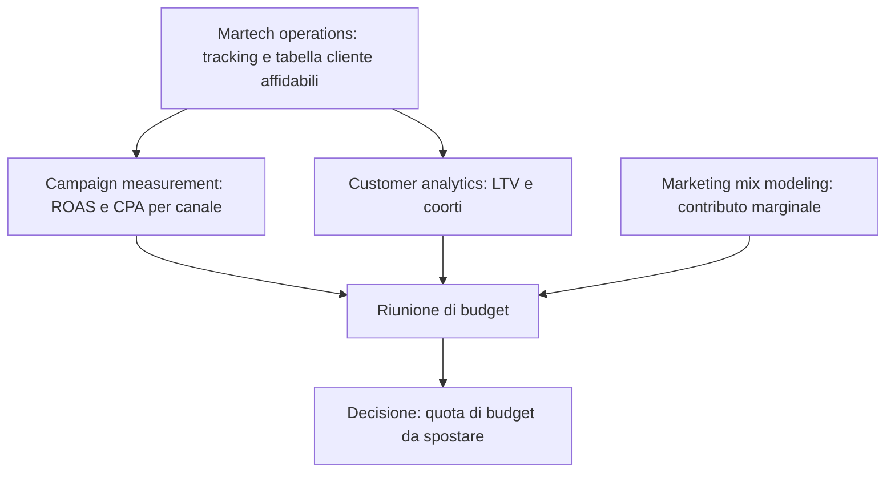

Caso ricostruito: un lunedì mattina il responsabile marketing di un e-commerce con 60.000 euro di budget mensile riunisce quattro persone per decidere dove spostare i soldi. Chi gestisce gli annunci a pagamento porta un ROAS di 4,0 per la ricerca. Il team CRM porta il tasso di riacquisto dei clienti arrivati dai social. La finanza porta un costo di acquisizione calcolato sull'intero budget, comprese le agenzie. Il responsabile del sito porta le conversioni di Google Analytics, che non coincidono con nessuno degli altri tre numeri. In un'ora la riunione diventa una discussione su quale dato sia giusto, e il budget resta dov'era.

Il problema non sono i dati ma l'assenza di un modello operativo: nessuno è responsabile di tenere insieme definizioni, baseline e decisione. Un operating model del marketing analytics è proprio questo, una scelta organizzativa, non un elenco di definizioni.

> **Idea chiave:** l'operating model del marketing analytics è la distribuzione esplicita di ownership, processi e metriche che permette di decidere il budget su dati affidabili: la domanda che conta non è quale definizione sia corretta in astratto, ma quale decisione cambia quando i dati diventano più affidabili e qualcuno è responsabile di leggerli.

## Quattro funzioni, quattro domande

Il marketing analytics non consiste nel tirare fuori i dati delle campagne. È un dominio con quattro funzioni distinte, ciascuna con una domanda e competenze proprie, e confonderle porta a chiedere a una persona un lavoro che appartiene a un'altra.

La prima è la campaign measurement, che risponde alla domanda se una campagna funzioni. Comprende la configurazione del tracking (UTM, pixel, tracciamento lato server), l'attribuzione, cioè l'assegnazione del merito di una vendita ai punti di contatto (ultimo click o multi-touch), il calcolo di ROAS e CPA e i test di significatività. Richiede SQL, Google Analytics 4, conoscenza dei modelli di attribuzione e statistica di base come gli intervalli di confidenza.

La seconda è la customer analytics, che capisce chi sono i clienti e come si comportano. Include segmentazione (RFM, comportamentale, demografica), analisi per coorti, valore del cliente nel tempo e previsione di abbandono. L'analisi RFM legge recency, frequency e monetary per ordinare i clienti per valore. Richiede SQL avanzato con funzioni finestra, Python per la segmentazione e modellazione statistica.

La terza è il marketing mix modeling, che alloca il budget tra canali per massimizzare il ritorno. È un modello econometrico che stima il contributo di ciascun canale al netto di stagionalità e fattori esterni, con analisi di saturazione e rendimenti decrescenti. Richiede statistica avanzata, regressione multipla, metodi bayesiani e Python o R. Un modello costruito su un periodo in cui le condizioni di mercato erano molto diverse perde valore, e va ricalibrato quando cambia il contesto, come accade dopo una variazione strutturale della domanda.

La quarta sono le martech operations, cioè l'infrastruttura. Verificano che gli strumenti siano integrati e che i dati siano affidabili: CDP, reverse ETL, tracciamento lato server, governance dei dati marketing. Richiedono familiarità con piattaforme come Salesforce, HubSpot o Braze, integrazione via API e un po' di data engineering. Il risultato visibile è una sola tabella cliente alimentata da tutti gli strumenti, al posto di quattordici fonti di verità che si contraddicono.

| Funzione | Domanda guida | Output | Competenze principali |
| --- | --- | --- | --- |
| Campaign measurement | La campagna funziona? | ROAS, CPA, test di significatività | SQL, GA4, attribuzione |
| Customer analytics | Chi sono i clienti e che valore hanno? | Segmenti, LTV, coorti | SQL avanzato, Python |
| Marketing mix modeling | Come distribuire il budget tra canali? | Contributo marginale per canale | Econometria, statistica bayesiana |
| Martech operations | I dati sono integrati e affidabili? | Tabella cliente unica, tracking verificato | API, ETL, governance |

L'ordine di lavoro conta: rendi affidabile la misurazione prima di segmentare i clienti, e costruisci il modello di mix solo quando il tracking regge, perché ogni livello vive della qualità di quello sotto.

## Ownership: chi risponde di cosa

Distribuire ownership significa scrivere, per ogni decisione ricorrente, chi la prepara, chi la approva e chi controlla il dato. Senza questa scrittura marketing e prodotto litigano su numeri diversi per la stessa domanda, e la discussione si sposta dall'azione alla difesa del proprio dato. Una matrice minima per il budget settimanale può essere così.

La riunione di budget riceve tre ingressi, tutti prodotti da una funzione con un responsabile, e produce una sola uscita. Se due ingressi si contraddicono, la risoluzione spetta a chi possiede la definizione, non a chi parla per ultimo. Un dettaglio operativo che evita molte discussioni: la definizione di ogni metrica (come si conta un nuovo cliente, quale finestra di attribuzione, quali spese entrano nel costo) vive in un unico documento firmato da chi ne risponde.

## Le metriche che ogni analista deve saper calcolare

Cinque metriche coprono la maggior parte delle decisioni di budget. Il CAC misura il costo per ottenere un cliente nuovo. L'LTV misura il valore che quel cliente genera nel tempo. ROAS e CPA misurano l'efficacia della spesa, il primo in ricavo per euro speso e il secondo in costo per azione. Il rapporto LTV/CAC dice se il modello regge.

| Metrica | Formula | A cosa serve | Riferimento tipico per l'e-commerce |
| --- | --- | --- | --- |
| CAC | Spesa marketing divisa nuovi clienti | Efficienza di acquisizione | Dipende dal prodotto |
| LTV | Margine medio per ordine per numero di ordini | Valore cliente | Superiore a 3 volte il CAC |
| ROAS | Ricavo da annunci diviso spesa annunci | Efficacia delle campagne | Dipende dal margine |
| CPA | Spesa divisa conversioni | Costo per azione | Dipende dal prodotto |
| CTR | Click diviso impression | Rilevanza della creatività | Da 0,5% a 2% |
| CVR | Conversioni diviso visitatori | Efficacia del funnel | Da 2% a 5% |

I riferimenti tipici sono ordini di grandezza orientativi e vanno sostituiti con la baseline della propria azienda: un ROAS di 2,5 è eccellente per un prodotto con margine del 70% e disastroso per uno con margine del 25%, quindi la lettura corretta richiede sempre il margine accanto al ricavo.

Due precisazioni evitano gli errori di lettura più frequenti. La prima riguarda il CAC: conta come costo di acquisizione tutto ciò che serve a ottenere il cliente, compensi di agenzia e strumenti inclusi, altrimenti il numero appare migliore di quanto sia e la finanza, che usa il totale, non lo riconosce. La seconda riguarda l'LTV, che è una stima su un orizzonte dichiarato e non un dato osservato: per un cliente acquisito da tre mesi si ha solo una frazione della vita utile, e il resto è una proiezione che va etichettata come tale.

## Un esempio svolto: tre canali e 60.000 euro

Usiamo numeri di esempio per l'e-commerce dell'apertura. Il budget mensile di 60.000 euro è diviso su tre canali: ricerca a pagamento 24.000 euro, social 20.000 euro, display 16.000 euro. Il mese ha prodotto 400 nuovi clienti dalla ricerca, 500 dai social e 160 dal display, con ricavi da annunci rispettivamente di 96.000, 50.000 e 28.800 euro.

Primo passo, il CAC per canale. Ricerca: 24.000 / 400 = 60 euro. Social: 20.000 / 500 = 40 euro. Display: 16.000 / 160 = 100 euro. Il CAC complessivo è 60.000 / 1.060 clienti = circa 56,6 euro, un numero che nasconde il fatto che il display costa due volte e mezzo il social.

Secondo passo, il ROAS. Ricerca: 96.000 / 24.000 = 4,0. Social: 50.000 / 20.000 = 2,5. Display: 28.800 / 16.000 = 1,8. Letto da solo, il ROAS premia la ricerca; ma include anche i clienti che avrebbero acquistato comunque, e questo è il rischio che il modello di mix e un test di incrementalità servono a ridurre.

Terzo passo, l'LTV. Un cliente medio fa 5 ordini da 60 euro con un margine del 40%, quindi LTV = 5 × 60 × 0,40 = 120 euro di margine. Il rapporto LTV/CAC è 120 / 60 = 2,0 per la ricerca, 120 / 40 = 3,0 per i social e 120 / 100 = 1,2 per il display. Solo i social superano la soglia di 3 volte, e il display non copre nemmeno il costo con margine adeguato.

Quarto passo, la decisione. Spostare 6.000 euro dal display ai social. I social saturano, quindi ipotizziamo un CAC marginale di 55 euro anziché 40: 6.000 / 55 = circa 109 nuovi clienti, per un valore di 109 × 120 = 13.080 euro di margine. Gli stessi 6.000 euro sul display avrebbero portato 6.000 / 100 = 60 clienti, cioè 60 × 120 = 7.200 euro. Il guadagno atteso è 13.080 - 7.200 = 5.880 euro di margine di vita, a parità di spesa. Il rischio residuo è l'ipotesi sul CAC marginale, che va verificata con un incremento graduale del 10% del budget social prima di spostare l'intera quota.

Il punto del calcolo non è la precisione ma l'ordine con cui si arriva alla scelta: prima il CAC separato per canale, poi il valore del cliente, poi il margine di sicurezza dichiarato. Qualunque soglia (qui 3 volte) va fissata prima di vedere i numeri, altrimenti si ricostruisce la regola a posteriori per giustificare la scelta già fatta.

## Rendere esplicite le assunzioni

La formalizzazione non complica il lavoro: rende visibili le assunzioni, così uno stakeholder può discutere il criterio invece di fidarsi del risultato per autorità. Conviene fissare cinque elementi prima di leggere i dati, ciascuno con il controllo minimo corrispondente.

| Elemento | Definizione operativa | Controllo minimo |
| --- | --- | --- |
| Unità di analisi | Oggetto su cui misuri il fenomeno | Utente, ordine, canale o periodo |
| Variabile osservata | Segnale che rappresenta il comportamento | Definizione stabile e tracciabile |
| Baseline | Stato contro cui confronti il segnale | Periodo, gruppo di controllo o riferimento interno |
| Soglia decisionale | Punto in cui cambia l'azione | Criterio scritto prima della lettura |
| Rischio residuo | Errore che può restare dopo l'analisi | Controllo di sensibilità o revisione qualitativa |

La logica è solida quando un altro analista può riprodurla, criticare le assunzioni e arrivare alla stessa decisione partendo dagli stessi dati. Nel caso dei tre canali, l'unità di analisi è il nuovo cliente, la baseline è il mese precedente, la soglia è un LTV/CAC di 3 e il rischio residuo è il CAC marginale ipotizzato.

## Trappole dell'operating model

### Il modello usato come etichetta

Il sintomo è un team che presenta un numero senza dire quale decisione cambia, quale baseline lo rende interpretabile e quale rischio resta aperto. Il dato sembra preciso ma non guida l'azione. Succede perché il modello operativo è stato scritto come organigramma e non come processo. Si corregge allegando a ogni report la riga della decisione e del responsabile.

### La media che nasconde un segmento

Il sintomo è una metrica che migliora in media mentre un segmento peggiora, per esempio un CAC complessivo stabile a 56,6 euro mentre il display sale a 100 euro. Sembra ragionevole perché la media è il numero che la direzione guarda. Si corregge segmentando per canale, coorte e dispositivo prima di discutere l'aggregato.

### Numeri incoerenti trattati come problema del dato

Il sintomo è una riunione in cui due fonti danno cifre diverse per la stessa metrica e nessuno sa quale usare. La causa è quasi sempre una definizione diversa (finestra di attribuzione, esclusione dei resi, fuso orario) e non un errore di calcolo. Si corregge assegnando la definizione a un responsabile e controllando completezza, duplicati e definizioni cambiate prima di portare i numeri alla decisione.

## È la direzione giusta per te?

Il marketing analytics è una buona scelta se ti interessa l'intersezione tra dati e comportamento del consumatore, se vuoi vedere l'impatto del tuo lavoro su metriche immediate come ricavo e ritorno, se sei a tuo agio con l'incertezza perché l'attribuzione perfetta non esiste e se ti piace lavorare con stakeholder non tecnici come marketer e creativi. Lo è meno se preferisci ambienti deterministici in cui ogni azione ha un esito prevedibile, se non tolleri dati sporchi, perché quelli di marketing sono tra i più disordinati in azienda, o se vuoi costruire sistemi invece di rispondere a domande di business. In quest'ultimo caso guarda piuttosto verso prodotto o analytics engineering.

## Verifica sul budget

1. Nel caso dei tre canali, perché il CAC complessivo di circa 56,6 euro è fuorviante per decidere dove spostare il budget?

Mostra risposta

Perché è una media di 60.000 euro su 1.060 clienti che nasconde la differenza tra canali: 40 euro per i social, 60 per la ricerca, 100 per il display. La decisione di spostare budget richiede il CAC per canale, non quello aggregato.

2. Con un LTV di 120 euro, quale canale supera la soglia di LTV/CAC pari a 3 e quale invece non copre il costo con margine adeguato?

Mostra risposta

I social: 120 / 40 = 3,0. Il display ha 120 / 100 = 1,2, ben sotto la soglia. La ricerca, con 120 / 60 = 2,0, sta nel mezzo e va letta con il ROAS e con un test di incrementalità.

3. Se il CAC marginale dei social fosse 80 euro invece di 55, la decisione di spostare 6.000 euro dal display cambierebbe?

Mostra risposta

Con 80 euro si acquisirebbero 6.000 / 80 = 75 clienti, pari a 75 × 120 = 9.000 euro di margine di vita contro 7.200 del display: il vantaggio scende a 1.800 euro e la decisione regge ancora, ma con un margine di sicurezza molto più stretto. Sopra i 100 euro di CAC marginale lo spostamento non converrebbe più.

4. Perché in un operating model la definizione di ogni metrica deve avere un responsabile unico?

Mostra risposta

Perché la stessa parola (nuovo cliente, ricavo da annunci, costo) può essere calcolata in modi diversi da funzioni diverse, e senza un responsabile la riunione di budget si trasforma in una discussione sul dato invece che sulla decisione.

