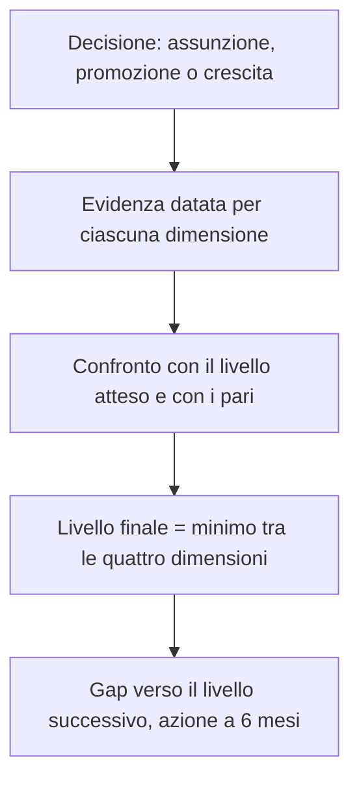

Scenario costruito: in un team dati di nove persone, due analisti entrano nel ciclo di promozione. Marco scrive query impeccabili e costruisce modelli dati che nessuno mette in discussione, ma risponde alle domande che gli arrivano e non ne propone di nuove. Sara ha una tecnica meno rifinita, però ha notato che la definizione di cliente attivo era diversa in due dashboard, ha convocato i due responsabili e ha prodotto una definizione unica. Il manager si accorge che, senza una rubrica scritta, la discussione si ridurrebbe a chi gli sembra più bravo. Una hiring rubric nasce per evitare esattamente questo.

Una rubrica di valutazione serve a distinguere un analista junior promettente da un senior capace di guidare decisioni, gestire ambiguità e influenzare gli stakeholder. La seniority analitica, in fondo, significa trasformare problemi mal posti in decisioni migliori con meno supervisione e più responsabilità. I segnali che contano sono cinque: autonomia, rigore, impatto, comunicazione e qualità del giudizio.

> **Idea chiave:** una hiring rubric è il criterio scritto che distingue i livelli di seniority in base ad autonomia, rigore, impatto e comunicazione dimostrati con evidenze concrete, e il livello finale è il minimo tra le dimensioni, non la media.

## Dalla rubrica alla decisione di carriera

Il problema non è conoscere il concetto in astratto ma decidere su una persona reale quando i segnali sono incompleti o ambigui. Una valutazione utile separa il segnale dal rumore, indica rispetto a quale baseline si legge un comportamento e mostra quale decisione di carriera diventa più difendibile. Senza una rubrica scritta, le promozioni finiscono per premiare anzianità o simpatia. Con una rubrica la discussione si sposta sull'evidenza: che cosa ha fatto questa persona che dimostri un certo livello di autonomia o di impatto.

La sequenza di lavoro è fissa, così che la valutazione non diventi un rituale. Prima si nomina la decisione da prendere: assunzione, promozione o piano di crescita. Poi si raccoglie per ciascuna delle quattro dimensioni un'evidenza concreta e datata, cioè un comportamento o un risultato osservabile, non un'impressione. Si confronta l'evidenza con il livello atteso, usando come baseline i pari ruolo o lo storico. Si assegna il livello finale come minimo tra le quattro dimensioni. Infine si scrive il gap verso il livello successivo come azione verificabile entro sei mesi.

Ogni passaggio rende più chiaro il costo di una decisione sbagliata, e per questo vale la regola che la soglia di promozione sia scritta prima della revisione e non dopo aver visto i candidati.

## La skill ladder standard per i ruoli data

Molte aziende tecnologiche pubblicano le proprie scale di carriera, tra cui il Handbook di GitLab, e le versioni per i ruoli dati convergono su una struttura simile, che qui riportiamo in forma semplificata come riferimento di lavoro.

| Livello | Titolo tipico | Cosa ci si aspetta | Esperienza orientativa |
| --- | --- | --- | --- |
| L3 | Data Analyst | Esegue compiti definiti da altri: query, dashboard, report | 0-2 anni |
| L4 | Senior Data Analyst | Definisce l'approccio a problemi ambigui, progetta metriche, guida progetti | 2-5 anni |
| L5 | Staff Data Analyst | Influenza la strategia del dipartimento, risolve problemi non ancora definiti, fa mentorship tecnica | 5-8 anni |
| L6 | Principal Data Analyst | Definisce la direzione tecnica dell'intera organizzazione dati e parla con il vertice | Oltre 8 anni |

Gli anni indicati sono orientativi e non sono un criterio di promozione: un analista con quattro anni che opera con lo scope di un L3 resta L3. La differenza tra L3 e L4 non è fare le stesse cose più in fretta, ma un cambio di autonomia e di perimetro. Un L3 riceve il problema già definito («ecco il problema, risolvilo») e lavora sul singolo compito. Un L4 riceve un dominio («ecco l'area, trova i problemi e risolvili») e lavora sul progetto. Un L5 riceve un'organizzazione («fai in modo che i dati guidino le decisioni») e il suo scope è il dipartimento. Per questo punta al livello il cui scope sai già coprire con evidenze, e non a quello che il titolo suggerisce.

## Le quattro dimensioni e perché il livello è il minimo

Le rubriche serie valutano quattro dimensioni indipendenti. Puoi essere forte in una e debole in un'altra, e il livello finale è il minimo tra le quattro perché una catena è forte quanto il suo anello più debole: un analista con craft da L5 e comunicazione da L3 non può guidare un'organizzazione, perché le sue conclusioni non arrivano a chi decide.

| Dimensione | L3 | L4 | L5 |
| --- | --- | --- | --- |
| Craft (competenza tecnica) | Scrive SQL corretto, costruisce dashboard | Progetta modelli dati, implementa test, ottimizza query | Definisce standard tecnici, crea framework riusabili |
| Business impact | Risponde a domande di business | Individua le domande giuste da fare | Cambia il modo in cui l'azienda decide |
| Comunicazione | Presenta i risultati al proprio team | Presenta a stakeholder cross-funzionali e leadership | Influenza decisioni al vertice con i dati |
| Leadership e mentorship | Chiede aiuto, impara | Aiuta analisti junior, fa peer review | Sviluppa persone, costruisce cultura dei dati |

Il passaggio da L3 a L4 richiede tipicamente di aver guidato un progetto che ha cambiato una decisione di business, non solo di aver scritto buon codice. Il passaggio da L4 a L5 richiede di aver cambiato il modo in cui lavora il team, di solito creando un framework, un processo o uno standard adottato da tutti. La conseguenza pratica è che ci si promuove per evidenza di impatto e non per anzianità.

## Un esempio svolto: Marco e il costo della media

Riprendiamo Marco con numeri di esempio. Il manager assegna a ciascuna dimensione il livello dimostrato dalle evidenze raccolte: craft L4, business impact L3, comunicazione L4, leadership L3. Nessuno dei quattro dati è un giudizio generale; ognuno rimanda a una evidenza datata, per esempio il modello dati che unifica cinque fonti per il craft, e l'assenza di domande proposte in autonomia per l'impatto.

Primo passo, il minimo. I livelli sono 4, 3, 4, 3 e il minimo è 3, quindi il livello assegnato è L3. Secondo passo, la media. (4 + 3 + 4 + 3) / 4 = 14 / 4 = 3,5. Una media arrotondata per eccesso porterebbe Marco a L4, e la rubrica per costruzione lo evita.

Terzo passo, il costo dell'errore. Supponiamo bande salariali di esempio con punto medio di 42.000 euro per L3 e 50.000 euro per L4. Promuovere Marco a L4 sulla base della media costerebbe 50.000 - 42.000 = 8.000 euro in più all'anno per un lavoro che copre lo scope di un L3. Se la situazione si protrae per due anni, il costo cumulato è 8.000 × 2 = 16.000 euro, a cui si aggiunge il costo meno visibile di un livello che non corrisponde alle aspettative: un L4 nominale che non propone domande autonomamente obbliga il manager a farlo al suo posto.

Quarto passo, il gap. Per arrivare a L4 Marco deve colmare due dimensioni, impatto e leadership, entro sei mesi. L'azione verificabile per l'impatto è identificare e presentare in autonomia almeno una domanda di business non richiesta, con stima del valore; per la leadership è fare peer review sistematica a un analista junior, con almeno quattro revisioni documentate. Così la decisione di carriera diventa un piano con due evidenze da produrre, e non un verdetto.

## Il colloquio data in quattro round

La stessa logica di rubrica si applica ai processi di selezione, che nelle aziende tecnologiche si strutturano di solito in quattro round, ciascuno con un obiettivo distinto.

| Round | Cosa verifica | Esempio di richiesta | Come prepararsi |
| --- | --- | --- | --- |
| SQL tecnico | Capacità di scrivere query complesse | Calcolare la retention a 30 giorni per coorte | Esercizi su piattaforme di pratica SQL |
| Case study | Problem solving analitico | Il ricavo è calato del 5%, che cosa fai? | Definire metriche, segmentare, formulare ipotesi, testare |
| Product sense | Intuizione sulle metriche di prodotto | Quali metriche misureresti per questa funzione? | Studiare le metriche standard del dominio |
| Behavioral | Cultura, comunicazione, leadership | Racconta di quando hai convinto uno stakeholder scettico | Preparare cinque o sei storie con il metodo STAR |

Il metodo STAR, che sta per situazione, compito, azione e risultato, forza a raccontare un'evidenza con un risultato misurabile invece di una dichiarazione di competenza. È lo stesso principio della rubrica: un'evidenza concreta pesa più di qualunque aggettivo.

## Laboratorio di auto-valutazione

Prendi la tabella delle quattro dimensioni e, per ciascuna, scrivi il tuo livello attuale con un'evidenza concreta e il gap per il livello successivo. Un modello di compilazione è questo.

> **Craft:** L4. Evidenza: ho costruito il modello int_customer_health che unifica cinque fonti, con test sulle chiavi.
> **Gap per L5:** non ho ancora creato un framework riusabile da tutto il team; azione entro sei mesi, un template di modello adottato da almeno due colleghi.
> **Business impact:** L3. Evidenza: rispondo alle domande del responsabile marketing.
> **Gap per L4:** non ho mai identificato in modo proattivo una domanda prima che lo stakeholder la ponesse; azione, una proposta documentata ogni trimestre.

Per una revisione di carriera più formale puoi trasformare lo schema in un decision memo: ipotesi sul livello, evidenze richieste, criteri di esclusione, soglia di promozione, rischio residuo e piano di monitoraggio. Se non hai dati reali, lavora su job description, portfolio, rubriche di assunzione e mappe degli stakeholder.

## Trappole della valutazione

### La rubrica usata come etichetta

Il sintomo è un colloquio di valutazione in cui si mostra un grafico senza decisione, una metrica senza baseline o una conclusione senza l'assunzione che potrebbe invalidarla. Succede perché la rubrica viene riempita a fine ciclo, per giustificare una scelta già presa. Due analisti possono produrre dashboard ugualmente corrette, ma solo uno anticipa le ambiguità, chiarisce le assunzioni e porta gli stakeholder a una decisione, e la rubrica deve premiare quel giudizio e non solo la tecnica. Si corregge raccogliendo le evidenze durante l'anno e datandole.

### La media al posto del minimo

Il sintomo è una promozione concessa perché la media delle dimensioni supera la soglia, come nel caso di Marco con 3,5. Sembra equo perché compensa un punto di forza con una debolezza. Il guaio è che una dimensione debole limita comunque il lavoro reale, e il livello nominale finisce per non corrispondere alle responsabilità. Si corregge fissando il minimo come regola e investendo sul punto più debole.

### Evidenze generiche e non datate

Il sintomo è un giudizio come «è molto autonomo» senza un episodio a cui ancorarlo. Succede perché le impressioni sono facili da produrre e le evidenze richiedono memoria e documentazione. Si corregge chiedendo per ogni dimensione un episodio datato e un risultato misurabile, e scartando le affermazioni che non lo hanno. Prima di fidarti delle metriche usate nella valutazione, controlla anche completezza, duplicati, fusi orari, definizioni cambiate e segmenti esclusi, perché molte analisi sofisticate falliscono solo perché il dato di partenza misura un comportamento diverso da quello che credi di osservare.

## Verifica sulla rubrica

1. Perché il livello finale è il minimo tra le quattro dimensioni e non la media?

Mostra risposta

Perché la dimensione più debole limita ciò che la persona può fare davvero: un craft da L5 con comunicazione da L3 produce analisi che non arrivano a chi decide. Con livelli 4, 3, 4, 3 la media è 3,5 e arrotonderebbe a L4, mentre il minimo è 3 e protegge dal sovra-inquadramento.

2. Con bande di 42.000 euro per L3 e 50.000 per L4, quanto costa in due anni promuovere Marco a L4 per errore?

Mostra risposta

La differenza annua è 50.000 - 42.000 = 8.000 euro, quindi 8.000 × 2 = 16.000 euro in due anni, senza contare il costo del manager che deve supplire alle domande che l'analista non propone.

3. Quale evidenza concreta distingue un L4 da un L3 nel lavoro quotidiano?

Mostra risposta

Un L4 individua le domande da porre in un dominio e conduce un progetto che cambia una decisione di business, mentre un L3 risponde a un problema già definito. L'evidenza tipica è una proposta di analisi non richiesta, con stima del valore, che ha portato a una decisione.

4. Quale gap devi colmare nei prossimi sei mesi per il livello successivo e come lo rendi verificabile?

Mostra risposta

Si individua la dimensione con il livello più basso e si scrive un'azione con data e prova, per esempio quattro peer review documentate per la leadership oppure una proposta trimestrale con stima del valore per l'impatto. Un gap senza evidenza attesa non è verificabile e non entra nella revisione.

