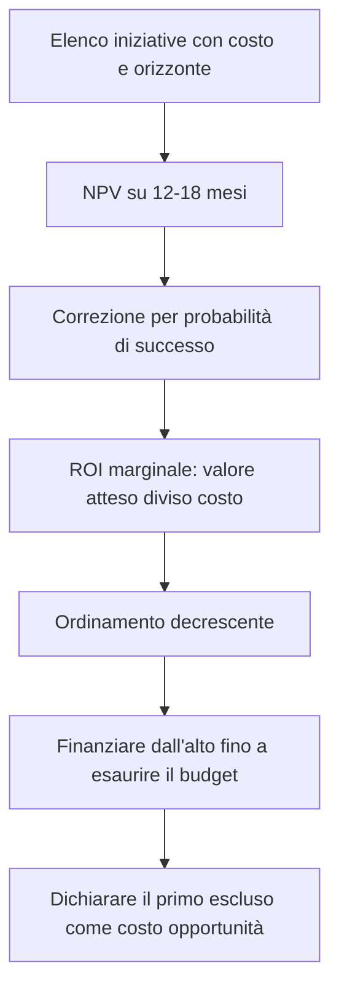

Scenario costruito: a novembre il leadership team di una società di abbonamenti online ha 230.000 euro da distribuire e tre richieste sul tavolo. Il responsabile acquisizione vuole 150.000 euro per una campagna a pagamento. Il responsabile retention ne chiede 100.000 per un programma che riduce l'abbandono. Il responsabile operations ne chiede 120.000 per automatizzare l'assistenza clienti. Le richieste sommano 370.000 euro, e ognuno porta un numero favorevole: un ROAS, un calo del churn, una riduzione dei ticket. Nessuna delle tre dice che cosa si sacrifica se viene approvata.

Allocare un budget è una decisione manageriale, e l'analista che la supporta non deve solo mostrare quale iniziativa rende di più. Deve spiegare trade-off, rischio, orizzonte temporale e costo opportunità. La leadership ripartisce le risorse tra acquisizione, retention, prodotto e operations sapendo che ogni euro ha tempi di ritorno e rischi diversi: il lavoro analitico porta metriche, vincoli e strategia nel punto in cui diventano una scelta di portafoglio e non una classifica di KPI.

> **Idea chiave:** allocare un budget significa confrontare iniziative in competizione tra loro con ritorno atteso, rischio, allineamento strategico e urgenza, e dichiarare cosa si sacrifica: la domanda non è se una singola iniziativa abbia ritorno positivo, ma se sia migliore dell'alternativa che bisogna tagliare per finanziarla.

## Il vincolo strutturale: non si può finanziare tutto

Il problema non è conoscere il concetto in astratto, ma decidere quando i dati sono incompleti, le metriche ambigue e i vincoli rendono fragile la lettura. Nel budget allocation il vincolo è strutturale: la somma delle richieste supera sempre la cassa disponibile. Per questo una lezione utile in questo ambito separa il segnale dal rumore, indica quale baseline usare e mostra quale azione diventa più difendibile dopo l'analisi.

La sequenza da seguire davanti a una decisione di budget è fissa. Si elencano le iniziative candidate con investimento richiesto e orizzonte temporale. Si stima per ciascuna il valore attuale netto su dodici-diciotto mesi, al netto dei costi. Si corregge il valore per il rischio di esecuzione e si assegnano i pesi a strategia e urgenza. Si ordinano le iniziative per punteggio e si finanzia dall'alto fino a esaurire il budget. Infine si dichiara il primo progetto escluso come costo opportunità di quelli approvati.

## Le quattro dimensioni del framework

Un framework efficace valuta ogni richiesta su quattro dimensioni, pesate in base alla strategia dell'azienda. I pesi indicati sono intervalli ragionevoli di partenza, da adattare, e vanno fissati prima di guardare le richieste.

| Dimensione | Peso tipico | Come si misura | Domanda di controllo |
| --- | --- | --- | --- |
| Ritorno finanziario atteso | 40-50% | NPV o ROI atteso su 12-18 mesi, margine incrementale | Quanto margine in più al netto dei costi? |
| Rischio di esecuzione | 20-30% | Probabilità di raggiungere il risultato | Quanto è probabile che renda meno del previsto? |
| Allineamento strategico | 15-25% | Coerenza con le priorità dichiarate dei prossimi 12 mesi | Supporta la strategia dell'anno? |
| Urgenza temporale | 5-10% | Finestre normative, stagionali o di mercato | Esiste una scadenza oltre cui il valore svanisce? |

Il ritorno finanziario è la dimensione più pesante e va misurato come margine incrementale, non come ricavo lordo. Il rischio ha un peso quasi pari perché cambia le priorità: un miglioramento incrementale di un processo esistente ha rischio basso, con probabilità di successo tra l'80% e il 90%; un nuovo canale con team esperto sta in mezzo, tra il 50% e il 70%; un nuovo mercato con tecnologia nuova e team inesperto sta sotto il 50%. L'allineamento strategico sposta le priorità in modo legittimo: se l'azienda ha dichiarato che l'anno è dedicato all'espansione internazionale, un progetto di localizzazione ha priorità più alta di un'ottimizzazione del mercato domestico, anche con ROI inferiore. L'urgenza premia le finestre del tipo ora o mai più, come una scadenza normativa o una stagione commerciale.

## Il valore attuale netto e il tempo

Per confrontare iniziative con orizzonti diversi si usa il valore attuale netto, NPV, che somma i flussi di cassa futuri, ciascuno diviso per uno più il tasso r elevato al numero di anni, e sottrae l'investimento iniziale. Il tasso r è il costo del capitale, tipicamente tra il 10% e il 15% per una startup e tra l'8% e il 10% per un'azienda matura. Si usa l'NPV al posto del ROI semplice perché tiene conto del valore del denaro nel tempo: 100 euro tra tre anni valgono meno di 100 euro oggi, e due iniziative con lo stesso ROI nominale possono avere valore molto diverso se una incassa nel primo anno e l'altra nel terzo.

Il rischio si incorpora moltiplicando l'NPV per la probabilità di successo. Un progetto con NPV di 500.000 euro e probabilità del 90% vale 450.000 euro attesi, mentre uno con NPV di 800.000 euro e probabilità del 60% ne vale 480.000: due progetti che sembrano molto diversi sono quasi equivalenti una volta corretti per il rischio, e la scelta tra i due dipende allora da strategia e urgenza, non dal ritorno.

## Un esempio svolto: tre iniziative e 230.000 euro

Torniamo alle tre richieste dell'apertura, con numeri di esempio e un tasso di sconto del 10% su un orizzonte di due anni.

Acquisizione a pagamento: investimento di 150.000 euro, flussi netti di 100.000 euro nel primo anno e 100.000 nel secondo. NPV = 100.000 / 1,10 + 100.000 / 1,21 - 150.000 = 90.909 + 82.645 - 150.000 = 23.554 euro. Con probabilità di successo del 60% il valore atteso è 23.554 × 0,60 = 14.132 euro.

Retention: investimento di 100.000 euro, flussi di 70.000 euro nel primo anno e 80.000 nel secondo. NPV = 70.000 / 1,10 + 80.000 / 1,21 - 100.000 = 63.636 + 66.116 - 100.000 = 29.752 euro. Con probabilità dell'85% il valore atteso è 29.752 × 0,85 = 25.289 euro.

Operations: investimento di 120.000 euro, flussi di 60.000 euro nel primo anno e 95.000 nel secondo. NPV = 60.000 / 1,10 + 95.000 / 1,21 - 120.000 = 54.545 + 78.512 - 120.000 = 13.058 euro. Con probabilità del 90% il valore atteso è 13.058 × 0,90 = 11.752 euro.

| Iniziativa | Costo | NPV a 2 anni | Probabilità | Valore atteso | ROI marginale |
| --- | --- | --- | --- | --- | --- |
| Retention | 100.000 euro | 29.752 euro | 85% | 25.289 euro | 25,3% |
| Operations | 120.000 euro | 13.058 euro | 90% | 11.752 euro | 9,8% |
| Acquisizione | 150.000 euro | 23.554 euro | 60% | 14.132 euro | 9,4% |

Il ROI marginale è il valore atteso diviso il costo: 25.289 / 100.000 = 25,3%, 11.752 / 120.000 = 9,8%, 14.132 / 150.000 = 9,4%. L'ordine decrescente è retention, operations, acquisizione. Si finanzia dall'alto: la retention assorbe 100.000 euro, restano 130.000, e le operations ne assorbono 120.000, lasciando 10.000 euro. L'acquisizione, che richiede 150.000 euro, non entra più.

Il primo progetto escluso è l'acquisizione, e il suo costo opportunità è il valore atteso che la società rinuncia a ottenere, cioè 14.132 euro. L'effetto è doppio: la decisione diventa trasparente, e il responsabile acquisizione ha uno strumento chiaro per riproporre la richiesta, per esempio alzando la probabilità di successo dal 60% all'80% con un test pilota da 20.000 euro. Se la probabilità salisse a 80%, il valore atteso passerebbe a 23.554 × 0,80 = 18.843 euro e il ROI marginale a 18.843 / 150.000 = 12,6%, superando le operations.

## Il punteggio pesato e la macro-allocazione

Il valore atteso copre la dimensione finanziaria e quella di rischio, ma non strategia e urgenza. Per includerle si assegna a ciascun progetto un punteggio da 1 a 5 per ciascuna dimensione e si pesa. Consideriamo due progetti con pesi 40% ritorno, 25% rischio, 25% strategia e 10% urgenza. Il progetto A ha ritorno 4, rischio 2 (alto), strategia 5 e urgenza 3: punteggio 4 × 0,40 + 2 × 0,25 + 5 × 0,25 + 3 × 0,10 = 1,60 + 0,50 + 1,25 + 0,30 = 3,65. Il progetto B ha ritorno 3, rischio 4 (basso), strategia 3 e urgenza 4: 3 × 0,40 + 4 × 0,25 + 3 × 0,25 + 4 × 0,10 = 1,20 + 1,00 + 0,75 + 0,40 = 3,35.

Il punteggio non decide da solo, ma rende espliciti i trade-off. Se il vertice vuole finanziare B invece di A deve spiegare perché, e la matrice mostra che sta scegliendo la sicurezza, un rischio basso, sopra il potenziale di un impatto alto.

A livello più ampio, il framework 70-20-10 descritto da Eric Schmidt e Jonathan Rosenberg in How Google Works (2014) fissa una macro-allocazione dichiarata: il 70% delle risorse al core business, il 20% ai business adiacenti e il 10% alle scommesse ad alto rischio. Il suo valore non sta nelle percentuali, ma nell'aver deciso la ripartizione prima di discutere i singoli progetti: quando un team del core chiede più del 70%, deve indicare quale iniziativa delle altre due fasce tagliare. La discussione si sposta così da voglio più soldi a che cosa siamo disposti a sacrificare. Per la società dell'esempio, una macro-allocazione dichiarata potrebbe essere 60% retention e ottimizzazione, 30% acquisizione e 10% sperimentazione.

## Trappole nell'allocazione

### Valutare i progetti in isolamento

Il sintomo è una frase del tipo questo progetto ha ROI positivo, approviamolo. Sembra ragionevole perché ogni singolo progetto supera la soglia di rendimento. Ma il budget è finito, e ogni approvazione sacrifica qualcosa. Si corregge ordinando tutte le richieste per ROI marginale e finanziando dall'alto, in modo che l'approvazione di un progetto equivalga a dichiarare che è migliore del primo non finanziato.

### Il ROI nominale al posto dell'NPV

Il sintomo è una classifica per ROI percentuale che favorisce un progetto con ritorno distante nel tempo. Succede perché il ROI non scontato non distingue tra incassi vicini e lontani. Si corregge calcolando l'NPV con un tasso dichiarato e confrontando i valori attuali, come nell'esempio svolto.

### Il numero che migliora senza confronto

Il sintomo è un indicatore che sale e si attribuisce all'iniziativa senza guardare il segmento o il costo. La media aggregata è solo il punto di partenza: se due segmenti si muovono in direzioni opposte, non rappresenta nessuno dei due. Prima di portare i numeri alla decisione controlla completezza, duplicati, fusi orari, definizioni cambiate e segmenti esclusi, e chiediti: se questo risultato fosse instabile, quale scelta sbaglierei? Se la risposta non è concreta, manca ancora il legame tra analisi e azione.

## Verifica sulle scelte di portafoglio

1. Quali sono le quattro dimensioni del framework e perché il rischio pesa quasi quanto il ritorno?

Mostra risposta

Ritorno finanziario atteso (40-50%), rischio di esecuzione (20-30%), allineamento strategico (15-25%) e urgenza (5-10%). Il rischio pesa molto perché cambia l'ordine delle priorità: un progetto da 500.000 euro di NPV con probabilità del 90% vale 450.000 euro attesi, quasi quanto uno da 800.000 con probabilità del 60%, che ne vale 480.000.

2. Perché si usa l'NPV invece del ROI semplice quando si confrontano iniziative con orizzonti diversi?

Mostra risposta

Perché l'NPV sconta i flussi futuri a un tasso dichiarato, e quindi riconosce che 100 euro tra tre anni valgono meno di 100 euro oggi. Il ROI nominale tratta allo stesso modo incassi vicini e lontani e può far preferire un progetto che incassa tardi.

3. Nell'esempio, perché l'acquisizione resta fuori e quanto vale il costo opportunità della sua esclusione?

Mostra risposta

Ha il ROI marginale più basso, 14.132 / 150.000 = 9,4%, e dopo aver finanziato retention (100.000 euro) e operations (120.000 euro) restano solo 10.000 euro dei 230.000. Il costo opportunità è il suo valore atteso, 14.132 euro.

4. Quale macro-allocazione dichiareresti per il tuo team e cosa sacrificheresti per finanziarla?

Mostra risposta

Una risposta valida indica una ripartizione prima dei singoli progetti, per esempio 60% su iniziative a rischio basso, 30% su canali nuovi, 10% su sperimentazione, e nomina esplicitamente la fascia che cede risorse quando un'altra chiede di più. Senza il nome della fascia sacrificata, la macro-allocazione non vincola nessuna decisione.

