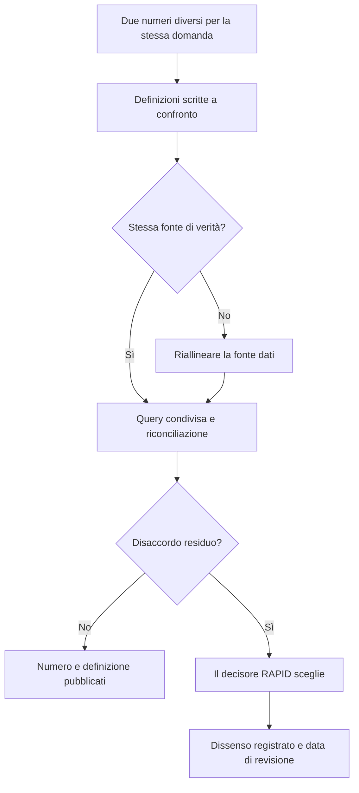

Il caso che segue è uno scenario costruito, con numeri di esempio, ma chi lavora sui dati lo incontra prima o poi sotto forma diversa. A fine trimestre il responsabile vendite porta in riunione il numero di nuovi clienti enterprise estratto dal CRM: 340. Il responsabile prodotto risponde con il conteggio dell'event tracking: 280 clienti enterprise attivi. Il CEO deve presentare un solo valore al board e guarda l'analista. Nessuno dei due sta mentendo, e proprio per questo la discussione rischia di durare settimane.

## Due numeri, una sola domanda

La prima reazione, in una stanza così, è cercare chi ha ragione. È la domanda sbagliata, perché presuppone che uno dei due numeri sia errato. Quasi sempre entrambi sono corretti rispetto alla definizione che il proprio team usa senza dichiararla. Il CRM conta contratti firmati nel trimestre; l'event tracking conta account che hanno prodotto almeno un evento di utilizzo. Sono due fenomeni vicini, non lo stesso.

> **Idea chiave:** un conflitto sui dati si risolve trasformando le definizioni divergenti in una definizione scritta, con una fonte di verità condivisa, un unico decisore e il dissenso registrato. Il numero giusto è una conseguenza di quel processo, non il suo punto di partenza.

L'analista in questa scena non è un osservatore neutrale di un fenomeno tecnico. Siede tra persone con incentivi diversi e il suo lavoro è rendere visibili le differenze senza prendere le parti di nessuno. Ignorare la dimensione organizzativa equivale a prescrivere un farmaco senza aver fatto l'anamnesi: si cura il sintomo e la causa resta.

## Da dove nasce il disaccordo

I conflitti sui dati raramente sono tecnici. Nascono da tre divergenze che conviene distinguere, perché ciascuna richiede un rimedio diverso.

| Divergenza | Esempio tipico | Rimedio |
| --- | --- | --- |
| Definizione | "Utente attivo" come login negli ultimi 7 giorni oppure negli ultimi 30 | Definizione scritta e misurabile |
| Metodologia | Attribuzione last-click, multi-touch o basata sui valori di Shapley | Scelta documentata del metodo per la decisione in corso |
| Incentivo | Marketing premiato sugli MQL, sales sui contratti chiusi | Decisore unico che pesa i trade-off |

La terza riga è la più profonda. Se marketing è valutato sui lead qualificati e sales sui contratti chiusi, i loro KPI ottimali sono diversi per costruzione, e nessuna query li farà coincidere. Un analista che entra nel conflitto senza capire gli incentivi finisce per riconciliare i numeri e lasciare intatta la tensione, che si ripresenterà il trimestre dopo su un'altra metrica.

Per questo la prima domanda utile non è quale dato sia giusto, ma come ciascun team definisce il termine in discussione. Nel caso del trimestre, "cliente enterprise" per sales è un contratto firmato con un'azienda sopra una certa dimensione. Per prodotto è un account che usa il software. Mettere le due frasi una accanto all'altra, per iscritto, spesso chiude metà della discussione prima ancora di toccare i dati.

## RAPID: chi decide cosa

Quando il disaccordo riguarda una scelta e non solo un conteggio, serve un modo per assegnare i ruoli. Il framework RAPID, descritto da Paul Rogers e Marcia Blenko di Bain & Company in un articolo della Harvard Business Review del 2006, distingue cinque funzioni.

| Ruolo | Significato | Nel contesto dati |
| --- | --- | --- |
| Recommend | Chi propone | L'analista che presenta dati e raccomandazione |
| Agree | Chi deve approvare | Chi ha potere di veto, per esempio il CMO sulle metriche marketing |
| Perform | Chi esegue | Il team che implementerà la decisione |
| Input | Chi fornisce elementi | Esperti di dominio e team toccati dalla scelta |
| Decide | Chi decide | Una persona sola, di norma il VP o il C-level |

Il punto che regge tutto il framework è che chi decide è una persona sola. Se la formula è "decide il team" o "decidiamo insieme", nessuno decide e il conflitto si cronicizza: ogni parte aspetta che l'altra ceda. Un VP Data efficace nomina un decisore per ogni questione contesa, anche quando è scomodo, e lo fa prima che la discussione si scaldi.

Notare la differenza tra Agree e Decide. Chi ha potere di veto può bloccare, ma non sceglie tra le alternative. Confondere i due ruoli produce la dinamica tipica in cui tutti possono dire no e nessuno può dire sì.

## Dalla discussione alla definizione scritta

Torniamo al caso. L'analista non sceglie tra 340 e 280: costruisce una riconciliazione che spieghi ogni record di differenza. Il lavoro procede in quattro passi.

Primo passo, la definizione scritta, per esempio: "cliente enterprise è un contratto firmato con un'azienda di almeno 250 dipendenti; è attivo se ha prodotto almeno un evento negli ultimi 30 giorni". Le definizioni orali sono ambigue per costruzione, quelle scritte si possono contestare punto per punto.

Secondo passo, una fonte di verità: entrambi i team accettano la stessa tabella o lo stesso modello dbt come base. Se marketing legge Google Analytics e prodotto legge Amplitude, il conflitto è già nei dati grezzi e nessuna interpretazione lo risolve.

Terzo passo, la riproducibilità: la query che produce il numero è accessibile a tutti. Non "fidati, l'ho calcolata io", ma "ecco la query, eseguila tu".

Quarto passo, la riconciliazione record per record. L'abbinamento tra CRM ed event tracking mostra da dove viene la differenza di 60 account (340 meno 280):

1. 18 account compaiono due volte nel CRM, perché lo stesso cliente ha due record creati da commerciali diversi: 340 − 18 = 322 contratti unici.
2. 8 contratti sono stati chiusi dopo la firma e non sono più validi: 322 − 8 = 314 contratti sotto impegno.
3. 34 contratti sono firmati ma l'onboarding non è partito, quindi non hanno ancora prodotto eventi: 314 − 34 = 280 attivi.

La somma torna: 18 + 8 + 34 = 60 account, esattamente la differenza di partenza. Il risultato per il board non è un numero ma due, con il loro rapporto: 314 clienti sotto contratto, di cui 280 attivi, pari a 280 ÷ 314 ≈ 89,2%. Il restante 10,8%, cioè 34 clienti, è il portafoglio in attesa di onboarding, che per un responsabile operations è l'informazione più utile di tutta la riunione.

## L'escalation quando il disaccordo resta

Se dopo definizione, fonte e riproducibilità il disaccordo persiste, serve un percorso di escalation strutturato, per non trasformare ogni conflitto in una questione di forza politica.

Il diagramma ha una caratteristica voluta: l'escalation arriva dopo i passi che si possono verificare, non al posto loro. Un decisore che interviene al primo attrito diventa un collo di bottiglia, mentre uno che interviene solo sul disaccordo residuo, e solo dopo che la riconciliazione ha ridotto la discussione a una scelta vera, ha un lavoro gestibile.

## Errori che cronicizzano il conflitto

### La definizione resta orale

Il sintomo è la stessa discussione che riappare ogni trimestre con attori diversi. Succede perché sembra più veloce accordarsi a voce, e in effetti lo è, fino al momento in cui qualcuno cambia ruolo e la definizione sparisce con lui. Si evita scrivendo la definizione nel punto in cui vive il dato, per esempio nella documentazione del modello dbt, con data e responsabile.

### Si decide per consenso

Il sintomo è una riunione che finisce con "ne riparliamo" o con un compromesso numerico che non rappresenta nessuno, come una media tra 340 e 280. Succede perché il consenso sembra rispettoso verso tutti. Il rimedio è nominare il decisore prima della riunione e dichiarare che il suo compito è scegliere, non mediare.

### L'analista prende le parti

Il sintomo è un team che smette di fidarsi dei numeri dell'analista, perché li percepisce come l'arma dell'altro. Succede quando l'analista, per risolvere in fretta, adotta la definizione del team più influente. Si evita presentando sempre la riconciliazione completa, in cui ogni record di differenza ha una causa, e mostrando entrambi i conteggi con la rispettiva definizione.

## Il dissenso documentato

Quando il decisore sceglie, il dissenso non scompare: va registrato. Un buon verbale ha quattro elementi e fa vedere a tutti che l'opinione contraria è stata ascoltata.

> Decisione: per il Q4 la finestra di "utente attivo" è di 30 giorni.
> Dissenso: il team Prodotto ritiene che 7 giorni descriva meglio la categoria.
> Motivazione del dissenso: l'uso del software è quotidiano per i clienti più grandi.
> Impegno: Prodotto supporta la metrica a 30 giorni e fornisce dati per rivalutarla a fine Q2.

La formula "disagree and commit" è usata in molte aziende e documentata, per esempio, nell'handbook pubblico di GitLab. Il suo valore pratico è doppio: chi dissente ha un luogo per farlo e una data in cui verrà riletto, chi decide sa che la scelta non è definitiva. Una decisione con revisione programmata costa meno da correggere di una difesa a oltranza.

## Verifica sul tuo conflitto

1. Due team presentano 340 e 280 per lo stesso trimestre. Quale prima domanda fai invece di chiedere chi ha ragione?

Mostra risposta

Chiedi a ciascun team come definisce il termine in discussione, per esempio "cliente enterprise". Le definizioni scritte a confronto spiegano di solito gran parte della differenza prima di toccare i dati.

2. Nel caso numerico, quanti account del CRM sono duplicati, chiusi e in attesa di onboarding, e perché la riconciliazione è corretta?

Mostra risposta

Sono 18 duplicati, 8 contratti chiusi e 34 in attesa di onboarding. La somma è 18 + 8 + 34 = 60, pari alla differenza 340 − 280, quindi ogni record è spiegato.

3. Qual è la differenza tra chi ha il ruolo Agree e chi ha il ruolo Decide in RAPID?

Mostra risposta

Chi ha Agree può esercitare un veto, ma non sceglie tra le alternative. Chi ha Decide è una persona sola e sceglie. Confondere i ruoli porta a una situazione in cui tutti possono bloccare e nessuno può approvare.

4. Perché la media tra 340 e 280 non è una risposta accettabile per il board?

Mostra risposta

Perché 310 non corrisponde a nessuna definizione: non è né un contratto firmato né un account attivo. Il board riceve una cifra che nessun team sa riprodurre, mentre servono due numeri con definizione e il loro rapporto.

5. Quali elementi deve contenere il verbale di un dissenso documentato?

Mostra risposta

La decisione, il dissenso con la sua motivazione, l'impegno di chi dissente a supportare la scelta e la data in cui la decisione sarà rivalutata.

