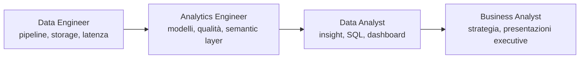

Scenario costruito: apri tre annunci di lavoro in una mattina. Il primo cerca un data analyst che costruisca modelli dbt, il secondo un analytics engineer che risponda alle domande del marketing con dashboard, il terzo un product analyst che scriva pipeline in Python. I titoli promettono mestieri diversi, i requisiti si sovrappongono quasi del tutto, e la scelta su quale candidatura inviare sembra casuale. Questa mappa serve a leggere le direzioni dell'analitica attraverso tre criteri che non cambiano da un annuncio all'altro: il problema che il ruolo risolve, lo stakeholder che serve ogni giorno, l'output che consegna.

## Perché i titoli ingannano

L'analitica non è un mestiere unico. Cambia molto a seconda che tu lavori su prodotto, marketing, finanza, operations, data platform o strategia, e le aziende assegnano gli stessi titoli a compiti diversi. In una startup il data analyst scrive anche le pipeline; in un'azienda grande lo stesso titolo significa solo costruire dashboard.

> **Idea chiave:** il ruolo giusto si riconosce dal problema che risolvi, dallo stakeholder che servi e dall'output che consegni, non dal titolo sul biglietto da visita. Se sai rispondere a queste tre domande per una posizione, l'hai capita meglio di chi ricorda l'elenco degli strumenti richiesti.

Quando guardi un annuncio, tieni a mente quattro domande. Quale decisione reale deve migliorare questo ruolo? Quale segnale osservabile rappresenta il problema? Rispetto a quale riferimento si legge il risultato? Cosa cambia dopo l'analisi? Se l'annuncio non permette di rispondere, il ruolo è definito male, e questa è già un'informazione utile per la tua scelta.

Questa lezione è anche la porta d'ingresso del modulo: le altre lezioni approfondiscono le direzioni verso cui lo spettro si apre, cioè prodotto, marketing e finanza, e le trovi indicate nel percorso del modulo.

## Lo spettro dall'infrastruttura alla decisione

I ruoli dei dati si distribuiscono lungo uno spettro. A un'estremità c'è chi costruisce e mantiene i tubi attraverso cui passano i dati; all'altra chi usa i numeri per orientare una scelta di business. Non sono compartimenti stagni ma gradienti di competenza.

Ogni ruolo ha una zona di comfort, cioè ciò che fa ogni giorno, e una zona di adiacenza, cioè ciò che tocca solo di tanto in tanto. La crescita di carriera passa per profondità, diventando il migliore nella propria zona, oppure per ampiezza, estendendo la zona di comfort verso un ruolo vicino. Sono due strade legittime, e la mappa ti aiuta a vedere quale delle due stai già percorrendo.

## I quattro ruoli a confronto

Il confronto che segue usa numeri di esempio per gli stipendi europei, indicativi e variabili per paese e settore. Servono a dare un ordine di grandezza, non una tabella retributiva.

| Ruolo | Problema tipico | Stakeholder quotidiano | Output | Fascia di esempio |
| --- | --- | --- | --- | --- |
| Data Engineer | Portare i dati del CRM nel warehouse ogni ora | Altri team tecnici | Pipeline affidabili | 45-55 mila euro entry, 80-110 senior |
| Analytics Engineer | Far significare "revenue" la stessa cosa per marketing e finance | Analisti e finance | Modelli documentati | 50-65 mila entry, 85-120 senior |
| Data Analyst | Spiegare perché la conversione è calata del 5% in una settimana | Prodotto e marketing | Insight e dashboard | 35-50 mila entry, 60-85 senior |
| Business Analyst | Decidere quale funzione costruire per prima | Direzione | Raccomandazioni | 40-55 mila entry, 70-95 senior |

Il data engineer lavora su ingestione, orchestrazione e storage con Python, SQL avanzato e infrastruttura cloud. È il ruolo con minore esposizione al business e maggiore profondità tecnica: senza le sue pipeline il warehouse resta vuoto. L'analytics engineer trasforma i dati grezzi in modelli analitici con dbt, cura la qualità e la documentazione ed è il ponte tra infrastruttura e analisi. È un ruolo formalizzato nella seconda metà degli anni Dieci e in forte crescita proprio per questa funzione di raccordo.

Il data analyst è il consumatore primario di quei modelli e il ruolo con la maggiore variabilità: in alcune aziende produce solo dashboard, in altre fa analisi vicine alla data science. Il business analyst, o product analyst, è il più vicino alla decisione e il più lontano dal codice, e spesso arriva da consulenza o da un percorso di management. Scegliere la profondità conviene se vuoi diventare insostituibile in un team dati grande; scegliere l'ampiezza conviene se vuoi guidare le decisioni in un team piccolo.

## Gli ibridi che stanno nascendo

Il mercato sta creando figure di confine, che riflettono esigenze concrete. L'analytics engineer si avvicina al data platform engineer, perché unisce modelli dbt e gestione della CI/CD per i dati. Il data analyst orientato al prodotto si specializza in analisi causali e sperimentazione, con tecniche statistiche più avanzate della sola dashboard. Il business analyst diventa data product manager, che non scrive codice ma traduce requisiti di business in specifiche per i data engineer.

Per chi legge una mappa, il segnale utile è che gli ibridi occupano le zone adiacenti: se una figura di confine ti attrae, di solito significa che la tua zona di comfort sta già scivolando in quella direzione.

## Scegliere con le tre domande sull'energia

La domanda di carriera non è quale ruolo sia il migliore in assoluto, ma quale lavoro ti dia energia anche nei giorni peggiori. Cassie Kozyrkov, che è stata Chief Decision Scientist in Google, propone tre domande che puoi usare come filtro.

1. Ti dà più soddisfazione costruire o rispondere a domande? Chi preferisce costruire guarda a data engineer e analytics engineer; chi preferisce rispondere guarda a data analyst e business analyst.
2. Cerchi profondità tecnica o ampiezza di contesto? La profondità porta a specializzarsi; l'ampiezza porta a ruoli ibridi o a ruotare ogni due o tre anni.
3. Quanto ti pesa non vedere l'impatto del tuo lavoro? Se ti pesa molto, avvicinati alla decisione; se ti pesa poco, l'infrastruttura può essere la tua casa.

La scelta si chiude con un'azione datata. Una direzione senza un progetto, un corso o una candidatura entro tre mesi resta un'intenzione, e le intenzioni non si misurano.

## Un percorso costruito: dal data analyst all'analytics engineer

Un caso ricostruito mostra come la mappa si traduce in un cambio di ruolo. Julia, matematica di formazione, lavora come data analyst in una telco. Dopo due anni si accorge che una parte rilevante del tempo del suo team va in pulizia dei dati. Impara dbt in quattro mesi e propone un modello di staging per i dati del CRM.

Ecco i numeri di esempio. Prima del modello, il team dedicava 12 ore a settimana alla pulizia; dopo, 2 ore. Il risparmio è 12 − 2 = 10 ore a settimana, cioè una riduzione di 10 ÷ 12 ≈ 83%. Su 46 settimane lavorative l'effetto è 10 × 46 = 460 ore l'anno, equivalenti a circa 11 settimane da 40 ore di lavoro tornate disponibili per analisi. Con uno stipendio di partenza di 48.000 euro, un aumento del 25% porta a 48.000 × 1,25 = 60.000 euro, quindi +12.000 euro l'anno.

Il percorso richiede tre mosse. Riconoscere il problema giusto, cioè quello che costa tempo a molte persone. Acquisire la competenza prima di chiedere il cambio di titolo. Dimostrare il valore con un progetto misurato, invece di chiedere una promozione astratta.

## Errori nella lettura della mappa

### Trattare la mappa come un elenco di etichette

Il sintomo è la scelta di un ruolo perché suona bene, seguita da delusione dopo tre mesi. Succede perché il titolo sembra preciso e non obbliga a chiedersi quale problema risolva e quale interlocutore serva. Si evita con la domanda di controllo: se questo ruolo si rivelasse diverso da come lo immagino, quale scelta starei sbagliando? Se non sai rispondere in modo concreto, manca il legame tra mappa e azione.

### Confrontare stipendi e strumenti invece di problemi

Il sintomo è una tabella di confronto piena di sigle e di cifre, senza una sola frase sul lavoro quotidiano. Succede perché strumenti e retribuzioni sono facili da trovare e da paragonare. Si corregge aggiungendo per ogni ruolo una colonna sul problema tipico e una sull'output, e dando loro lo stesso peso delle altre.

## Verifica sulla tua direzione

1. Quale problema risolve il ruolo che ti interessa e chi è il suo stakeholder quotidiano?

Mostra risposta

La risposta dipende dal ruolo scelto. Un buon esempio: l'analytics engineer risolve il problema di definizioni incoerenti tra team e serve analisti e finance. Se non riesci a nominare problema e stakeholder, non hai ancora capito il ruolo.

2. Dove ti collochi oggi sullo spettro tra infrastruttura e decisione, e verso quale zona adiacente vorresti muoverti?

Mostra risposta

Indica la tua zona di comfort e una sola zona adiacente, non due. Un analista che passa metà del tempo a pulire dati ha una naturale adiacenza verso l'analytics engineering.

3. Nel percorso di Julia, quante ore l'anno recupera il team e di quale percentuale si riduce il lavoro di pulizia?

Mostra risposta

Si passa da 12 a 2 ore a settimana: 10 ore risparmiate, riduzione di circa 83%. Su 46 settimane sono 460 ore l'anno.

4. Quale delle tre domande sull'energia ti aiuta di più a scegliere, e perché?

Mostra risposta

Non esiste una risposta unica: scegli la domanda che separa meglio i due ruoli tra cui sei indeciso. Se oscilli tra data engineer e data analyst, la prima domanda, costruire o rispondere, è la più discriminante.

5. Quale azione concreta compi entro tre mesi per avvicinarti alla direzione scelta?

Mostra risposta

Un progetto misurabile nel tuo lavoro attuale, per esempio un modello che riduce un'attività ripetitiva, con una stima in ore risparmiate come quella del caso costruito.

