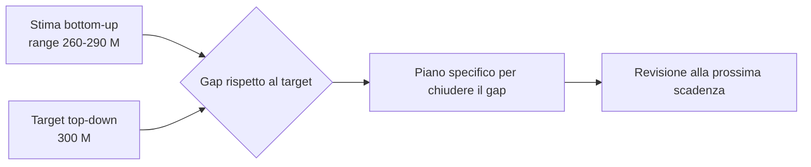

Scenario costruito, con numeri di esempio: a metà ottobre la responsabile marketing di un e-commerce deve chiudere il budget del trimestre successivo. Ha un piano che presuppone 3.000 nuovi clienti al mese. Il finance le chiede una previsione, e lei porta una sola cifra: 2.500. Il direttore commerciale la contesta, il CFO si chiede se 2.500 sia un valore probabile o la media di due stati d'animo. Nessuno ha sbagliato un calcolo; manca un modo condiviso di dire quanto è incerta la cifra e che cosa si farà se non si realizza.

## Il forecast come strumento di coordinamento

Ogni trimestre un'azienda deve prevedere domanda, capacità, ricavi e costi prima di avere dati certi. Il forecasting aziendale è il processo ricorrente che traduce driver, assunzioni e scenari in decisioni di budget, organico e prezzi. Un driver è la variabile che muove il risultato, per esempio il traffico o il tasso di conversione.

> **Idea chiave:** un forecast utile non promette certezza: esplicita i driver, dichiara il range, fissa i momenti di revisione e lega ogni scenario alla decisione che lo aspetta. Formule e modelli servono solo dentro questo processo.

Leggere il forecast come coordinamento tra previsione e responsabilità cambia le domande. Non basta il numero finale: serve sapere quale ciclo di planning lo usa, quale driver spiega lo scostamento principale e se lo scenario è presentato come ipotesi di lavoro o come promessa. Se manca una di queste condizioni, il forecast diventa una slide efficace che non cambia alcuna scelta.

Il valore di un forecast si misura sulla decisione che abilita. Se il numero non cambia budget, assunzioni o prezzi, è arrivato troppo tardi oppure è troppo aggregato per essere usato.

## Tre cicli di planning sovrapposti

Ogni azienda opera su tre cicli con scopo e dettaglio diversi. Confonderli è un errore frequente: si usa un forecast strategico per correggere una settimana, o un dato tattico per decidere un investimento triennale.

| Ciclo | Frequenza | Orizzonte | Granularità | Chi lo guida |
| --- | --- | --- | --- | --- |
| Strategico | Annuale | 3-5 anni | Annuale, per business unit | CEO e board |
| Operativo | Trimestrale | 12-18 mesi | Mensile, per dipartimento | CFO e FP&A |
| Tattico | Mensile o settimanale | 1-3 mesi | Giornaliera o settimanale | Responsabili di team |

Il forecast mensile pesa di più sull'operatività, perché dice se l'azienda è in linea o deve cambiare rotta. Entro il quinto giorno del mese ogni responsabile dovrebbe sapere se il mese precedente è sopra o sotto il target. Una regola pratica: usa il ciclo strategico per la direzione, quello operativo per l'allocazione delle risorse, quello tattico per la correzione settimanale.

## Il modello a tre scenari

La pratica standard in FP&A, cioè Financial Planning and Analysis, è costruire tre scenari invece di uno. Il caso migliore assume che tutte le ipotesi ottimistiche si realizzino; il caso peggiore che si realizzino tutte quelle pessimistiche; il caso base usa le assunzioni più probabili. Il caso base non è la media aritmetica degli altri due: è il valore atteso, costruito sulle probabilità reali di ciascun driver.

Applichiamolo alla responsabile marketing. I nuovi clienti mensili sono il prodotto di traffico e tasso di conversione. Il traffico base è di 100.000 visite al mese con uno scarto del 20%; il tasso di conversione base è del 2,5% con uno scarto di 0,5 punti percentuali.

1. Caso migliore: traffico 100.000 + 20% = 120.000 visite, conversione 2,5% + 0,5 pp = 3,0%. Risultato: 120.000 × 3,0% = 3.600 clienti.
2. Caso base: 100.000 visite × 2,5% = 2.500 clienti.
3. Caso peggiore: traffico 100.000 − 20% = 80.000 visite, conversione 2,5% − 0,5 pp = 2,0%. Risultato: 80.000 × 2,0% = 1.600 clienti.

Il range 1.600-3.600 dice molto più del punto 2.500. Il piano marketing presuppone 3.000 clienti: il caso base è 500 clienti sotto, cioè una differenza del 16,7% (500 ÷ 3.000), e solo il caso migliore raggiunge il budget. Il forecast avverte subito che il piano poggia sull'ipotesi ottimistica su entrambi i driver, non su quella più probabile.

Dichiarato in questo modo, il numero cambia la conversazione. La domanda smette di essere se 2.500 sia giusto e diventa quale driver conviene muovere per avvicinarsi a 3.000, e con quale costo.

## Bottom-up e top-down: dove si incontrano

Il forecast bottom-up parte dai team operativi: ciascuno stima le proprie metriche e il totale finanziario è la somma. Il forecast top-down parte dal target del board, per esempio crescere del 30%, e adatta i numeri all'obiettivo. Nessuno dei due è corretto da solo: il primo tende alla prudenza, il secondo all'ambizione. L'approccio solido li fa incontrare e rende esplicito il divario.

Con numeri di esempio, il bottom-up indica 260-290 milioni di ricavi e il target è 300 milioni. Il gap è compreso tra 300 − 290 = 10 e 300 − 260 = 40 milioni; al punto medio del range, 275, è pari a 25 milioni. Il gap non si chiude con "lavoriamo di più", ma con un piano verificabile. Riprendendo il caso dei nuovi clienti: un aumento del 15% del tasso di conversione porta il 2,5% a 2,5% × 1,15 = 2,875%, quindi 100.000 × 2,875% = 2.875 clienti, 375 in più del caso base. È un'azione concreta con un progetto, un responsabile e una data, e il suo effetto è calcolabile prima di spendere.

## Metodi semplici per le serie storiche

Per un forecast utile non serve un modello di machine learning. Tre approcci semplici battono spesso modelli complessi, soprattutto quando i dati storici sono pochi.

Il primo è il metodo naïve con stagionalità: il ricavo del mese è quello dello stesso mese dell'anno precedente, moltiplicato per uno più il trend annuale. Se a novembre dell'anno scorso il ricavo è stato di 4,0 milioni e il trend annuale osservato è +8%, la previsione è 4,0 × 1,08 = 4,32 milioni. Funziona bene per attività stagionali come il retail e il turismo.

Il secondo è la media mobile con trend: media degli ultimi tre mesi più la variazione recente, adatta a una crescita costante. Il terzo è il run rate con aggiustamento: dati del mese corrente annualizzati per 12 e corretti per la stagionalità nota, utile per i SaaS a metà trimestre.

Prima di passare a modelli più complessi, un metodo semplice fornisce un riferimento: se un modello sofisticato non batte il naïve stagionale, la sofisticazione non sta aggiungendo informazione. Prima di portare una previsione in decisione, controlla completezza, duplicati, timezone, definizioni cambiate e segmenti esclusi, perché un forecast costruito su un dato che misura un comportamento diverso da quello dichiarato resta sbagliato per quanto elegante.

## Aggiornare il forecast durante il ciclo

Un forecast non si scrive una volta e si archivia. Ogni ciclo prevede date di revisione, e la revisione ha una regola: si aggiorna la stima quando un driver esce dal range dichiarato, non a ogni piccola oscillazione. Se il traffico reale di un mese è di 78.000 visite, sotto le 80.000 del caso peggiore, il driver ha rotto il range e va rivalutato subito, insieme a ciò che ne dipende. Se invece è di 97.000, il caso base resta in piedi e basta annotare lo scostamento del 3%, pari a (100.000 − 97.000) ÷ 100.000.

Conviene anche registrare per ogni driver l'errore di previsione dei cicli precedenti. Se il traffico è stato sovrastimato per tre trimestri di fila, la correzione non è la fiducia nel prossimo, ma un aggiustamento esplicito dell'assunzione. Con il tempo questo registro dice quali driver sono prevedibili e quali no, e orienta il lavoro: sui primi conviene un modello semplice e stabile, sui secondi un range più largo e una revisione più frequente.

Infine, il forecast va collegato a una soglia di azione scritta prima di leggere i numeri. Se il caso base scende sotto l'80% del budget, per esempio sotto 2.400 clienti su 3.000, scatta la riallocazione della spesa; se resta sopra, si prosegue. Decidere la soglia in anticipo evita di negoziare il significato dello scostamento quando il numero è già sul tavolo.

## Errori che uccidono un forecast

### Ancorarsi all'anno scorso

Il sintomo è un forecast che coincide con il consuntivo precedente aumentato di una percentuale tonda, tipicamente il 10%. Succede perché il passato è il dato più comodo e crea la sensazione di una base solida. Il rimedio è confrontare ogni driver con il trend recente e chiedersi se mercato o prodotto sono cambiati: se sì, l'anno scorso non è una baseline.

### Assunzioni che ignorano il trend recente

Il sintomo è un'ipotesi di churn al 4% mentre negli ultimi tre mesi il tasso è salito. Succede perché la media storica sembra più stabile del dato recente. Si corregge datando ogni assunzione e usando i mesi più vicini, con una nota sul perché si scarta la media di lungo periodo.

### Un solo numero senza range

Il sintomo è una slide con "Ricavi Q3: 88 milioni". Succede perché il punto singolo sembra più decisivo. Si corregge comunicando "82-94 milioni, caso base 88", che permette a chi decide di capire quanta fiducia dare alla cifra e quando intervenire.

## Verifica sul tuo forecast

1. Quale ciclo di planning decide l'allocazione trimestrale del budget?

Mostra risposta

Il ciclo operativo, guidato da CFO e FP&A, con orizzonte 12-18 mesi e granularità mensile per dipartimento.

2. Perché il caso base non è la media tra scenario ottimista e pessimista?

Mostra risposta

Perché è il valore atteso, costruito sulle probabilità reali dei driver. Nell'esempio la media tra 3.600 e 1.600 sarebbe 2.600, mentre il caso base calcolato è 2.500.

3. Il bottom-up dà 260-290 milioni e il target è 300 milioni: quanto vale il gap e come lo chiudi?

Mostra risposta

Il gap è tra 10 e 40 milioni, circa 25 al punto medio. Si chiude con un piano specifico e quantificato, per esempio un aumento della conversione, non con una generica richiesta di impegno.

4. Con 100.000 visite e conversione del 2,5%, quanti clienti in più ottieni portando la conversione a 2,875%?

Mostra risposta

100.000 × 2,875% = 2.875 clienti, cioè 375 in più rispetto ai 2.500 del caso base, pari al 15% in più.

5. Quale controllo sui dati fai prima di portare un forecast in decisione?

Mostra risposta

Completezza, duplicati, timezone, definizioni cambiate e segmenti esclusi, oltre alla verifica che i segmenti non si muovano in direzioni opposte nascoste dalla media aggregata.

