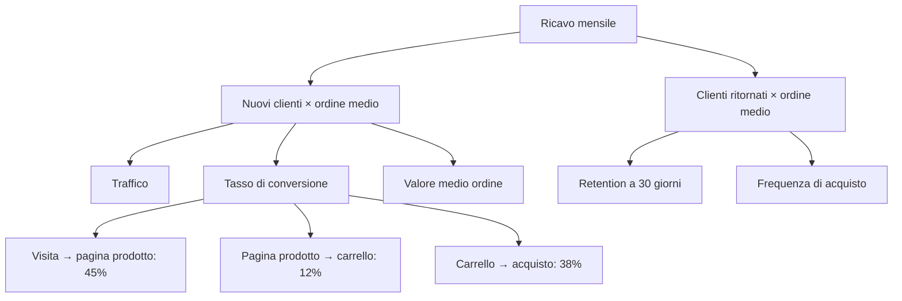

Scenario costruito, con numeri di esempio: in un e-commerce il marketing festeggia perché il traffico è cresciuto del 20%, il prodotto segnala che la conversione del carrello è scesa, la finanza vede un margine più basso. Ciascuno guarda una metrica vera e ciascuno ha ragione. Nessuno sa dire se, complessivamente, il mese è andato meglio o peggio, perché le tre metriche vivono in tre fogli diversi senza un legame esplicito. Un KPI tree serve a costruire quel legame.

## Che cos'è un KPI tree

Un KPI tree è la scomposizione gerarchica di una metrica di risultato, tipicamente il ricavo o l'EBITDA, nei suoi driver operativi. L'outcome è il risultato finale; il driver è la leva che lo muove. Si parte dalla metrica che interessa alla direzione e si scompone in parti via via più piccole, fino a quelle che un singolo team può influenzare direttamente.

> **Idea chiave:** un albero di metriche ha valore solo se ogni foglia ha un owner e un target numerico. Senza di essi resta un diagramma elegante; con essi diventa un sistema operativo che dice chi agisce su cosa.

La domanda di fondo è pratica. Quale funzione ottimizza una metrica che impatta le altre? Quale nodo collega risultato e driver? Come si usa l'albero per risolvere un conflitto tra team? Le risposte stanno nella struttura, non nel singolo numero.

## Scegliere la North Star

Il primo passo è scegliere la metrica North Star, quella che unisce valore per il cliente e valore per l'azienda. Per un marketplace di alloggi può essere il numero di notti prenotate, che serve a ospiti, host e piattaforma; per un servizio di streaming musicale il tempo di ascolto; per un'azienda di pagamenti il volume processato.

Non usare il ricavo come North Star in un marketplace o in un modello freemium. Il ricavo è un outcome, non il valore percepito dall'utente: ottimizzarlo direttamente spinge a decisioni di breve periodo, come aumentare i prezzi, che danneggiano la crescita. Una buona North Star misura qualcosa che il cliente riconoscerebbe come utile e da cui il ricavo discende come conseguenza.

## Scomporre senza sovrapposizioni

Il secondo passo è decomporre la metrica nei driver operativi. Per ogni nodo ti chiedi che cosa deve succedere perché quel numero aumenti. La decomposizione deve essere MECE, cioè mutuamente esclusiva e collettivamente esaustiva: le parti non si sovrappongono e insieme coprono tutto il nodo superiore.

Per un SaaS o un e-commerce la scomposizione più utile segue il ciclo di vita del cliente: il ricavo è la somma tra i nuovi clienti per il ricavo medio per cliente, più i clienti esistenti per il ricavo medio per cliente moltiplicato per la quota che non abbandona. In formula: R = N × ARPU + E × ARPU × (1 − c), dove N sono i nuovi clienti, E gli esistenti e c il tasso di abbandono.

Quando il livello più basso dell'albero compare due volte in rami diversi, la scomposizione non è MECE e i numeri saranno contati due volte. È il primo controllo da fare su un albero appena disegnato.

## Owner e target per foglia: un esempio svolto

Il terzo passo assegna a ogni foglia un team responsabile, un target numerico, una frequenza di misura e una fonte dati. Vediamo come si propaga una leva fino al ricavo, con numeri di esempio.

Il sito riceve 100.000 visite al mese. Il funnel ha tre passaggi: il 45% delle visite arriva alla pagina prodotto, il 12% di queste aggiunge al carrello, il 38% dei carrelli diventa acquisto. Il valore medio dell'ordine è di 60 euro e il margine lordo è del 40%.

1. Pagina prodotto: 100.000 × 45% = 45.000 visite.
2. Carrello: 45.000 × 12% = 5.400 carrelli.
3. Acquisti: 5.400 × 38% = 2.052 ordini, pari a una conversione complessiva del 2,052%.
4. Ricavo: 2.052 × 60 euro = 123.120 euro.
5. Margine lordo: 123.120 × 40% = 49.248 euro.

Il team prodotto, owner della foglia carrello → acquisto, ha come target il 42% invece del 38%. Con la stessa base di 5.400 carrelli gli ordini diventano 5.400 × 42% = 2.268, cioè 216 in più (+10,5%). Il ricavo sale a 2.268 × 60 = 136.080 euro, con una differenza di 12.960 euro; il margine aggiuntivo è 12.960 × 40% = 5.184 euro al mese. Una leva sulla foglia spiega con precisione un effetto sul nodo di vertice: è esattamente il tipo di domanda a cui l'albero deve saper rispondere.

| Foglia | Owner | Target | Frequenza | Fonte |
| --- | --- | --- | --- | --- |
| Visita → pagina prodotto | Growth | 45% | Settimanale | Event tracking |
| Pagina prodotto → carrello | Prodotto | 12% | Settimanale | Event tracking |
| Carrello → acquisto | Prodotto | 42% | Settimanale | Funnel di checkout |
| Valore medio ordine | Merchandising | 60 euro | Mensile | Sistema ordini |
| Margine lordo | Finance | 40% | Mensile | Contabilità |

## Collegare gli alberi tra funzioni

Il quarto passo collega gli alberi di funzioni diverse. Marketing, prodotto, sales e finance possono avere alberi distinti, ma le foglie devono connettersi: il tasso di conversione del funnel marketing è l'input del funnel di vendita, e il ricavo ricorrente nell'albero finance è l'output degli alberi di marketing e prodotto.

Il collegamento serve soprattutto quando due metriche si contraddicono. Il marketing ottimizza i lead, sales la pipeline, finance il margine e il prodotto l'attivazione. Il KPI tree è utile quando mostra dove queste metriche si rinforzano, dove si contraddicono e quale deve prevalere nella decisione specifica.

Quando una metrica sembra migliorare, la lettura prudente passa da una baseline: un numero che sale va confrontato con un periodo e un gruppo comparabili. Se un segmento cambia più degli altri, la media nasconde una differenza e va scomposta per coorte. Se il costo cresce con il risultato, l'effetto va letto sul margine e non sul volume.

Un esempio di conflitto tipico aiuta a vedere il meccanismo. Il marketing aumenta la spesa sui canali a pagamento e il traffico passa da 100.000 a 120.000 visite. Se i nuovi visitatori hanno intenzione di acquisto più bassa, la conversione complessiva scende, per esempio da 2,052% a 1,9%, e gli ordini diventano 120.000 × 1,9% = 2.280 invece dei 2.052 di partenza, con un aumento del solo 11,1% a fronte di un traffico cresciuto del 20%. L'albero mostra subito che il costo per ordine è peggiorato anche se il volume è migliorato. Senza l'albero, la discussione si riduce a quale team abbia ottenuto il risultato migliore.

Per questo, quando due funzioni propongono azioni opposte, conviene tornare al nodo comune più alto, in genere il ricavo o il margine, e valutare ciascuna proposta per il suo effetto su quel nodo. La funzione che propone di spendere di più dimostra l'effetto netto sul margine, quella che propone di spendere meno dimostra cosa si perde in volume. Il decisore ha così due calcoli confrontabili e non due opinioni.

Resta da decidere con quale cadenza l'albero viene riletto. Le foglie operative, come i passaggi del funnel, si guardano ogni settimana; i nodi intermedi, come il valore medio dell'ordine, ogni mese; la North Star ogni trimestre, perché si muove lentamente e leggerla troppo spesso spinge a reazioni sul rumore. Ogni rilettura ha una domanda fissa: quale foglia si è mossa fuori dal proprio intervallo atteso e chi ne risponde. Quando l'albero viene aggiornato solo in occasione delle revisioni di budget, perde la funzione che lo rende utile, cioè anticipare lo scostamento prima che arrivi al nodo di vertice.

## Errori comuni nella costruzione

### Troppi livelli

Il sintomo è un albero di sette livelli che nessuno aggiorna. Succede perché ogni nodo sembra legittimo e scomporre ancora dà un'impressione di rigore. Bastano tre o quattro livelli, da outcome a driver, leva e azione operativa; oltre, le foglie non hanno più un owner chiaro.

### Metriche vanity al posto di metriche azionabili

Il sintomo è una foglia che cresce senza che nessuno sappia cosa fare. Le visualizzazioni di pagina non dicono quale azione compiere, il tasso di click dalla home alla pagina prodotto sì. Si corregge chiedendo per ogni foglia quale azione cambierebbe se il valore si muovesse.

### Alberi che non si parlano

Il sintomo è marketing che massimizza i lead, sales che massimizza la dimensione del contratto e nessuno che massimizza il profitto. Succede perché ogni albero nasce nel proprio team. Si corregge con una riunione di raccordo in cui le foglie condivise vengono nominate e ciascuna ha un solo owner, anche se più funzioni la influenzano.

Un quarto controllo vale per qualunque metrica: un tasso di conversione del 3% significa poco senza sapere se il mese scorso era 2% o 4%. Ogni foglia ha bisogno di trend e di un riferimento di confronto.

## Verifica sul tuo albero

1. Quale nodo del tuo albero è un outcome e quale è un driver operativo?

Mostra risposta

L'outcome è il risultato finale, per esempio il ricavo mensile; il driver è la leva che un team può muovere, per esempio il tasso di conversione dal carrello all'acquisto.

2. Con 100.000 visite, 45% alla pagina prodotto, 12% al carrello e 38% all'acquisto, quanti ordini ottieni?

Mostra risposta

100.000 × 45% = 45.000; × 12% = 5.400; × 38% = 2.052 ordini, conversione complessiva del 2,052%.

3. Se il tasso carrello → acquisto passa dal 38% al 42%, quanto cambia il ricavo con un ordine medio di 60 euro?

Mostra risposta

Gli ordini passano da 2.052 a 2.268, quindi +216. Il ricavo aumenta di 216 × 60 = 12.960 euro, da 123.120 a 136.080 euro.

4. Perché il ricavo non è una buona North Star per un marketplace?

Mostra risposta

Perché è un outcome e non il valore percepito dall'utente. Ottimizzarlo direttamente porta a decisioni di breve periodo, come alzare i prezzi, che erodono la crescita.

5. Come capisci che una scomposizione non è MECE?

Mostra risposta

Se una foglia compare in due rami o se la somma delle parti non copre il nodo superiore. Nel primo caso i numeri vengono contati due volte, nel secondo restano buchi non spiegati.

