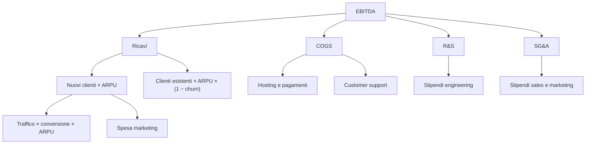

Scenario costruito, con numeri di esempio: la chiusura di ottobre mostra un EBITDA in miglioramento, e il direttore generale si rilassa. Il tesoriere però segnala che la cassa è scesa. I clienti grandi hanno spostato i pagamenti a 60 giorni, mentre i costi di un nuovo fornitore sono stati pagati in anticipo. L'azienda guadagna sul conto economico e perde liquidità sul conto corrente. Una discussione di questo tipo è il terreno della finance analytics: non spiega il passato dei bilanci, ma aiuta a decidere prima che il problema diventi urgente.

## Che cosa fa il finance analyst oggi

La finance analytics non vive solo nei consuntivi. Serve quando il business deve leggere margine, cash flow, budget, forecast e scostamenti prima che diventino problemi, ed è il ponte tra il reporting finanziario e la gestione.

> **Idea chiave:** il valore del finance analyst non sta nel foglio accurato, ma nello spiegare driver, varianze e opzioni prima della decisione. Se un numero non cambia una scelta, manca il collegamento tra metrica e azione.

Il finance analyst tradizionale passava la maggior parte del tempo a riconciliare estratti conto e a preparare report mensili. Quello moderno, spesso chiamato analista FP&A (Financial Planning and Analysis) o Strategic Finance, fa tre cose diverse: modella il futuro, costruisce KPI tree e progetta scenari. La domanda guida non è come sia andato il mese scorso, ma dove saremo tra sei mesi se continuiamo così.

Il modello standard per un SaaS è il three statement model, che collega conto economico (P&L), stato patrimoniale e rendiconto finanziario. La parte analitica sta nella scomposizione del ricavo: il revenue è la somma tra i nuovi clienti per il ricavo medio per cliente e i clienti esistenti per lo stesso ricavo medio, ridotti del tasso di abbandono. Un buon analista non applica la formula e basta: capisce quali leve la muovono e quali conseguenze hanno sulla cassa.

## Le metriche da conoscere

Otto metriche coprono la maggior parte delle conversazioni tra finance, direzione e team operativi. Conoscerne la formula esatta evita molti equivoci, perché sigle simili si usano con significati diversi in aziende diverse.

| Metrica | Formula | Perché conta |
| --- | --- | --- |
| EBITDA | Ricavi − COGS − costi operativi, esclusi ammortamenti, interessi e tasse | Redditività operativa |
| Gross margin | (Ricavi − COGS) ÷ Ricavi | Efficienza del prodotto o servizio |
| Burn rate | Cassa spesa al mese | Velocità di consumo della liquidità |
| Runway | Cassa disponibile ÷ burn rate | Mesi di autonomia |
| Rule of 40 | Crescita dei ricavi % + margine EBITDA % | Benchmark SaaS: sopra 40 è sano |
| Payback period | CAC ÷ ARPU mensile | Mesi per recuperare il costo di acquisizione |
| ARPU | Ricavi ÷ numero di clienti | Valore medio per cliente |
| Churn rate | Clienti persi ÷ clienti iniziali | Tasso di abbandono |

Un esempio rapido sul payback: con un CAC di 200 euro e un ARPU mensile di 50 euro, il costo di acquisizione si recupera in 200 ÷ 50 = 4 mesi, prima di considerare il margine lordo. Se il margine lordo è dell'80%, il contributo mensile utile è 50 × 80% = 40 euro e il payback reale diventa 200 ÷ 40 = 5 mesi.

## Scomporre l'EBITDA nei driver

Un KPI tree decompone una metrica finanziaria alta, come l'EBITDA, nei driver operativi. Traduce il linguaggio del CFO, il margine operativo, nel linguaggio del team, per esempio il costo per acquisire un cliente.

Ogni nodo è una metrica misurabile con target e margine di ottimizzazione. Il finance analyst moderno non costruisce l'albero da solo, ma con ogni team, usando i loro dati operativi. Se un nodo non ha un owner, una fonte e una frequenza di misura, va tolto dall'albero: un nodo senza responsabile fa solo rumore.

## Un mini modello SaaS passo per passo

Il laboratorio più istruttivo è un modello su 12 mesi con pochi input. Parti da questi dati di esempio: 1.000 clienti iniziali, 100 nuovi clienti al mese, churn mensile del 5%, ARPU di 50 euro al mese, CAC di 200 euro e costi fissi di 80.000 euro al mese. I clienti del mese successivo sono i clienti attuali per 0,95, più 100 nuovi. Il costo di acquisizione mensile è 100 × 200 = 20.000 euro.

1. Mese 1: 1.000 clienti, MRR 1.000 × 50 = 50.000 euro. Cash flow: 50.000 − 20.000 − 80.000 = −50.000 euro.
2. Mese 2: clienti 1.000 × 0,95 + 100 = 1.050, MRR 52.500 euro. Cash flow: 52.500 − 20.000 − 80.000 = −47.500 euro.
3. Mese 3: clienti 1.050 × 0,95 + 100 = 1.097,5, MRR 54.875 euro. Cash flow: 54.875 − 100.000 = −45.125 euro.

Il cash flow migliora ogni mese, ma l'osservazione decisiva viene dal punto di equilibrio dei clienti. Con 100 nuovi al mese e churn del 5%, la base tende a 100 ÷ 0,05 = 2.000 clienti. A regime il MRR è 2.000 × 50 = 100.000 euro e il cash flow è 100.000 − 20.000 − 80.000 = 0. Con questi parametri il modello si avvicina al pareggio senza mai superarlo: il breakeven non esiste. La conclusione per il management non è un mese ma un'azione.

Muoviamo due leve. Con un ARPU più alto del 10%, cioè 55 euro, il MRR a regime è 110.000 euro e il cash flow diventa +10.000 euro al mese. Il cash flow supera zero quando i clienti superano 100.000 ÷ 55 ≈ 1.818, il che accade al mese 35. Con churn al 7% la base a regime è 100 ÷ 0,07 ≈ 1.429 clienti, il MRR 71.429 euro e il cash flow resta intorno a −28.571 euro: nessun breakeven. Il confronto è netto: un aumento del 10% dell'ARPU cambia l'esito, un peggioramento di due punti del churn lo rende irraggiungibile.

Il runway completa il quadro. Con 600.000 euro in cassa e un burn iniziale di 50.000 euro al mese, l'autonomia è 600.000 ÷ 50.000 = 12 mesi. Poiché il burn scende lentamente, il runway reale è un po' più lungo, ma il margine di sicurezza dipende dal fatto che il breakeven senza intervento non arriva.

## Scenari e stress test

Lo scenario planning risponde a una domanda concreta: che cosa succede con i numeri di oggi se le condizioni cambiano. Se il CAC aumenta del 20% perché la pubblicità a pagamento diventa più cara, passa da 200 a 240 euro e il costo di acquisizione mensile sale a 24.000 euro, con un cash flow peggiore di 4.000 euro al mese. Se il churn mensile passa dal 5% al 7% perché un concorrente lancia una funzione decisiva, il cash flow del mese 2 passa da −47.500 a −48.500 euro e la base a regime scende da 2.000 a circa 1.429 clienti. Se il cambio euro-dollaro scende del 10% per un'azienda con costi in dollari e ricavi in euro, i costi in valuta aumentano nello stesso rapporto.

Lo scenario planning usa la stessa struttura del modello base, muove le variabili chiave e mostra l'effetto a cascata sugli indicatori finanziari. Tre shock quantificati su CAC, churn e cambi valgono più di dieci scenari narrativi, perché ciascuno si può discutere, riprodurre e collegare a una soglia di decisione.

## Errori frequenti

### Leggere l'EBITDA come se fosse cassa

Il sintomo è una riunione serena sull'EBITDA seguita da una sorpresa sul conto corrente. Succede perché l'EBITDA ignora tempi di incasso, pagamenti anticipati e investimenti. Si corregge leggendo sempre insieme performance economica, liquidità e timing.

### Un modello con troppe variabili

Il sintomo è un foglio con decine di input che nessuno sa aggiornare. Succede perché ogni variabile sembra rilevante. Si corregge isolando le tre-cinque variabili che spiegano la maggior parte della varianza dei risultati: nel mini modello sono clienti iniziali, acquisizione, churn e ARPU.

### Un numero senza decisione

Il sintomo è un report accurato che nessuno usa. Si evita chiudendo ogni analisi con una scelta possibile: continuare, fermare, iterare, investire o rimuovere. Prima di raccomandare, controlla completezza, duplicati, timezone, definizioni cambiate e segmenti esclusi.

## Per chi è questa direzione

La finance analytics fa per te se hai una mente metodica, perché gli errori nei numeri finanziari hanno conseguenze reali. Fa per te se ti piace lavorare con direzione e board, perché il CFO è lo stakeholder primario, e se vuoi capire come funziona il business, dato che la finanza è il linguaggio comune dell'azienda. Non fa per te se preferisci sperimentazione continua, perché la finanza segue principi contabili e norme; né se non tolleri la ripetitività del ciclo di chiusura mensile, o se ti servono dati in tempo reale, visto che la finanza opera su cicli mensili, trimestrali e annuali.

## Verifica sui numeri finanziari

1. Con un CAC di 200 euro, un ARPU di 50 euro e un margine lordo dell'80%, in quanti mesi recuperi il costo di acquisizione?

Mostra risposta

Il contributo mensile è 50 × 80% = 40 euro, quindi il payback è 200 ÷ 40 = 5 mesi. Senza margine lordo sarebbero 4 mesi, che sottostimano il tempo reale.

2. Perché nel mini modello il cash flow non supera mai zero con i dati di partenza?

Mostra risposta

Perché la base di clienti tende a 100 ÷ 0,05 = 2.000. A regime il MRR è 100.000 euro e costi di acquisizione più costi fissi valgono 20.000 + 80.000 = 100.000 euro, quindi il cash flow tende a 0.

3. Quale effetto ha un ARPU più alto del 10% e dopo quanto tempo si vede?

Mostra risposta

Il MRR a regime sale a 110.000 euro e il cash flow a +10.000 euro al mese. Serve una base di circa 1.818 clienti, raggiunta al mese 35.

4. Con 600.000 euro in cassa e un burn di 50.000 euro, quale runway hai?

Mostra risposta

600.000 ÷ 50.000 = 12 mesi, con la cautela che il burn cambia nel tempo e va rimisurato ogni mese.

5. Quando EBITDA e cash flow si muovono in direzioni opposte, quale guardi per la liquidità?

Mostra risposta

Il cash flow e il runway, perché l'EBITDA non registra i tempi di incasso e pagamento. Le due metriche vanno lette insieme per distinguere performance economica e liquidità.

