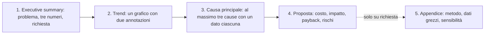

Questo è uno scenario costruito, con numeri di esempio, ma chi lavora in una banca o in una fintech lo riconosce subito. Un'analista passa tre settimane sul modello di approvazione dei prestiti personali e arriva a un risultato solido: il tasso di approvazione è al 62%, il benchmark di mercato è al 73%, e una parte consistente dei clienti rifiutati avrebbe rimborsato senza problemi. Il giovedì presenta il lavoro al comitato esecutivo con ventidue slide, tre heatmap e una tabella di correlazioni. Dopo undici minuti il direttore finanziario guarda l'orologio e chiede: "Quindi cosa vuoi da noi?". L'analisi era corretta, la decisione non è arrivata.

Parlare a un executive o a un board è un lavoro diverso dall'analizzare. L'analisi risponde alla domanda "che cosa succede", la presentazione deve far uscire dalla stanza una decisione. Chi decide non ha bisogno di vedere ogni grafico: ha bisogno di capire che cosa è cambiato, perché conta, quale rischio si apre e che cosa gli viene chiesto di firmare.

> **Idea chiave:** una presentazione executive è una compressione rigorosa dell'analisi in tre elementi, un numero con il suo benchmark, una causa dimostrata e una richiesta esplicita, e ogni slide deve già contenere la sua conclusione nel titolo.

## Cosa distingue una presentazione che decide da una che informa

Una presentazione informativa mostra tutto ciò che l'analista ha trovato, nell'ordine in cui lo ha trovato. Una presentazione decisionale fa il percorso inverso: parte dalla risposta, poi porta le prove strettamente necessarie a sostenerla. La differenza si vede nella prima frase. "Abbiamo analizzato il modello di approvazione e abbiamo osservato alcune anomalie" lascia chi ascolta in attesa. "Chiediamo 80.000 euro per un pilota che recupera circa 4.200 clienti all'anno" gli dà qualcosa su cui dire sì, no o "mostrami perché".

Il flusso mentale di chi costruisce il messaggio può essere schematizzato in cinque passaggi, ciascuno con una domanda a cui rispondere prima di aprire il software delle slide.

| Passaggio | Domanda da porsi | Output atteso |
| --- | --- | --- |
| Decisione | Quale scelta deve prendere il comitato oggi? | Una richiesta in una frase |
| Segnale | Quale numero riduce di più l'incertezza? | Una metrica con la sua unità |
| Baseline | Rispetto a cosa il numero è buono o cattivo? | Benchmark, target o periodo precedente |
| Vincolo | Che cosa potrebbe falsare la lettura? | Una o due assunzioni dichiarate |
| Azione | Che cosa succede dopo il sì? | Costo, tempi, responsabile |

Il passaggio più trascurato è il terzo. Un numero senza riferimento è rumore: il 62% di approvazione, da solo, può essere un successo prudente o un disastro commerciale. Diventa un'informazione solo accanto al 73% del mercato, perché allora il comitato vede un divario di 11 punti percentuali.

## La regola dei tre minuti

Un executive raramente concede più di tre minuti prima di decidere se l'argomento merita attenzione. Se in quel tempo non hai convinto, il resto dell'analisi non verrà letto. Conviene quindi scrivere il discorso come un budget di secondi, assegnando a ciascun blocco una funzione precisa.

Nei primi trenta secondi si descrive la situazione: "Il tasso di approvazione dei prestiti è al 62%, il benchmark di mercato è al 73%, stiamo rifiutando clienti profittevoli". Nei sessanta secondi successivi si dà l'intuizione: "Il 23% dei clienti rifiutati avrebbe rimborsato; il modello pesa troppo lo storico bancario e troppo poco la stabilità del reddito". Altri sessanta secondi vanno alla raccomandazione: tre variabili in più nel modello, soglia abbassata di 5 punti percentuali, pilota su 10.000 richieste, costo 80.000 euro. Gli ultimi trenta secondi chiudono con la richiesta: approvazione del budget e un sostegno esplicito verso la funzione compliance. In totale 30 + 60 + 60 + 30 = 180 secondi, cioè tre minuti esatti, senza margine per le digressioni.

Il vantaggio di questo schema non è la velocità in sé. Costringe l'analista a decidere che cosa tagliare, e ciò che sopravvive al taglio è di solito ciò che conta davvero.

## Calcolare l'impatto prima di entrare nella stanza

Un'affermazione come "recuperiamo 4.200 clienti" non regge davanti a un direttore finanziario se non è accompagnata da un conto che si può rifare a mente. Ricostruiamo i numeri di esempio del caso, passo per passo, con il volume annuo di richieste fissato a 60.000.

1. **Clienti approvati oggi.** Con un tasso di approvazione del 62%, le richieste approvate sono 60.000 × 0,62 = 37.200 clienti.
2. **Clienti rifiutati.** Le richieste respinte sono 60.000 - 37.200 = 22.800 clienti.
3. **Rifiutati che avrebbero rimborsato.** Il 23% dei rifiutati è 22.800 × 0,23 = 5.244 clienti profittevoli lasciati fuori.
4. **Quota recuperabile.** Ipotizziamo che le tre nuove variabili e la soglia più bassa recuperino l'80% di questo gruppo: 5.244 × 0,80 = 4.195 clienti, arrotondati a 4.200.
5. **Nuovo tasso di approvazione.** (37.200 + 4.200) / 60.000 = 41.400 / 60.000 = 69,0%. Il divario dal benchmark passa da 73% - 62% = 11 punti percentuali a 73% - 69% = 4 punti.
6. **Margine atteso.** Con un margine di circa 667 euro per cliente nel primo anno, 4.200 × 667 euro = 2.801.400 euro, cioè circa 2,8 milioni di euro.
7. **Rapporto con il costo.** Contro 80.000 euro di spesa, il ritorno lordo è 2.800.000 / 80.000 = 35 volte, e per questo il pilota su 10.000 richieste, che recupera in proporzione 4.200 × 10.000 / 60.000 = 700 clienti, è facile da difendere.

Un conto così rende discutibile ogni ipotesi: l'80% di recupero, il margine per cliente, la stabilità del 23%. Il comitato può contestare un'assunzione invece di fidarsi dell'autorità dell'analista, ed è esattamente il tipo di discussione che porta a una decisione.

## Piramide e titoli conclusivi

Barbara Minto ha codificato il Pyramid Principle alla fine degli anni Ottanta, quando era consulente in McKinsey, e resta il riferimento per la scrittura executive. La regola è partire dalla risposta e non dalla domanda: "Raccomandiamo di entrare nel mercato tedesco nel terzo trimestre", non "Abbiamo studiato il mercato tedesco e questo è quello che abbiamo trovato". La risposta si regge su tre argomenti, non su dodici, perché tre sono credibili e si ricordano. Ogni argomento porta un dato, non cinque: "Il mercato tedesco vale 4,2 miliardi" funziona meglio di una tabella con venti cifre.

La stessa logica si applica al titolo di ogni slide. Un titolo descrittivo come "Ricavi per regione, terzo trimestre" obbliga chi guarda a ricostruire da solo il messaggio. Un titolo conclusivo come "Europa in crescita del 12%, Asia-Pacifico in calo del 4%: serve investire in Asia-Pacifico" dà la conclusione prima del grafico, e il grafico serve solo a confermarla.

> Titolo descrittivo: "Tasso di approvazione per trimestre"
> Titolo conclusivo: "Approviamo il 62% delle richieste contro il 73% del mercato"
> Il secondo dice già che cosa guardare, che cosa pensare e che cosa mettere in discussione.

## Il board deck in cinque slide

I materiali per consigli di amministrazione ben fatti tendono a convergere su una struttura di cinque slide. Ciascuna ha un compito diverso e nessuna può essere saltata senza perdere un pezzo di argomento.

La prima slide, l'executive summary, è la più importante: una frase per il problema o l'opportunità, al massimo tre numeri, la raccomandazione in una frase e la richiesta in una frase. La seconda mostra il trend con un solo grafico e una o due annotazioni sui punti di svolta. La terza spiega perché sta succedendo, con al massimo tre cause e un dato per ciascuna, non con una matrice di correlazioni. La quarta contiene la proposta: che cosa fare, quanto costa, quanto rende, in quanto tempo si ripaga e quali rischi restano. La quinta resta chiusa finché qualcuno non la chiede: metodologia, dati grezzi e analisi di sensibilità. Se il board vuole altro lo domanda; se gliene dai venticinque, ne legge zero.

## Trappole che svuotano la presentazione

### Il numero senza decisione

Il sintomo è una slide con un dato corretto e nessun verbo: il comitato annuisce, poi passa al punto successivo. Succede perché l'analista considera concluso il proprio lavoro quando la cifra è stata calcolata, e la decisione gli sembra compito di altri. La correzione è scrivere la richiesta prima di costruire qualunque grafico e verificare che ogni slide riporti la richiesta o la sostenga.

### La media che non rappresenta nessuno

Il sintomo è un indicatore aggregato che sembra stabile mentre due parti dell'azienda si muovono in direzioni opposte. Il tasso medio di approvazione al 62% può nascondere un 80% sui clienti con reddito fisso e un 35% sui lavoratori autonomi. Succede perché la media è il primo numero che il sistema restituisce e sembra neutra. La correzione è segmentare per canale, coorte e tipologia di cliente prima di decidere quale numero portare, e dichiarare in appendice che lo si è fatto.

### La slide che non sopravvive alla domanda difficile

Il sintomo è un'impasse quando un membro del board chiede "e se il 23% fosse in realtà il 15%?". Succede quando le assunzioni non sono scritte, cosicché ogni obiezione sembra un attacco. La correzione è preparare in appendice un controllo di sensibilità: con il 15% di rifiutati profittevoli, 22.800 × 0,15 × 0,80 = 2.736 clienti recuperati, un margine di circa 1,8 milioni di euro, ancora ampiamente sopra gli 80.000 euro di costo. Mostrare in anticipo che la decisione regge anche nello scenario peggiore trasforma l'obiezione in una conferma.

## Verifica sulla tua prossima presentazione

1. Quale decisione deve uscire dalla tua prima slide, e riesci a scriverla in una frase che contenga un verbo di azione?

Mostra risposta

La decisione è la richiesta esplicita al comitato: approvare un budget, autorizzare un pilota, scegliere tra due opzioni. Se la frase non contiene un'azione che qualcuno può compiere in sala, la slide sta informando e non chiedendo. Un esempio funzionante è "Approvate 80.000 euro per un pilota su 10.000 richieste".

2. Quale benchmark rende interpretabile il tuo numero principale, e che cosa succede alla lettura se non lo hai?

Mostra risposta

Un benchmark può essere un valore di mercato, un target interno o il periodo precedente. Senza di esso il 62% di approvazione non dice se il risultato è buono: con il 73% di mercato appare un divario di 11 punti percentuali, con un benchmark del 60% sarebbe un risultato superiore alla media. Il benchmark decide la direzione della conclusione.

3. Se il tuo conto di impatto assume che l'80% dei 5.244 rifiutati profittevoli sia recuperabile, quanti clienti recuperi con una quota del 50%, e basta ancora il pilota a giustificare i 80.000 euro?

Mostra risposta

5.244 × 0,50 = 2.622 clienti. Con 667 euro di margine ciascuno si ottengono circa 1,75 milioni di euro, circa 22 volte il costo di 80.000 euro. La decisione resta valida, e dichiararlo in appendice mostra che il risultato non dipende da un'unica ipotesi ottimistica.

4. Come riscriveresti il titolo "Ricavi per regione, terzo trimestre" per renderlo conclusivo?

Mostra risposta

Un titolo conclusivo enuncia ciò che il grafico dimostra e implica una scelta, per esempio "Europa cresce del 12% e Asia-Pacifico cala del 4%: spostiamo budget verso Asia-Pacifico". Chi legge capisce il messaggio prima di guardare il grafico, e il grafico diventa la prova invece del puzzle.

