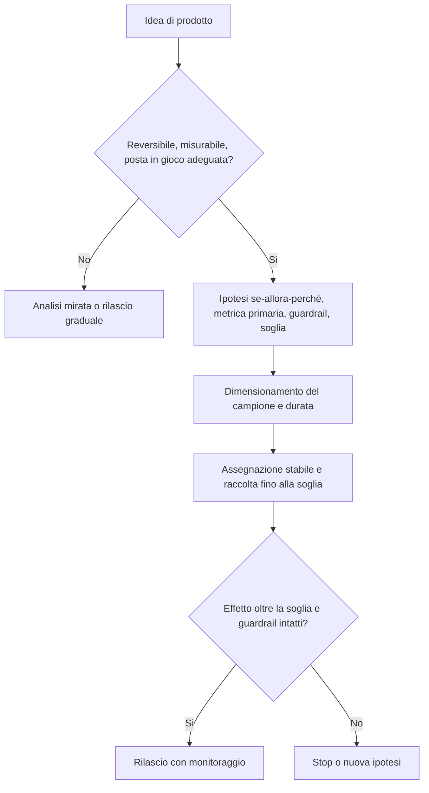

Scenario costruito, con numeri di esempio: un'app di prenotazione di corsi online ha un onboarding in sei schermate e il 12% dei nuovi iscritti completa la prima prenotazione entro sette giorni. Il designer propone di ridurlo a quattro schermate. Il responsabile di prodotto lo vuole subito in produzione, perché "è ovvio che meno passaggi convertono di più". L'analista deve scegliere tra tre strade: fidarsi dell'intuizione, confrontare il prima e il dopo, oppure organizzare un esperimento. Le prime due costano poco e sono fragili, la terza costa tempo e dà una risposta difendibile.

Il lavoro del product analyst non è eseguire A/B test in serie. È decidere quando un esperimento serve, come disegnarlo perché la risposta non dipenda dal caso, e quando fermarsi. Questa lezione ricostruisce quel percorso con un solo esempio numerico, dal dimensionamento fino alla lettura del risultato.

> **Idea chiave:** un A/B test è giustificato quando la decisione è reversibile, l'esito è misurabile con le metriche che hai già e il costo di sbagliare supera il costo di testare; tutto il resto va risolto con un'analisi mirata.

## Quando conviene testare e quando no

Ronny Kohavi, che ha guidato la sperimentazione su larga scala a Microsoft e ha ricostruito il metodo nel volume scritto con Diane Tang e Ya Xu nel 2020, indica tre condizioni che conviene verificare prima di scrivere una riga di codice di assegnazione. Le tre domande sono semplici e vanno poste in quest'ordine, perché ciascuna può chiudere la discussione.

| Condizione | Domanda di controllo | Se manca |
| --- | --- | --- |
| Reversibilità | Possiamo tornare indietro in poche ore e a costo basso? | Servono analisi osservazionale e rilascio graduale, non un test classico |
| Misurabilità | L'effetto atteso si vede in una metrica già raccolta? | Costruire prima lo strumento di misura, poi testare |
| Posta in gioco | L'errore costa più del test? | Analisi qualitativa o decisione di buon senso |

Cambiare l'algoritmo di raccomandazione è reversibile, lanciare un prodotto fisico in un nuovo mercato no. Ipotizzare un aumento della soddisfazione senza avere un punteggio NPS o un sondaggio in app produce un esperimento inconcludente. Cambiare l'oggetto di una email promozionale non vale un test controllato, mentre ridisegnare il funnel di checkout, dove un calo delle conversioni si traduce in ricavi persi ogni ora, lo giustifica pienamente.

Nel caso dell'onboarding le tre condizioni sono soddisfatte: tornare alle sei schermate richiede un rilascio, il completamento della prima prenotazione è già tracciato e il flusso incide su tutti i nuovi iscritti. Il test è lo strumento giusto.

## Ipotesi falsificabile, metrica primaria e guardrail

Un'ipotesi robusta non è una domanda e non è un auspicio. È un'affermazione che può risultare falsa, scritta nel modello "se, allora, perché": se riduciamo l'onboarding da sei a quattro schermate, allora la quota di nuovi iscritti che prenota entro sette giorni passa dal 12% al 13,2% o più, perché si perdono meno utenti nei passaggi intermedi. Dentro la frase ci sono i tre elementi indispensabili: l'intervento, l'esito misurabile e la logica causale che li lega.

Prima di far partire il test si fissano per iscritto altre tre cose. La metrica primaria è una sola: il completamento della prima prenotazione. I guardrail sono le metriche che non devono peggiorare, per esempio il tasso di richieste di rimborso e di ticket al supporto. La soglia decisionale dice a quale condizione si rilascia: effetto positivo oltre +1,0 punti percentuali, guardrail entro 0,3 punti di tolleranza. Scrivere la soglia prima è ciò che impedisce di trovare dopo una buona ragione per rilasciare qualunque risultato.

## Dimensionare il test sull'esempio dell'onboarding

Il campione non si sceglie a sensazione: dipende dal tasso di partenza, dall'effetto minimo che vuoi riconoscere e dalla variabilità del dato. Per un tasso di conversione, con potenza dell'80% e livello di significatività del 5% bilaterale, esiste una regola pratica ampiamente usata che dà il numero di utenti per gruppo: n ≈ 16 × p × (1 - p) / δ², dove p è il tasso atteso e δ la differenza assoluta da individuare.

Il tasso attuale è 12% e vogliamo riconoscere un miglioramento di 1,2 punti percentuali, cioè un 13,2% (+10% in termini relativi), quindi δ = 0,012. Come tasso medio prendiamo p = (12% + 13,2%) / 2 = 12,6%, per cui p × (1 - p) = 0,126 × 0,874 = 0,1101. Il numero di utenti per gruppo è allora n = 16 × 0,1101 / 0,012² = 1,7616 / 0,000144 = 12.233, arrotondato a 12.300. Con due gruppi servono 12.300 × 2 = 24.600 utenti. Con 3.500 nuovi iscritti al giorno, 24.600 / 3.500 = 7,0 giorni di traffico; si lasciano girare 14 giorni per coprire due cicli settimanali completi, perché il comportamento di sabato e domenica differisce da quello dei giorni feriali.

Il numero di giorni non si decide guardando i risultati intermedi: si fissa qui e si rispetta. Interrompere il test appena il confronto sembra favorevole gonfia il tasso di falsi positivi, perché il rumore casuale attraversa quasi sempre la soglia almeno una volta durante la raccolta.

## Leggere il risultato: differenza, errore standard e z-score

Dopo 14 giorni il test ha raccolto 12.300 utenti in ciascun gruppo. Il gruppo di controllo ha 1.476 prime prenotazioni, la variante a quattro schermate ne ha 1.624. Il conto si svolge in cinque passi.

Il gruppo di controllo ha 1.476 prime prenotazioni su 12.300 utenti, cioè 1.476 / 12.300 = 12,00%; la variante ne ha 1.624, cioè 1.624 / 12.300 = 13,20%. La differenza è 13,20% - 12,00% = 1,20 punti percentuali, pari a 148 prenotazioni in più. Il tasso combinato è (1.476 + 1.624) / 24.600 = 3.100 / 24.600 = 12,60%. L'errore standard della differenza è la radice di 0,1260 × 0,8740 × (2 / 12.300), cioè la radice di 0,1101 × 0,0001626 = 0,0000179, circa 0,00423, pari a 0,42 punti percentuali. Lo z-score è quindi 0,0120 / 0,00423 ≈ 2,84, che corrisponde a un p-value bilaterale di circa 0,0045, sotto la soglia del 5%.

Il risultato supera quindi la soglia statistica e anche quella decisionale di +1,0 punti. Resta da guardare i guardrail: se le richieste di rimborso sono rimaste al 4,0% contro 4,1%, la differenza è dentro la tolleranza di 0,3 punti. Sul piano economico, con 90 euro di margine per prima prenotazione, le 148 prenotazioni aggiuntive in 14 giorni valgono 148 × 90 euro = 13.320 euro. Il rilascio è giustificato, accompagnato da un controllo dopo quattro settimane per verificare che l'effetto non sia solo di novità.

| Situazione osservata | Lettura prudente | Decisione |
| --- | --- | --- |
| Effetto positivo ma intervallo che include zero | Il segnale potrebbe dipendere dal campione | Estendere o ridisegnare il test |
| Miglioramento in un solo segmento | L'effetto medio nasconde eterogeneità | Separare coorti o casi d'uso, ritestare |
| Metrica primaria su, guardrail giù | Il beneficio va letto sul margine netto | Applicare la soglia economica scritta prima |
| Numeri incoerenti tra gruppi | La fiducia nel dato è parte della decisione | Correggere assegnazione e tracciamento |

## Errori che invalidano un esperimento

### Guardare i risultati ogni giorno e fermarsi al primo segnale

Il sintomo è un test che a metà durata mostra un p-value di 0,03 e viene chiuso con entusiasmo. Succede perché sembra uno spreco continuare quando la risposta pare chiara. In realtà, osservando il risultato più volte, la probabilità di trovare per caso un valore sotto soglia sale ben oltre il 5% dichiarato. Si evita fissando durata e dimensione prima della partenza, oppure usando metodi sequenziali esplicitamente progettati per l'osservazione continua.

### Cambiare la metrica primaria dopo aver visto i dati

Il sintomo è una metrica primaria che si sposta dal completamento della prenotazione alla durata della sessione, perché quest'ultima mostra un +8%. Succede perché con dieci metriche monitorate qualcuna risulta quasi sempre significativa per puro effetto del caso. Si evita scrivendo la metrica primaria nel documento di ipotesi e trattando le altre come esplorative, da confermare con un secondo test.

### Gruppi che non sono la metà esatta del traffico previsto

Il sintomo è una divisione 50-50 attesa che nei dati compare come 51,8% contro 48,2%. Succede perché un bug di assegnazione, un filtro dei bot o un errore di tracciamento esclude utenti in modo non casuale. Quando il rapporto tra i gruppi devia più di quanto il caso permetta, il confronto non è affidabile qualunque sia il p-value. Si evita controllando il rapporto di assegnazione prima di guardare qualsiasi esito e correggendo la causa tecnica.

## Verifica sul tuo prossimo esperimento

1. Quando un test è giustificato rispetto a un'analisi mirata nel tuo caso?

Mostra risposta

Quando sono vere insieme tre condizioni: la decisione si può annullare in poche ore, l'effetto atteso è visibile in una metrica già tracciata, e il costo di un errore supera il costo del test. Nel caso dell'onboarding il rilascio è reversibile, il completamento della prima prenotazione è già raccolto e il flusso riguarda tutti i nuovi iscritti.

2. Con una conversione di base del 12% e un obiettivo del 13,2%, quanti utenti servono per gruppo e quanto dura il test con 3.500 iscritti al giorno?

Mostra risposta

n ≈ 16 × 0,126 × 0,874 / 0,012² ≈ 12.233, arrotondati a 12.300 per gruppo, quindi 24.600 in totale. Con 3.500 iscritti al giorno servono 7 giorni di traffico; si estendono a 14 per includere due cicli settimanali completi.

3. Un collega propone di fermare il test al giorno 6 perché il p-value è 0,03. Che cosa rispondi?

Mostra risposta

Il test è stato dimensionato per 14 giorni e la soglia del 5% vale solo se si osserva il risultato una volta alla fine. Guardare e fermarsi alla prima soglia superata aumenta il rischio di falso positivo. Si prosegue fino alla durata pianificata, oppure si dichiara in anticipo un metodo sequenziale.

4. Quale assunzione falsa ti farebbe bloccare il rilascio dopo un risultato positivo?

Mostra risposta

Il rapporto di assegnazione tra i gruppi, che deve restare vicino al 50-50: se risultasse 51,8% contro 48,2% senza una causa spiegata, il confronto non sarebbe affidabile. Vale lo stesso per un aumento dei rimborsi oltre la tolleranza dei guardrail, che annullerebbe il beneficio sulla metrica primaria.

