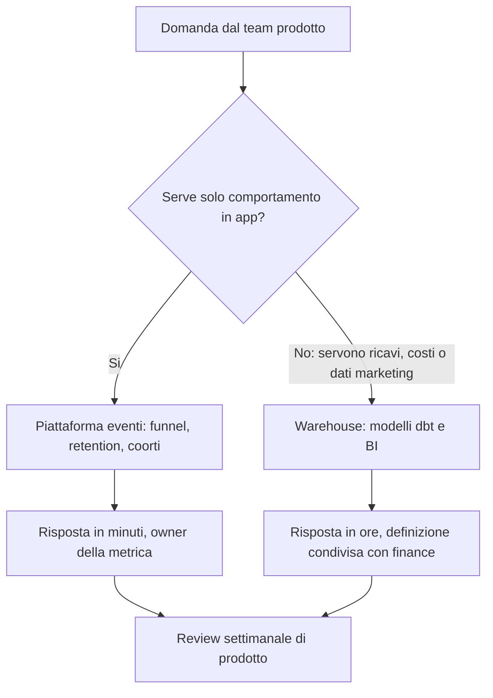

Caso ricostruito, con numeri di esempio: una scale-up di software per la gestione delle prenotazioni ha sei squadre di prodotto e due analisti. Ogni lunedì arrivano in coda domande del tipo "perché è calato il completamento dell'onboarding", "quanto vale per cliente chi usa la funzione calendario", "la nuova schermata di prezzo ha cambiato qualcosa". Gli analisti rispondono nell'ordine in cui le richieste arrivano, e dopo tre mesi le squadre hanno smesso di chiedere perché le risposte arrivano quando la decisione è già stata presa. Il problema non è la competenza degli analisti: è che il lavoro non ha un modello operativo.

Un operating model di product analytics è il sistema che decide chi misura cosa, con quali definizioni, in quali momenti del ciclo di prodotto e con quale strumento. Quando funziona, l'analisi entra nella discovery e nella delivery. Quando manca, l'analista diventa un produttore di dashboard e di spiegazioni retrospettive.

> **Idea chiave:** un operating model è l'insieme di eventi con proprietario, poche metriche con benchmark interno, rituali di review con soglie di intervento e una divisione chiara tra analisi rapide su piattaforma eventi e analisi cross-dominio su warehouse.

## Dalle domande di comportamento alle metriche

Il product analyst parte da una domanda sul comportamento, non da un numero. La domanda è "perché gli utenti abbandonano la prenotazione", non "quanto vale il tasso di abbandono". Il numero è un punto di partenza, il comportamento è ciò che si vuole capire. Dave McClure ha organizzato queste domande nel 2007 con il modello AARRR, che copre acquisizione, attivazione, retention, ricavi e passaparola, e rimane un riferimento comodo perché obbliga a nominare in quale parte del ciclo di vita si colloca ogni metrica.

| Fase | Domanda di comportamento | Metrica tipica |
| --- | --- | --- |
| Acquisizione | Da quale canale arrivano gli utenti di qualità? | Iscrizioni per canale |
| Attivazione | Qual è il momento in cui il valore diventa evidente? | Quota di utenti che completano la prima azione chiave |
| Retention | Perché gli utenti tornano e che cosa li fa smettere? | Retention a 7 e a 30 giorni |
| Monetizzazione | Quale comportamento precede l'acquisto? | Conversione da prova gratuita a piano a pagamento |

Una metrica entra nel sistema solo se è associata a una fase e a una decisione che può cambiare. Misurare tutto e spiegare niente è il sintomo più frequente di un team senza modello operativo.

## Poche metriche, ciascuna con proprietario e confronto interno

Un'analisi di prodotto matura si regge su un insieme ristretto di metriche con formula scritta, finestra temporale dichiarata e un proprietario. La tabella seguente raccoglie le più usate con valori indicativi, da prendere come ordine di grandezza e non come obiettivi universali.

| Metrica | Formula | Cosa dice | Ordine di grandezza |
| --- | --- | --- | --- |
| DAU/MAU | Utenti attivi al giorno ÷ utenti attivi al mese | Frequenza d'uso, la stickiness | 20-50% per app, 10-20% per web |
| Retention a 7 e 30 giorni | Quota di utenti ancora attivi dopo N giorni | Fedeltà al prodotto | Molto variabile per categoria |
| Adozione di una funzione | Utenti che usano la funzione ÷ utenti attivi | Rilevanza della funzione | 5-15% nel primo mese per una funzione nuova |
| Tempo al valore | Tempo tra iscrizione e primo risultato utile | Efficacia dell'onboarding | Sotto i 5 minuti è un ottimo segnale |
| Conversione | Azioni completate ÷ azioni iniziate | Efficacia del funnel | 2-5% per e-commerce, 20-40% da freemium a pagamento |

Il DAU/MAU mostra bene perché il confronto con un numero generico inganna. Un messaggio istantaneo ha valori tra 50% e 70% perché l'uso quotidiano è la norma; un'app bancaria sta intorno al 10-15% con uso settimanale; un'app di consegna di cibo scende al 3-5% con uso occasionale. Il confronto utile è il tuo stesso prodotto nel trimestre precedente, a parità di definizione di utente attivo. Una metrica senza proprietario si degrada: nessuno corregge la definizione quando cambia l'evento sottostante e dopo sei mesi nessuno sa più che cosa conteggi.

## Piattaforma eventi e warehouse: due livelli con compiti diversi

Gli strumenti di un team moderno si dividono in quattro famiglie. Le piattaforme di product analytics come Amplitude, Mixpanel, PostHog e Heap tracciano gli eventi lato client e permettono analisi di funnel, retention e coorti senza SQL, ma dipendono dalla qualità del tracciamento. L'analisi warehouse-native, basata sui dati nel data warehouse trasformati con dbt e letti con uno strumento di BI, è più flessibile e permette di unire prodotto, finanza e marketing, ma richiede competenze SQL. Le piattaforme di sperimentazione come Optimizely, LaunchDarkly, Eppo e Statsig gestiscono assegnazione, tracciamento e analisi statistica degli A/B test. Gli strumenti qualitativi come UserTesting, Maze, Hotjar e FullStory catturano il "perché" dietro il "cosa".

La scelta non è tra uno strumento e l'altro, ma tra due livelli di risposta. Le domande rapide sul comportamento, quelle del tipo "dove si fermano gli utenti nel flusso", si risolvono sulla piattaforma eventi in pochi minuti. Le domande che richiedono dati non presenti negli eventi, come il valore economico degli utenti che adottano una funzione, vanno sul warehouse perché solo lì si trovano i ricavi, i costi e le informazioni commerciali.

## Capacità del team: il conto che giustifica il modello a due livelli

Il vantaggio di separare i livelli si vede con un calcolo sulle ore disponibili. Nello scenario costruito i due analisti lavorano 140 ore al mese ciascuno sulle richieste di prodotto, per un totale di 2 × 140 = 280 ore. Le richieste sono mediamente 120 al mese. Una rilevazione sulle ultime settimane mostra che il 70% sono domande di comportamento e il 30% richiede dati incrociati.

Se tutte le 120 richieste passassero dal warehouse, con una media di 3 ore ciascuna, servirebbero 120 × 3 = 360 ore, cioè 360 - 280 = 80 ore oltre la capacità, pari a un sovraccarico del 28,6%. Con il modello a due livelli la situazione cambia: le richieste rapide sono 120 × 0,70 = 84, risolte sulla piattaforma eventi in 0,5 ore ciascuna, per 84 × 0,5 = 42 ore; le richieste incrociate sono 120 × 0,30 = 36, da 3 ore ciascuna, per 36 × 3 = 108 ore. Il totale è 42 + 108 = 150 ore, cioè 150 / 280 = 53,6% della capacità. Restano 280 - 150 = 130 ore, quasi la metà del tempo, che il team può investire in manutenzione dei tracciamenti, in esperimenti e in attività di discovery invece di inseguire la coda.

Il conto dipende dalle ipotesi sul tempo medio per richiesta e sulla quota di domande rapide, e va aggiornato ogni trimestre. Rende però discutibile la scelta organizzativa con un numero in mano.

## Rituali di review e soglie di intervento

Un modello operativo vive nel calendario più che nei documenti. Tre rituali bastano nella maggior parte dei team: una review settimanale delle metriche di ciascuna squadra, in cui ogni proprietario porta la sua metrica con benchmark interno e variazione; una review mensile delle definizioni, in cui si controlla che gli eventi siano ancora coerenti con le funzioni rilasciate; un controllo di strumentazione prima di ogni rilascio, in cui si dichiarano l'evento, la metrica di successo e il rito di review della nuova funzione.

> Scheda di una metrica nel sistema:
> Nome e formula: completamento della prima prenotazione entro 7 giorni, utenti che completano ÷ nuovi iscritti.
> Proprietario: responsabile di prodotto dell'onboarding, con un analista di riferimento.
> Soglia di intervento: scende sotto il 10,5% per due settimane consecutive, si apre un'analisi di causa entro 48 ore.

Ogni metrica con una scheda di questo tipo ha una persona che risponde quando cambia, una definizione leggibile e una regola per decidere quando muoversi.

## Errori tipici nel costruire il modello

### Usare il modello come etichetta e non come processo

Il sintomo è un documento ben fatto sull'organizzazione dell'analytics che nessuno consulta nei lunedì di coda. Succede perché la definizione del modello viene considerata un esercizio una tantum. Il rimedio è legare il modello a rituali con date, a persone con nome e a metriche con soglie, e verificare ogni trimestre che si usino davvero.

### Lanciare funzioni senza evento né metrica di successo

Il sintomo è una funzione rilasciata di cui, dopo un mese, nessuno sa dire se funzioni. Succede perché la strumentazione sembra un costo a cui pensare dopo, e l'analisi arriva come spiegazione retrospettiva. Il rimedio è un controllo di strumentazione obbligatorio prima del rilascio: senza evento definito e metrica di successo scritta, la funzione non esce.

### Un unico strumento per ogni domanda

Il sintomo è una piattaforma eventi forzata a rispondere su ricavi e margini, con esportazioni in fogli di calcolo e numeri che non quadrano con quelli di finance. Succede perché la piattaforma è già nota e comoda. Il rimedio è il modello a due livelli: risposte di comportamento nella piattaforma eventi, risposte economiche nel warehouse, definizioni condivise tra i due.

## Controllo sul tuo modello operativo

1. Quale domanda di comportamento guida la tua metrica principale?

Mostra risposta

Una metrica è ben ancorata se risponde a una domanda su che cosa fanno gli utenti in una fase precisa del ciclo di vita, per esempio "dove si perdono i nuovi iscritti prima di prenotare". Se la risposta è soltanto "il numero va monitorato", la metrica non ha ancora una decisione associata.

2. Chi è il proprietario della definizione di una metrica e quando la riguarda?

Mostra risposta

Il proprietario è una persona di prodotto, affiancata da un analista di riferimento, che risponde della formula, della finestra temporale e della manutenzione dell'evento sottostante. La definizione si rivede nella review mensile e ogni volta che una funzione rilasciata cambia il significato dell'evento.

3. Con 280 ore al mese di capacità e 120 richieste, quante ore servono se il 70% è rapido a 0,5 ore e il 30% incrociato a 3 ore?

Mostra risposta

Le richieste rapide sono 84, per 84 × 0,5 = 42 ore; quelle incrociate sono 36, per 36 × 3 = 108 ore. Il totale è 150 ore, pari al 53,6% della capacità. Se tutto passasse dal warehouse servirebbero 360 ore, oltre i 280 disponibili.

4. Quando sposti un'analisi dalla piattaforma eventi al warehouse?

Mostra risposta

Quando la domanda richiede dati che la piattaforma eventi non contiene, come ricavi, costi o campagne di marketing, oppure quando serve una definizione condivisa con la finanza. Per le domande di solo comportamento in app, la piattaforma eventi risponde in minuti e il warehouse sarebbe un costo inutile.

